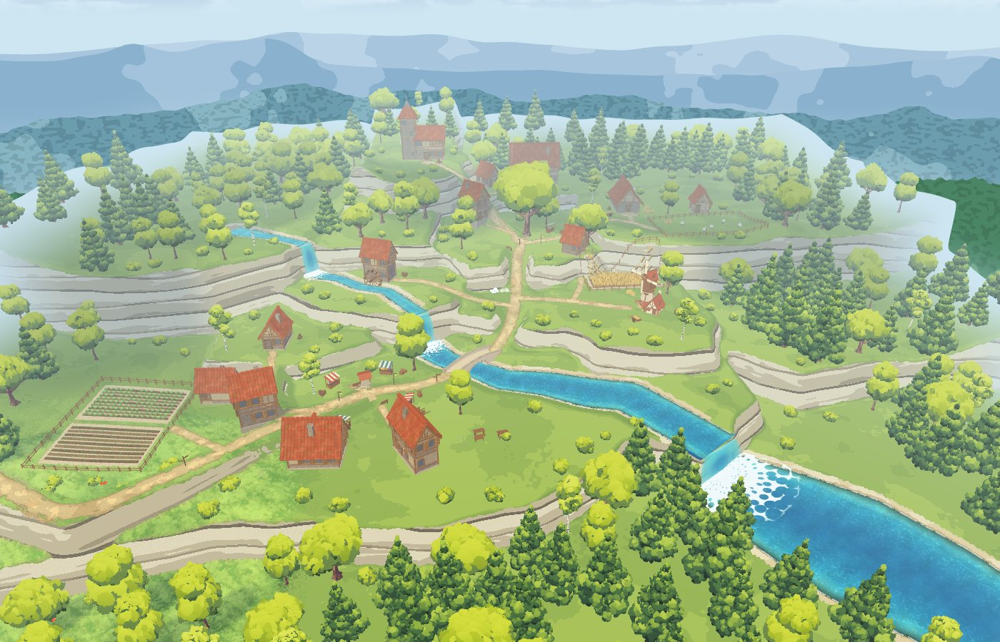
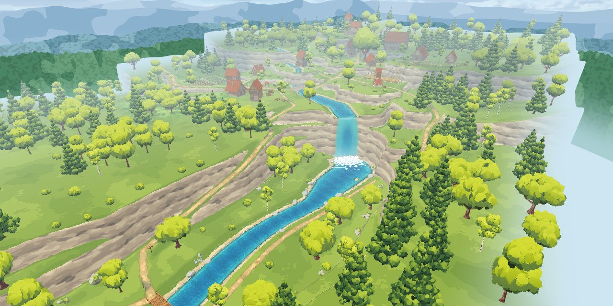

# Liora Farm

Fresh start using the uploaded meadow exploration project (v19).

A static Three.js game with mobile movement, a third-person camera, meadow vegetation, animals, interactive water and sky/water tuning.

## Run

Serve this directory over HTTP. Open `index.html`. GitHub Pages serves the same entry point. Three.js 0.170.0 and its addons load from jsDelivr.

The game opens on its map, the hill village (the same as `?map=hillvillage`). `?map=valley` opens the first map's valley, which used to be what the plain link opened; the other maps each have their own `?map=` (below).

Touch: left side to move, right side to rotate the camera; tap water to make ripples.

## The shaders' noise

Every shader's noise is `NOISE` in `stylized-nature.js` (`noise2`, `hash2`). Its random numbers come from whole-number arithmetic that a 32-bit float does exactly, so they are the same on every graphics chip. They used to be `fract(sin(x) * 43758.5)`, which a phone may round differently in two places of one shader: neighbouring squares of the noise then disagree on their shared corner, and whatever tone is made of noise jumps along straight lines (seen on Android on the dirt paths: straight seams a few metres apart; a computer drew it smooth). A shader that needs noise takes `NOISE`; it does not write a sine hash of its own for anything neighbours must agree on (a number for one whole drop or one whole cell is fine).

## Asset credits

Credits retained from the supplied project:
- Playable characters (Vivi, Shino, Shibu, Darkness Shibu, Vita, Victoria, Fumiriya, HairSample F/M): VRoid Studio sample avatars by pixiv (CC0), in `assets/characters/` (`characters.js` lists them; the 👤 button top left picks one). Each was made from its .vrm by `tools/prep-vroid.py` (model) and `tools/bake-character-springs.py` (hair and cloth that swing); Vivi's model is her earlier `prep_vivi.py` one, which the new tool reproduces.
- Their moves: Quaternius Universal Animation Library 1+2 (CC0 1.0). The whole shared library is in `assets/animations/` (84 clips as `.vrma`, with `index.json`; made from Quaternius' GLBs by `tools/ual_to_vrma.py`). Two clips are not Quaternius' as they came: `Climb_Loop`, which `tools/make-climb-anim.py` makes on the library's skeleton, and `Hop`, which `tools/make-hop-anim.py` makes from the library's tucked jump. The game does not load the `.vrma` files: the clips it uses are baked into `character-anim.js` by `tools/bake-character-anim.py` (`python3 tools/bake-character-anim.py assets/animations/vrma`; the clip list is at the top of the script).
- Swinging hair and cloth: spring bones solved by pixiv's `@pixiv/three-vrm-springbone` (MIT, loaded from jsDelivr), built by `character-springs.js`.
- “DEER” by WildMesh 3D (CC BY-NC 4.0).
- Grass approach inspired by Cortiz (MIT).
- Windmill: a Sketchfab model supplied for this project, restyled into flat colour patches (`assets/models/windmill.glb`); author and licence credit still to be filled in.
- Village houses: pieces of the Medieval Village MegaKit by Quaternius (CC0 1.0), the free Standard set, packed into `assets/models/village-kit.glb` (the glTF files were taken from the copy kept at github.com/J-Ponzo/gltf-medieval-village-megakit).

The previous game remains available in Git history before this replacement.

## Painted foam

`assets/water/foam-brush-v1.png` is an original AI-generated grayscale brush mask created for this project. The shader samples the artwork in flowing coordinates, limits swash foam to shallow edges, and uses the wave simulation for short-lived contact foam. No Unreal or Blender package assets are included.

Foam transport uses a damped wave-pressure velocity potential stored in the simulation alpha channel. Its gradient advects painted foam density in blue with a fixed 60 Hz semi-Lagrangian step, solid boundary masking and exponential dissipation. This is a lightweight surface approximation, not a full 3D fluid solver.

## Splashes and footsteps

Splashes and wading are made by the water's own wave simulation, in the same painted style as the rest of the water: a tap or jump heaps the surface up (the simulated height lifts the water mesh) and throws painted-brush foam onto it, which the flow then carries and wears away; a footstep presses a dip that rings outward and leaves a little foam behind. There are no separate splash meshes. The sliders are in **ปรับน้ำ** (น้ำนูนขึ้นตรงจุดกระเซ็น, ฟองที่ติดค้างตามรอยเท้า / จุดกระเซ็น). `anime-cells.js` bakes the 256x256 cellular mask the anime foam rings, the wading wake and the anime water's strokes sample. (It also drew foam islands along the shore once; their cells' straight edges lined up into a ladder of white bars across the foam line, so the shore no longer uses it.)

**The screen.** Only what is played with is on it: the map in the top right corner (tap it for the whole map, tap a pin to go there), the clock (☀ day / dusk / night, ⏸ stop time) and full screen under it, on the hill village a button that switches between its living world and its cursed one (🥀 ไปโลกคำสาป / 🌿 ไปโลกปกติ: `world-switch.js`; the map loads again in the other world, `?curse=1` put on or taken off, with her where she stood, the camera as it looked and the hour as it was), and on the hill village the two hand tools top left (🏠 ย้ายของ, 🖌 ทาทาง). The deer's credit is on the loading screen (its licence, CC BY-NC 4.0, asks for it); the other credits are in this README. `?dev=1` puts the testing buttons back as well (fps, grass look, ปรับน้ำ, ปรับฟ้า, the water buttons below, 📍 ไปที่…, the forage bag and 🌿 ไปดูของป่า, 🛠 แก้ฉาก and 🪨 แก้หิน where a map has them).

Use **ไปดูน้ำ** (with `?dev=1`) to move to a nearby clear shallow bank, then **ทดสอบน้ำกระเซ็น** or tap the water. `?view=water` starts at the bank, on the hill village or on any other map: `?map=valley&view=water`, `?map=meadow&view=water` and `?map=hills&view=water` select the others.

Footsteps follow the character's foot bones: the water is touched at the moment and the place each foot comes down, harder when she runs. Every footstep, splash and the foot of the waterfall also throws out an anime foam ring (`WATER_RINGS` in `stylized-water.js`): a cell-patterned ring of white foam that spreads, opens in the middle and breaks up at the rim. Slider: **วงฟองอนิเมะตอนเหยียบน้ำ / น้ำกระเซ็น / น้ำตก**.

Anime water: the **น้ำ: อนิเมะ / น้ำ: สมจริง** button switches between flat colour bands with hard-edged foam and drawn strokes (`WATER_TUNE.anime` = 1) and the clear, mirrored water (0, the default). The choice is remembered. Its shore is a white band along the edge, its outer edge gently scalloped, and a second line a little way out that slides in and out with the swell, in long dashes tapering to a point at both ends; every drawn edge of its foam is one pixel soft (from the screen-space change, `fwidth`), so none is stair-stepped.

A full splash (a tap, the **ทดสอบน้ำกระเซ็น** button) also throws up a crown and a jet, drawn by `water-droplets.js` together with the drops. The crown is a thin sheet of the river's own water: clear and turquoise, with the sky on its rim, and white only at the churned foot and along the thick lip. Its lip swells into rounded fingers with a bead at the tip, where the drops fly off. As the crown sinks, a column rises out of the middle; the bulb at its tip lets go as one or two fat drops. A footstep throws only two or three drops and its ring of waves, no crown.

## The walker's shadow

By day the character throws her real shadow: her own outline, moving with her animation, lying the same way as the trees' shadows and growing long when the sun is low. `character-shadow.js` draws her from the sun's point of view into a small picture each frame, and a patch of ground-hugging mesh around her feet darkens the ground wherever she is in the way of the light. It follows slopes and shows on the river bed through the water.

It falls on the grass too: `shadow.receive(level.grass.material)` teaches the grass shader to ask the same question for every blade at the blade's own height, so her outline lies across the tops of the grass with the same cool tint as the trees' shadows (the old soft patch over the grass is gone). Rocks and other objects do not receive it yet. Inside a tree's shadow it fades out, and at night the round blob under her feet takes over.

Wading leaves a foam wake in the same style as the foot of the waterfall (`WATER_WAKE` in `stylized-water.js`): a sheet of white foam with holes of mixed sizes, thick round the legs, tearing into threads and flecks behind her and dissolving in place. It is one smooth field laid down along her path (`WATER_WAKE.track` once a frame from the level's `follow`), so nothing pops in or out; each footstep adds a puff where the foot lands. The big foam rings (`WATER_RINGS`) are now only for splashes. The churn under the waterfall is drawn on the water surface itself (`WATER_CHURN`): cells of two sizes laid out in metres, carried outwards by the flow (fast near the fall, slower further out), with patches of thicker and thinner foam drifting through it, so it never looks like one pattern turning round. Along the foot of the falls soft white billows boil up like small clouds (`createBillows` in `stylized-waterfall.js`): camera-facing cards with a cloud of round lobes drawn on each, white in the light and pale blue in the folds, small puffs that pop up out of the foam, drift out over the pool spreading apart and growing like clouds, and fade away with their outlines going soft. Their size, number, spread, rise, life and fade are sliders under **ฟองตีนน้ำตก** in **ปรับน้ำ** (`FALL_TUNE`). Where the sheet lands it also heaves the pool: small restless pokes all along the foot, and every so often a heave: the water wells up at three spots along the foot, with a shallow trough round each holding the same amount of water, and rolls out across the pool as waves through the wave simulation (sliders under **คลื่นจากน้ำตก**). Crowns and cones of water are kept for splashes in the river.

**In the water, not on it.** Her legs are seen through the water that really lies over them: everything of hers under the surface writes how far under it is into the alpha of the picture of what lies under the water (`stylized-character.js`; all else there is 1), and the surface (`stylized-water.js`) shows her through that much water, clear just under the surface and fading into the water's colour further down, bending the view of her less the nearer the surface, so her legs join the rest of her at the waterline; a line of foam is drawn on her there. Before, she was seen through as much water as lay over the bed, which from knee-deep cut her off at the surface. Wading is heavier the deeper it is (`player.js`: ankle-deep hardly slows her, knee-deep she cannot run, and she is slow to get going and quick to stop); running in throws one splash where she breaks the surface; every footstep flicks up two or three drops (on the hill village, the pit and the village island too, which threw none); and what has been under water stays darker, up to a ragged line, until it dries a quarter of a minute after she is out.

A fall is also drawn the way an anime fall is drawn, three things on top of the water as it was (sliders under **น้ำตกแบบอนิเมะ** in **ปรับน้ำ**, each 0 = not there; `FALL_TUNE` in `stylized-waterfall.js`). The falling sheet has a pale band of light down each side, where a round column of water turns away from the eye, and long pale cells sliding down inside it (the churn's cell texture pulled out lengthways). Along the line where the sheet lands the water is thrown back up as cones of white lace (`createSplashCones`): narrow where they leave the pool and opening as they rise, the same cells as the churn running upwards with gaps that widen towards the lip and as the cone ages, the far wall a pale blue through the gaps; each is thrown up fast and sinks back slower, its neighbours half a beat apart, behind the billows so the lace stands up over the clouds. And bubbles drift up out of the foam: a thin white ring with one window of light, swaying as it rises, that swells and pops. They are among the small things at a fall's foot that are not drawn from more than 60 m off or in the water's mirror.

## The cliff path, the meadow and the windmill

A path is cut into the east cliff's shoulder (`createValley({ climb: { side: 1 } })` in `stylized-terrain.js`): it starts on the valley floor a little up-river of the bridge, climbs at a steady grade along the cliff face and comes out on the plateau beside the falls. Its line is found on the land itself (where the face reaches the height the path has climbed to), and the ground is set to the path's height along it. On top is a small open meadow with a windmill looking down the valley; its sails turn. `level.confine` keeps a walker on the valley floor, the path or the meadow. `?view=climb` starts at the foot of the path, `?view=mill` on the meadow.

`stylized-props.js` loads buildings and props that have been restyled into flat colour patches (vertex colours, no textures) and lights them with the kit's three hard bands. The windmill went from 4.9 MB with three textures to under 0.5 MB.

**The cliffs are carved into blocks of rock** (`rocks.js`), from the foot of the falls to the valley's mouth for now. The land's own mesh is too coarse on a cliff (half a metre between points, so a face is a few stretched triangles), so each face gets a fine skin that follows the very same heights, is tucked under the land along its foot and top edge, and is painted with the land's own material. Between foot and top it stands out of the face block by block, cell by cell and layer by layer, so the ledges fall on the strata's seams. Nothing changes for walking; faces beside a path are left as they are.

## The village above the falls

The plateau behind the falls is built up in terraces (`createValley({ tiers })` in `stylized-terrain.js`): the land and the upper river step up twice, and the river comes down each riser as a small cascade (`createWaterfall({ scale })`). Ramps cut into the risers lead from one terrace to the next. On the lower terrace: the windmill's meadow, a stone bridge over the river, two houses and a well, and a water mill whose wheel turns in the stream below the first cascade. On the upper terrace: a great tree, three houses, a fenced pasture, a plank bridge, and a keep on a knoll.

All the buildings are stand-ins built in code (`stylized-buildings.js`: boxes, slabs and cylinders in flat colours, drawn with the props' material) until real models take their place; where everything stands is the `VILLAGE` table at the top of `valley-level.js`. Up there a walker may stand on even ground, on the ramps and on the bridges; the risers, the river and the buildings are walls. `?view=village`, `?view=tree` and `?view=keep` start in the village.

Round the village the land stands up as hills (`tiers.rise`, `villageHills` in `valley-level.js`): a craggy ridge behind the upper terrace, out of which the river comes through a gorge, and shoulders climbing away on either side. Rocky tors stand up out of the terraces (`VILLAGE.tors`), one of them joining the keep's knoll into a ridge. Crags and boulders lie along the foot of each riser, beside the cascades and round the knoll (baked into one mesh for each kind of stone). The small things that make it look lived in (market stalls, barrels, crates, hay, benches, lamps, signposts, a cart, woodpiles, sheep in the pasture) are `propGeometry` in `stylized-buildings.js`, placed by the `VILLAGE.props` table; bushes, flower beds and pines are placed by hand in the same table.

The village crates and barrels use the original farm GLBs restored from the pre-rebuild `assets/models/builder/crate.glb` and `wine_barrel.glb`. `legacy-wood-props.js` keeps their original meshes and UVs, uses the `*-stylized.glb` variants with new 512px hand-painted-style honey wood / matte grey metal albedo maps, normalizes their bases and heights to the existing placements, and batches each kind into one mesh. The original GLBs remain available; editable albedo maps are in `assets/textures/props/`. The prop shader applies the same light bands and haze as the village. If one model cannot load, its stand-in remains. Other village props stay procedural.

## The village's ways

The trodden ways between the houses (`VILLAGE.paths`, the ramps and the yards) are drawn by the ground itself. `valley-level.js` bakes a small picture of how far every spot is from the nearest way and how paved it is; the terrain shader (`WAYS` in `stylized-terrain.js`) reads it and lays down, from the grass inwards: a verge of short yellowed grass, a rim of darker damp earth, the trodden earth, and pale worn patches down the middle. The edge wanders and is ragged. Pebbles lie thick along the edges and thin in the middle. Yards marked as paved in `VILLAGE.yards` (round the well, before the keep's door) are laid with cobbles that thin out into single stones at the yard's edge. The grass map agrees with it: no blades on the earth, sparse yellowed ones at its edge, and on the verge they stand about half as tall. Long ways are worn broad, spurs to a door narrow.

## The abyss

Down the valley the river runs out over the brink of an abyss: a round pit 80 m across (`abyss-shape.js`: where everything is, `ABYSS`, and how it bends the land; `abyss-scene.js`: its falls and clouds). The map now runs on to z = 170 to take it in.

- The river spreads out among rock islands (small trees and bushes on them, low sandbars between) and pours over the brink in four falls. Three brooks run in across the plateau from the east, west and south and drop in from the rim.
- The walls step down in ragged ledges (green on top) into the clouds that hang in the pit, and below them only blue, then dark: no floor is ever seen (`uDeepOn` in the terrain shader). Under each fall the ledges are worn into a sheer chute, so the water drops clear and frays away into the clouds.
- The clouds are soft puffs in the same style as the foot of the falls, sitting on the ledges and drifting slowly round, thicker where the falls go in, with a slow swirl of mist under them and the dark eye left open in the middle.
- A second path is cut into the east cliff (`createValley({ climbs })`): from the valley floor it climbs to the rim. A trodden way runs round the rim behind a rail, over plank bridges at the brooks, and out onto a lookout (a tongue of rock with a bench) that faces the river's falls. In the river she can wade the shallows up to the brink, but not the runs into the falls.
- A rope bridge (`ropeBridgeGeometry` in `stylized-buildings.js`, where it hangs in `ABYSS.span`) crosses the pit's north end just past the brink the river falls over, from the clifftop by the top of the path up to the far end of the rim walk, so the walk round the rim is a whole loop. It sags 3.2 m at the middle, where a wider landing is for standing and looking straight down into the clouds, and it sways a little, more while she is on it.
- `?view=abyss` starts on the lookout, `?view=brink` in the shallows at the brink, `?view=rim` at the foot of the path up.

**📍 ไปที่…** (`teleport-menu.js`) opens a list of every place the map offers, by area (the valley, the village, the abyss), and takes her straight there. The same names work as `?view=` (`start`, `falls`, `climb`, `village`, `mill`, `tree`, `keep`, `abyss`, `bridge`, `brink`, `abyssNorth`, `abyssEast`, `abyssWest`, `rim`).

The valley's own trees, rocks and flowers are still thrown with the same dice over the land as it lay before (`V.legacyKindAt`), so everything generated earlier stands where it stood and edits made in the scene editor keep their place; what would now land in the widened river or on the new path is left out. The abyss's forest and rocks have dice of their own.

**A trial: the rock kit in the abyss (`?rocks=new`).** Without it the valley is as it was. With it (`abyss-rocks.js` lays the pieces out, `rock-world.js` puts them in the world the way every map's rocks are): three pillars stand up out of the clouds in the pit, their heads below the rim (two of the kit's spires, made slimmer and drawn up twice their height, and a mesa with a flat, mossy top). **🪨 แก้หิน** moves them by hand.

## The guild

Where the keep stood, on the rock at the west end of the upper terrace, is the adventurers' guild (`stylized-guild.js`): the place only for now, no people in it yet.

- **The hall** has three storeys and is walked into through its open door with no cut. Ground floor: the reception desk, the quest board, a shop counter in the corner behind the stair, a hearth and tables. First floor: a gallery round an opening that looks down into the hall, books along one wall. Attic: the guild master's room, and a door out to a balcony over the front door.
- **Out of doors**: stone steps up from the terrace to a paved court, a duelling ring behind the hall (sand inside a kerb of stones, two gates), and a training yard south of the ring (straw dummies, archery butts, weapon racks). The back door of the hall opens onto the yard; a way round the north side leads to the ring.
- **How she walks in it**: the three floors are fixed heights joined by two straight stairs; she changes storey halfway up a stair. Walls, rails and furniture are line segments and circles marked with the storeys they stand on. `level.guild.storey` is -1 out of doors, 0 / 1 / 2 inside.
- **How it is seen**: while she is inside, the outside of the hall is thinned away and the rooms are drawn like a doll's house: inner walls are seen from their front only, the things on a wall are put away with it when the camera is behind it, and a floor or ceiling above her is drawn only while the camera is below it. So nothing ever stands between her and the camera.
- **The ground** is levelled by a `pads` entry in `createValley({ tiers })` (`stylized-terrain.js`). The plants and rocks of the valley are still thrown with the same dice on the land as it was, and whatever fell on the guild's ground is left out, so nothing else in the valley moved.
- `level.guild.spots` lists places for people and things to do later (reception, board, shop, tables, library, master's room, balcony, ring, yard). `?view=guild` starts at the foot of the steps.

## The depths of the abyss

Two layers down in the abyss, reached by **warp stones**: one on the rim beside the walk near the lookout, two in layer 1 and one in layer 2. Standing by a stone shows a 🌀 button that lists the other stones. No path joins them to the rim.

1. **The shelf and the meadow** (one map, walked end to end):
   - **The shelf** (หิ้งหญ้าริมทะเลเมฆ): a grassy shelf on the pit's wall above a sea of cloud. A tarn fed by a fall off the wall, a stream that runs off the brink, a headland to look out from, rocks standing in the clouds and hanging in the air. Its warp stone is at the north end.
   - **The ledge**: at the shelf's south end the land narrows to a ledge about 9 m wide along the brink, outside the meadow's east wall, and the path follows it down to the window in that wall.
   - **The meadow** (ทุ่งใต้เสาหินลอย): walled round, the widest. Rolling grass, paths, two ponds (one with lilies and a fall from a floating rock), flower drifts, trees. The window in its east wall is the way in from the ledge. It has a warp stone of its own at its north end. It is laid out in a frame of its own (`MEADOW`) and turned half round into the shelf's (`toM`), so its numbers still read as they did when it was a scene of its own.
2. **The gorge** (หุบน้ำตกในหมอก): a winding gorge with four side chambers, each with a tall two-step fall and a pool; a stream joins them. Rock pillars, mossy boulders, shafts of light, a lid of mist overhead.

- **Each layer is a scene of its own** (`depths-level.js`, `?map=depths&layer=1|2`, `&view=stone-shelf|stone-meadow|stone-gorge` to stand by a stone; the old `layer=3` opens layer 1 by the meadow's stone): the valley is too much for a phone to hold along with what lies under it. A warp opens the page again in the other scene (`warp-ui.js`), so everything of the scene she leaves is let go of first; coming back up is `?view=warp-rim`. The valley itself holds only the rim's warp stone.
- **Where things are and how the land lies** is `abyss-depths.js`: height maths on a 0.5 m grid, drawn with the valley's own terrain paint (`_terrain.terrainMaterial`), so the walls have the same strata as the pit's. A layer has its own ground picture, fluffy grass, clear water (ripples, wading), falls, clouds and plants, built the same way as the other maps.
- **The rock** down there is built of broken blocks (`rocks.js`): every rock face of a layer's land gets a stack of chunky flat-faced blocks stood in front of it, each its own size, lean and shade, with grass on top hanging over the lip and damp stains low down. The land behind is painted as plain deep stone (`rocks.js`), so a gap between blocks reads as a crack. `?rock=old` shows the bare walls, to compare.
- **The camera** comes in close when there is a wall of rock behind her, instead of being lifted over it (`player.js`); this holds at the valley's cliffs too.

## The scene editor

`🛠 แก้ฉาก` opens an editor made for a phone (`scene-editor.js`). It has two views:

- **🚶 เดินแก้ (walk)**: the game as it is played. Walk to the spot and fix it there.
  - **🖌 ระบาย**: a brush for the ground: ดิน (trodden earth), หินปู (cobbles), หญ้า (grass: takes a way away), in three sizes. Tap the ground to lay a dab, or turn on **👣 ตามเท้า** and walk the way you want: the brush follows her feet. The ground changes at once and the grass there lies down. `↶ ย้อน` takes back the last stroke.
  - **＋ วาง**: pick a tree, bush, rock or flower bed and tap where it should go. **🗑 ลบ**: tap the dot on a thing to take it out (again to put it back). **✋ ย้าย**: tap a thing, then tap where it should stand.
- **🗺 มุมบน (top)** (`?edit`): straight down, north up. Drag to move, pinch to zoom. The same brush (drag a finger; two fingers move the view), every plant and rock as a dot to pick, drag or delete, and **เส้นทาง**: the village's ways as lines whose points can be dragged, added (tap a line) and removed, new ways drawn point by point, broad or narrow; yards added, moved, sized, paved.

The ground (ways, yards, brush work) can be edited inside the village (the dashed frame in the top view) and shows as it is edited. Plants and rocks are built with the level: until the edits are saved, a mark shows what will happen (a red cross = taken out, a dashed line = moved, a plus = new).

**💾 บันทึก** keeps the edits in the browser (`localStorage`, key `liora.valley.edits.v1`) and loads the scene again with them, back in the editor at the same spot. `⋯` shows the edits as text: copy it to make them permanent (it goes into `valley-edits.js`), paste one back, or clear everything. `?edits=off` loads the valley without any edits.

The edits are a small list laid over what `valley-level.js` generates, and never change what it generates: a plant taken out still takes its turn in the dice and still keeps its neighbours at their distance, so everything else stays exactly where it was. A thing is known by its kind and where it was first put; if the level later stops generating it, its edit is simply ignored. Brush work is a list of dabs `[x, z, radius, what]` stamped over the picture of the ways, in order.

## Trees (catalog)

`tree-catalog.html` shows every tree in `stylized-nature.js` one at a time (Vivi stands beside it for scale), or a whole set in a row. Nine new kinds were added beside the five the maps already use, all in the same flat-patch look:

- **Accent crowns:** ซากุระ (`sakura`, pink puffs on a short leaning trunk), เมเปิลใบแดง (`maple`, reds, oranges and gold), ต้นแอปเปิล / ต้นส้ม (`apple`, `orange`: low orchard trees with toon fruit hung on the outside of the crown), ต้นยักษ์โบราณ (`giant`: a wide old tree with buttress roots and moss patches, built at a normal size and stood up 2.2× bigger by `createTree` and `createForest`).
- **New silhouettes:** หลิวกิ่งย้อย (`willow`: curtains of leaf strings hanging from the crown), กอไผ่ (`bamboo`: a clump of ringed culms bowing out like a vase, leaf sprays hanging off them), สนทรงสูง (`cypress`: one tall dark flame), ต้นทรงร่ม (`umbrella`: a long bare leaning trunk under a flat wide crown).

Seven of them are **grown**, not stacked (`buildGrown`, `spec.grow`): the wood comes first — the trunk runs on up as a leader into the top of the crown, limbs spiral up it and reach out to the crown's outline, side branches split off them — and a leaf clump is grown on every branch tip. So every leaf mass sits on wood, no limb stops short of the leaves or ends in the air, and no cut-off trunk shows inside the crown. The clumps are lit as one whole crown (height and sun measured over the crown's outline, darker deep inside), so the tree reads as one piece rather than a pile of balls. Fruit has a soft round shading, a stalk and one leaf.

The five old kinds come out exactly as before (same dice, same geometry). Fruit is batched by `createForest` like everything else (one more draw call for all of it). 🆕/🌳 switches between the new and the old set, ◀ ▶ go through a set, 🎲 rolls new shapes, ดูทั้งชุด shows the set in a row (`?type=willow`, `?all=1`, `?seed=4`, `?novivi=1`). Nothing in the game uses the new kinds yet.

## Stylized prop rocks and cliffs (catalog)

`rock-catalog.html` shows a new set of rocks and cliff pieces made in the look of a hand-made stylized kit (`rocks.js`, section 5: `createPropRock({ type, seed })`). Each piece is a rough block cut by many flat planes (big faces, then small chips off the edges), with the creases softened a little; the paint goes by the faces: warm and light towards the sun, cool blue-grey away from it, a pale rim on the edges, darker in the creases and at the foot, moss on the tops. Big shapes are assembled from pieces sunk into each other, the way such kits are used.

- **Rocks:** ก้อนใหญ่, ก้อนกลาง, เสาหินตั้ง, แผ่นหินซ้อนชั้น, หินกรวด, หินปูทาง.
- **The cliff kit** (organic, modular): หน้าผาใหญ่ (`cliffFace`), หน้าผาสูง (`cliffTall`), สันผา (`buttress`), ผาบน (`cliffTop`), หินเชื่อมทางลาด (`slopeRock`), หินตีนผา (`footRock`), กลุ่มหิน (`cluster`), หินปิดรอยต่อ (`rubble`), and ผาประกอบ, an example of what they make together. Each piece is a few lumps of rock sunk into each other; a lump is cut along one grain (four families of side planes, none square to each other or to the ground, tipped tops, corners and shoulders taken off), so nothing reads as a box or a wall; where two lumps meet the join is shaded dark. A piece's shape depends only on its type and seed, so a level draws the same few shapes many times over (`createRockKit`: one instanced group for each type and seed).

⛰/🪨 switches between the two sets, ◀ ▶ go through a set, 🎲 rolls new shapes, ดูทั้งชุด shows the set in a row (`?type=wall`, `?all=1`, `?seed=4`). Nothing in the game uses them yet.

## The rock builder

`rock-builder.html` is for putting those pieces together by hand. Tap a piece in the bar at the bottom to set it down; tap a rock to pick it (a yellow box shows which), drag it to move it over the ground, and use the panel for turning, tipping forward/back and left/right, size and height (sink it into the ground or another rock, or lift it onto one); ⧉ copies it, 🎲 gives it a new shape, 🗑 takes it away. The pieces are painted by height above the ground (`createPropRock({ world: true })`), so stacked pieces share one shading. Their feet take on the ground's own colour, the way Unreal blends rocks into a landscape with a runtime virtual texture (`rocks.js`, section 7): the ground is drawn once from straight above into a picture of its colour and one of its height (`bakeGroundForRocks`), and the last half-metre or so of rock above the ground is painted over with that colour along a ragged edge, as if the grass ran up onto it. 🌱 กลืนพื้น turns it off and on, to compare.

**🔥 หลอมรวม** melts everything into one rock (`fuseRocks` in `rocks.js`, section 6): each chiselled piece is measured on a grid of points (signed distance: which side of its surface a point is on is told by the surface's own facing, so folds left by the cuts don't fool it), the pieces are joined with a soft minimum so the joins fill out into curves of rock, and a new surface is drawn through the grid. Faces away from the joins stay flat. It takes a few seconds; **✋ แยกชิ้น** goes back to the pieces to go on editing.

💾 keeps the work: three slots in this browser, and the layout as text to copy out (for the game later) or paste back in. The last layout is also kept by itself as you work.

## The rock test map (`?map=rocks`)

`rocks-level.js`: a small map for seeing the stylized rocks and the cliff kit in the world they will live in, with the game's own grass, ground, water and light, before they go into the real maps. A clearing in the middle; a cliff along the north with a waterfall; a pool under the falls that runs into a pond with stones standing in it; dirt paths to the pond, to the foot of the cliff and the pool, and up a ramp at the cliff's west end and along the top to a lookout by the falls. The rocks put together in `rock-builder.html` stand in the clearing (the builder's last layout in the same browser; `?layout=demo` leaves them out). 📍 has its places.

**The cliff is built the way a studio builds one.** The land is its bones: a step up to a plateau 7.6 m high along a wandering line, a hollow where the falls come over, a ramp where it runs out. The kit gives the face its shape: along the line, wherever the land's own face is high, a big piece (faces, tall blocks and ribs in turn; three shapes of each) stands sunk into the ground and into the face, scaled to the face's height there, only just overlapping the one before, so each reads as one rock; behind some of the joins another stands deeper in; here and there a top slab lies on the plateau's edge. Where the face runs down into the ramp: wedges, then fallen rocks. At the foot, on the joins: rubble, fallen blocks, huddles of rock. The land's own face (bare where it is steep) is painted the grey of the rocks' shaded sides, so what little shows between the pieces reads as a crack. A stream on the plateau comes over the lip between two blocks (`createWaterfall`) into the pool. About 145 rocks in under 35 shapes, some 310k triangles. The rocks' faces are flat colour: the light in a few steps, each face its own tone, bright edges, dark creases, moss; no painted pattern over them.

How a rock takes part in the world (the same for every rock): the ground under it is cut into one-metre cells. Each cell it stands on is solid (she walks round it), grows no grass, has the grass round it pressed down and its ground shaded (the dark at the foot that sets a rock on the ground), throws a shadow that follows the sun, and keeps the water's waves out (so the water swells round it). The rocks know the ground's height (their foot shading and moss go by it: `bakeGroundForRocks` draws the terrain once from above) and the water's level (`setRockWater`: a wet band at the waterline, greener under the water). Cloud shadows and the light of the hour reach them the way they reach everything else.

The thin edge of ground colour on the rocks' feet (`GROUND_BLEND`) is off: painting the foot in the ground's colour made rocks seem to float (the eye loses where rock meets ground); the shadow round the foot and the grass against it do that job.

**The brink.** The land's face along the cliff is all but upright, and the kit's big pieces stand against it with their backs in the land and their heads just under the level of the plateau's edge (each as tall as the face where it stands, by the lowest of the edge along its width). So from above the grass runs to the brink and she walks to it; the rocks' heads lie just below, in front. The grass hangs a little way down over the brink (the ground's paint is grass, not bare rock, for the first metre or so of the drop), so no bare strip shows between it and the rocks' heads. No slabs lie on the edge, and no piece stands above it.

**The tops of the rocks are grass, and she can stand on them.** The big pieces' heads lie at the plateau's level (a little under it), so the grass runs on from the plateau onto the rocks. The grass on them is the meadow's own: the follow-grass stands at the height of a picture of the land with the grassy rock tops raised into it, and the ground map grows grass there in its own colour (`grow`; `lawn: true` keeps the meadow's colour as if nothing were painted over it). Under the blades the rock's flat tops are painted as the meadow is (`setRockLawn`). Where she can stand is worked out from the rocks' real shapes (`sampleKitSurface`) on a grid of half a metre: a rock top she reaches from the land (or from another rock top) by a step of no more than half a metre, with no drop round it bigger than that, is ground she walks on (`level.standAt`: the player stands on it), not a wall. Grass grows on such tops where they are the flat tops of mossy rocks and not at an edge.

**Fewer, bigger masses.** The cliff is dressed mostly with the broad piece, sized 1.35-1.75 and fitted to the edge (so it is squat and wide, with broad planes), each overlapping the next, a piece behind more than half the joins. A fitted piece is also kept under the plateau wherever a part of it lies behind the edge, so nothing of it stands up out of the grass.

**LOD (level of detail).** Each shape of the kit is made three times, cut more coarsely each time: the same planes cut it, so it is the same shape with fewer points (a cliff face: 6,400 / 2,400 / 960 triangles). A rock is drawn with the version its distance calls for, counted in its own sizes (its radius times its size), so a big cliff piece keeps its detail further off than a pebble: in full within about 3 of its radii, the middle one to about 6.5, the coarsest beyond (`ROCK_LOD`, with a little slack so one at the edge does not flicker). The kit sorts its rocks again whenever the camera has moved half a metre (`kit.userData.update(camera)`, from the level's update). In the test map that draws 80k–135k triangles instead of 314k, depending on where she stands.

### One system for the rocks of every map (`rock-world.js`)

A level hands over the rocks it lays out and what it knows of its land (its height, where she can walk, where the water is), and `createRockWorld` does the rest the same way on every map: draws them with the kit (instancing, LOD), lays over them what was placed by hand (kept in the browser, or in the map's layout file for everyone), works out each rock's footprint on the land, the rock tops she stands on (`standAt`) and the meadow's grass on the mossy ones, and gives the rock editor what it needs (`level.rockEdit`). So a map that puts rocks in its world gets standing on them, grass on their tops and the 🪨 editor with nothing more. `fitToEdge` fits a cliff piece to whatever edge it stands at (the top of the rise behind its front; along its width, only where there is a drop; a piece much taller than the drop keeps at least three quarters of its height and is sunk deeper instead of squashed); a map that knows its cliff better brings its own (the rock test map fits to its cliff's line). Used by `?map=rocks` (its layout in `rocks-layout.js`) and `?map=blockout` (`blockout-layout.js`).

### Moving the rocks by hand (`rock-editor.js`)

The code lays the rocks out the way a studio's tools do; `🪨 แก้หิน` is the pass the studio's artist makes over it, in the map itself, made for a phone. The camera flies free of her: one finger turns round what it looks at, two fingers move it and zoom (the mouse wheel too). Tap a rock to pick it (a ring round it on the ground, its name above); drag it to move it (it keeps its depth in the ground as it goes, by the lowest ground under it, so a cliff piece stays on the land below the face); the sliders turn it, tip it forward or sideways, size it, raise or sink it; ◀ ▶ another shape of the same kind; ⧉ one more like it; ⬇ down onto the ground; 🗑 out. `＋ เพิ่มหิน`: a new piece of the kit, where you tap the ground. `↶ ย้อน` goes back one change.

**Fitted to the cliff's edge (📐 เสมอขอบผา).** The big pieces the cliff is dressed with are fitted to it: the foot sunk into the low ground in front, the head (the top of the piece's front, `rockFrontTop`) level with the plateau's edge, the piece stretched up or down (`sy`) to span the face. In the editor a fitted piece stays fitted whatever is done to it: made bigger it grows wide and deep and its height still spans the face; made smaller it is narrower and its head still meets the edge (it never floats). Moved along the cliff, turned, given another shape: fitted again. The 📐 button fits a piece or lets it go; a cliff piece put down at the cliff is fitted at once.

`💾 บันทึก` keeps the rocks in this browser and loads the map again, back in the editor at the same view: her way round the rocks, the grass, the shade and the shadows are worked out again for where they now stand (until then only the rocks themselves move). From then on that list is the map's rocks, all of them (`?edits=off`: the code's layout). `⋯` gives the list as text: sent to Claude and put into `rocks-layout.js`, it is the game's for everyone; pasted back, it is used again. There too: back to the game's own layout.

## Land in blocks, and the big cliff pieces (`?map=blockout`)

**Blocks of land** (`terrain-blocks.js`). A block is a piece of land to play on: an outline (one of a few shapes: `plateau`, `spur`, `knob`; turned and sized; its outline wanders into bays and headlands) and a top at some height. Blocks are put down overlapping: where they overlap they join into one table with a lobed outline, and a block with a higher top standing on a lower one makes a step. A block is land (it raises the level's height field: `blocks.stamp`), so grass grows on it, she walks on it and things can be placed on it with nothing more. The same few shapes are used again and again.

**The big cliff pieces** (rocks.js: `bluffTall`, `bluffWide`, `bluffSplit` for faces about 16 m high; `bluffLow`, `bluffLowSplit` for about 8 m). Made at that size, not small pieces sized up: a few great lumps standing close and upright, cut into broad flat faces with many small facets shaved off them, each facet its own tone and lit as the flat plane it is (crisp, like a painted cliff), deep joins between the lumps; in a pale, cool stone (near white in the sun, periwinkle in the shade; a kit can be given a tone: `createRockKit(list, { tone: 'pale' })`). `blocks.dress` stands them all the way round each block's outline wherever the land really drops (not where another block covers the outline, a ramp comes up or a waterfall goes over): each chosen and sized by the height of the drop there, its head just under the block's edge (nothing of it stands above the land), its foot in the ground, fallen rock at some joins. They are drawn with the kit's instancing and LOD.

**Mountains** (rocks.js: `peakSpire` 44 m, `peakTwin` 38 m, `mesaMount` 26 m, `stepMount` 33 m, `ridgeMount` 25 m, `archMount` 21 m; the catalog's 🗻 group). Whole masses of rock made at that size: a crowd of columns standing close (each 5 to 8 m wide, as high as the mountain's outline says where it stands, so there are tops and ledges at every level, where grass grows) round a few greater masses. `mesaMount` has a broad level top and `stepMount` three terraces (room to stand, to build on); `archMount` is two piers and a slab across, to walk under. 60k-73k triangles in full, about 25k and 10k in the coarser LODs (the arch: 23k / 8k / 3k). Not yet placed in a map.

**The blockout map** (`blockout-level.js`): a Mondstadt-like place built this way. A rolling meadow with a lake; table A (8 m: three blocks joined), with a ramp up from the meadow and a stream that falls over its edge; table B (16 m: three more, partly on A), with a ramp up from A; the top C (26 m, one block on B) with one great tree on it; a knoll by the lake. The whole layout is the few lines of `BLOCKOUT_MAP`. The rocks are in the world the way every map's are (`rock-world.js`): she stands on the heads of the big pieces at the blocks' edges and on the low ones, grass grows on the flat tops of the mossy ones, and `🪨 แก้หิน` moves them by hand (📐 fits a piece to the edge of the block it is moved to). The water is still plain. 📍 has its places.

### Dirt paths (`ground-paths.js`)

Trodden paths of warm sandy earth, the way a studio lays a road over a landscape: a ribbon that follows a line over the ground (a spline decal) with its own painted look, a hair above the land. The ground map is told where the path is (bare earth, clumps of grass pushing in from the edges, short trodden grass beside it), and the ribbon reads that map back: where the map says grass grows, the ribbon is not drawn, so grass and path meet along one ragged edge. The paint: the old Liora Farm ground textures (`assets/ground/path-sand.webp`, `path-dirt.webp`, seamless, brought back from the repo's history): sand down the worn middle, dirt creeping in from the edges in patches and in damp spots, each laid twice at two sizes and turned so the repeat does not show, the grit made a little stronger so it reads on a phone; a dark rim of roots where the grass begins, and the sun's shadows. One picture of how far every point is from the nearest path's middle is shared by all the ribbons, so where two paths meet they agree. (Without the textures it falls back to painted dabs of tone.) The path lies a few centimetres below the grass; flat stones (`flagstone`, a new rock piece) are set into it alone or in twos and threes, pebbles lie by its sides, and a few flowers grow beside it. A level can keep things that grow off its paths with `keepClear(x, z, r)`. There are two looks (`createPaths({ style })`). `'grit'` is the one above. `'soft'` is smooth earth laid in with a brush, with no line at its edge: one new picture (`assets/ground/path-paint.webp`, made by `tools/make-path-paint.py`: broad drifts of tone, soft dabs of the brush, a few pebbles) laid twice at two sizes; in the game it is made paler down the worn middle, given broad soft patches of deeper and paler tone, and browner toward the sides. Where the ground map says grass begins, the earth goes to the colour of dry grass and fades out, so the meadow shows through it, and the map is told to let the grass come up thin and short at first and taller over the next metre: no ragged line and no dark rim. For that the ribbon is see-through at its edges (drawn after the land and the grass, before the water), and a second number in the shared picture says how many metres outside the path's edge a point is. The hill village uses it (`HILL_VILLAGE_MAP.paths`; `?paths=grit` shows the old look there); the rock test map keeps `'grit'`. In the rock test map: from the start down to the pond's beach, and on to the foot of the cliffs (📍 ทางดิน). The ribbon's points are never more than about half a metre apart, along it and across it (its ends past the line and a wide yard too), so it lies on the ground everywhere: a long piece is flat between its corners, and by a cliff it stood off the land as a slanted sheet through the air. The soft look draws none of a way on a cliff's face (full on a slope of 45 degrees, gone by 65).

### The map (`game-map.js`)

A map as a game shows one, for the hill village (`?map=hillvillage`). A small round map sits in the middle of the screen's top edge: the land slides under an arrow that points the way she faces, with a pale fan for the way the camera looks; north (the game's -z) is at the top. A tap opens the whole map: drag to move it, pinch (or + and -, or the wheel) to zoom, ◎ to come back to her. Every place the 📍 menu offers is a pin (`teleportPlaces(level)` in `teleport-menu.js`); a tap on a pin names it and offers **ไปที่นี่**, which takes her there. The 📍 menu itself is as it was.

The picture is not drawn by hand: `tools/make-hill-village-map.py` paints it from the land's heights and the plan (meadow paler the higher it lies and lit from the north-west so every terrace edge shows, rock where it is steep, the pit going down into its mist, each stretch of water as wide as it is with foam where it falls, the ways, fields, fences, bridges, roofs, the windmill's sails, rocks and trees), 5 pixels to a metre, and writes beside it which part of the world it covers (`assets/maps/hill-village-map.webp`, `.json`). The land tool runs it at its end, so the map is never of an older land. A level offers a map by giving `level.map` (the `.json`'s address); a map with none gets no small map. Nothing is redrawn each frame: the picture is one `` moved by a CSS transform, and only when she has moved or turned.

## The pit drawn by hand (`?map=pit`)

A trial of shaping land by hand instead of by formulas (`pit-level.js`). The land is a picture: `assets/heightmaps/abyss-pit.png`, 16-bit grey, white high and black low, painted and then given hard-edged terraces (four wide shelves and a sheer shaft in the middle; the wavy outlines and the brooks are the painting's own). It covers 110 m square, so the pit is about 80 m across like the valley's, and black lies 60 m under white. On it: the valley's land paint (strata on the walls, fading into the pit's mist), the ground picture and the fluffy grass, a forest round the rim, saplings, pines and bushes on the shelves, and the abyss's clouds. Five brooks (where the painting has them) run across the rim in the valley's clear water, and on down the pit as the land lies: across each shelf, over its edge as a fall onto the next, and from the last shelf in one long fall into the mist. Nothing is cut through the shelves; only a shallow bed is pressed into the ground under the water. No rocks yet; she walks on the rim only.

A browser reads a PNG only to 8 bits, too coarse for gentle ground, so the game reads `abyss-pit.bin` beside it: the same picture as raw 16-bit numbers, 513 × 513, little-endian. After painting a new PNG, make its `.bin` (Termux: `pip install pillow numpy`):

    python3 -c "import numpy as n;from PIL import Image as I;a=n.array(I.open('assets/heightmaps/abyss-pit.png')).astype('f4');n.clip(n.array(I.fromarray(a,'F').resize((513,513),I.BILINEAR)),0,65535).round().astype('<u2').tofile('assets/heightmaps/abyss-pit.bin')"

(an 8-bit PNG works too: multiply by 257 before saving). `tools/make-pit-heightmap.py` does the whole way from a painting to the game: the hard-edged terraces, the brooks' shallow beds, the PNG, the `.bin` and `abyss-pit-brooks.json` (each brook's line and water height, and where each falls). The sizes are `PIT_MAP` at the top of `pit-level.js`. `?map=pit&view=pit-north` (or `pit-east`, `pit-west`) starts on the far side of the brink.

## The terraced village island (`?map=village`)

A trial of the village above the falls rebuilt on terraces, after the concept art (`village-level.js`). The land is a heightmap made in code: `tools/make-village-heightmap.py` draws an island about 150 m across (the picture covers 165 m) of plateaus in hard-edged steps, their outlines scalloped like clouds, a ravine running across it to the south-east edge, and three waters: a river from a spring on the high plateau down a cascade of falls to the low ground and into the ravine, a mill stream off the keep's knoll, and the ravine's own stream, which pours off the island's edge into the haze. It writes `assets/heightmaps/village-terrace.png` (16-bit, white high), its `.bin` (what the game reads) and `village-terrace-brooks.json` (each reach of water, row by row with its height, and each fall). Heights are terrace levels: 3.5 m a level, the island's floor at 0 m, the plateaus at 7, 10.5, 14 and 17.5 m, the ravine's water at -5 m; off the edge the land drops sheer to -60 m (`VILLAGE_MAP` at the top of `village-level.js`).

On it, as in the concept art: the keep on the knoll with the water mill beside its stream, the manor and the great tree by the river's spring on the high plateau with the sheep's pasture, the market on the middle shelf, the windmill on the east shelf, houses on the west shelf, houses round a well in the lower village (where she starts), and a stone bridge over the river on the low ground. Everything stands where `VILLAGE` (in the same file) says. Trees thicken on the low ground and along the cliff tops; the plateaus stay open for the village. The buildings are the code-built stand-ins of `stylized-buildings.js`.

For now she walks one level at a time: the cliffs are too steep to climb and there are no ways up or down yet. **📍 ไปที่…** has every level under "หมู่บ้านขั้นบันได". To change the land: edit the plateaus (`MESAS`), the ravine or the rivers in the tool and run it again from the repo's root (`python3 tools/make-village-heightmap.py`, needs numpy, scipy and pillow); then check that `VILLAGE`'s places still stand on flat ground.

## The hill village on a heightmap (`?map=hillvillage`)

A village on stepped cliffs, laid out from a painting: a keep on a crag, a manor, a great tree with a few cottages round it, a pasture and a barn, the windmill on a ledge, a water mill on a stream, and below them a market round a well, houses, fenced fields and a road in. A river comes down through it in falls, under a stone bridge, and goes over the terrace's edge into the valley below. It is a separate trial map: nothing in the valley is touched, and it is not the terraced village island above (`?map=village`), which is another trial of the same painting with code-built houses.

South of the village the land goes on, and the valley of the first map lies in it, made again to its measure (not the first map's own code, and without what stands in it there: the abyss, the guild and its village). Its head lies right under the village's terrace: the river goes over the terrace's edge in one fall of eighteen metres into a plunge pool (there was a pool on a step between, and a second fall from it: one step of falls too many, so it is gone), and winds down a floor some forty metres wide between stepped cliffs, with clumps of trees at the cliffs' feet, sand banks and water-worn stones. A way cut along the west cliff goes down to the floor; a plank bridge crosses the river; a lookout stands on the east brink across from the fall. At its end the valley opens into a bowl, and the pit lies in the bowl's floor.

**The water mill's wheel** turns in a race cut into the bank under it (`tools/make-hill-village-heightmap.py`, after the beds are laid): the ground under the wheel and a little either side is taken down below the stream, and the wheel stands half a metre further into the water with a longer axle to the mill's wall. It stood half on the bank, its lower rim buried in the ground and its paddles out of the water.

**The stone bridge** over the river is laid in the houses' own stone (`village-kit.js`, `builder().bridge`): the kit has no bridge, so it is made in code, its faces painted from the kit's own pictures as the kit's pieces are: walls of the brick houses' rubble, a ring of cut stones round its arch and a vault of them under it, coping slabs on its parapets and posts of cut stone at its ends (the RockTrim sheet's strips), its deck paved with the rubble as the kit's floors are. It is merged into the houses' meshes of the same pictures, so it adds nothing to draw (it was a mesh of its own in flat colours). Its deck, parapets and the way she walks over it are as they were. **She can walk under it** too, where its bed is dry (under the curse; in the living world the river there is too deep to wade): the level is asked about the ground with her height (`standAt`, `waterDepthAt`, `walkable`, the parapets' colliders), so a spot under the deck is the bed's when she is more than a metre under the deck, and the deck's when she is on it. Under it she may go where the arch's vault stands at least 1.9 m over the bed (`HEADROOM`; not into its haunches, nor through its piers); the camera keeps under the vault (posts along it in `cameraTrunks`). The plank bridges are told of the same way. The world switch notes her height too, so she comes back under the bridge, not on it.

**Where she may walk** (the old walker, `player.js`, `?move=0`; the moves below go further): off the cliffs and out of deep water (`walkable` in the level). Walking into a cliff's edge she goes along it with the part of her step that runs along it, or stops at it if she walks within some 24 degrees of straight at it (`confine(p, from)`: which way the edge faces her is found from the ground round her she may not stand on; round a bump in a ragged edge she steps a little away from it; never further than her step). Her legs go at the pace she really goes (`player.js`), so going along an edge she walks or runs as fast as she moves, and at an edge she stands. She used to be put back on the nearest ground she might stand on, found by looking round in rings whose first was 0.15 m out: every frame she pushed on she was thrown 0.15 m or more, three times a run's step and not always the way she was going, so she raced along the edge or shook on the spot running; and her speed was cut to her pace each frame, so along a low cliff's ragged edge she crept with her legs going.

### The moves (the player since 18 Nov 2026; `?move=0`: the old walker)

The game's player is `player-moves.js` (the same `createPlayer`, the same `player` object as `player.js`, plus `player.dash()` and `player.mode`). With `?move=0` the page uses the old walker, `player.js`, instead, to compare; `player.js` stays because of that, and because the camera (`player-camera.js`) takes its trunk clip from it. The point of the moves: she gets about the land without going round. No stamina: every face can be climbed, every water swum.

- **Off a cliff's top.** Walking square at an edge (within 60 degrees of straight off it) she hops off, falls and lands at the cliff's foot, on the ground or in the water. A drop of more than 3 m holds her at the brink for 0.3 s first, so brushing an edge does not throw her off a height; a jump or a dash goes at once. The land is a heightmap, so a cliff is a steep face, not a wall: where she comes down on the face she slides down it. A fall of more than 2.7 m ends in a forward roll (the library's `Roll`). No fall damage. Before she leaves an edge two ways down are looked along (`beyond` in `player-moves.js`): straight on across the face, and down the face the way a slide goes; both must end on ground or water. A drop of more than 20 m is not taken, and the pit's shaft is not a place (`'out'`).
- **Climbing.** Pushing at a face for 0.12 s she takes hold of it and climbs, at 1.7 m/s over the rock: the stick towards the rock is up, away from it down, across it along (whatever the camera's angle). The jump button is a leap over the rock (2.5 times the pace for 0.3 s); the dash button, labelled **ปล่อย** on a face, lets go and she slides down. When her hands reach the top (2 m over the rock above her feet) she vaults over it (the library's `ClimbUp_1m`, 0.62 s); a ledge lower than that is vaulted straight from the ground. A brink with nothing below to hop down to (a gully's side) is climbed down the same way. Sliding or falling down a face, pushing at it takes hold again; a slide with nowhere to go on to (the map's end below her) holds on by itself. She climbs laid against the land (`player-climb.js` measures the face). A face is never flat (its foot is hollow, its top bulges), so the flat she is laid on is taken from the rock under her whole body, from her feet to her hands' reach (`face.lie`): a plank stood on the rock at her feet and leant on the rock above, the steepest line from her feet that none of the rock reaches over. Over a hollow she bridges it; where the rock falls away above her (a bulge, a top within reach) her feet stay on it and her hands are over the edge; rock beside her that stands higher holds her off by as much. Laid by the rock's angle under her feet alone, as she first was, her head was inside the rock 18% of the time she climbed and her chest 11% (measured climbing 14 cliffs across the map, up to 37 cm deep); now neither ever is.
- **The climbing clip** is made for this game: Quaternius' libraries have no climbing loop. `tools/make-climb-anim.py` builds `Climb_Loop.vrma` and adds it to the library; it is baked like every other clip. She crawls up the wall, after the way it is done in Genshin Impact: her hips stand off it and her body leans in, one hand reaches as high as the arm goes while the knee of the other side comes up toward the wall (as in a crawl, not out to the side) and its foot takes the wall on its toes; then she pulls on the hand and stands up on the foot while the other hand reaches. Her body heaves up after each hold and hangs back while the next is reached for, and a hand or foot that holds stays where it was put (in the clip it slides down the wall at the climbing pace). The limbs are solved by two-bone IK on the playable characters' own proportions (the mean of the models in `assets/characters/`: a VRoid model's arms are three quarters the length of the library skeleton's, and with his arms her hands never reached the wall), so the clip fits them to a few centimetres each; it is still written on the library's bones.
- **Going over low things.** Running at a fence, the stone bridge's parapet, a barrel, a stack of crates, a bale of hay, a bench, a table or a woodpile, she hops over it: her knees come up under her as she rises, her arms go back, her legs come down again once her feet are past it, and she lands in her stride with a light dip and runs on (over a fence from a run: 0.75 s in the air, 0.7 m up, from 1.3 m before it to 1.8 m past it). The first way over, a one-handed vault made in code in 0.6 s, was too fast and not pretty: this one is slower and its poses are hand-made. Walking at one, she goes over after a moment (0.1 s), so brushing a fence's rail as she walks along it does nothing; the jump button by one goes over it too, and from a stand she crouches and pushes off first. If the stick is let go in the air she lands as from a jump, in a crouch. Over the bridge's parapet she falls into the river (or onto its bank) and swims. What can be gone over is the level's to say: a collider with a top, `[x, z, r, lo, hi, top]` (the fence's circles from `fenceGeometry`, the parapet's, the low props'; not a stall, a cart, a lamp, a signpost, a sheep, a tree or a house). `player-hurdle.js` finds the thing before her (no higher than 1.24 m over her feet nor lower than 0.56 m, no deeper along her way than 1.65 m, met within 60 degrees of square) and makes the hop: a jump's arc under the real world's gravity (9.9 m/s² at 1.75 m, two fifths of her jump's), just high enough for her soles to clear the top by 12 cm all the way across, begun as far before the thing as that arc wants at her pace (`hopLead`), and come down where no solid thing stands. Begun right against the thing she rises first and goes over after. The clip, `Hop.vrma` (played as `hop`), is the library's tucked jump (`NinjaJump_Start`) with its knees brought together and its arms lowered by `tools/make-hop-anim.py` (as the library has it, knees wide and arms like wings, it reads as a frog from behind); the fall and the landing are her jump's own clips. The pieces that tool shares with the climb's are `tools/vrma_pose.py`. Tried on the hill village without drawing: 14 minutes of random hands by the fences, the bridge and the low props, 94 hops: none stuck, none come down inside a solid thing, none with a jump in her place between two frames (0.23 m at most in a frame, measured on 43 of them).
- **Swimming.** Water deeper than 1.05 m carries her (where `footing` says `'water'`): she swims at 2.6 m/s where the stick points and treads water when it is let go (the library's `Swim_Fwd_Loop`, `Swim_Idle_Loop`: both have the water's surface at her root), wades out where it shallows (0.95 m), climbs out up a rock bank she pushes at, and jumps or slides into water from a cliff. At a lip the water goes over, pushing for 0.3 s takes her over the fall, if there is ground or water within 20 m below. Not up a fall, nor between two waters whose surfaces differ by 0.4 m or more.
- **Dash** (the **พุ่ง** button beside the jump; Shift): 0.2 s at 9.9 m/s the way the joystick points (the way she faces if it is let go), then a sprint (5.8 m/s) for as long as she keeps running; again after 0.8 s. Not in water above her knees.
- **Paces** (at 1.75 m): walk 1.5 m/s, run 4.2 m/s (the walker's 4.1; the first trial ran at 5.0 and that was too fast), sprint 5.8. Up a slope she slows (to 80% at 31 degrees and steeper), down one she goes a tenth faster. Her feet are on the slope she walks, and she leans: forward up a hill, back down one, forward in a dash and a sprint, into her turns.
- **The camera** (`player-camera.js`) is the walker's, line for line: the first trial's camera (it came round behind her, tilted with the hills, pulled back at speed) was liked less. The moves only tell it what height to stand on (`aimY`): her feet; in a jump the ground she left and a little of the hop, so a fall off a cliff is followed down and not thrown down; swimming, a little under the water's surface.
- **What the level has to say.** `level.footing(x, z, y)` -> `'ground'` (the same answer as `walkable`) | `'cliff'` (too steep to stand on) | `'water'` (too deep to wade) | `'wall'` | `'out'`. Only the hill village says it; on the other maps cliffs and deep water stay walls and there is no climbing or swimming. A steep bank under more than 0.35 m of water is ground to her (she wades down it).
- **Tested** without drawing, on the hill village: from the foot of 140 faces (0.4 to 13 m) she reached ground above on 137 (the other three reached a different top than the one measured); from 70 shores she swam on 67 (three lines crossed a bridge) and got out again on 66; 50 minutes of random hands: never off the map, never in a wall, no jump of more than 0.3 m in a frame.
- **Files**: `player-moves.js` (her body in the world), `player-climb.js` (a cliff's face: which way it rises, a step over it, where its top is, the flat to lay her on), `player-hurdle.js` (a low thing before her, and her way over it), `player-input.js` (joystick, look, keys), `player-camera.js` (the walker's camera), `player-footsteps.js` (her feet in the water).

### The plant boss (a trial: `?boss=1`)

With `?boss=1` the hill village has the three-headed plant boss standing in the west fringe's sag field (`boss-trial.js`), to see how it looks in the game; she starts some 13 m before it, facing it, and the map has a pin for it (🌿 บอสต้นไม้, view `wf-boss`). Without it nothing of the trial is loaded and the game is as it was.

- **The boss** is `plant-boss.js`: sculpted in code (one head, built three times on thorned necks, a skirt of red-tipped leaves, a mound of roots), 7 m high, about 29,000 triangles, one draw call, painted in the kit's flat tones. Its necks sway like an octopus's arms, its eyes blink, its skirt of leaves breathes.
- **It does not fight yet: its heads talk.** What they say shows in bubbles over their heads (`speech-bubbles.js`; beside a head when there is no room above it on the screen). `plant-boss-banter.js` decides who says what to whom, by how close she is: far off (past 24 m) they chat among themselves about the heat, the dry ground, who snores; as she comes in they notice her ("หือ!? นั่นใคร", coming back "มาอีกแล้วเหรอ") and while she stays they gossip about her, rudely, glancing at her, now and then one roaring at her for looking; within 9.5 m one roars to warn her off and the others jeer, again every few seconds while she stays; when she backs off they laugh at her. They never strike. Each line is acted by `plant-boss-talk.js` (the talking scene's acting: looks, moods, the lip beating in syllables, and a roar in each head's own way). The lines are `BANTER` in `plant-boss-banter.js`.
- **Each head moves in its own manner** (`MANNERS` in `plant-boss-talk.js`), whatever it says. The middle one, the leader, is heavy and slow: it turns late and stops dead, more with its eyes than its head, holds itself high, speaks slowly, laughs in slow heaves, and a roar beside it hardly moves it. The right one, hot-headed, is quick and jerky: it turns at once and goes past its mark, cannot keep still, rolls its eyes when it has to listen, jabs its head at who it talks to. The left one, the trickster, is loose: it sways with its head on one side, speaks in a sing-song, steals sly looks at the others, giggles fast, and shrinks right away from a roar. The talking is soft: every turn and reach is a spring worked in small steps (the same on a slow phone), nothing starts together (the speaker moves at once, the others turn to it a little after, each in its own time, blinking as their eyes go over), the middle of a neck trails its head and swings through as an octopus's arm does, a stressed word is one soft beat of the head, and a line said laughing is said first and laughed after.
- **The skirt answers** (`body.leaves`, `body.ring` in `plant-boss.js`): the leaves under a head are raised like hackles when it is angry or startled (they start up), droop when it is bored or sad, rise with each word it stresses, bounce when it laughs, and stand up trembling when it roars; the roar then goes round the whole ring. A leaf between two heads takes some of each.
- **It turns on its roots to her, all the way round** (`plant-boss-turn.js`). She can walk right round it, and once it has seen her (from the moment its heads start at her until she is far off again) it keeps its faces to her: the whole plant comes round, heads, necks and skirt, while its roots stay where they are in the ground (the boss's Group is turned, and `plant-boss.js` turns the roots back by as much: `body.roots`). Slowly and heavily (`BOSS_TURN`: at most 0.6 radians a second, a half turn in some five seconds): it does not stir for a step to one side, sets off once she is some 20 degrees off, picks up speed, comes round the nearer way and slows as it gets there. Walking round it she cannot get behind it; running round it close by she can (within some 7 m of it running, 9.5 m sprinting), for a moment, and its heads look back at her over their necks while the rest comes round. Its top comes after its foot (`body.twist`: the heads trail the turn, the skirt's leaves swing out and trail by their tips) and swings a little past as it stops. Far off, when it has not seen her, it stays as it is.
- **The fight is written but not called yet**: `plant-boss-moves.js` (a roar before each blow, the right head's vine whip, the middle head's pollen, the left head's thorn roots, the great bramble, the thicket, struck, beaten head by head, dying, coming up out of the ground).
- **The thicket, with all it draws, is kept apart for now** (`boss-thicket.html`, nothing of it is in the game yet): `moves.play('thicket')` shuts the boss in its bud; a warning ring opens round it, out to 6 m (`BOSS_MOVES.thicket.radius`), and fills; the ground cracks and glows; thorned vines burst up all over the ring 4.2 s in (the hit: she must be out of it by then), writhe, and sink; the ground spits green and the bud bursts open. `thicket-fx.js` draws it from the moves' events (`fx.event(e)`, `fx.update(dt, camera)`): the ring (a salmon fill with waves of light running out, a thick white-hot rim with an echo inside it), a wall of flame-like light round the rim, faint red smoke drifting up off it, the cracks, the plates the ground breaks into, the vines, dust, rock, sparks, the green burst and the scorch. `fx.shake` says how hard the ground jolts, for the camera. The preview page plays it in a meadow with Vivi standing just outside the ring: loop, ×½, ×¼, and a camera behind her.
- **The boss as in the talking clip, also kept apart for now** (`boss-talk.html`; the game keeps the boss, its talking and its warning roar as they were until these are turned on there):
  - `createPlantBoss({ clip: true })`: more leaves (one or two off each neck, a ring of plain green ones on the ground round its foot), a little texture (small flecks on the necks and pods, plainer veins), and opened wide its mouth is a maw with bone teeth, a red throat and a tongue (its roars, the fight's too).
  - `createBossBanter(boss, { clip: true })` (plant-boss-talk.js's `CLIP_MANNERS`): the heads turn right round to whoever they talk to and lean far over to them, their necks in an S, the side heads standing apart and taller, a wider mouth when they speak; they never go into or in front of one another.
  - `createBossBanter(boss, { howl: true })`: coming in too close earns the howl (the move `'howl'`, all three at once, `HOWL` in plant-boss-talk.js): they snap round to her, crouch and gather themselves, the middle one rears up and a column of green light goes up out of its crown, green wind goes round tearing leaves off, and all three lunge at her and bellow, green breath streaming out of their mouths ("ไปให้พ้น!!!", "แฮ่!!!"). Then the warning roars as before; another howl only if she comes in again more than 20 s later. `howl-fx.js` draws its light from `banter.howl` (`fx.update(dt, camera, boss, banter.howl, her)`; `fx.shake` for the camera).
  - The preview page: buttons send Vivi far off (they chat), in (they talk about her) or close (the howl); a camera as in the clip, or behind her.
- **In the world**: the cloud shadows, the light of the hour and the curse reach it as they reach everything else (it is made before they are laid on the scene); its real shadow is thrown on the ground by the same sun as hers (`character-shadow.js`, made for it); it is solid (a collider, and a crown the camera keeps out of).

**The pit at the valley's end.** The bowl is 108 m across, and in its floor lies the pit drawn by hand (`?map=pit`): the same picture (`abyss-pit.bin`), stamped into this map's land by the tool. So it is one land with the village and the valley (one heightmap, the same paint, brushed cliffs, grass and woods), and she walks from the village to the pit's rim without a break. The tool turns the picture (218 degrees: the turn that leaves the widest shelves where the three waters come down) and fills in the picture's own five brook beds, since the water here is laid by `land-water.js`. The valley's river comes to the pit's brink and goes down it; two brooks rise in the meadows east and west of the bowl, come down its cliff, cross its floor and go down the pit the same way. The top of each water's way down is a cascade: low steps with a small pool on each, three falls of some four and a half metres where there was one of thirteen (`CASC_RUN`, `CASC_N` in the tool: how long a step is, how many between one level and the next). From the bowl's floor to the pit's first shelf the steps are let into the floor, back from the brink (the shelf below is too narrow to build them out onto); where a side brook comes over the bowl's cliff, into that cliff. A step is a bench wider than its pool, with rock either side and the water falling free over its edge; its sides stand back as they rise, as a gully's do. They are cut after the ways are laid and before the water, which then lies on them as on any terrace. Below the first shelf it is as it was: a fall from shelf to shelf, and off the third into the mist. That is twenty-one falls from one step to the next and three into the mist. A way goes all round the pit's rim, over a plank bridge at each of the three waters, on the strip of floor above its steps; the steps and the shelves are to look at, not to walk on. The pit's clouds lie in it (`createAbyssClouds`) and its cliffs fade into the mist below, both measured from this map's rim height and not the pit map's (`pit.shift` in the plan; `uDeepTop` in the land's paint). `?map=pit` itself is as it was.

The land and the plan come from one place, `tools/make-hill-village-heightmap.py`. It lays the plateaus out as polygons with a height, makes their edges wander, lays the ways on the land (`way_profile`: each way lies as near the land under it as it can and still be walked, none steeper than 30%; where it must climb a cliff it is cut into the top and banked at the foot, and a bank or a cutting has sides of earth and grass two and a half times as wide as it is high, not walls of rock, never over a house's pad or the water's banks; both ends of a way lie on the land, so it meets the way, plaza or bridge it comes from), levels the ground under every building, and lays the water in shallow beds: each stretch of water lies on its own terrace and goes over the terrace's edge as a fall (nothing is cut through the terraces; only the cliff right under a fall is made sheer, so the water falls free). The valley is cut the same way, from numbers at the head of its part of the tool (how far it drops, how wide its floor, where its river winds); its head is put where the river leaves the terrace, found from the land itself; and the way down it is laid on the cliff's own face. She walks on 160 m by 337 m (the village's square, the valley south of it and the bowl with the pit); round that there is a 30 m margin of wooded hills to look at. It writes, in `assets/heightmaps/`:

- `hill-village.bin`: the land as raw 16-bit numbers, little-endian, `land.nx` across by `land.nz` down (551 x 1063), one every `land.cell` metres (0.4) from (`land.x0`, `land.z0`): what the game reads. `hill-village.png` is the same picture, smaller, to look at.
- `hill-village.json`: the plan. Where the land lies and the part she walks on (`land.play`), the water (`brooks` and `falls`, as for `?map=pit`), the buildings, the two bridges, the ways and yards, the fences, the fields, the small things, the plants, the three plank bridges round the pit (`planks`), the valley's rocks, the pit (`pit`: where it lies, its brink, its shelves, how far below the pit map's heights it stands), which stretches end in a fall into the mist (`deep`), and the places to start from. Places are metres from the middle of the village, x east and z south.

To move or change anything, edit the tool, run it (`python3 tools/make-hill-village-heightmap.py`; Termux: `pip install numpy scipy pillow`) and reload. It warns when a prop stands on a way, in water or on a cliff.

`hill-village-level.js` reads the two files and puts the game's own things on top: the valley's land paint (with painted cliffs, below), the ground picture and the fluffy grass, the dirt ways of `ground-paths.js` in its soft look (a yard is a short way as wide as the yard), the woods, and the water (below). The waters lie at many heights: the waves are worked out on one, the river's by the bridge, and the water's mirror is made each frame for the height of the stretch she is nearest (`setLevel` on `createWaterOptics`).

**The water is laid on the land, by the land** (`land-water.js`). A level says only where each stretch of water runs and how high it stands (the plan's `brooks`: rows of x, z, level, half-width). What is seen is then worked out from the ground as it is drawn, so the water, the falls and the foam cannot disagree with the land or with each other:

- **The surface** is a sheet at the stretch's height, cut out to its real shore: out from the stretch's line it goes as far as the ground first comes up through it, and no further; and never over air (where the ground has dropped away under it, the sheet stops at that edge).
- **The lip**: where a stretch runs off an edge, the edge is found lane by lane across the water, walking each lane downstream until the ground falls away (more than a bed's depth and a little under the water). The points found are the lip. The bed's depth is that of the stretch's rows, leaving out those at its end that already lie out over the drop: a step of a cascade is only five to ten rows long, one or two of them were in its deepest tenth, and its lip was then looked for metres down the cliff's face, so its water stood out over the drop a metre or two above the rock, and the fall hung from it like a card. Now each step's water ends on its sill and goes over the rock's edge. The long stretches are as they were.
- **The fall** hangs from that very line (`createWaterfall({ lip })` in `stylized-waterfall.js`: the falling sheet's top row of points are the lip's own), so the surface and the fall are one water with no gap; and it lands on whatever water lies below it there, its churn, billows, spray and mist put at that spot and height (the churn no wider than the water it lands on). A low fall, one step of a cascade, raises no mist.
- **Into the mist**: a stretch named in `deep` ends where there is no water below. The level gives the fall for it (`deepFall`; here the abyss's long falls, `createAbyssFalls`), hung from the stretch's end, and the check counts it apart.
- **The check**: `level.stats.water` (also printed to the console as `[land-water] clean` or `NOT CLEAN`): points of a sheet still hanging over air, a stretch that ends at a drop with no lip, a fall whose foot is not on water, more or fewer falls than the plan has; and how many metres of a sheet's edge stand open over a side drop or stop short of a shore. A map's water is not right until this is clean.

Before this the surface was cut from the stretch's line alone and ended on a straight line, and a ready-made fall was stood at a spot given in numbers: where a cliff's edge was not square to the stream the surface hung out over it, the fall stood apart from it, and the billows of every fall were drawn at the middle of the map (a fall built at 0, 0 and then moved did not take its billows with it: fixed in `stylized-waterfall.js`, for every map that places its falls so). The tool does its part: the last 3 m of a stretch that ends in a fall are made a lip, the bed coming up to a shallow sill with a shoulder of rock each side of the water right to the lip's line, and the cliff under it sheer. The other heightmap maps (`?map=pit`, `?map=village`) still lay their water the old way; `land-water.js` is written for them to use too.

The land is big, so what is not in view is not drawn: the ground is in 18 pieces and the woods in groves 80 m square, each drawn only when the camera looks its way; beds of flowers and falls far off are left out (a fall's spray beyond 60 m, a low fall's veil too, the whole fall beyond 170 m), the spray and billows at the falls' feet are left out of the water's mirror (`water.small`), and so are far groves in the water's mirror. Trees out in the margin, which she never comes near, have half the leaves. The far hills of `stylized-sky.js` stand round this map's middle and further out (`level.horizon`), as the land is longer than their nearest ring is wide.

The cliffs are painted with a brush, as in a watercolour background, in place of the valley's strata: `assets/ground/cliff-paint.webp`, a seamless picture laid on 20 m along a cliff by 10 m up it, from whichever side a face looks to. `tools/make-cliff-paint.py` paints it: three tiers of rock, each lit along its top and falling into a brown shadow under the next; the rock broken into chunky planes, each one tone of a five-tone palette, neighbours of one tone running together; a few thin washes over that; paper grain. The land's paint takes it as an option (`terrainMaterial(far, half, zc, { cliffPaint })` in `stylized-terrain.js`; without it nothing changes, so the other maps keep their strata). `?cliff=strata` shows this map with the strata instead, to compare.

The sand of the banks is painted with the ways' own brush, in place of the valley's flat patches of sand, which read as another set beside the painted ways (pink at dawn, mauve at night, and cut into hard-edged patches): `assets/ground/sand-paint.webp`, made by the same tool as the soft ways' paint (`tools/make-path-paint.py sand`: the same brush and the earth's own colours a step paler, quieter dabs, few pebbles, many fine grains light and dark), laid on at the ways' own size (twice, 4.1 m and 6.3 m to a repeat, turned against each other) with broad soft patches of deeper and paler tone, as the ways have. So the beach and the ways read as one ground, and where a way runs down onto the beach the two run together. Wet sand is not painted: the land's paint darkens the sand toward the water and under it, softly, wherever the water is. Where the ground map lets the blades stand thick, the sand goes through dry grass into the meadow, with no line. The land's paint takes it as an option (`terrainMaterial(far, half, zc, { sandPaint, ground })`, ground being the ground map; without it nothing changes, so the other maps keep their flat patches). `?sand=flat` shows this map with the flat patches instead, to compare. The ways are wet there too: the level's `bankAt(x, z)` (how high a spot stands above the water beside it) is the one measure both go by, the land's `aBank` and the ways' ribbon (`ribbon(heightAt, map, tex, bankAt)`: each of its points carries it), and the soft look darkens toward the water with the sand's own darkening and ragged edge, so a way running down to the water is wet just where the beach beside it is (ways painted by hand too). The blades by the beach are rooted in the land's dry grass (the ground map's sand colour is `TERRAIN_COLORS.hay` on this map), so they meet the sand's dry-grass edge instead of standing pale on it.

The houses are put together from a modular building kit by `village-kit.js`: walls 2 m wide and 3 m tall, doors, windows, shutters, tiled roofs, gables, chimneys and dormers, stood side by side on a 2 m grid (`builder().house({ w, l, floors, wall, door, seed })`; the keep is a four-floor tower with the kit's tower roof and a hall against it). All the houses of the map are merged into one mesh for each of the kit's pictures and drawn with the props' material, so the game's three bands of light fall on them. `?look=flat` draws them in flat colour patches instead (each face takes one colour from the kit's picture), like the windmill. `tools/pack-village-kit.py` makes `village-kit.glb` from the kit's glTF folder: only the 60 pieces used, only their colour pictures, at 1024 px (2.7 MB instead of 59 MB).

What the kit has no piece for is still built in code, in flat colours: the well, the water wheel, the stone bridge, fences, stalls, barrels, carts and sheep (`stylized-buildings.js`), and the fields (`village-fields.js`: ridges of turned earth that follow the ground, with cabbages, carrots or wheat on them). The windmill is of the kit too, so it sits with the other houses: a three-floor tower with the kit's tower roof and the miller's house against its wall (two houses of the plan), and on its face the sails of the model supplied for the game, the one part of that model still used here. `loadSpinner` in `stylized-props.js` takes the sails out of the file, puts their middle on the axle and gives them the kit's own wood and a linen that sits with its plaster; the level hangs them on a wooden axle out of the tower's wall. The fields lie on ground the tool has made even; the tool says so out loud (a line beginning `!`) if a field or a fence lies across a cliff, where the crop and the rails would climb the rock.

All of the map can be walked. She may go anywhere that is not a cliff or deep water, and a way leads to every part: besides the ways between the doors, one goes west from the great tree to the west wood and its spring, one from the windmill's ledge through the east wood to the lookout on the valley's east brink, and one down the cliff below the village to the meadow and along the valley's brink to the top of the way down. That goes down the west cliff to the valley's floor, over the plank bridge, up the east bank to the foot of the great fall, and down both banks to the bowl, where a way goes all round the pit's rim, over a plank bridge at the river and at each of the two brooks. The two streams are shallow enough to wade; the river and the valley's river are not (the player stops at water deeper than half a metre), so they are crossed by bridges (the stone one in the village, planks in the valley and round the pit), where `waterDepthAt` answers 0 for anyone on the deck. `?map=hillvillage&view=vl-plaza` (or `vl-bridge`, `vl-tree`, `vl-castle`, `vl-manor`, `vl-pasture`, `vl-windmill`, `vl-watermill`, `vl-fields`, `vl-falltop`, `vl-spring`, `vl-eastwood`, `vl-brink`, `vl-rim`, `vl-fallfoot`, `vl-valley`, `vl-pit`, `vl-cascade`, `vl-pit-south`, `vl-pit-above`) starts there; the same places are in the 📍 menu.

### Water's ways shaped as water shapes them (`tools/water_shape.py`)

Every map's heightmap tool shapes its water with one shared file, `tools/water_shape.py`. A tool draws where a water runs and how high it stands; this makes its bed: the line wanders a little, the bed is wide and shallow on a riffle and narrow and deep in a pool, the pools at the bends; in a bend the deepest lies against the outer bank, cut steep, and the inner side rises slowly over its bar; under a fall a round pool; where a way crosses, a ford. Nothing low by the water stands steep enough for the land to paint it as rock. It also says where the rain would run (the land drained place by place, hollows filled first) and how deep it wears the land there: a gully where the water runs fast, a swale where it runs slowly.

- **The west fringe** uses all of it for its dry water (see the west fringe below).
- **The hill village** (`tools/make-hill-village-heightmap.py`, 6) shapes the upper stream, the mill stream, the river, the valley's river and the meadow and bowl brooks this way; a cascade's steps and the pit's shelves are pools too short to have a shape and stay as they were. The water still stands level at each stretch's height and is as wide as its bed point by point (the plan's rows). Kept as they are: each stretch's two ends (the lip it leaves by, the fall it comes in under), the bridges and the mill's wheel; a bed neither wanders nor widens toward anything that must stay dry (a house, a yard, a field, a way, a plant) nor into higher ground; the river and the valley's river are never shallow enough to wade, the streams always are but under a fall; a rock in the river sits on a shoal of its own, so it stands out of the water.
- **The rain's runnels in the hill village** (7b): worn over the whole land, but nothing where something stands or is walked, in or by a water, at a fall or a cascade, in the pit, where an inflow's valley is cut, nor by the seam; on a cliff a runnel is half as deep, and how fast the water runs is read along its own way down (water along a cliff's foot runs slowly). Under the meadow's grass a runnel is not seen, so where one is cut deep and fast its floor is bare earth (`assets/heightmaps/hill-village-bare.png`, painted by the level). The village is terraces and cliffs, so they show mostly on the hills at the map's edges.

### Past the map's edge (`map-rim.js`)

Nothing ends where the land ends. The land used to go pale into the haze toward its edge, and from the part she walks on that read as hills of frost against the sky, with the trees on them hanging in the air and the far hills standing behind. Now the land keeps its own colours to its last metre (so do the blades of grass), and past it lie meadow hills with woods on them, under mountains:

- **The apron.** The land's edge is carried on outward ring by ring in the land's own paint, and over some seventy metres turns into hills of its own that rise as they go (7 to 28 m above the edge at their crest), so the far side is closed by land and not by sky. A cliff that runs off the land lies back into a grassy slope within a dozen metres. Its first ring lies on the land's edge, a hair under it.
- **Meadow and woods.** The same ground, coarser, out to the foot of the far hills, which stand at least 120 m past the land's corners (`HILL_VILLAGE_MAP.rim`). It is meadow with woods on it: groves some fifty metres across over about half of it (`RIM_LOOK.groves`: 0 all meadow, 1 all wood), a tree alone on the meadow now and then. Under a wood the ground is painted as a wood seen from afar, crowns light on top and dark between, along a ragged line.
- **The crowns.** The trees of those woods are cards that face the camera, each with a leafy outline and lit as the ball it stands for, in the crowns' own five flat tones and by the same sun (the way `anime-tree.js` lights a puff), every one on a thin trunk (a crown without one hangs in the air over a meadow). They are sized to the land's own trees (12 to 18 m tall: `RIM_LOOK.crownR`, `trunk`). Two triangles a crown and one draw call for all of them (about 1,600 crowns; the whole rim is some 37,000 triangles in three draw calls). They begin in the land's own last ten metres, among its trees (never nearer than twenty metres to where she can come), fewer and bigger the further off.
- **Its meadow is the land's, and it has a lit and a shaded side.** The rim's ground is painted as the land's far meadow is (below: the meadow as its grass paints it), in broad drifts of the meadow's three greens, lighter on a slope that leans to the sun (`grassLook.lean`), so a hill out there is a hill and not a flat green shape.
- **Shadows.** Every tree of the rim throws a shadow on the meadow under it, soft and cool, lying away from the sun and moving with it, as the land's own trees do: a tree out on a hill stands on the hill. Past the land's edge they are one small picture the rim's ground reads (worked out again a few trees at a time when the sun has moved a couple of degrees); the rim's trees in the land's own last metres are handed to the level, which casts them on the land's ground map with its own.
- **The mountains.** This map has far hills of its own (`HILL_VILLAGE_MAP.alps`, handed to `stylized-sky.js` as `level.horizon.layers`): green foothills with pasture and wood, wooded mountain sides, then two ranges of bare rock with snow on their peaks. A layer there can now be a range: `sharp` draws its ridge line up into peaks, `snow: [from, to, ragged]` lays snow above a height. The other maps keep the hills they had.
- **The road in goes on.** A way that ends out in the margin runs on to the land's edge (the level lays the land for it: a gentle climb through a cutting with soft banks, out over a dip in the hill's crest), and the rim takes it on as trodden earth: it bends, narrows and is lost under the trees.
- **Where the waters come from.** No water rises at a spot she can look at. The upper stream (it used to begin as a pond's round end) and the two meadow brooks by the pit each come in from the margin, out of a small valley through its hills and round the foot of a knoll that hides where the water begins: from anywhere she can stand, the water comes round a grassy shoulder. The tool only writes where each runs (`inflows` in the plan, section 10 of `tools/make-hill-village-heightmap.py`: the stretch it flows into, its line and widths, its knoll) and the map's picture draws it; the land's picture is left as it was. The game cuts the knoll, the valley (`HILL_VILLAGE_MAP.valley`) and the bed as it reads the land, and lays the water on as part of the stretch it flows into, so its sheet, shore, sand and wading are worked out as for any water. The lines are drawn between the plants that stand there (the foliage is kept as it stands and is not touched).

The rim takes the haze, the clouds' shadows and the light of the hour as the land does. It is not drawn into the water's own pictures. Its numbers are `RIM_LOOK` at the top of `map-rim.js`; any map can have one (`createMapRim`: the land's rectangle, its height, its paint, where the far hills stand, the ways that leave it).

### The grass near and far, and the meadow beyond it

The grass is a pool of tufts on a tile that follows her (`createFollowGrass`). Five things about it are for what lies away from her:

- **Near and far tufts (`farLod`, on by default).** A full tuft is five curved blades, 15 triangles; drawn so everywhere, the grass was 2.25 million triangles a frame, the biggest thing on screen. Now only the tufts within some fifteen metres of her are full; the rest are far tufts, the same tuft's first three blades as one flat triangle each. Nothing is seen to change over, because it is one tuft drawn either way: the tile is the same quarter laid out four times, so the full tufts (that quarter, on its own small tile about her) stand exactly on the far tufts' spots; going out from her a full tuft turns into its far shape little by little (its two spare blades sink, the other three widen and straighten onto the far tuft's triangles), and only where the two shapes are the same is the far one drawn in its place. About 1.01 million triangles. `?grasslod=0` draws every tuft in full, to compare.
- **The tile's edge thins out a tuft at a time.** Each tuft goes at a distance of its own over the tile's last third. All at one distance, the grass came up in a line that ran ahead of her as she walked.
- **The ring: coarse tufts on out to a hundred metres (`ring`).** Past the tile the meadow was paint only, and from where she stands most of what she sees of it is past the tile: smooth ground, with the trees on it standing on nothing. Now a third pool of far tufts lies on a tile of its own, 215 m wide, few and coarse (45,000 of them, about one to a square metre against the tile's forty, each as broad as a clump: its blades 1.9 times a far blade's, three and a half times as far apart). A ring tuft comes up where the tile's own tufts thin out, by the same rule (each at a distance of its own), and thins out the same way from 65 to 105 m, so nothing is seen to begin or to end. 135,000 triangles; the adaptive quality thins it with the rest. `?grassring=0`: without it.
- **The blades stand past the land's edge (`beyond`).** The grass used to stop some fifteen metres short of the land's sides and twenty-five short of its ends (left over from when the land went pale toward its edge), and none grew on the rim: from the edge of where she can walk, thirty metres from the land's edge, the meadow ended in a line with smooth hills behind it. Now it grows to the land's edge and on over the rim's meadow, as far as blades are drawn. Out there the map and the land's heights have nothing to say, so the rim hands the grass a picture of its own ground (`rim.userData.grass`, the sheet: 1024 points square, some 60 cm to a point, read off the rim's two meshes; its height, where grass grows, how deep in a wood, how the slope leans to the sun) and its trees' shadows; a blade there takes the colour the rim's own paint gives that ground, by the same lines of shader, and none stands in a wood or on a way out.
- **The meadow as its grass paints it (`grassLook`, `stylized-terrain.js`).** Beyond the blades the land's paint lays the meadow in with the blades' own flat tones, from the same ground map and by the same brush strokes, the trees' shadows in it (the hill village's land used to have its own greens there, and no shadows: the far meadow was another colour than the near, flat, and the trees on it had nothing under them). So the far meadow is the near one seen from afar, and the blades come up out of ground of their own colour. Under the standing blades the land keeps its paint. No triangles are added by any of this.

### Leaves laid as a brush lays them (`anime-tree.js`: `BRUSH`)

The leafy plants' leaves are brush dabs, rounder and broader than pointed leaves and heaped a little closer, their edges broken by the bristles; and the light steps through the five flat tones in long patches that lean the same way over the whole plant (as the grass's painterly look lays the meadow), instead of each leaf taking a speck of tint of its own. Nothing more is drawn: the same cards, one flat tone a leaf. Needles and flowers are as they were. `?leafbrush=0`: the leaves as they were.

### Leaf cards that cannot be seen are not sent (`anime-tree.js`: `lod`)

A far crown's leaves were already fewer, and a card behind others already gone, but both by shrinking the card to nothing in the shader: the phone shaded none of it, yet was still sent every card and still worked out where each would stand. From most places well over half the cards sent were such, or belonged to trees out of view (a grove is 80 m across, and was drawn whole if any of it was in view). Now a grove's leaf cards are kept in cells 30 m wide (`createAnimeForest(list, { cell })`), each cell's cards in the order of their own numbers, and each frame (`forest.userData.lod(eye, frustum, mirrorY)`) a cell with no plant in view is not drawn (a tree above the top of the picture that stands mirrored in the water still is), and of a cell that is drawn only as many cards are sent as its nearest plant still shows: the rest are the ones the shader had shrunk to nothing. The picture is the same to the last pixel (checked against `?leaflod=0`, which sends every card as before); a quarter to a half of the cards are sent, for a few more draw calls.

### The wood far off, and the land's triangles

- **Wood (`anime-tree.js`).** In a forest kept in cells, a cell's trunks and limbs are one mesh too (per kind of tree): not drawn when none of its trees is in view (or mirrored), and from further off than `WOOD_FAR` (for the tree's size) drawn as far wood, the same tree grown with plainer limbs (`FAR_WOOD`; `growTreeFrame(spec, seed, wood)`): the stem, which is what shows, stays exactly as it is; the limbs, a point or two thick by then and mostly in the leaves, have fewer sides and rings. Most of what is saved is the wood out of view: a grove is 80 m across and its wood was drawn whole.
- **The land (`stylized-terrain.js`: `coarseGrid`).** The hill village's land is a grid of half-metre cells and was two triangles to every cell, 753 000, meadow and cliff alike. Now a square of 2, 4 or 8 cells is drawn whole where the land in it is flat to 3 cm and its normals alike to 4 degrees, and only where nothing shows the ground itself from near: where grass grows thick, away from water, all field or none. Squares of different sizes meet without a gap (a square beside smaller ones is a fan from its middle through every point they use along its sides). 491 000 triangles; the picture differs by slivers between the blades at her feet. `?landlod=0`: every cell, as it was.

### Dead trees (`stylized-nature.js`: `BARE BRANCHES`; the bark's `DRYNESS`)

A dead tree is the living tree's wood, bare: no card is drawn for it at all. Its stem and dozen limbs alone would be a few thick sticks, far smaller than the crown had been, so its wood has bare branches (`buildBare`, asked for by a tree's `grow.bare`): off each limb's outer part, and off the leader, a few side branches that leave at a sharp angle toward the limb's tip, crooked, drawn out to a point, each forking into a twig or two and a twig now and then into a finer one; the limb's own blunt end forks in two. All of it reaches up (`bare.rise`): none leaves its limb heading down or level, and none turns down at a joint, whichever way the limb runs; a branch that hangs or sticks straight out of a bare tree reads as broken. They are real wood: one piece with the limb they leave, swaying with it, and the same from every side as the eye goes round. They are drawn with the tree's own bark material, told apart only by an attribute (`aBare`), so whatever the game lays on the bark is on them too: the hour's light, the clouds' shadows and the curse's grade are worked into each material once, when the scene is built, and a cell's bare branches are made long after that (with a material of their own they stood pale and unlit in the night). A living tree shows none of them (they would be a tangle under its leaves): the bark's vertex shader draws them out of their own middle lines as the land dries (`BARE`), so a dying tree is brown leaves and bare branches together. The wood itself goes with the land too: the bark turns a dry pale grey, peeled here and there to paler bare wood, with no moss and no green at its foot. Living trees look exactly as they did. `tree-states.html`: a tree dead, dying and alive side by side.

(The bare crown was first drawn on the leaves' own cards, as sprays of twigs, then as painted sprays. Cards face the eye: a spray turned as the camera did, and was never one piece with the limb beside it. Leaves can be cards; wood cannot.)

A bush has no wood: on dead land it is gone.

What a dead tree costs, beside a living one. A grove of 26 trees at the sizes they stand at in the hill village, seen from its edge on a phone held upright (counted in software rendering):

| the grove | leaf cards sent | pixels a card is rasterised over, per pixel of the screen | triangles of wood |
|---|---|---|---|
| alive | 36 720 | 16.4 | 41 934 |
| dead | 0 | 0 | 41 934 + 51 994 of bare branches |

A dead grove has no cards, so none of the leaves' work (the depth pass, the colour pass, thirty cards deep): it is solid thin wood, drawn once. Its bare branches are about 3 000 triangles a tree from near (an oak 4 000, a sapling 1 000), the side branches alone and a little thicker from further off (`BARE_NEAR`), none past `BARE_MID`: far off a dead tree is its stem and limbs. A cell's bare branches are made the first time the cell shows them, never for a cell whose land is alive or that she never comes near. Dead land also sends fewer cards where some leaves are left (`createAnimeForest`'s `lod`: DEAD LAND): a card whose leaves are gone used to shrink to nothing in the shader, sent and worked out all the same; now each mesh of cards knows how dry the land under its plants is at the least (read from the dryness picture's own bytes) and sends none past the last that can still show there, and is not drawn at all where every leaf is gone. The picture is the same to the pixel. None of this has been measured on a phone.

### Dead land: dry earth and dry grass (`stylized-grassfield.js`: `DRY GROUND`; `dryPaint` in the land's paint)

Where the land is dead its ground is too. One picture says how dead the land is (`setDryness`, stylized-nature.js: the picture the trees die by; `west-fringe.js` makes it: dead west of the seam, its edge wandering a few metres, dying over twenty metres beside it, the village's wooded margin to the north left alive), and everything that draws the meadow reads the same spot of the ground map as dry ground there (`dryGround`, in the grass's shared look): bare dry earth, and dry grass still standing in patches over about a quarter of it. So it is the grass system as it was: the blades stand where the ground has grass and take its colour, straw in dead land, with a dry blade's tip, deep tone and root shade in place of the green ones. Nothing is baked into the ground map, so when the picture changes the land dries or comes back to life with its trees.

- **The earth** is painted with the ways' own brush (`tools/make-path-paint.py dry` -> `assets/ground/dry-paint.webp`): a dull grey-brown, dust lying pale on it, its cracks kept in the picture's alpha. The land's paint lays it wherever the dead land carries no grass (twice, at two sizes, as the sand), ragged against the dry grass, and cracked only in stretches. The map's shadows lie on it; a dead tree throws a thin one and has no pool of shade under it.
- **Sand and ways** lying in dead land lose their warmth (a dry bed's silt, trodden earth gone grey).
- **Past the land's edge** (`map-rim.js`) the same picture holds: the meadow there is dry, the woods' floor is the dry ground, and their crowns are bare: most of a crown's leaves gone, what is left a lace of dry grey.
- Where the land is alive nothing changes: the spawn view is the same picture as before.

### The curse's drought (`?curse=1`: `drought.js`, `dark-mist.js`)

The game is to begin under the curse, so the curse's link shows the whole hill village as it will be then: dead all round, the village itself nearly dead, no fall running and the water left only in pools. Nothing is baked: the same plan, read another way, so the land can come back to life a place and a stretch of water at a time (the falls coming back one by one, down to the valley, is for the game's quests).

- **The land.** One picture over the whole map (`cursedLand`), the one everything dies by (`setDryness`): dead in the hills, the woods, the valley, round the pit and in the fringe; in the village itself (round its houses, yards, fields, pasture and stalls) nearly dead (`NEAR`: brown leaves half gone, the meadow mostly dry, a little life left in patches), the edge between the two wandering. Everything that grows dies by it: the trees, the grass and the ground, and the **ferns** (brown, wilted, about half gone), the **tall grass** (straw), the **flowers** (faded, one by one gone; none in dead land) and the **pines** (rust-brown, then a weathered grey, the needles sparse, some fronds fallen; their bark the dead wood's grey). The normal map is unchanged: nothing of these stands in its dead land.
- **The water: no falls, pools.** Every stretch stands below the lowest point of its lip (`droughtWater`; land-water.js takes it as `lower`, and `still`: no fall is asked of them), so none goes over anywhere, the three into the pit too, and what is left lies in the deepest parts of the beds: a pool under each old fall (where the water dug deepest), pools along the streams and the rivers' deep reaches, the rest dry silt, cracked near the water (the land's paint, by how high a spot stands over the water as it now is). How low at least by the kind of water (`KIND`); lower where its lip lies deep; and lower still until every pool lies in a hollow of its own (`spillLevel`: no pool runs out of its bed onto lower ground, nor lies as a film over a flat bed with no bank to stop it). Each pool is the ground under its level joined to the stretch's line, its sheet running one step on onto the banks, where the ground hides its edge (land-water.js, `still`), so it takes its hollow's own shape, never a line of the grid. The dry beds can be walked. The mill's wheel barely turns.
- **Murky.** The pools are stagnant water (stylized-water.js, `MURK`: the material's `murk`): a dull grey-green, deeper toward the middle, the bottom lost under a hand's depth of it, no light netting it.
- **Dark mist** (`dark-mist.js`): off the ten bigger pools (none two within 14 m of each other), now and then a puff of dark mist comes up off the water, lifts and spreads, and thins slowly away: the falls' own puffs (`createBillows`) in the curse's dark, one to a pool, each about every ten to twenty seconds.
- **The map** (`game-map.js`): under the curse it is its own picture, `hill-village-map-cursed.webp` (tools/make-hill-village-map.py paints both: the land dead, every tree a dead one, the water's beds dry, no foam), and the pools the drought has left are painted on it as the level loads (`droughtPools`: the parts of each sheet that lie over the ground; the map's `overlay`). The fringe's dry brook runs on into the village's brook on both maps, as one way.
- **Pools under the falls** (the map's tool, 6): the water has dug itself a pool under each fall, deeper the higher it falls from (0.4 m under a low step, 1.8 under the great fall), in the floor under the fall and out round where it lands, its shores left where they were. This is in the normal map too (the water at a fall's foot a little deeper).
- **A demon lord's sky** (`curse.js`, `CURSE_SKY` and `CURSE_MOON`, which time-of-day.js takes in place of its own hours): dark blood-red overhead, rust and ember at the horizon, heavy clouds of a dull dusky red (lit by a red sun, never white), fiery at dawn and dusk, near black with a red glow at night under a blood moon. The world's greying reaches the sky only a little (`SKY_GRAY`), so its red stays red.
- **Wind, mist, leaves** (`curse-weather.js`): the wind blows hard (`WIND`: the grass lies over and its gusts roll by faster, the trees sway, the clouds race); thin low banks of mist stand among the village's houses, wells and stalls (`MIST`: soft veils of the haze's colour, a shade paler, their wisps streaming with the wind; gone close to her and far off); dry leaves skip past her low over the ground (`LEAVES`, in a box that goes with her; none right in front of the camera). All of it is moved in the shaders by the kit's clock.
- `level.stats.drought`: how low each stretch stands; `stats.pools`, `stats.mist`: how many pools are left and how many send up mist.

### The pines of the hill village (`frond-pine.js`)

The hill village's pines are firs of drooping fronds, after a painted storybook pine, made wholly in code (no model, no picture file). The other trees of the map are still `anime-tree.js`'s; the other maps keep their own pines.

- **A frond** is one ribbon card that does not turn to the camera: it leaves the trunk, reaches out, droops at the tip and curves down across its width like a roof. It is painted by a mask drawn on a canvas as the game loads: long slim brush strokes, pointed at both ends, that leave the rib and sweep forward to a ragged edge. Each stroke takes one flat tone of the game pine's five (`ANIME_PALETTES.pine`), as an anime tree's leaves do.
- **The light** is the sun's (the same sun as the other trees: `setFrondPineSun`, called beside `setAnimeSun`) and the sky's from above, so the side away from the sun still shows the tops of its skirts; and each skirt shades the inner part of the one below, which is what makes the skirts read one by one from far off.
- **The shape** is order and chance, about 70 to 30. Order: a cone, in skirts, and the fronds of a skirt in pairs across the trunk, so the tree is as wide on one side as the other from wherever it is seen. Chance: the skirts sit in no even rhythm, some are thin and their fronds bunched, and every tree has its own height, breadth and number of skirts (`characterOf(seed)`; a grove uses six shapes).
- **Far trees** (the plan's `detail` under 0.8: out in the margin, never come near) have two skirts fewer, three pairs of wider fronds to a skirt and plainer cards: under half of a near tree's triangles. A grove of pines is two or three draw calls (`createFrondPineForest`), and the map draws no more triangles with these pines than with the ones before.

`FROND_LOOK` at the top of the file holds the look's numbers (how bright, how deep the shade under a skirt, how much the strokes differ).

**Pines and ferns laid as a brush lays them** (`frond-pine.js`, `ground-cover.js`: `BRUSH`; `?pinebrush=0`: as they were). As the leaves above: the light steps through the tones in long patches that lean the same way over the whole tree, so a stroke of light or of shade runs over several fronds, and each stroke's own little shade is mostly left out (the thin dark and light accents stay). The fronds keep their shape and their slim strokes; their edges are a little softer. The ferns' leaflets are brush dabs, as wide as before but fuller and broken at the edge by bristles, their tones laid in the same long patches, a third the size of a tree's. The tall tufts of grass and their plumes are as they were. Nothing more is drawn.

### The rocks of the hill village

The loose rocks are the rock kit's (`rocks.js`, `createRockKit`): the big chiselled boulder, the middling stone (alone by the water, three together on the land) and the small pebbles, where the plan has its boulders, stones and pebbles. They are painted with the cliffs' own brush-painted stone (`propRockMaterial({ paint })`: the cliff paint laid on from the three sides a face looks to, in the kit's own few steps of light), so they read as fallen from the cliffs; a little moss on what faces up on the land, none on those standing in the water. `?cliff=strata`: the kit's own pale stone.

### Moving the houses and small things by hand (`place-editor.js`, `place-edits.js`)

`🏠 ย้ายของ` (only on `?map=hillvillage`): the pass over where things stand, made for a phone, the same way as `🪨 แก้หิน`. The camera flies free of her (one finger turns, two move and zoom). Tap a house, the well, the great tree or a small thing (a bench, a lamp, a stall, a sign, the sheep, ...) to pick it: a ring round it on the ground and its name above. Drag it to move it; the slider and `⟲ 15°` / `⟳ 15°` turn it; `↺ ที่เดิม` puts it back where the map has it; `↶ ย้อน` goes back one change. The ring turns red, with the reason, where it should not stand: in the water, out of the map, or a house straddling a cliff (its footing more than 1.2 m). Anything may stand on a way: a house on bare earth, a stall in the market.

While the editor is open each thing is an object of its own (`level.placeEdit`, hill-village-level.js), built where it stands; the village's merged meshes are hidden, and a house is built again for the ground it is put down on (its footing). `💾 บันทึก` keeps the moves in this browser and loads the map again, back in the editor: her way round the things, the bare ground, the grass and the shadows are worked out for where they now stand (`applyPlaceEdits` puts the moves on the plan as it loads). The ground under a moved house is not levelled in the game and the map's picture is not drawn again: `⋯` gives the moves as text (`{ map, v, moves: [{ id, name, from: [x, z, yaw], to: [x, z, yaw] }] }`; a building's id is the plan's, a small thing's is its kind and where the map put it, `bench@-28.2,28.4`) to send to Claude, who keeps them in `assets/heightmaps/hill-village-moves.json`: the tool puts each thing there before it levels the ground (the windmill's sails go with its tower) and draws the map again. A move only applies where its thing still is where the move found it; one the map has already taken in (a small thing is then found where the move took it), or one made out of date by a change to the map, is left (the editor says how many).

### Painting the ways by hand (`path-brush.js`, `path-edits.js`)

`🖌 ทาทาง` (only on `?map=hillvillage`): a brush for the ways, in the look the map's own ways have (the soft trodden earth of `ground-paths.js`, fading into the grass). The camera looks down from above: one finger paints, two fingers move, zoom and twist the view. `🟫 ทาง` paints a way; `🌿 หญ้า` paints grass back over a way (the map's own ways too) to take it away; `เล็ก / กลาง / ใหญ่` how wide. `🚶 ทาตามเท้า`: the editor steps aside, she is walked about as in the game, and the brush follows her feet (a small bar keeps the brush and `⏹ หยุด`). `↶ ย้อน` takes back a stroke of this visit.

A stroke shows at once: a painted way is one more ribbon of the ways' own (`P.add` in ground-paths.js: into its distance picture and drawn), and the grass's amount in the ground picture is laid low under it, or let back up under grass. `💾 บันทึก` keeps the strokes in this browser and loads the map again: the level folds them into the ground picture in the order they were painted (`foldPathOps`: a way painted over grass shows, grass painted over a way hides it), so the ground's colour, the paths' little dip in the land and the grass are made for them. `⋯` gives the strokes as text (`{ map, v, ops: [{ k: 'way', half, pts } | { k: 'grass', r, pts }] }`) to send to Claude, who keeps them in `assets/heightmaps/hill-village-paths.json`: the tool writes them into the plan (`pathOps`), keeps plants off a painted way and the map's picture draws them. Once the map has them, the browser lets its copy go (`settlePathOps`: they would be drawn twice); what was painted after them stays kept, and `⋯` gives only that the next time, to add to the file. A painted way is only paint: it does not cut a ramp into a slope (a way that should climb goes into the tool's own ways). In the soft look the ways are laid by the land's own paint (`ground-paths.js`, `onLand`; `stylized-terrain.js`, `ways`), by the same lines of shader a soft ribbon had: no ribbon at all. A ribbon was a mesh of its own, a draw call each, lying see-through over the land, and the 668 short strokes painted on the hill village were some 640 of the 970 draw calls looking over the village, and 354 000 triangles drawn again over the same ground wherever strokes lay close. Now painting more ways adds nothing to draw: the land is drawn anyway. (`?paths=grit`: ribbons, as before.) Nor much to load: the land's heights, the ground picture and the ways' picture ask at every point which way is nearest, and that went through every way each time, and the ways' picture asked every point once for each way whose box took it in; with the strokes painted by hand that was some 20 of the 30 seconds the map took to load on the test machine. The ways are now looked up by squares of the land (`ground-paths.js`, `WAY_SQUARE`: the same ways asked in the same order, so the same answers) and each point is asked once: some 14 seconds in all. The trees' shapes are worked out faster too (`anime-tree.js`: a leaf card's shading rays test only the puffs they can reach, with the same sums; a forest's cards are laid into their mesh in order once): the same numbers, byte for byte, the planting step some 20% shorter.

### The west fringe (`west-fringe.js`)

The land goes on west of the hill village: the countryside the capital forgot, where the game is to begin under its curse. It is part of the map: from the village's road and the empty meadow she walks straight into it. `?curse=1` adds the curse's colours.

- **The land** is a heightmap of its own, `assets/heightmaps/west-fringe.bin` (16-bit, 601 x 778, 0.4 m; `.png` to look at, `.json` its plan), written by `tools/make-west-fringe-heightmap.py`. It lies on the village's own grid and is the village's land from the seam (x = -80) east, so the two are the same heights where they meet; west of the seam it replaces the village's old margin of wooded hills. 200 m by 247 m to walk on. If the village's land changes near the seam, run the fringe's tool again.
- **What lies in it:** the old road along the shelf under the north cliff (a sinkhole has taken a piece of it), a lost hamlet on a round shelf held in a crescent of cliff (six house floors, a fallen rim, an old well below), a dry gully, pond and brook (the brook in level reaches with two dry falls, down to the village's own brook at the seam), low ground sunk toward the village in two broken scarps, three sinkholes and two cracks, and a dead hill with a way winding up it. No houses or well are built yet: only their floors. Ten places in the 📍 menu.
- **Joining** is `west-fringe.js`'s one job: the fringe's columns are put in beside the village's as the land is read, and the plan is changed (the land wider, a second part to walk in, the fringe's ways and places, the old margin's brook no longer coming in). `hill-village-level.js` only learns that a land may be wider on one side (`CX`, its middle) and may have more than one part to walk in (`land.more`).
- **The dead trees** are the map's own plants, in its kept foliage like any other (`hill-village-foliage.json`): the fringe's tool planted them once and put them in with `--into-map` (as an arrangement sent from the foliage editor is put in), taking the old margin's plants out. So they are arranged by hand with `🌿 จัดต้นไม้`, and running the fringe's tool again does not move them. `west-fringe.js` makes them dead: `setAnimeDryness` (anime-tree.js) takes the leaves off every tree west of the seam and thins those just east of it. A dead tree keeps its crown's shape in bare twigs and its wood goes a weathered grey, and the ground under them is dry earth with dry grass in patches (see below: dead trees, dead land). That change to the foliage was marked to carry (`foliageWas`, foliage-edits.js): a browser holding plants arranged on the foliage before it has the same taken out and put in, and its arrangement stands.
- **The dry water is made as water makes it**, not dug (`tools/make-west-fringe-heightmap.py`, in three steps). *Shaped along the lines drawn for it:* the beds wander a little about their lines, wide and shallow on a riffle and narrow and deep in a pool, the pools at the bends; in a bend the deepest lies against the outer bank, cut steep, and the inner side goes up slowly over its bar; under each dry fall a round pool, its lip narrow and cut back in the middle; a ford where a way crosses. The pond has a wandering shore, shallows of uneven width, low steps where the water stood as it went down, a basin deepest off its middle, a fan where the gully came in, banks from a beach to a cut bank, an islet. *Where the rain would run:* the land is drained place by place to its lowest neighbour (hollows filled, as a flood would) and the ground draining through each place counted; where enough gathers the land is worn, a gully where it comes down a bank or a scarp, no more than a swale on the flats. *Kept as it is:* the ways, the floors, the trees' feet and the seam; the tool checks that she still reaches every place, walks the beds, and that no tree stands in one. The plan carries each bed's line with its width and level at every point and the pond's shore (`dry_water`); the dead trees are planted once and then read back, so changing the land does not move them.
- **The dry beds** are painted as dry sand, and darker where they lie deep: a pool or the pond's basin is mud that dried last, cracked, ringed by the lines the water stood at. The land's paint reads the beds from a picture (`west.beds`: where a bed lies, and its level), a pixel at a time, so a bed's edge runs as the bed does; carried by the land's corners it ran along the triangles' sides, in teeth. And nothing low by the water stands steep enough to be painted as rock (a bank a step high would be a row of splinters): the tool eases it, and checks. **The map** (`game-map.js`) shows both lands: `tools/make-hill-village-map.py` joins them as the game does.
- **A tree on a slope** (every tree of the map): it stands on the lowest ground under its foot, not at the height of the ground under its middle, so no part of its foot hangs in the air and the side toward the hill goes into the hill (`footY`, hill-village-level.js; never deeper than 0.6 of the foot's radius, so a tree by a cliff's edge stays as it is). The fringe's tool makes a tree smaller the steeper the ground it stands on.
