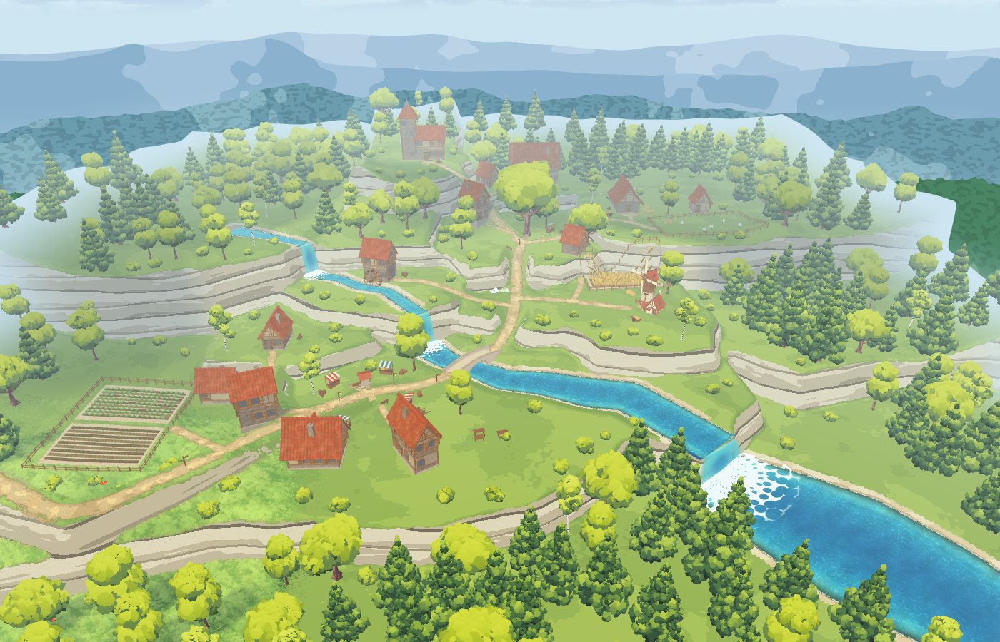
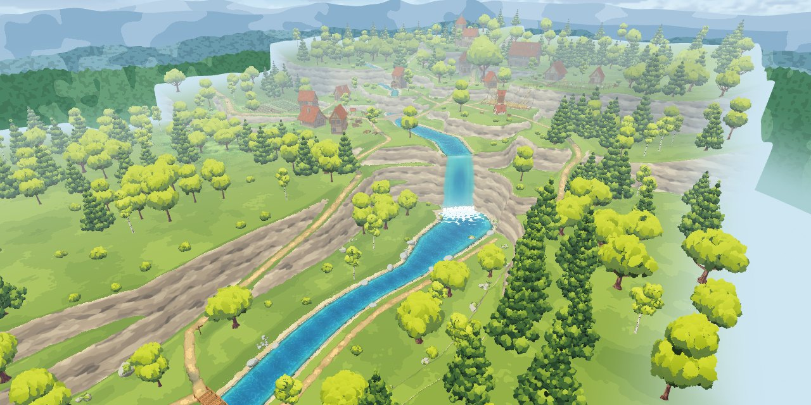
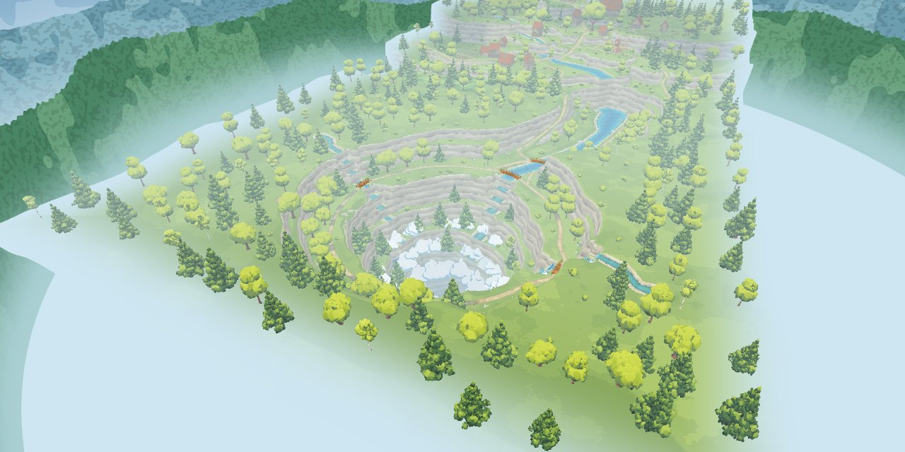

# Liora Farm

Fresh start using the uploaded meadow exploration project (v19).

A static Three.js game with mobile movement, a third-person camera, meadow vegetation, animals, interactive water and sky/water tuning.

## Run

Serve this directory over HTTP. Open `index.html`. GitHub Pages serves the same entry point. Three.js 0.170.0 and its addons load from jsDelivr.

Touch: left side to move, right side to rotate the camera; tap water to make ripples.

## Asset credits

Credits retained from the supplied project:
- Vivi: VRoid sample (CC0).
- “DEER” by WildMesh 3D (CC BY-NC 4.0).
- Grass approach inspired by Cortiz (MIT).
- Windmill: a Sketchfab model supplied for this project, restyled into flat colour patches (`assets/models/windmill.glb`); author and licence credit still to be filled in.
- Village houses: pieces of the Medieval Village MegaKit by Quaternius (CC0 1.0), the free Standard set, packed into `assets/models/village-kit.glb` (the glTF files were taken from the copy kept at github.com/J-Ponzo/gltf-medieval-village-megakit).

The previous game remains available in Git history before this replacement.

## Painted foam

`assets/water/foam-brush-v1.png` is an original AI-generated grayscale brush mask created for this project. The shader samples the artwork in flowing coordinates, limits swash foam to shallow edges, and uses the wave simulation for short-lived contact foam. No Unreal or Blender package assets are included.

Foam transport uses a damped wave-pressure velocity potential stored in the simulation alpha channel. Its gradient advects painted foam density in blue with a fixed 60 Hz semi-Lagrangian step, solid boundary masking and exponential dissipation. This is a lightweight surface approximation, not a full 3D fluid solver.

## Splashes and footsteps

Splashes and wading are made by the water's own wave simulation, in the same painted style as the rest of the water: a tap or jump heaps the surface up (the simulated height lifts the water mesh) and throws painted-brush foam onto it, which the flow then carries and wears away; a footstep presses a dip that rings outward and leaves a little foam behind. There are no separate splash meshes. The sliders are in **ปรับน้ำ** (น้ำนูนขึ้นตรงจุดกระเซ็น, ฟองที่ติดค้างตามรอยเท้า / จุดกระเซ็น). `anime-cells.js` bakes the 256x256 cellular mask the surface samples for its sparse foam islands.

Use **ไปดูน้ำ** to move to a nearby clear shallow bank, then **ทดสอบน้ำกระเซ็น** or tap the water. `?view=water` starts at the bank, including on the default valley map. `?map=meadow&view=water` and `?map=hills&view=water` select the other maps.

Footsteps follow the character's foot bones: the water is touched at the moment and the place each foot comes down, harder when she runs. Every footstep, splash and the foot of the waterfall also throws out an anime foam ring (`WATER_RINGS` in `stylized-water.js`): a cell-patterned ring of white foam that spreads, opens in the middle and breaks up at the rim. Slider: **วงฟองอนิเมะตอนเหยียบน้ำ / น้ำกระเซ็น / น้ำตก**.

Anime water: the **น้ำ: อนิเมะ / น้ำ: สมจริง** button switches between flat colour bands with hard-edged foam and drawn strokes (`WATER_TUNE.anime` = 1) and the clear, mirrored water (0, the default). The choice is remembered.

A full splash (a tap, the **ทดสอบน้ำกระเซ็น** button) also throws up a crown and a jet, drawn by `water-droplets.js` together with the drops. The crown is a thin sheet of the river's own water: clear and turquoise, with the sky on its rim, and white only at the churned foot and along the thick lip. Its lip swells into rounded fingers with a bead at the tip, where the drops fly off. As the crown sinks, a column rises out of the middle; the bulb at its tip lets go as one or two fat drops. A footstep throws only two or three drops and its ring of waves, no crown.

## The walker's shadow

By day the character throws her real shadow: her own outline, moving with her animation, lying the same way as the trees' shadows and growing long when the sun is low. `character-shadow.js` draws her from the sun's point of view into a small picture each frame, and a patch of ground-hugging mesh around her feet darkens the ground wherever she is in the way of the light. It follows slopes and shows on the river bed through the water.

It falls on the grass too: `shadow.receive(level.grass.material)` teaches the grass shader to ask the same question for every blade at the blade's own height, so her outline lies across the tops of the grass with the same cool tint as the trees' shadows (the old soft patch over the grass is gone). Rocks and other objects do not receive it yet. Inside a tree's shadow it fades out, and at night the round blob under her feet takes over.

Wading leaves a foam wake in the same style as the foot of the waterfall (`WATER_WAKE` in `stylized-water.js`): a sheet of white foam with holes of mixed sizes, thick round the legs, tearing into threads and flecks behind her and dissolving in place. It is one smooth field laid down along her path (`WATER_WAKE.track` once a frame from the level's `follow`), so nothing pops in or out; each footstep adds a puff where the foot lands. The big foam rings (`WATER_RINGS`) are now only for splashes. The churn under the waterfall is drawn on the water surface itself (`WATER_CHURN`): cells of two sizes laid out in metres, carried outwards by the flow (fast near the fall, slower further out), with patches of thicker and thinner foam drifting through it, so it never looks like one pattern turning round. Along the foot of the falls soft white billows boil up like small clouds (`createBillows` in `stylized-waterfall.js`): camera-facing cards with a cloud of round lobes drawn on each, white in the light and pale blue in the folds, small puffs that pop up out of the foam, drift out over the pool spreading apart and growing like clouds, and fade away with their outlines going soft. Their size, number, spread, rise, life and fade are sliders under **ฟองตีนน้ำตก** in **ปรับน้ำ** (`FALL_TUNE`). Where the sheet lands it also heaves the pool: small restless pokes all along the foot, and every so often a heave: the water wells up at three spots along the foot, with a shallow trough round each holding the same amount of water, and rolls out across the pool as waves through the wave simulation (sliders under **คลื่นจากน้ำตก**). Crowns and cones of water are kept for splashes in the river.

## The cliff path, the meadow and the windmill

A path is cut into the east cliff's shoulder (`createValley({ climb: { side: 1 } })` in `stylized-terrain.js`): it starts on the valley floor a little up-river of the bridge, climbs at a steady grade along the cliff face and comes out on the plateau beside the falls. Its line is found on the land itself (where the face reaches the height the path has climbed to), and the ground is set to the path's height along it. On top is a small open meadow with a windmill looking down the valley; its sails turn. `level.confine` keeps a walker on the valley floor, the path or the meadow. `?view=climb` starts at the foot of the path, `?view=mill` on the meadow.

`stylized-props.js` loads buildings and props that have been restyled into flat colour patches (vertex colours, no textures) and lights them with the kit's three hard bands. The windmill went from 4.9 MB with three textures to under 0.5 MB.

**The cliffs are carved into blocks of rock** (`rocks.js`), from the foot of the falls to the valley's mouth for now. The land's own mesh is too coarse on a cliff (half a metre between points, so a face is a few stretched triangles), so each face gets a fine skin that follows the very same heights, is tucked under the land along its foot and top edge, and is painted with the land's own material. Between foot and top it stands out of the face block by block, cell by cell and layer by layer, so the ledges fall on the strata's seams. Nothing changes for walking; faces beside a path are left as they are.

## The village above the falls

The plateau behind the falls is built up in terraces (`createValley({ tiers })` in `stylized-terrain.js`): the land and the upper river step up twice, and the river comes down each riser as a small cascade (`createWaterfall({ scale })`). Ramps cut into the risers lead from one terrace to the next. On the lower terrace: the windmill's meadow, a stone bridge over the river, two houses and a well, and a water mill whose wheel turns in the stream below the first cascade. On the upper terrace: a great tree, three houses, a fenced pasture, a plank bridge, and a keep on a knoll.

All the buildings are stand-ins built in code (`stylized-buildings.js`: boxes, slabs and cylinders in flat colours, drawn with the props' material) until real models take their place; where everything stands is the `VILLAGE` table at the top of `valley-level.js`. Up there a walker may stand on even ground, on the ramps and on the bridges; the risers, the river and the buildings are walls. `?view=village`, `?view=tree` and `?view=keep` start in the village.

Round the village the land stands up as hills (`tiers.rise`, `villageHills` in `valley-level.js`): a craggy ridge behind the upper terrace, out of which the river comes through a gorge, and shoulders climbing away on either side. Rocky tors stand up out of the terraces (`VILLAGE.tors`), one of them joining the keep's knoll into a ridge. Crags and boulders lie along the foot of each riser, beside the cascades and round the knoll (baked into one mesh for each kind of stone). The small things that make it look lived in (market stalls, barrels, crates, hay, benches, lamps, signposts, a cart, woodpiles, sheep in the pasture) are `propGeometry` in `stylized-buildings.js`, placed by the `VILLAGE.props` table; bushes, flower beds and pines are placed by hand in the same table.

The village crates and barrels use the original farm GLBs restored from the pre-rebuild `assets/models/builder/crate.glb` and `wine_barrel.glb`. `legacy-wood-props.js` keeps their original meshes and UVs, uses the `*-stylized.glb` variants with new 512px hand-painted-style honey wood / matte grey metal albedo maps, normalizes their bases and heights to the existing placements, and batches each kind into one mesh. The original GLBs remain available; editable albedo maps are in `assets/textures/props/`. The prop shader applies the same light bands and haze as the village. If one model cannot load, its stand-in remains. Other village props stay procedural.

## The village's ways

The trodden ways between the houses (`VILLAGE.paths`, the ramps and the yards) are drawn by the ground itself. `valley-level.js` bakes a small picture of how far every spot is from the nearest way and how paved it is; the terrain shader (`WAYS` in `stylized-terrain.js`) reads it and lays down, from the grass inwards: a verge of short yellowed grass, a rim of darker damp earth, the trodden earth, and pale worn patches down the middle. The edge wanders and is ragged. Pebbles lie thick along the edges and thin in the middle. Yards marked as paved in `VILLAGE.yards` (round the well, before the keep's door) are laid with cobbles that thin out into single stones at the yard's edge. The grass map agrees with it: no blades on the earth, sparse yellowed ones at its edge, and on the verge they stand about half as tall. Long ways are worn broad, spurs to a door narrow.

## The abyss

Down the valley the river runs out over the brink of an abyss: a round pit 80 m across (`abyss-shape.js`: where everything is, `ABYSS`, and how it bends the land; `abyss-scene.js`: its falls and clouds). The map now runs on to z = 170 to take it in.

- The river spreads out among rock islands (small trees and bushes on them, low sandbars between) and pours over the brink in four falls. Three brooks run in across the plateau from the east, west and south and drop in from the rim.
- The walls step down in ragged ledges (green on top) into the clouds that hang in the pit, and below them only blue, then dark: no floor is ever seen (`uDeepOn` in the terrain shader). Under each fall the ledges are worn into a sheer chute, so the water drops clear and frays away into the clouds.
- The clouds are soft puffs in the same style as the foot of the falls, sitting on the ledges and drifting slowly round, thicker where the falls go in, with a slow swirl of mist under them and the dark eye left open in the middle.
- A second path is cut into the east cliff (`createValley({ climbs })`): from the valley floor it climbs to the rim. A trodden way runs round the rim behind a rail, over plank bridges at the brooks, and out onto a lookout (a tongue of rock with a bench) that faces the river's falls. In the river she can wade the shallows up to the brink, but not the runs into the falls.
- A rope bridge (`ropeBridgeGeometry` in `stylized-buildings.js`, where it hangs in `ABYSS.span`) crosses the pit's north end just past the brink the river falls over, from the clifftop by the top of the path up to the far end of the rim walk, so the walk round the rim is a whole loop. It sags 3.2 m at the middle, where a wider landing is for standing and looking straight down into the clouds, and it sways a little, more while she is on it.
- `?view=abyss` starts on the lookout, `?view=brink` in the shallows at the brink, `?view=rim` at the foot of the path up.

**📍 ไปที่…** (`teleport-menu.js`) opens a list of every place the map offers, by area (the valley, the village, the abyss), and takes her straight there. The same names work as `?view=` (`start`, `falls`, `climb`, `village`, `mill`, `tree`, `keep`, `abyss`, `bridge`, `brink`, `abyssNorth`, `abyssEast`, `abyssWest`, `rim`).

The valley's own trees, rocks and flowers are still thrown with the same dice over the land as it lay before (`V.legacyKindAt`), so everything generated earlier stands where it stood and edits made in the scene editor keep their place; what would now land in the widened river or on the new path is left out. The abyss's forest and rocks have dice of their own.

**A trial: the rock kit in the abyss (`?rocks=new`).** Without it the valley is as it was. With it (`abyss-rocks.js` lays the pieces out, `rock-world.js` puts them in the world the way every map's rocks are): three pillars stand up out of the clouds in the pit, their heads below the rim (two of the kit's spires, made slimmer and drawn up twice their height, and a mesa with a flat, mossy top). **🪨 แก้หิน** moves them by hand.

## The guild

Where the keep stood, on the rock at the west end of the upper terrace, is the adventurers' guild (`stylized-guild.js`): the place only for now, no people in it yet.

- **The hall** has three storeys and is walked into through its open door with no cut. Ground floor: the reception desk, the quest board, a shop counter in the corner behind the stair, a hearth and tables. First floor: a gallery round an opening that looks down into the hall, books along one wall. Attic: the guild master's room, and a door out to a balcony over the front door.
- **Out of doors**: stone steps up from the terrace to a paved court, a duelling ring behind the hall (sand inside a kerb of stones, two gates), and a training yard south of the ring (straw dummies, archery butts, weapon racks). The back door of the hall opens onto the yard; a way round the north side leads to the ring.
- **How she walks in it**: the three floors are fixed heights joined by two straight stairs; she changes storey halfway up a stair. Walls, rails and furniture are line segments and circles marked with the storeys they stand on. `level.guild.storey` is -1 out of doors, 0 / 1 / 2 inside.
- **How it is seen**: while she is inside, the outside of the hall is thinned away and the rooms are drawn like a doll's house: inner walls are seen from their front only, the things on a wall are put away with it when the camera is behind it, and a floor or ceiling above her is drawn only while the camera is below it. So nothing ever stands between her and the camera.
- **The ground** is levelled by a `pads` entry in `createValley({ tiers })` (`stylized-terrain.js`). The plants and rocks of the valley are still thrown with the same dice on the land as it was, and whatever fell on the guild's ground is left out, so nothing else in the valley moved.
- `level.guild.spots` lists places for people and things to do later (reception, board, shop, tables, library, master's room, balcony, ring, yard). `?view=guild` starts at the foot of the steps.

## The depths of the abyss

Two layers down in the abyss, reached by **warp stones**: one on the rim beside the walk near the lookout, two in layer 1 and one in layer 2. Standing by a stone shows a 🌀 button that lists the other stones. No path joins them to the rim.

1. **The shelf and the meadow** (one map, walked end to end):
   - **The shelf** (หิ้งหญ้าริมทะเลเมฆ): a grassy shelf on the pit's wall above a sea of cloud. A tarn fed by a fall off the wall, a stream that runs off the brink, a headland to look out from, rocks standing in the clouds and hanging in the air. Its warp stone is at the north end.
   - **The ledge**: at the shelf's south end the land narrows to a ledge about 9 m wide along the brink, outside the meadow's east wall, and the path follows it down to the window in that wall.
   - **The meadow** (ทุ่งใต้เสาหินลอย): walled round, the widest. Rolling grass, paths, two ponds (one with lilies and a fall from a floating rock), flower drifts, trees. The window in its east wall is the way in from the ledge. It has a warp stone of its own at its north end. It is laid out in a frame of its own (`MEADOW`) and turned half round into the shelf's (`toM`), so its numbers still read as they did when it was a scene of its own.
2. **The gorge** (หุบน้ำตกในหมอก): a winding gorge with four side chambers, each with a tall two-step fall and a pool; a stream joins them. Rock pillars, mossy boulders, shafts of light, a lid of mist overhead.

- **Each layer is a scene of its own** (`depths-level.js`, `?map=depths&layer=1|2`, `&view=stone-shelf|stone-meadow|stone-gorge` to stand by a stone; the old `layer=3` opens layer 1 by the meadow's stone): the valley is too much for a phone to hold along with what lies under it. A warp opens the page again in the other scene (`warp-ui.js`), so everything of the scene she leaves is let go of first; coming back up is `?view=warp-rim`. The valley itself holds only the rim's warp stone.
- **Where things are and how the land lies** is `abyss-depths.js`: height maths on a 0.5 m grid, drawn with the valley's own terrain paint (`_terrain.terrainMaterial`), so the walls have the same strata as the pit's. A layer has its own ground picture, fluffy grass, clear water (ripples, wading), falls, clouds and plants, built the same way as the other maps.
- **The rock** down there is built of broken blocks (`rocks.js`): every rock face of a layer's land gets a stack of chunky flat-faced blocks stood in front of it, each its own size, lean and shade, with grass on top hanging over the lip and damp stains low down. The land behind is painted as plain deep stone (`rocks.js`), so a gap between blocks reads as a crack. `?rock=old` shows the bare walls, to compare.
- **The camera** comes in close when there is a wall of rock behind her, instead of being lifted over it (`player.js`); this holds at the valley's cliffs too.

## The scene editor

`🛠 แก้ฉาก` opens an editor made for a phone (`scene-editor.js`). It has two views:

- **🚶 เดินแก้ (walk)**: the game as it is played. Walk to the spot and fix it there.
  - **🖌 ระบาย**: a brush for the ground: ดิน (trodden earth), หินปู (cobbles), หญ้า (grass: takes a way away), in three sizes. Tap the ground to lay a dab, or turn on **👣 ตามเท้า** and walk the way you want: the brush follows her feet. The ground changes at once and the grass there lies down. `↶ ย้อน` takes back the last stroke.
  - **＋ วาง**: pick a tree, bush, rock or flower bed and tap where it should go. **🗑 ลบ**: tap the dot on a thing to take it out (again to put it back). **✋ ย้าย**: tap a thing, then tap where it should stand.
- **🗺 มุมบน (top)** (`?edit`): straight down, north up. Drag to move, pinch to zoom. The same brush (drag a finger; two fingers move the view), every plant and rock as a dot to pick, drag or delete, and **เส้นทาง**: the village's ways as lines whose points can be dragged, added (tap a line) and removed, new ways drawn point by point, broad or narrow; yards added, moved, sized, paved.

The ground (ways, yards, brush work) can be edited inside the village (the dashed frame in the top view) and shows as it is edited. Plants and rocks are built with the level: until the edits are saved, a mark shows what will happen (a red cross = taken out, a dashed line = moved, a plus = new).

**💾 บันทึก** keeps the edits in the browser (`localStorage`, key `liora.valley.edits.v1`) and loads the scene again with them, back in the editor at the same spot. `⋯` shows the edits as text: copy it to make them permanent (it goes into `valley-edits.js`), paste one back, or clear everything. `?edits=off` loads the valley without any edits.

The edits are a small list laid over what `valley-level.js` generates, and never change what it generates: a plant taken out still takes its turn in the dice and still keeps its neighbours at their distance, so everything else stays exactly where it was. A thing is known by its kind and where it was first put; if the level later stops generating it, its edit is simply ignored. Brush work is a list of dabs `[x, z, radius, what]` stamped over the picture of the ways, in order.

## Stylized prop rocks and cliffs (catalog)

`rock-catalog.html` shows a new set of rocks and cliff pieces made in the look of a hand-made stylized kit (`rocks.js`, section 5: `createPropRock({ type, seed })`). Each piece is a rough block cut by many flat planes (big faces, then small chips off the edges), with the creases softened a little; the paint goes by the faces: warm and light towards the sun, cool blue-grey away from it, a pale rim on the edges, darker in the creases and at the foot, moss on the tops. Big shapes are assembled from pieces sunk into each other, the way such kits are used.

- **Rocks:** ก้อนใหญ่, ก้อนกลาง, เสาหินตั้ง, แผ่นหินซ้อนชั้น, หินกรวด, หินปูทาง.
- **The cliff kit** (organic, modular): หน้าผาใหญ่ (`cliffFace`), หน้าผาสูง (`cliffTall`), สันผา (`buttress`), ผาบน (`cliffTop`), หินเชื่อมทางลาด (`slopeRock`), หินตีนผา (`footRock`), กลุ่มหิน (`cluster`), หินปิดรอยต่อ (`rubble`), and ผาประกอบ, an example of what they make together. Each piece is a few lumps of rock sunk into each other; a lump is cut along one grain (four families of side planes, none square to each other or to the ground, tipped tops, corners and shoulders taken off), so nothing reads as a box or a wall; where two lumps meet the join is shaded dark. A piece's shape depends only on its type and seed, so a level draws the same few shapes many times over (`createRockKit`: one instanced group for each type and seed).

⛰/🪨 switches between the two sets, ◀ ▶ go through a set, 🎲 rolls new shapes, ดูทั้งชุด shows the set in a row (`?type=wall`, `?all=1`, `?seed=4`). Nothing in the game uses them yet.

## The rock builder

`rock-builder.html` is for putting those pieces together by hand. Tap a piece in the bar at the bottom to set it down; tap a rock to pick it (a yellow box shows which), drag it to move it over the ground, and use the panel for turning, tipping forward/back and left/right, size and height (sink it into the ground or another rock, or lift it onto one); ⧉ copies it, 🎲 gives it a new shape, 🗑 takes it away. The pieces are painted by height above the ground (`createPropRock({ world: true })`), so stacked pieces share one shading. Their feet take on the ground's own colour, the way Unreal blends rocks into a landscape with a runtime virtual texture (`rocks.js`, section 7): the ground is drawn once from straight above into a picture of its colour and one of its height (`bakeGroundForRocks`), and the last half-metre or so of rock above the ground is painted over with that colour along a ragged edge, as if the grass ran up onto it. 🌱 กลืนพื้น turns it off and on, to compare.

**🔥 หลอมรวม** melts everything into one rock (`fuseRocks` in `rocks.js`, section 6): each chiselled piece is measured on a grid of points (signed distance: which side of its surface a point is on is told by the surface's own facing, so folds left by the cuts don't fool it), the pieces are joined with a soft minimum so the joins fill out into curves of rock, and a new surface is drawn through the grid. Faces away from the joins stay flat. It takes a few seconds; **✋ แยกชิ้น** goes back to the pieces to go on editing.

💾 keeps the work: three slots in this browser, and the layout as text to copy out (for the game later) or paste back in. The last layout is also kept by itself as you work.

## The rock test map (`?map=rocks`)

`rocks-level.js`: a small map for seeing the stylized rocks and the cliff kit in the world they will live in, with the game's own grass, ground, water and light, before they go into the real maps. A clearing in the middle; a cliff along the north with a waterfall; a pool under the falls that runs into a pond with stones standing in it; dirt paths to the pond, to the foot of the cliff and the pool, and up a ramp at the cliff's west end and along the top to a lookout by the falls. The rocks put together in `rock-builder.html` stand in the clearing (the builder's last layout in the same browser; `?layout=demo` leaves them out). 📍 has its places.

**The cliff is built the way a studio builds one.** The land is its bones: a step up to a plateau 7.6 m high along a wandering line, a hollow where the falls come over, a ramp where it runs out. The kit gives the face its shape: along the line, wherever the land's own face is high, a big piece (faces, tall blocks and ribs in turn; three shapes of each) stands sunk into the ground and into the face, scaled to the face's height there, only just overlapping the one before, so each reads as one rock; behind some of the joins another stands deeper in; here and there a top slab lies on the plateau's edge. Where the face runs down into the ramp: wedges, then fallen rocks. At the foot, on the joins: rubble, fallen blocks, huddles of rock. The land's own face (bare where it is steep) is painted the grey of the rocks' shaded sides, so what little shows between the pieces reads as a crack. A stream on the plateau comes over the lip between two blocks (`createWaterfall`) into the pool. About 145 rocks in under 35 shapes, some 310k triangles. The rocks' faces are flat colour: the light in a few steps, each face its own tone, bright edges, dark creases, moss; no painted pattern over them.

How a rock takes part in the world (the same for every rock): the ground under it is cut into one-metre cells. Each cell it stands on is solid (she walks round it), grows no grass, has the grass round it pressed down and its ground shaded (the dark at the foot that sets a rock on the ground), throws a shadow that follows the sun, and keeps the water's waves out (so the water swells round it). The rocks know the ground's height (their foot shading and moss go by it: `bakeGroundForRocks` draws the terrain once from above) and the water's level (`setRockWater`: a wet band at the waterline, greener under the water). Cloud shadows and the light of the hour reach them the way they reach everything else.

The thin edge of ground colour on the rocks' feet (`GROUND_BLEND`) is off: painting the foot in the ground's colour made rocks seem to float (the eye loses where rock meets ground); the shadow round the foot and the grass against it do that job.

**The brink.** The land's face along the cliff is all but upright, and the kit's big pieces stand against it with their backs in the land and their heads just under the level of the plateau's edge (each as tall as the face where it stands, by the lowest of the edge along its width). So from above the grass runs to the brink and she walks to it; the rocks' heads lie just below, in front. The grass hangs a little way down over the brink (the ground's paint is grass, not bare rock, for the first metre or so of the drop), so no bare strip shows between it and the rocks' heads. No slabs lie on the edge, and no piece stands above it.

**The tops of the rocks are grass, and she can stand on them.** The big pieces' heads lie at the plateau's level (a little under it), so the grass runs on from the plateau onto the rocks. The grass on them is the meadow's own: the follow-grass stands at the height of a picture of the land with the grassy rock tops raised into it, and the ground map grows grass there in its own colour (`grow`; `lawn: true` keeps the meadow's colour as if nothing were painted over it). Under the blades the rock's flat tops are painted as the meadow is (`setRockLawn`). Where she can stand is worked out from the rocks' real shapes (`sampleKitSurface`) on a grid of half a metre: a rock top she reaches from the land (or from another rock top) by a step of no more than half a metre, with no drop round it bigger than that, is ground she walks on (`level.standAt`: the player stands on it), not a wall. Grass grows on such tops where they are the flat tops of mossy rocks and not at an edge.

**Fewer, bigger masses.** The cliff is dressed mostly with the broad piece, sized 1.35-1.75 and fitted to the edge (so it is squat and wide, with broad planes), each overlapping the next, a piece behind more than half the joins. A fitted piece is also kept under the plateau wherever a part of it lies behind the edge, so nothing of it stands up out of the grass.

**LOD (level of detail).** Each shape of the kit is made three times, cut more coarsely each time: the same planes cut it, so it is the same shape with fewer points (a cliff face: 6,400 / 2,400 / 960 triangles). A rock is drawn with the version its distance calls for, counted in its own sizes (its radius times its size), so a big cliff piece keeps its detail further off than a pebble: in full within about 3 of its radii, the middle one to about 6.5, the coarsest beyond (`ROCK_LOD`, with a little slack so one at the edge does not flicker). The kit sorts its rocks again whenever the camera has moved half a metre (`kit.userData.update(camera)`, from the level's update). In the test map that draws 80k–135k triangles instead of 314k, depending on where she stands.

### One system for the rocks of every map (`rock-world.js`)

A level hands over the rocks it lays out and what it knows of its land (its height, where she can walk, where the water is), and `createRockWorld` does the rest the same way on every map: draws them with the kit (instancing, LOD), lays over them what was placed by hand (kept in the browser, or in the map's layout file for everyone), works out each rock's footprint on the land, the rock tops she stands on (`standAt`) and the meadow's grass on the mossy ones, and gives the rock editor what it needs (`level.rockEdit`). So a map that puts rocks in its world gets standing on them, grass on their tops and the 🪨 editor with nothing more. `fitToEdge` fits a cliff piece to whatever edge it stands at (the top of the rise behind its front; along its width, only where there is a drop; a piece much taller than the drop keeps at least three quarters of its height and is sunk deeper instead of squashed); a map that knows its cliff better brings its own (the rock test map fits to its cliff's line). Used by `?map=rocks` (its layout in `rocks-layout.js`) and `?map=blockout` (`blockout-layout.js`).

### Moving the rocks by hand (`rock-editor.js`)

The code lays the rocks out the way a studio's tools do; `🪨 แก้หิน` is the pass the studio's artist makes over it, in the map itself, made for a phone. The camera flies free of her: one finger turns round what it looks at, two fingers move it and zoom (the mouse wheel too). Tap a rock to pick it (a ring round it on the ground, its name above); drag it to move it (it keeps its depth in the ground as it goes, by the lowest ground under it, so a cliff piece stays on the land below the face); the sliders turn it, tip it forward or sideways, size it, raise or sink it; ◀ ▶ another shape of the same kind; ⧉ one more like it; ⬇ down onto the ground; 🗑 out. `＋ เพิ่มหิน`: a new piece of the kit, where you tap the ground. `↶ ย้อน` goes back one change.

**Fitted to the cliff's edge (📐 เสมอขอบผา).** The big pieces the cliff is dressed with are fitted to it: the foot sunk into the low ground in front, the head (the top of the piece's front, `rockFrontTop`) level with the plateau's edge, the piece stretched up or down (`sy`) to span the face. In the editor a fitted piece stays fitted whatever is done to it: made bigger it grows wide and deep and its height still spans the face; made smaller it is narrower and its head still meets the edge (it never floats). Moved along the cliff, turned, given another shape: fitted again. The 📐 button fits a piece or lets it go; a cliff piece put down at the cliff is fitted at once.

`💾 บันทึก` keeps the rocks in this browser and loads the map again, back in the editor at the same view: her way round the rocks, the grass, the shade and the shadows are worked out again for where they now stand (until then only the rocks themselves move). From then on that list is the map's rocks, all of them (`?edits=off`: the code's layout). `⋯` gives the list as text: sent to Claude and put into `rocks-layout.js`, it is the game's for everyone; pasted back, it is used again. There too: back to the game's own layout.

## Land in blocks, and the big cliff pieces (`?map=blockout`)

**Blocks of land** (`terrain-blocks.js`). A block is a piece of land to play on: an outline (one of a few shapes: `plateau`, `spur`, `knob`; turned and sized; its outline wanders into bays and headlands) and a top at some height. Blocks are put down overlapping: where they overlap they join into one table with a lobed outline, and a block with a higher top standing on a lower one makes a step. A block is land (it raises the level's height field: `blocks.stamp`), so grass grows on it, she walks on it and things can be placed on it with nothing more. The same few shapes are used again and again.

**The big cliff pieces** (rocks.js: `bluffTall`, `bluffWide`, `bluffSplit` for faces about 16 m high; `bluffLow`, `bluffLowSplit` for about 8 m). Made at that size, not small pieces sized up: a few great lumps standing close and upright, cut into broad flat faces with many small facets shaved off them, each facet its own tone and lit as the flat plane it is (crisp, like a painted cliff), deep joins between the lumps; in a pale, cool stone (near white in the sun, periwinkle in the shade; a kit can be given a tone: `createRockKit(list, { tone: 'pale' })`). `blocks.dress` stands them all the way round each block's outline wherever the land really drops (not where another block covers the outline, a ramp comes up or a waterfall goes over): each chosen and sized by the height of the drop there, its head just under the block's edge (nothing of it stands above the land), its foot in the ground, fallen rock at some joins. They are drawn with the kit's instancing and LOD.

**Mountains** (rocks.js: `peakSpire` 44 m, `peakTwin` 38 m, `mesaMount` 26 m, `stepMount` 33 m, `ridgeMount` 25 m, `archMount` 21 m; the catalog's 🗻 group). Whole masses of rock made at that size: a crowd of columns standing close (each 5 to 8 m wide, as high as the mountain's outline says where it stands, so there are tops and ledges at every level, where grass grows) round a few greater masses. `mesaMount` has a broad level top and `stepMount` three terraces (room to stand, to build on); `archMount` is two piers and a slab across, to walk under. 60k-73k triangles in full, about 25k and 10k in the coarser LODs (the arch: 23k / 8k / 3k). Not yet placed in a map.

**The blockout map** (`blockout-level.js`): a Mondstadt-like place built this way. A rolling meadow with a lake; table A (8 m: three blocks joined), with a ramp up from the meadow and a stream that falls over its edge; table B (16 m: three more, partly on A), with a ramp up from A; the top C (26 m, one block on B) with one great tree on it; a knoll by the lake. The whole layout is the few lines of `BLOCKOUT_MAP`. The rocks are in the world the way every map's are (`rock-world.js`): she stands on the heads of the big pieces at the blocks' edges and on the low ones, grass grows on the flat tops of the mossy ones, and `🪨 แก้หิน` moves them by hand (📐 fits a piece to the edge of the block it is moved to). The water is still plain. 📍 has its places.

### Dirt paths (`ground-paths.js`)

Trodden paths of warm sandy earth, the way a studio lays a road over a landscape: a ribbon that follows a line over the ground (a spline decal) with its own painted look, a hair above the land. The ground map is told where the path is (bare earth, clumps of grass pushing in from the edges, short trodden grass beside it), and the ribbon reads that map back: where the map says grass grows, the ribbon is not drawn, so grass and path meet along one ragged edge. The paint: the old Liora Farm ground textures (`assets/ground/path-sand.webp`, `path-dirt.webp`, seamless, brought back from the repo's history): sand down the worn middle, dirt creeping in from the edges in patches and in damp spots, each laid twice at two sizes and turned so the repeat does not show, the grit made a little stronger so it reads on a phone; a dark rim of roots where the grass begins, and the sun's shadows. One picture of how far every point is from the nearest path's middle is shared by all the ribbons, so where two paths meet they agree. (Without the textures it falls back to painted dabs of tone.) The path lies a few centimetres below the grass; flat stones (`flagstone`, a new rock piece) are set into it alone or in twos and threes, pebbles lie by its sides, and a few flowers grow beside it. A level can keep things that grow off its paths with `keepClear(x, z, r)` (the forage reads it). There are two looks (`createPaths({ style })`). `'grit'` is the one above. `'soft'` is smooth earth laid in with a brush, with no line at its edge: one new picture (`assets/ground/path-paint.webp`, made by `tools/make-path-paint.py`: broad drifts of tone, soft dabs of the brush, a few pebbles) laid twice at two sizes; in the game it is made paler down the worn middle, given broad soft patches of deeper and paler tone, and browner toward the sides. Where the ground map says grass begins, the earth goes to the colour of dry grass and fades out, so the meadow shows through it, and the map is told to let the grass come up thin and short at first and taller over the next metre: no ragged line and no dark rim. For that the ribbon is see-through at its edges (drawn after the land and the grass, before the water), and a second number in the shared picture says how many metres outside the path's edge a point is. The hill village uses it (`HILL_VILLAGE_MAP.paths`; `?paths=grit` shows the old look there); the rock test map keeps `'grit'`. In the rock test map: from the start down to the pond's beach, and on to the foot of the cliffs (📍 ทางดิน).

## The pit drawn by hand (`?map=pit`)

A trial of shaping land by hand instead of by formulas (`pit-level.js`). The land is a picture: `assets/heightmaps/abyss-pit.png`, 16-bit grey, white high and black low, painted and then given hard-edged terraces (four wide shelves and a sheer shaft in the middle; the wavy outlines and the brooks are the painting's own). It covers 110 m square, so the pit is about 80 m across like the valley's, and black lies 60 m under white. On it: the valley's land paint (strata on the walls, fading into the pit's mist), the ground picture and the fluffy grass, a forest round the rim, saplings, pines and bushes on the shelves, and the abyss's clouds. Five brooks (where the painting has them) run across the rim in the valley's clear water, and on down the pit as the land lies: across each shelf, over its edge as a fall onto the next, and from the last shelf in one long fall into the mist. Nothing is cut through the shelves; only a shallow bed is pressed into the ground under the water. No rocks yet; she walks on the rim only.

A browser reads a PNG only to 8 bits, too coarse for gentle ground, so the game reads `abyss-pit.bin` beside it: the same picture as raw 16-bit numbers, 513 × 513, little-endian. After painting a new PNG, make its `.bin` (Termux: `pip install pillow numpy`):

    python3 -c "import numpy as n;from PIL import Image as I;a=n.array(I.open('assets/heightmaps/abyss-pit.png')).astype('f4');n.clip(n.array(I.fromarray(a,'F').resize((513,513),I.BILINEAR)),0,65535).round().astype('<u2').tofile('assets/heightmaps/abyss-pit.bin')"

(an 8-bit PNG works too: multiply by 257 before saving). `tools/make-pit-heightmap.py` does the whole way from a painting to the game: the hard-edged terraces, the brooks' shallow beds, the PNG, the `.bin` and `abyss-pit-brooks.json` (each brook's line and water height, and where each falls). The sizes are `PIT_MAP` at the top of `pit-level.js`. `?map=pit&view=pit-north` (or `pit-east`, `pit-west`) starts on the far side of the brink.

## The terraced village island (`?map=village`)

A trial of the village above the falls rebuilt on terraces, after the concept art (`village-level.js`). The land is a heightmap made in code: `tools/make-village-heightmap.py` draws an island about 150 m across (the picture covers 165 m) of plateaus in hard-edged steps, their outlines scalloped like clouds, a ravine running across it to the south-east edge, and three waters: a river from a spring on the high plateau down a cascade of falls to the low ground and into the ravine, a mill stream off the keep's knoll, and the ravine's own stream, which pours off the island's edge into the haze. It writes `assets/heightmaps/village-terrace.png` (16-bit, white high), its `.bin` (what the game reads) and `village-terrace-brooks.json` (each reach of water, row by row with its height, and each fall). Heights are terrace levels: 3.5 m a level, the island's floor at 0 m, the plateaus at 7, 10.5, 14 and 17.5 m, the ravine's water at -5 m; off the edge the land drops sheer to -60 m (`VILLAGE_MAP` at the top of `village-level.js`).

On it, as in the concept art: the keep on the knoll with the water mill beside its stream, the manor and the great tree by the river's spring on the high plateau with the sheep's pasture, the market on the middle shelf, the windmill on the east shelf, houses on the west shelf, houses round a well in the lower village (where she starts), and a stone bridge over the river on the low ground. Everything stands where `VILLAGE` (in the same file) says. Trees thicken on the low ground and along the cliff tops; the plateaus stay open for the village. The buildings are the code-built stand-ins of `stylized-buildings.js`.

For now she walks one level at a time: the cliffs are too steep to climb and there are no ways up or down yet. **📍 ไปที่…** has every level under "หมู่บ้านขั้นบันได". To change the land: edit the plateaus (`MESAS`), the ravine or the rivers in the tool and run it again from the repo's root (`python3 tools/make-village-heightmap.py`, needs numpy, scipy and pillow); then check that `VILLAGE`'s places still stand on flat ground.

## The hill village on a heightmap (`?map=hillvillage`)

A village on stepped cliffs, laid out from a painting: a keep on a crag, a manor, a great tree with a few cottages round it, a pasture and a barn, the windmill on a ledge, a water mill on a stream, and below them a market round a well, houses, fenced fields and a road in. A river comes down through it in falls, under a stone bridge, and goes over the terrace's edge into the valley below. It is a separate trial map: nothing in the valley is touched, and it is not the terraced village island above (`?map=village`), which is another trial of the same painting with code-built houses.

South of the village the land goes on, and the valley of the first map lies in it, made again to its measure (not the first map's own code, and without what stands in it there: the abyss, the guild and its village). Its head lies right under the village's terrace: the river goes over the terrace's edge in one fall of eighteen metres into a plunge pool (there was a pool on a step between, and a second fall from it: one step of falls too many, so it is gone), and winds down a floor some forty metres wide between stepped cliffs, with clumps of trees at the cliffs' feet, sand banks and water-worn stones. A way cut along the west cliff goes down to the floor; a plank bridge crosses the river; a lookout stands on the east brink across from the fall. At its end the valley opens into a bowl, and the pit lies in the bowl's floor.

**The pit at the valley's end.** The bowl is 108 m across, and in its floor lies the pit drawn by hand (`?map=pit`): the same picture (`abyss-pit.bin`), stamped into this map's land by the tool. So it is one land with the village and the valley (one heightmap, the same paint, brushed cliffs, grass and woods), and she walks from the village to the pit's rim without a break. The tool turns the picture (218 degrees: the turn that leaves the widest shelves where the three waters come down) and fills in the picture's own five brook beds, since the water here is laid by `land-water.js`. The valley's river comes to the pit's brink and goes down it; two brooks rise in the meadows east and west of the bowl, come down its cliff, cross its floor and go down the pit the same way. The top of each water's way down is a cascade: low steps with a small pool on each, three falls of some four and a half metres where there was one of thirteen (`CASC_RUN`, `CASC_N` in the tool: how long a step is, how many between one level and the next). From the bowl's floor to the pit's first shelf the steps are let into the floor, back from the brink (the shelf below is too narrow to build them out onto); where a side brook comes over the bowl's cliff, into that cliff. A step is a bench wider than its pool, with rock either side and the water falling free over its edge; its sides stand back as they rise, as a gully's do. They are cut after the ways are laid and before the water, which then lies on them as on any terrace. Below the first shelf it is as it was: a fall from shelf to shelf, and off the third into the mist. That is twenty-one falls from one step to the next and three into the mist. A way goes all round the pit's rim, over a plank bridge at each of the three waters, on the strip of floor above its steps; the steps and the shelves are to look at, not to walk on. The pit's clouds lie in it (`createAbyssClouds`) and its cliffs fade into the mist below, both measured from this map's rim height and not the pit map's (`pit.shift` in the plan; `uDeepTop` in the land's paint). `?map=pit` itself is as it was.

The land and the plan come from one place, `tools/make-hill-village-heightmap.py`. It lays the plateaus out as polygons with a height, makes their edges wander, cuts ramps where the ways climb (none steeper than 30%), levels the ground under every building, and lays the water in shallow beds: each stretch of water lies on its own terrace and goes over the terrace's edge as a fall (nothing is cut through the terraces; only the cliff right under a fall is made sheer, so the water falls free). The valley is cut the same way, from numbers at the head of its part of the tool (how far it drops, how wide its floor, where its river winds); its head is put where the river leaves the terrace, found from the land itself; and the way down it is laid on the cliff's own face. She walks on 160 m by 337 m (the village's square, the valley south of it and the bowl with the pit); round that there is a 30 m margin of wooded hills to look at. It writes, in `assets/heightmaps/`:

- `hill-village.bin`: the land as raw 16-bit numbers, little-endian, `land.nx` across by `land.nz` down (551 x 1063), one every `land.cell` metres (0.4) from (`land.x0`, `land.z0`): what the game reads. `hill-village.png` is the same picture, smaller, to look at.
- `hill-village.json`: the plan. Where the land lies and the part she walks on (`land.play`), the water (`brooks` and `falls`, as for `?map=pit`), the buildings, the two bridges, the ways and yards, the fences, the fields, the small things, the plants, the three plank bridges round the pit (`planks`), the valley's rocks, the pit (`pit`: where it lies, its brink, its shelves, how far below the pit map's heights it stands), which stretches end in a fall into the mist (`deep`), and the places to start from. Places are metres from the middle of the village, x east and z south.

To move or change anything, edit the tool, run it (`python3 tools/make-hill-village-heightmap.py`; Termux: `pip install numpy scipy pillow`) and reload. It warns when a prop stands on a way, in water or on a cliff.

`hill-village-level.js` reads the two files and puts the game's own things on top: the valley's land paint (with painted cliffs, below), the ground picture and the fluffy grass, the dirt ways of `ground-paths.js` in its soft look (a yard is a short way as wide as the yard), the woods, and the water (below). The waters lie at many heights: the waves are worked out on one, the river's by the bridge, and the water's mirror is made each frame for the height of the stretch she is nearest (`setLevel` on `createWaterOptics`).

**The water is laid on the land, by the land** (`land-water.js`). A level says only where each stretch of water runs and how high it stands (the plan's `brooks`: rows of x, z, level, half-width). What is seen is then worked out from the ground as it is drawn, so the water, the falls and the foam cannot disagree with the land or with each other:

- **The surface** is a sheet at the stretch's height, cut out to its real shore: out from the stretch's line it goes as far as the ground first comes up through it, and no further; and never over air (where the ground has dropped away under it, the sheet stops at that edge).
- **The lip**: where a stretch runs off an edge, the edge is found lane by lane across the water, walking each lane downstream until the ground falls away. The points found are the lip.
- **The fall** hangs from that very line (`createWaterfall({ lip })` in `stylized-waterfall.js`: the falling sheet's top row of points are the lip's own), so the surface and the fall are one water with no gap; and it lands on whatever water lies below it there, its churn, billows, spray and mist put at that spot and height (the churn no wider than the water it lands on). A low fall, one step of a cascade, raises no mist.
- **Into the mist**: a stretch named in `deep` ends where there is no water below. The level gives the fall for it (`deepFall`; here the abyss's long falls, `createAbyssFalls`), hung from the stretch's end, and the check counts it apart.
- **The check**: `level.stats.water` (also printed to the console as `[land-water] clean` or `NOT CLEAN`): points of a sheet still hanging over air, a stretch that ends at a drop with no lip, a fall whose foot is not on water, more or fewer falls than the plan has; and how many metres of a sheet's edge stand open over a side drop or stop short of a shore. A map's water is not right until this is clean.

Before this the surface was cut from the stretch's line alone and ended on a straight line, and a ready-made fall was stood at a spot given in numbers: where a cliff's edge was not square to the stream the surface hung out over it, the fall stood apart from it, and the billows of every fall were drawn at the middle of the map (a fall built at 0, 0 and then moved did not take its billows with it: fixed in `stylized-waterfall.js`, for every map that places its falls so). The tool does its part: the last 3 m of a stretch that ends in a fall are made a lip, the bed coming up to a shallow sill with a shoulder of rock each side of the water right to the lip's line, and the cliff under it sheer. The other heightmap maps (`?map=pit`, `?map=village`) still lay their water the old way; `land-water.js` is written for them to use too.

The land is big, so what is not in view is not drawn: the ground is in 18 pieces and the woods in groves 80 m square, each drawn only when the camera looks its way; beds of flowers and falls far off are left out (a fall's spray beyond 60 m, a low fall's veil too, the whole fall beyond 170 m), the spray and billows at the falls' feet are left out of the water's mirror (`water.small`), and so are far groves in the water's mirror. Trees out in the margin, which she never comes near, have half the leaves. The far hills of `stylized-sky.js` stand round this map's middle and further out (`level.horizon`), as the land is longer than their nearest ring is wide.

The cliffs are painted with a brush, as in a watercolour background, in place of the valley's strata: `assets/ground/cliff-paint.webp`, a seamless picture laid on 20 m along a cliff by 10 m up it, from whichever side a face looks to. `tools/make-cliff-paint.py` paints it: three tiers of rock, each lit along its top and falling into a brown shadow under the next; the rock broken into chunky planes, each one tone of a five-tone palette, neighbours of one tone running together; a few thin washes over that; paper grain. The land's paint takes it as an option (`terrainMaterial(far, half, zc, { cliffPaint })` in `stylized-terrain.js`; without it nothing changes, so the other maps keep their strata). `?cliff=strata` shows this map with the strata instead, to compare.

The houses are put together from a modular building kit by `village-kit.js`: walls 2 m wide and 3 m tall, doors, windows, shutters, tiled roofs, gables, chimneys and dormers, stood side by side on a 2 m grid (`builder().house({ w, l, floors, wall, door, seed })`; the keep is a four-floor tower with the kit's tower roof and a hall against it). All the houses of the map are merged into one mesh for each of the kit's pictures and drawn with the props' material, so the game's three bands of light fall on them. `?look=flat` draws them in flat colour patches instead (each face takes one colour from the kit's picture), like the windmill. `tools/pack-village-kit.py` makes `village-kit.glb` from the kit's glTF folder: only the 60 pieces used, only their colour pictures, at 1024 px (2.7 MB instead of 59 MB).

What the kit has no piece for is still built in code, in flat colours: the well, the water wheel, the stone bridge, fences, stalls, barrels, carts and sheep (`stylized-buildings.js`), and the fields (`village-fields.js`: ridges of turned earth that follow the ground, with cabbages, carrots or wheat on them). The windmill is of the kit too, so it sits with the other houses: a three-floor tower with the kit's tower roof and the miller's house against its wall (two houses of the plan), and on its face the sails of the model supplied for the game, the one part of that model still used here. `loadSpinner` in `stylized-props.js` takes the sails out of the file, puts their middle on the axle and gives them the kit's own wood and a linen that sits with its plaster; the level hangs them on a wooden axle out of the tower's wall. The fields lie on ground the tool has made even; the tool says so out loud (a line beginning `!`) if a field or a fence lies across a cliff, where the crop and the rails would climb the rock.

All of the map can be walked. She may go anywhere that is not a cliff or deep water, and a way leads to every part: besides the ways between the doors, one goes west from the great tree to the west wood and its spring, one from the windmill's ledge through the east wood to the lookout on the valley's east brink, and one down the cliff below the village to the meadow and along the valley's brink to the top of the way down. That goes down the west cliff to the valley's floor, over the plank bridge, up the east bank to the foot of the great fall, and down both banks to the bowl, where a way goes all round the pit's rim, over a plank bridge at the river and at each of the two brooks. The two streams are shallow enough to wade; the river and the valley's river are not (the player stops at water deeper than half a metre), so they are crossed by bridges (the stone one in the village, planks in the valley and round the pit), where `waterDepthAt` answers 0 for anyone on the deck. `?map=hillvillage&view=vl-plaza` (or `vl-bridge`, `vl-tree`, `vl-castle`, `vl-manor`, `vl-pasture`, `vl-windmill`, `vl-watermill`, `vl-fields`, `vl-falltop`, `vl-spring`, `vl-eastwood`, `vl-brink`, `vl-rim`, `vl-fallfoot`, `vl-valley`, `vl-pit`, `vl-cascade`, `vl-pit-south`, `vl-pit-above`) starts there; the same places are in the 📍 menu.
