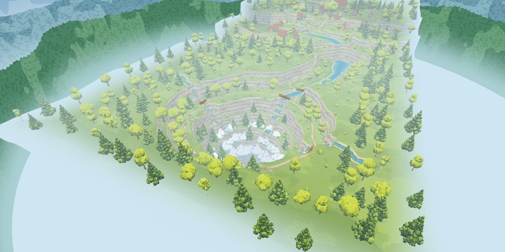

# Liora Farm

Fresh start using the uploaded meadow exploration project (v19).

A static Three.js game with mobile movement, a third-person camera, meadow vegetation, animals, interactive water and sky/water tuning.

## Run

Serve this directory over HTTP. Open `index.html`. GitHub Pages serves the same entry point. Three.js 0.170.0 and its addons load from jsDelivr.

The game opens on its map, the hill village (the same as `?map=hillvillage`). `?map=valley` opens the first map's valley, which used to be what the plain link opened; the other maps each have their own `?map=` (below).

Touch: left side to move, right side to rotate the camera; a quick touch on either side is a tap: on water it makes ripples (with `?farm=1` and a tool chosen, on a square of her farm it uses the tool).

Working on it with an agent (Claude, Codex …): `AGENTS.md` has the notes they hand on to each other, and the log of who did what.

## The look of her magic: the basic combo's water is the reference

"หลังจากนี้ใช้ style ของสกิลคอมโบพื้นฐานเป็น ref" (the user, 23 Nov 2026). Whatever is drawn for one of her spells from now on, new or made again, is to look like the basic combo's four tapped casts as they are in the game (and on `magic-combo.html`, the page to try them on: there are dummies to hit there; they were worked out on a trial page of their own, `combo-water-trial/`, which went when they came into the game the same night). Look at them before drawing anything; what their look is:

- **Painted water, not light.** Flat anime shapes with hard edges, a white crest along an edge, lighter streaks inside, drops as round beads. Aqua: heart `#effffe`, body `#5fe6e8`, deep `#169fb0` (`WATER_LOOK`; each picture also carries its own ramp of eight colours, read off the clip). No soft orb of light, no glow at her hand, no ribbon of light behind a hand, no thin ring of light, no gold sparks: where the sky-blue set had one of those, the water set has a picture, or nothing.
- **Drawn frame by frame.** A cast is a flipbook of the frames of a clip the user sent (12 to 24 a second), ONE whole frame shown at a time (two mixed read as out of focus: "vfx ดูเบลอๆ"), about 260 pixels to a metre (a phone held upright shows about 330).
- **The pieces there are** (use them before making new ones; all `assets/water-casts/water-*.webp`, what is in each in `water-casts.js` beside them):
  - the four casts: `jet` (needles out of a hand), `sweep` (a crescent swung round her), `orbit` (rings round her and a burst), `vortex` (a dome, a flash, a whirl);
  - `bolt`: what a cast throws, turned the way it flies; `hit`: the splash where anything lands;
  - `blade`: the sweep's crescent laid out straight, three frames. A band of that water wherever a ring or a wave is wanted: along a wave (two crossed bands, so that it is a crescent from the side and from behind), round a ring over the ground (a crown thrown outward), round a hoop in the air, along a ribbon.
- **How they are drawn** (`magic-combo-fx.js`): `tiles(name)` is a flipbook on one square turned to the camera; `laid(name, shape)` lays a strip on a shape of its own; `fx.look('water')` is the whole set (`fx.cast`, `fx.shot`, `fx.burst`, `fx.ring`). A picture is two numbers a pixel (how light, how much), coloured by its ramp, kept as tiles (a frame is mostly air).
- **Which way a picture faces: the way she casts.** The clip was filmed from behind its girl, so what is before her is up the picture. The game's camera does not come round behind her of its own accord and she casts the way she faces, so a picture drawn as the clip has it sent its water up the screen whichever way she faced: off to one side of her, or behind her ("เอฟเฟคมันดูพุ่งเบี้ยวๆ ไม่ตรงหน้าตัวละคร", 23 Nov 2026). A cast's picture is turned, as the camera sees her from above, to the way she casts (`WATER_CASTS`' `flat`, in `magic-combo-fx.js`): the first cast's needles fan out the way its bolt goes; the crescent is made as tall as it is from straight above, turned, and made flat again, so it stays a level sweep round her front from every side; the third cast's rings and the finisher's shell are round her and are not turned. A picture put where she stands goes with her as she steps on. With nothing to cast at, a bolt leaves her hand for the line straight ahead of her and goes along that (`LANE`, `magic-combo.js`); it is turned the way it goes on the screen, is shorter seen from its end, and is gone close before the camera.
- **Weight.** The camera is mostly behind her, and a thing going away at one pace slows on the screen to nothing and is gone without a mark ("มันดูช้าๆ ดูไม่มี momentum เลย", 23 Nov 2026). So what is thrown leaves fast and gathers pace as it goes (`SHOTS`' `rush`), a bolt is drawn out along its way as it leaves, and one that meets nothing bursts in a splash 8 m out, where it can be seen; a cast's picture comes out small and is its own size in a moment, and its first frames come faster than its last (`swell`, `quick`). Anything new that is thrown or swung should begin fast and end in something.
- **How a new piece is made from a clip**: `tools/make-water-casts.py` (the water lifted off the clip's picture; the clip's girl taken out and the water drawn again where she stood; made crisp with Real-ESRGAN's anime model; packed).
- **For a weak phone held upright** (the user's): few squares at once, pictures no bigger than they must be, nothing that needs a pass over the whole screen.

**Over water** (23 Nov 2026: "น้ำบังสกิลหมดเลย", with a picture of the lance's circle cut off along the far bank). Most of the combo's materials and all of the spear rain's were not marked see-through: drawn with the solid things and writing no depth, they were painted over by whatever solid came after them, and the river comes after the land (`land-water.js`, its renderOrder 1). So wherever water lay behind her light on the screen it was drawn over it: the lance's circle, the lance and its wake, the orbs, the bursts. `material()` in `magic-combo-fx.js` and `spear-rain-fx.js` now marks every one `transparent` (drawn in one pass, `forceSinglePass`, as they were, those that were not). Anything new drawn without writing depth must be marked so too. Then the falls ("ยังมีอยู่นะ", the same morning, the lance's circle by the plank bridge at the pit's rim, the foam at the foot of a fall over half of it): among the see-through things, what has the higher renderOrder is drawn later, and the falls' sheets and foam (`stylized-waterfall.js`, 2 to 6) came after the combo's (0) and the spear rain's (1 to 9), over them, behind them as they were. So each of her spells' four Groups (`magic-combo-fx.js`, `spear-rain-fx.js`, `magic-circle-fx.js`, `barrier-fx.js`, and the Groups within them) has the renderOrder 100: a Group's renderOrder orders all that is in it as one, after everything that has none, its own renderOrders keeping their order within it, and between the four. What it gives up: a see-through thing of the world in front of her spell (a fall she casts behind) is drawn under it, not over; the camera is behind her, and that is seldom. And wading, what stands on the ground stands on the water over her feet instead of on the riverbed under it: the barrier (`player-spells.js`), and the jump's circle off the ground and the one that catches a fall (`player-moves.js`; 6 cm over the surface, over its slow waves).

Kept as they are, by the user's own choice: the lance's magic circle (line work; three layers that turn against each other and come together as the lance grows, since 23 Nov 2026) and its spear (a picture the user sent), the jump's circles. The lance's rings of water (the hoops round its line, the wave round its circle, its wake, where it lands) are the blade and the splash since 23 Nov 2026 ("สกิลปาหอก ทำวงคลื่นให้เป็นแนวๆ เดียวกัน").

## The shaders' noise

Every shader's noise is `NOISE` in `stylized-nature.js` (`noise2`, `hash2`). Its random numbers come from whole-number arithmetic that a 32-bit float does exactly, so they are the same on every graphics chip. They used to be `fract(sin(x) * 43758.5)`, which a phone may round differently in two places of one shader: neighbouring squares of the noise then disagree on their shared corner, and whatever tone is made of noise jumps along straight lines (seen on Android on the dirt paths: straight seams a few metres apart; a computer drew it smooth). A shader that needs noise takes `NOISE`; it does not write a sine hash of its own for anything neighbours must agree on (a number for one whole drop or one whole cell is fine).

## Asset credits

Credits retained from the supplied project:
- Playable characters (Vivi, Shino, Shibu, Darkness Shibu, Vita, Victoria, Fumiriya, HairSample F/M): VRoid Studio sample avatars by pixiv (CC0), in `assets/characters/` (`characters.js` lists them; the 👤 button top left picks one). Each was made from its .vrm by `tools/prep-vroid.py` (model) and `tools/bake-character-springs.py` (hair and cloth that swing); Vivi's model is her earlier `prep_vivi.py` one, which the new tool reproduces.
- Their moves: Quaternius Universal Animation Library 1+2 (CC0 1.0). The whole shared library is in `assets/animations/` (84 clips as `.vrma`, and 4 more from Universal Animation Library 2 the user sent: `Jump_Double`, `Jump_OffWall_R`, `NinjaJump_Double`, `Jog_Into_Flip`, made `.vrma` by `tools/ual_to_vrma.py --bind`, with `index.json`; made from Quaternius' GLBs by `tools/ual_to_vrma.py`). Three clips are not Quaternius' as they came: `Climb_Loop`, which `tools/make-climb-anim.py` makes on the library's skeleton, `Hop`, which `tools/make-hop-anim.py` makes from the library's tucked jump, and `Barrier_Cast`, which `tools/make-barrier-anim.py` makes on from the library's `Spell_Simple_Enter` (for `barrier.html`, below). The game does not load the `.vrma` files: the clips it uses are baked into `character-anim.js` by `tools/bake-character-anim.py` (`python3 tools/bake-character-anim.py assets/animations/vrma`; the clip list is at the top of the script).
- Her vault over low things (`vault-anim.js`): Adobe Mixamo's "Vault Over Box" motion capture (free to use in a game; not handed on here as a file of its own), retargeted by `tools/mixamo-to-vrma.mjs`, with the leap off the top from the Quaternius library's sprint (`tools/make-vault-anim.py`).
- The magic jump's Step 3 (`mjf_3b` in `magic-jump-flow-anim.js`): Adobe Mixamo's "Jump" (free to use in a game; not handed on here as a file of its own), cut and played in place by `tools/make-magic-jump-flow.py`.
- Her magic combo's moves (`magic-combo-anim.js`, a trial page's for now): Adobe Mixamo's "Standing 1H Magic Attack 02" and "03", "Standing 2H Magic Attack 05" and "Standing Block End" (free to use in a game; not handed on here as files of their own); Kevin Iglesias' "ThrowSpear01_R" and its "Hold" (feminine), from his free Human Throwing Animations pack (the Asset Store's standard licence: royalty-free, commercial use, no resale; likewise not handed on here as files); and the Quaternius library's `Sword_Regular_B`, `Sword_Regular_C`, `Sword_Heavy_Combo` and `Roll` (CC0), posed again for her by `tools/make-magic-combo-anim.py`.
- Swinging hair and cloth: spring bones solved by pixiv's `@pixiv/three-vrm-springbone` (MIT, loaded from jsDelivr), built by `character-springs.js`.
- “DEER” by WildMesh 3D (CC BY-NC 4.0).
- The forest sprite (`assets/models/loria-sprite.glb`; it goes with her in the game, and `?sprite=1` is its trial): the user's own creature, from a model and drawings they sent (24 Nov 2026); made lighter, painted, and given its bones and moves here (see *The forest sprite* below).
- The first NPC (`assets/npcs/fantasy-girl.glb`, `?npc=1`): a model the user sent (24 Nov 2026, `fantasy_girl_01.vrm`). By its own VRM data it is "Fem_base" by Project RPG NEO: no credit asked, changes allowed, but not to be handed on (`allowRedistribution: false`); a file on GitHub Pages can be downloaded by anyone, so whether it may be here is the user's to judge. Made lighter and fitted to the game's bones here (see *The first NPC* below).
- The goblin (`assets/models/goblin.glb`, `?goblin=1`): the user's own character, from a model and three drawings they sent (25 Nov 2026); made lighter, painted and given its bones here by `tools/make-goblin.py` (see *The goblin* below). Its idle is the Quaternius library's `Idle_Loop` (CC0), laid on its own stance.
- Her four water casts' pictures, the bolt of water they throw, its splash and the band of water along her waves and rings (`assets/water-casts/`): frames of a clip the user made with Gemini (a girl's four water casts; the clip is not kept here), lifted off its picture, the clip's girl taken out of them and the water drawn again where she stood, and made crisp by `tools/make-water-casts.py`, which uses Real-ESRGAN's anime-video model (`realesr-animevideov3`, BSD-3, github.com/xinntao/Real-ESRGAN) as a tool; the model is not kept here either.
- Her combo's casts (`assets/audio/cast-1.mp3`): a sound sent by the user (`Fantasy_action_RPG_w_3`), cut and levelled here.
- Her held cast, the lance (`assets/audio/gate-1.mp3`, `throw-1.mp3`): the sound of a clip the user made with Gemini and sent (22 Nov 2026), its first 4.2 seconds, cut and levelled here. The lance's look is after the same clip.
- The lance itself (`assets/textures/lance-spear.webp`): a picture the user sent (22 Nov 2026), turned level and made smaller here.
- The magic jump's sounds (`assets/audio/jump-1.mp3`, `air-1.mp3`, `air-2.mp3`, `launch-1.mp3`): the sound of a clip the user sent (22 Nov 2026: ten seconds of a girl jumping off magic circles), four of its bursts, cut and levelled here (`tools/make-step-sounds.py --alone`). The circles' colours, their dome of water, its flash and its splash are after the same clip.
- The magic circle under her foot (`assets/audio/circle-1.mp3`): a sound sent by the user (`A_short_powerful_ma_4`), cut and levelled here.
- Her blink's sounds (`assets/audio/blink-out-1.mp3`, `blink-in-1.mp3`, `blink-out-2.mp3`, `blink-in-2.mp3`): the sound of a clip the user made with Gemini and sent (24 Nov 2026: ten seconds of a girl at night, sparks, circles and afterimages), four of its own sounds, cut and levelled by `tools/make-blink-sounds.py` (the clip is not kept here). The blink's look is after the same clip.
- Her stop after the blink (`blink_stop` in `blink-stop-anim.js`): Adobe Mixamo's "Run To Stop" (free to use in a game; not handed on here as a file of its own), retargeted by `tools/mixamo-to-vrma.mjs` and posed again for her by `tools/make-blink-stop-anim.py`.
- Her jumps' whoosh (`assets/audio/whoosh-1.mp3`): "Movement Swipe Whoosh 3" by floraphonic, from Pixabay (the Pixabay Content License: free to use in a game, no credit asked; not to be handed on as a sound by itself), found and sent by the user.
- Her steps heard (in the game: `assets/audio/steps.mp3`): recordings made with ElevenLabs' Sound Effects v3 (elevenlabs.io), chosen by the user (four takes of a walk in soft grass, an earlier walk, four of a run through soft grass, a thud, a gust of wind, twelve short takes of her dress, twelve of water, eight of a magic circle, eight of a thing dropped into water and four of a hard landing), cut, levelled and packed into one file by `tools/make-step-sounds.py`. The recordings themselves are not kept here. As with the air about her, next: ElevenLabs' free plan asks that what is published with them name elevenlabs.io (the trial page does, at its foot; the game, now that her steps are in it, in its credit line, which like the others' is seen with `?dev=1` only: on the free plan it should be where every player sees it, or the plan be a paid one). The first set, from Kenney's Impact Sounds and Fantozzi's Footsteps (both CC0), is gone from here: not wanted (21 Nov 2026).
- The air about her (in the game: `assets/audio/ambience/`): sixteen loops made with ElevenLabs' Sound Effects v3 (elevenlabs.io), levelled and made small by `tools/make-ambience.py`. Made on ElevenLabs' free plan, which asks that what is published with them name elevenlabs.io: the trial page does, at its foot; the game in its credit line, as for her steps (seen with `?dev=1` only: on the free plan it should be where every player sees it, or the plan be a paid one).
- Grass approach inspired by Cortiz (MIT).
- Windmill: a Sketchfab model supplied for this project, restyled into flat colour patches (`assets/models/windmill.glb`); author and licence credit still to be filled in.
- Village houses: pieces of the Medieval Village MegaKit by Quaternius (CC0 1.0), the free Standard set, packed into `assets/models/village-kit.glb` (the glTF files were taken from the copy kept at github.com/J-Ponzo/gltf-medieval-village-megakit).

The previous game remains available in Git history before this replacement.

## Painted foam

`assets/water/foam-brush-v1.png` is an original AI-generated grayscale brush mask created for this project. The shader samples the artwork in flowing coordinates, limits swash foam to shallow edges, and uses the wave simulation for short-lived contact foam. No Unreal or Blender package assets are included.

Foam transport uses a damped wave-pressure velocity potential stored in the simulation alpha channel. Its gradient advects painted foam density in blue with a fixed 60 Hz semi-Lagrangian step, solid boundary masking and exponential dissipation. This is a lightweight surface approximation, not a full 3D fluid solver.

## Splashes and footsteps

Splashes and wading are made by the water's own wave simulation, in the same painted style as the rest of the water: a tap or jump heaps the surface up (the simulated height lifts the water mesh) and throws painted-brush foam onto it, which the flow then carries and wears away; a footstep presses a dip that rings outward and leaves a little foam behind. There are no separate splash meshes. The sliders are in **ปรับน้ำ** (น้ำนูนขึ้นตรงจุดกระเซ็น, ฟองที่ติดค้างตามรอยเท้า / จุดกระเซ็น). `anime-cells.js` bakes the 256x256 cellular mask the anime foam rings, the wading wake and the anime water's strokes sample. (It also drew foam islands along the shore once; their cells' straight edges lined up into a ladder of white bars across the foam line, so the shore no longer uses it.)

**The screen.** Only what is played with is on it: the map in the top right corner (tap it for the whole map, tap a pin to go there), the clock (☀ day / dusk / night, ⏸ stop time) and full screen under it, on the hill village a button that switches between its living world and its cursed one (🥀 ไปโลกคำสาป / 🌿 ไปโลกปกติ: `world-switch.js`; the map loads again in the other world, `?curse=1` put on or taken off, with her where she stood, the camera as it looked and the hour as it was), and on the hill village the two hand tools top left (🏠 ย้ายของ, 🖌 ทาทาง). The deer's credit is on the loading screen (its licence, CC BY-NC 4.0, asks for it); the other credits are in this README. `?dev=1` puts the testing buttons back as well (fps, grass look, ปรับน้ำ, ปรับฟ้า, the water buttons below, 📍 ไปที่…, the forage bag and 🌿 ไปดูของป่า, 🛠 แก้ฉาก and 🪨 แก้หิน where a map has them).

**The picture as the player sets it** (27 Nov 2026). On the user's iPhone 17 Pro the tuner below took the picture down over and over as she played and the frames came unevenly ("ยังลดคุณภาพอยู่ เฟรมเรทก็ไม่นิ่ง งงมาก"); asked how it should be, she chose to set it herself, the game never changing it on its own ("ให้เลือกเองในตั้งค่า"). So the tuner is gone (`tune` in `index.html` only counts, for the `?dev=1` readout) and the settings card (⚙️ ตั้งค่า, where 🔊 เสียง was) has two rows above the sound's sliders (`picture-settings.js`, kept in `localStorage` `loria.picture`): **ภาพ** สวย (the picture at its best: at 1.5 on a phone, all the grass, the clouds redrawn as often as they are, the full mirror on the water, or as the water's own settings left it) or ลื่น (the tuner's own levers pulled part way: the picture at 1.0, half the grass, the clouds redrawn half as often, the small mirror), and **เฟรม** 60 or a steady 30 (every other one of a 60 Hz screen's frames). Set at once, and as the page loads before its warm-up. `?fps=30|60|120` still sets the pace whatever is chosen. The readout says `(ตั้ง 30)` at 30. What follows is the tuner's story, kept for what it found.

**Smooth on a phone** (until 27 Nov 2026). When the phone struggled the game lowered its own quality and gave it back when there was room (`tune` in `index.html`): first the picture's sharpness (`ภาพ` %), then how often the clouds are redrawn, the mirror on the water, and last the grass. It goes by the typical frame of each second (the middle one, the frames in order of how long they took), not their average, so a hitch now and then is not taken for a slow phone: on an iPhone each hitch used to take the picture a step coarser and the grass a step thinner (27 Nov 2026: "ลื่นแต่กระตุกเป็นพักๆ, ภาพค่อยๆ เบลอ หญ้าบางลง"). Most of those hitches were shaders and pictures made the first time something came into view (by the falls, her first attack, barrier or jump: Safari makes a shader all at once, a freeze). Now they are made behind the loading screen (`เตรียมภาพ…`: `renderer.compileAsync`, and `renderer.initTexture` for every picture a material in the scene wears): headless, 27 shaders and 33 pictures were made after loading before, 8 shaders after (the things made only when first needed). `?dev=1` shows the pace, the tuner's settings, and how many frames in the last minute took longer than 50 ms, with the longest (`กระตุก n/นาที (นานสุด ms)`).

**A steady 30 where 60 is not kept** (27 Nov 2026: on the user's iPhone and iPad still "กระตุกมาก": 32 fps with everything taken down as far as it goes, `กระตุก 151/นาที (นานสุด 138 ms)`). Four things, each measured headless (Chrome, SwiftShader, walking, 60 frames):
- *The pace.* A phone that cannot draw a frame in 16 ms drew them at 16, 33 and 50 ms as each happened to fit, and the eye takes that unevenness for stutter. Now the first thing the tuner does when 60 is not kept (the typical frame slower than 60's, or a fifth of the frames a whole frame late) is to draw every other one of the screen's frames, a steady 33 ms, the picture left whole; it lowers the picture, the clouds, the mirror and the grass only if 30 is not kept either, and gives them back as soon as 30 is kept with room. With everything whole it tries 60 again now and then (after 30 s, then 1, 2, 4, at most 5 minutes): kept, it stays. The readout says `(ล็อก 30)`. `?fps=60` keeps 60 whatever (the tuner as it was, to compare), `?fps=30` keeps 30. *The screen's own frame* (the same day, the user: "มีผลกับ android ไหม"): a frame is drawn on the first of the screen's frames a pace's gap after the last, so on a 90 Hz screen, which many Android phones have, a pace of 60 comes to 45 (every second frame of the screen's; 120 Hz: 60, 144 Hz: 48). The tuner judged that 45 against 60: as slow. Before the steady 30 it lowered the picture, the clouds, the mirror and the grass as far as they go however strong the phone (simulated: all of it within 33 s), with it it held 30. Now it judges a pace by what it comes to on the screen it is on (`capOf`; `tick`: the shortest gap between two of the screen's frames in the last five seconds, never taken as longer than 60's), so a strong 90 Hz phone keeps a steady 45 with everything whole. `?dev=1` shows the screen's rate when it is over 60 (`จอ 90Hz`). *Patient with the picture* (the same evening, the user: "ภาพสวย 20 วิแรก ... ผ่านไปหนึ่งนาทีลดคุณภาพ", the phone not even warm): after her first touch the page wakes its sound (her steps, the air's loops, the music: fetched and decoded, some 60 MB in the first half minute), and a phone is slow for those seconds and then is not. The tuner took each slow second for a slow phone and took the picture down. Now it takes nothing from the picture in the first 45 seconds of play by the clock (`SETTLE`; the pace may still go to 30), and after that only once it has been slow for 3 seconds running (`SLOW_RUN`). And the grass, which keeps whole eighths, is given back an eighth at a time: it was given back by a twelfth more, which from half or less never came to another eighth, so it never came back, and the clouds and the mirror, given back only after it, never did either (simulated: a slow half minute took everything down to the floor for good; now nothing is taken for it, and after a slow minute and a half everything comes back).
- *One colour space* (`index.html`, by the renderer). three.js gave a material drawn both on the screen (sRGB) and into a picture (linear: the mirror, what is seen through the water, her shadow's picture) a program for each, and each time it went from one to the other looked its program up again, building a big object and a long key: by the water some 300 times a frame. The screen is now linear too, as the game's own shaders always assumed (they write raw sRGB values and never used the conversion); three's own few materials (the blob under her feet, the sprite's shadow, the falls' spray) do the conversion themselves in the one line of theirs that did it (`ShaderChunk.colorspace_fragment`). Screenshots before and after are the same to the bit (by the spawn; by the falls, mirror and all: 1 in 255 at most). 119 programs became 92, the garbage made a frame went from about 600 KB to 170 KB, and the time spent drawing into pictures from 3.5 to 1.4 ms (the frames with the mirror in them were 70 % dearer than the others, now 45 %).
- *The sun's new shadows* (`stylized-grassfield.js`, SENT A STRIP AT A TIME): every 9 seconds or so with the clock running the ground map's two pictures (6.5 MB and 1.6 MB) went to the GPU whole in one frame; now 80 rows a frame over 16 frames (read back after: the GPU's copy is the CPU's to the byte).
- *Smaller things*: her shadow's picture leaves out the face's parts that lie inside her outline (eyes, brows, lashes, the inside of the mouth: 9 of Vivi's 16 draws, by their materials' names, `character-shadow.js`), and the loops that ran over every crown, trunk and collider each frame read them by index instead of taking each one apart (`[cx, cz, ...] of list` made garbage for each: `player-camera.js`, `player.js`, `player-moves.js`, `player-hurdle.js`).

**Measured on the phone: `?measure=1`** (27 Nov 2026). On the user's iPhone 17 Pro the game still slowed and the tuner took the picture down, where her Samsung, its chip no stronger, played it smoothly ("ทำไม Samsung ไม่เป็น ชิปก็แรงพอๆ กัน"). Every browser on an iPhone draws through Safari's WebGL, which turns the game's drawing into Metal's, and what is dear there can only be found on the phone. `frame-measure.js` (loaded only with the flag; the game's own frames and its tuner stand still meanwhile) runs by itself once the game has loaded and is not to be touched until it asks: how often the screen offers a frame; the game's own frames for 4 s where she starts; then frames each drawn and waited for until the GPU has finished them (a 1-pixel read: the whole frame, the GPU and Safari's own work included), with everything and without one part at a time (the grass, the trees, the flowers and bushes, the water, its mirror, the ground, the houses, the rocks, the sky, her and her shadow) and with the picture at 1.0 and 0.5, where she starts and by the water at the bridge, and with everything at the plaza, the east wood and the foot of the falls; a touch, asked for, wakes the sound, and the frames are taken for 12 s after it, and with the sound playing and stopped; then the page loads twice more, without antialiasing (`?aa=0`, new) and with powerPreference 'default' (`?gpu=default`, new), each measured where she starts and at the bridge. At the end a card with all of it as text and a 📋 button to copy it (kept in `localStorage` `liora.measure`; `?measure=show` shows the last). Headless (SwiftShader, so only the run itself is tried, not the numbers): a frame draws 266 to 369 times and 2.2 to 3.0 million triangles at those five places, every pass counted.

*The readout in play* (`?dev=1`, the same evening: in play the iPhone showed 20 fps where `?measure=1` had found 59, and `?measure=1` run again was shut by Safari, "เกิดปัญหาตลอดเวลา", a page closed for want of memory). The readout is a box at the top left now, in short lines the minimap does not cover: fps (by the frames' own time: the time step is held to 50 ms, and 20 was the least it could show), how often the screen offers a frame (จอ), the gap between frames drawn (ห่าง); the page's own work for a frame, the middle and the longest (งาน), and the drawing's part of it (วาด); what a frame draws, every pass counted (draw, สามเหลี่ยม); the picture's settings; the hitches. So one picture of it in play tells whether the page's work, the drawing, or what comes after it (the GPU, Safari) holds the frames up. `?measure=1` goes from stage to stage with `location.replace`, the page before not kept. The game's memory, measured headless: about 200 MB of pictures on the GPU (and their CPU copies, some 130 MB), some 210 MB of geometry (the terrain's 36 pieces share one set of vertices: 31 MB), some 80 MB of sound once it has woken, 85 MB of JS objects.

*Her numbers, the same evening* (the card as she sent it from each phone). **iPhone 17 Pro** (Safari 27.2; the picture at 1.5, 603 × 1071): the screen 59 Hz; as played where she starts 58.8 fps (57.7 on average), the page's own work 4 ms a frame, no frame over 50 ms; a frame waited for until the GPU had done 13 ms where she starts, 16 at the bridge, 13 at the plaza, 16 in the east wood, 14 at the foot of the falls (6 with nothing drawn: the wait's own cost). Safari's clock counts whole milliseconds, and taking a part away read as nothing or as slower: no part of the picture is dear there. Without antialiasing, or with powerPreference 'default', no different. The sound woken: 12 s as played 58.8 fps (54.8 on average), 2 frames over 50 ms; a frame 18 ms with it playing and 14 with it stopped (in its first half minute, while its loops are fetched and decoded). **Her Samsung** (Brave on Android; the picture at 1.5, 576 × 1032): as played 59.9 fps for the typical frame but 42.7 on average (one frame in every few missed); a frame waited for 37 ms where she starts, 47 at the bridge, 37 at the plaza, 38 in the east wood, 53 at the foot of the falls (6.5 with nothing drawn); any part taken away 5 to 21 ms less (the ground and the mirror the most, by the bridge), the picture at 1.0 or 0.5 hardly less: it is held up by how much is drawn (2.1 to 3.5 million triangles, 200 to 590 draws a frame), not by its pixels. So the iPhone draws the game some three times as fast as the Samsung, and what took its picture down was the tuner (gone since #128, *The picture as the player sets it*); the Samsung keeps 60 only unevenly, so สวย with 30 there.

*Lighter far off* (`far-detail-lite`, 28 Nov 2026). In play her iPhone held 60 for a while and then fell to some 20 (`?dev=1`: the page's own work 6 to 14 ms, the frames 50 ms apart), with the sound off too; locked and woken, it played at 60 again for a while: the chip heating and slowing itself, not a fault in the game. Offered to have what is far off drawn less and what is near her as it was, she said "ทำค่ะ". Less work for the same picture (screenshots of `main` and of this, at the phone's own size, compared pixel by pixel):
- *The land's paint* (`stylized-terrain.js`) no longer works out what is never seen: the flat greens where the meadow's own paint covers them whole (past the standing blades), the sand's rag above the water's reach. Three and four noises a pixel fewer over most of the land, the picture the same to the pixel; the land alone about an eighth less work.
- *A tuft where no blade grows* (a way, sand, a field, the water) is folded away before the heavy part of the grass's shader (`stylized-grassfield.js`): it stood zero high, its blades lines that drew nothing.
- *What never moves* (the woods, the beds of flowers, the ferns and tufts, the land, the level's own group and the scene) has its place worked out once, not every frame (`hill-village-level.js`, STILL): three.js did so for all 2700 things in the scene, a fifth of the page's own work a frame.
- *The water's ripples* are worked out only while some water lies within 45 m of her (they are made in a square of 48 m round her).

And less drawn far off (`hill-village-level.js`, FAR, LIGHTER): the ferns and tufts thinner from 32 m and none past 85 m (were 38 and 95); the beds of flowers none past 85 m (110); a far crown's leaf cards fewer from nearer (`anime-tree.js`: from 12 to 36 m for the tree's size, where it was 16 to 48); falling leaves only from a grove within some 30 m; in the water's mirror no ferns, tufts or flowers further off than 20 m; the clouds' picture made anew every 2 s, not every second (ลื่น: 4). The far grass drawn thinner and wider was tried and left out: on the slope past the bridge it showed, for next to nothing saved (its far tufts and its ring were a hundredth of the frame's work each). `?far=full`: all that is drawn as it was, to compare. Headless (seven places): draws a frame 5 to 12 % fewer, triangles 3 to 8 % fewer, a whole frame's work in SwiftShader 10 to 16 % less. Not yet tried on her iPhone: if it still falls after a few minutes there, เฟรม 30 halves all of it.

**The crowns on an iPhone.** A tree's leaves are drawn in two passes (`anime-tree.js`, LEAF PREPASS): every card first into depth only, then in colour only where a card is the nearest leaf, so the costly leaf shader runs about once a pixel. The two passes are two programs made from the same vertex code, and they must agree on where a card is to the last bit. On an iPhone they did not always (27 Nov 2026, the user's video: a patch of a crown went see-through, the sky showing, for a frame or two, here and there): Safari's compiler may round the two programs' arithmetic differently, a card then came out a hair further in the colour pass, failed its test, and its patch kept the sky's colour. Now `LEAF_VS` declares `invariant gl_Position` (the compiler must work it out alike in both) and the depth pass lies 8 of the depth buffer's least steps behind, not 2 (a few millimetres at thirty metres). `?leafpre=0` draws the leaves in one pass, as before, to compare.

Use **ไปดูน้ำ** (with `?dev=1`) to move to a nearby clear shallow bank, then **ทดสอบน้ำกระเซ็น** or tap the water. `?view=water` starts at the bank, on the hill village or on any other map: `?map=valley&view=water`, `?map=meadow&view=water` and `?map=hills&view=water` select the others.

Footsteps follow the character's foot bones: the water is touched at the moment and the place each foot comes down, harder when she runs. Every footstep, splash and the foot of the waterfall also throws out an anime foam ring (`WATER_RINGS` in `stylized-water.js`): a cell-patterned ring of white foam that spreads, opens in the middle and breaks up at the rim. Slider: **วงฟองอนิเมะตอนเหยียบน้ำ / น้ำกระเซ็น / น้ำตก**.

Anime water: the **น้ำ: อนิเมะ / น้ำ: สมจริง** button switches between flat colour bands with hard-edged foam and drawn strokes (`WATER_TUNE.anime` = 1) and the clear, mirrored water (0, the default). The choice is remembered. Its shore is a white band along the edge, its outer edge gently scalloped, and a second line a little way out that slides in and out with the swell, in long dashes tapering to a point at both ends; every drawn edge of its foam is one pixel soft (from the screen-space change, `fwidth`), so none is stair-stepped.

A full splash (a tap, the **ทดสอบน้ำกระเซ็น** button) also throws up a crown and a jet, drawn by `water-droplets.js` together with the drops. The crown is a thin sheet of the river's own water: clear and turquoise, with the sky on its rim, and white only at the churned foot and along the thick lip. Its lip swells into rounded fingers with a bead at the tip, where the drops fly off. As the crown sinks, a column rises out of the middle; the bulb at its tip lets go as one or two fat drops. A footstep throws only two or three drops and its ring of waves, no crown.

## The walker's shadow

By day the character throws her real shadow: her own outline, moving with her animation, lying the same way as the trees' shadows and growing long when the sun is low. `character-shadow.js` draws her from the sun's point of view into a small picture each frame, and a patch of ground-hugging mesh around her feet darkens the ground wherever she is in the way of the light. It follows slopes and shows on the river bed through the water.

It falls on the grass too: `shadow.receive(level.grass.material)` teaches the grass shader to ask the same question for every blade at the blade's own height, so her outline lies across the tops of the grass with the same cool tint as the trees' shadows (the old soft patch over the grass is gone). Rocks and other objects do not receive it yet. Inside a tree's shadow it fades out, and at night the round blob under her feet takes over.

Wading leaves a foam wake in the same style as the foot of the waterfall (`WATER_WAKE` in `stylized-water.js`): a sheet of white foam with holes of mixed sizes, thick round the legs, tearing into threads and flecks behind her and dissolving in place. It is one smooth field laid down along her path (`WATER_WAKE.track` once a frame from the level's `follow`), so nothing pops in or out; each footstep adds a puff where the foot lands. The big foam rings (`WATER_RINGS`) are now only for splashes. The churn under the waterfall is drawn on the water surface itself (`WATER_CHURN`): cells of two sizes laid out in metres, carried outwards by the flow (fast near the fall, slower further out), with patches of thicker and thinner foam drifting through it, so it never looks like one pattern turning round. Along the foot of the falls soft white billows boil up like small clouds (`createBillows` in `stylized-waterfall.js`): camera-facing cards with a cloud of round lobes drawn on each, white in the light and pale blue in the folds, small puffs that pop up out of the foam, drift out over the pool spreading apart and growing like clouds, and fade away with their outlines going soft. Their size, number, spread, rise, life and fade are sliders under **ฟองตีนน้ำตก** in **ปรับน้ำ** (`FALL_TUNE`). Where the sheet lands it also heaves the pool: small restless pokes all along the foot, and every so often a heave: the water wells up at three spots along the foot, with a shallow trough round each holding the same amount of water, and rolls out across the pool as waves through the wave simulation (sliders under **คลื่นจากน้ำตก**). Crowns and cones of water are kept for splashes in the river.

**In the water, not on it.** Her legs are seen through the water that really lies over them: everything of hers under the surface writes how far under it is into the alpha of the picture of what lies under the water (`stylized-character.js`; all else there is 1), and the surface (`stylized-water.js`) shows her through that much water, clear just under the surface and fading into the water's colour further down, bending the view of her less the nearer the surface, so her legs join the rest of her at the waterline; a line of foam is drawn on her there. Before, she was seen through as much water as lay over the bed, which from knee-deep cut her off at the surface. Wading is heavier the deeper it is (`player.js`: ankle-deep hardly slows her, knee-deep she cannot run, and she is slow to get going and quick to stop); running in throws one splash where she breaks the surface; every footstep flicks up two or three drops (on the hill village, the pit and the village island too, which threw none); and what has been under water stays darker, up to a ragged line, until it dries a quarter of a minute after she is out.

A fall is also drawn the way an anime fall is drawn, three things on top of the water as it was (sliders under **น้ำตกแบบอนิเมะ** in **ปรับน้ำ**, each 0 = not there; `FALL_TUNE` in `stylized-waterfall.js`). The falling sheet has a pale band of light down each side, where a round column of water turns away from the eye, and long pale cells sliding down inside it (the churn's cell texture pulled out lengthways). Along the line where the sheet lands the water is thrown back up as cones of white lace (`createSplashCones`): narrow where they leave the pool and opening as they rise, the same cells as the churn running upwards with gaps that widen towards the lip and as the cone ages, the far wall a pale blue through the gaps; each is thrown up fast and sinks back slower, its neighbours half a beat apart, behind the billows so the lace stands up over the clouds. And bubbles drift up out of the foam: a thin white ring with one window of light, swaying as it rises, that swells and pops. They are among the small things at a fall's foot that are not drawn from more than 60 m off or in the water's mirror.

## The cliff path, the meadow and the windmill

A path is cut into the east cliff's shoulder (`createValley({ climb: { side: 1 } })` in `stylized-terrain.js`): it starts on the valley floor a little up-river of the bridge, climbs at a steady grade along the cliff face and comes out on the plateau beside the falls. Its line is found on the land itself (where the face reaches the height the path has climbed to), and the ground is set to the path's height along it. On top is a small open meadow with a windmill looking down the valley; its sails turn. `level.confine` keeps a walker on the valley floor, the path or the meadow. `?view=climb` starts at the foot of the path, `?view=mill` on the meadow.

`stylized-props.js` loads buildings and props that have been restyled into flat colour patches (vertex colours, no textures) and lights them with the kit's three hard bands. The windmill went from 4.9 MB with three textures to under 0.5 MB.

**The cliffs are carved into blocks of rock** (`rocks.js`), from the foot of the falls to the valley's mouth for now. The land's own mesh is too coarse on a cliff (half a metre between points, so a face is a few stretched triangles), so each face gets a fine skin that follows the very same heights, is tucked under the land along its foot and top edge, and is painted with the land's own material. Between foot and top it stands out of the face block by block, cell by cell and layer by layer, so the ledges fall on the strata's seams. Nothing changes for walking; faces beside a path are left as they are.

## The village above the falls

The plateau behind the falls is built up in terraces (`createValley({ tiers })` in `stylized-terrain.js`): the land and the upper river step up twice, and the river comes down each riser as a small cascade (`createWaterfall({ scale })`). Ramps cut into the risers lead from one terrace to the next. On the lower terrace: the windmill's meadow, a stone bridge over the river, two houses and a well, and a water mill whose wheel turns in the stream below the first cascade. On the upper terrace: a great tree, three houses, a fenced pasture, a plank bridge, and a keep on a knoll.

All the buildings are stand-ins built in code (`stylized-buildings.js`: boxes, slabs and cylinders in flat colours, drawn with the props' material) until real models take their place; where everything stands is the `VILLAGE` table at the top of `valley-level.js`. Up there a walker may stand on even ground, on the ramps and on the bridges; the risers, the river and the buildings are walls. `?view=village`, `?view=tree` and `?view=keep` start in the village.

Round the village the land stands up as hills (`tiers.rise`, `villageHills` in `valley-level.js`): a craggy ridge behind the upper terrace, out of which the river comes through a gorge, and shoulders climbing away on either side. Rocky tors stand up out of the terraces (`VILLAGE.tors`), one of them joining the keep's knoll into a ridge. Crags and boulders lie along the foot of each riser, beside the cascades and round the knoll (baked into one mesh for each kind of stone). The small things that make it look lived in (market stalls, barrels, crates, hay, benches, lamps, signposts, a cart, woodpiles, sheep in the pasture) are `propGeometry` in `stylized-buildings.js`, placed by the `VILLAGE.props` table; bushes, flower beds and pines are placed by hand in the same table.

The village crates and barrels use the original farm GLBs restored from the pre-rebuild `assets/models/builder/crate.glb` and `wine_barrel.glb`. `legacy-wood-props.js` keeps their original meshes and UVs, uses the `*-stylized.glb` variants with new 512px hand-painted-style honey wood / matte grey metal albedo maps, normalizes their bases and heights to the existing placements, and batches each kind into one mesh. The original GLBs remain available; editable albedo maps are in `assets/textures/props/`. The prop shader applies the same light bands and haze as the village. If one model cannot load, its stand-in remains. Other village props stay procedural.

## The village's ways

The trodden ways between the houses (`VILLAGE.paths`, the ramps and the yards) are drawn by the ground itself. `valley-level.js` bakes a small picture of how far every spot is from the nearest way and how paved it is; the terrain shader (`WAYS` in `stylized-terrain.js`) reads it and lays down, from the grass inwards: a verge of short yellowed grass, a rim of darker damp earth, the trodden earth, and pale worn patches down the middle. The edge wanders and is ragged. Pebbles lie thick along the edges and thin in the middle. Yards marked as paved in `VILLAGE.yards` (round the well, before the keep's door) are laid with cobbles that thin out into single stones at the yard's edge. The grass map agrees with it: no blades on the earth, sparse yellowed ones at its edge, and on the verge they stand about half as tall. Long ways are worn broad, spurs to a door narrow.

## The abyss

Down the valley the river runs out over the brink of an abyss: a round pit 80 m across (`abyss-shape.js`: where everything is, `ABYSS`, and how it bends the land; `abyss-scene.js`: its falls and clouds). The map now runs on to z = 170 to take it in.

- The river spreads out among rock islands (small trees and bushes on them, low sandbars between) and pours over the brink in four falls. Three brooks run in across the plateau from the east, west and south and drop in from the rim.
- The walls step down in ragged ledges (green on top) into the clouds that hang in the pit, and below them only blue, then dark: no floor is ever seen (`uDeepOn` in the terrain shader). Under each fall the ledges are worn into a sheer chute, so the water drops clear and frays away into the clouds.
- The clouds are soft puffs in the same style as the foot of the falls, sitting on the ledges and drifting slowly round, thicker where the falls go in, with a slow swirl of mist under them and the dark eye left open in the middle.
- A second path is cut into the east cliff (`createValley({ climbs })`): from the valley floor it climbs to the rim. A trodden way runs round the rim behind a rail, over plank bridges at the brooks, and out onto a lookout (a tongue of rock with a bench) that faces the river's falls. In the river she can wade the shallows up to the brink, but not the runs into the falls.
- A rope bridge (`ropeBridgeGeometry` in `stylized-buildings.js`, where it hangs in `ABYSS.span`) crosses the pit's north end just past the brink the river falls over, from the clifftop by the top of the path up to the far end of the rim walk, so the walk round the rim is a whole loop. It sags 3.2 m at the middle, where a wider landing is for standing and looking straight down into the clouds, and it sways a little, more while she is on it.
- `?view=abyss` starts on the lookout, `?view=brink` in the shallows at the brink, `?view=rim` at the foot of the path up.

**📍 ไปที่…** (`teleport-menu.js`) opens a list of every place the map offers, by area (the valley, the village, the abyss), and takes her straight there. The same names work as `?view=` (`start`, `falls`, `climb`, `village`, `mill`, `tree`, `keep`, `abyss`, `bridge`, `brink`, `abyssNorth`, `abyssEast`, `abyssWest`, `rim`).

The valley's own trees, rocks and flowers are still thrown with the same dice over the land as it lay before (`V.legacyKindAt`), so everything generated earlier stands where it stood and edits made in the scene editor keep their place; what would now land in the widened river or on the new path is left out. The abyss's forest and rocks have dice of their own.

**A trial: the rock kit in the abyss (`?rocks=new`).** Without it the valley is as it was. With it (`abyss-rocks.js` lays the pieces out, `rock-world.js` puts them in the world the way every map's rocks are): three pillars stand up out of the clouds in the pit, their heads below the rim (two of the kit's spires, made slimmer and drawn up twice their height, and a mesa with a flat, mossy top). **🪨 แก้หิน** moves them by hand.

## The guild

Where the keep stood, on the rock at the west end of the upper terrace, is the adventurers' guild (`stylized-guild.js`): the place only for now, no people in it yet.

- **The hall** has three storeys and is walked into through its open door with no cut. Ground floor: the reception desk, the quest board, a shop counter in the corner behind the stair, a hearth and tables. First floor: a gallery round an opening that looks down into the hall, books along one wall. Attic: the guild master's room, and a door out to a balcony over the front door.
- **Out of doors**: stone steps up from the terrace to a paved court, a duelling ring behind the hall (sand inside a kerb of stones, two gates), and a training yard south of the ring (straw dummies, archery butts, weapon racks). The back door of the hall opens onto the yard; a way round the north side leads to the ring.
- **How she walks in it**: the three floors are fixed heights joined by two straight stairs; she changes storey halfway up a stair. Walls, rails and furniture are line segments and circles marked with the storeys they stand on. `level.guild.storey` is -1 out of doors, 0 / 1 / 2 inside.
- **How it is seen**: while she is inside, the outside of the hall is thinned away and the rooms are drawn like a doll's house: inner walls are seen from their front only, the things on a wall are put away with it when the camera is behind it, and a floor or ceiling above her is drawn only while the camera is below it. So nothing ever stands between her and the camera.
- **The ground** is levelled by a `pads` entry in `createValley({ tiers })` (`stylized-terrain.js`). The plants and rocks of the valley are still thrown with the same dice on the land as it was, and whatever fell on the guild's ground is left out, so nothing else in the valley moved.
- `level.guild.spots` lists places for people and things to do later (reception, board, shop, tables, library, master's room, balcony, ring, yard). `?view=guild` starts at the foot of the steps.

## The depths of the abyss

Two layers down in the abyss, reached by **warp stones**: one on the rim beside the walk near the lookout, two in layer 1 and one in layer 2. Standing by a stone shows a 🌀 button that lists the other stones. No path joins them to the rim.

1. **The shelf and the meadow** (one map, walked end to end):
   - **The shelf** (หิ้งหญ้าริมทะเลเมฆ): a grassy shelf on the pit's wall above a sea of cloud. A tarn fed by a fall off the wall, a stream that runs off the brink, a headland to look out from, rocks standing in the clouds and hanging in the air. Its warp stone is at the north end.
   - **The ledge**: at the shelf's south end the land narrows to a ledge about 9 m wide along the brink, outside the meadow's east wall, and the path follows it down to the window in that wall.
   - **The meadow** (ทุ่งใต้เสาหินลอย): walled round, the widest. Rolling grass, paths, two ponds (one with lilies and a fall from a floating rock), flower drifts, trees. The window in its east wall is the way in from the ledge. It has a warp stone of its own at its north end. It is laid out in a frame of its own (`MEADOW`) and turned half round into the shelf's (`toM`), so its numbers still read as they did when it was a scene of its own.
2. **The gorge** (หุบน้ำตกในหมอก): a winding gorge with four side chambers, each with a tall two-step fall and a pool; a stream joins them. Rock pillars, mossy boulders, shafts of light, a lid of mist overhead.

- **Each layer is a scene of its own** (`depths-level.js`, `?map=depths&layer=1|2`, `&view=stone-shelf|stone-meadow|stone-gorge` to stand by a stone; the old `layer=3` opens layer 1 by the meadow's stone): the valley is too much for a phone to hold along with what lies under it. A warp opens the page again in the other scene (`warp-ui.js`), so everything of the scene she leaves is let go of first; coming back up is `?view=warp-rim`. The valley itself holds only the rim's warp stone.
- **Where things are and how the land lies** is `abyss-depths.js`: height maths on a 0.5 m grid, drawn with the valley's own terrain paint (`_terrain.terrainMaterial`), so the walls have the same strata as the pit's. A layer has its own ground picture, fluffy grass, clear water (ripples, wading), falls, clouds and plants, built the same way as the other maps.
- **The rock** down there is built of broken blocks (`rocks.js`): every rock face of a layer's land gets a stack of chunky flat-faced blocks stood in front of it, each its own size, lean and shade, with grass on top hanging over the lip and damp stains low down. The land behind is painted as plain deep stone (`rocks.js`), so a gap between blocks reads as a crack. `?rock=old` shows the bare walls, to compare.
- **The camera** comes in close when there is a wall of rock behind her, instead of being lifted over it (`player.js`); this holds at the valley's cliffs too.

## The scene editor

`🛠 แก้ฉาก` opens an editor made for a phone (`scene-editor.js`). It has two views:

- **🚶 เดินแก้ (walk)**: the game as it is played. Walk to the spot and fix it there.
  - **🖌 ระบาย**: a brush for the ground: ดิน (trodden earth), หินปู (cobbles), หญ้า (grass: takes a way away), in three sizes. Tap the ground to lay a dab, or turn on **👣 ตามเท้า** and walk the way you want: the brush follows her feet. The ground changes at once and the grass there lies down. `↶ ย้อน` takes back the last stroke.
  - **＋ วาง**: pick a tree, bush, rock or flower bed and tap where it should go. **🗑 ลบ**: tap the dot on a thing to take it out (again to put it back). **✋ ย้าย**: tap a thing, then tap where it should stand.
- **🗺 มุมบน (top)** (`?edit`): straight down, north up. Drag to move, pinch to zoom. The same brush (drag a finger; two fingers move the view), every plant and rock as a dot to pick, drag or delete, and **เส้นทาง**: the village's ways as lines whose points can be dragged, added (tap a line) and removed, new ways drawn point by point, broad or narrow; yards added, moved, sized, paved.

The ground (ways, yards, brush work) can be edited inside the village (the dashed frame in the top view) and shows as it is edited. Plants and rocks are built with the level: until the edits are saved, a mark shows what will happen (a red cross = taken out, a dashed line = moved, a plus = new).

**💾 บันทึก** keeps the edits in the browser (`localStorage`, key `liora.valley.edits.v1`) and loads the scene again with them, back in the editor at the same spot. `⋯` shows the edits as text: copy it to make them permanent (it goes into `valley-edits.js`), paste one back, or clear everything. `?edits=off` loads the valley without any edits.

The edits are a small list laid over what `valley-level.js` generates, and never change what it generates: a plant taken out still takes its turn in the dice and still keeps its neighbours at their distance, so everything else stays exactly where it was. A thing is known by its kind and where it was first put; if the level later stops generating it, its edit is simply ignored. Brush work is a list of dabs `[x, z, radius, what]` stamped over the picture of the ways, in order.

## Trees (catalog)

`tree-catalog.html` shows every tree in `stylized-nature.js` one at a time (Vivi stands beside it for scale), or a whole set in a row. Nine new kinds were added beside the five the maps already use, all in the same flat-patch look:

- **Accent crowns:** ซากุระ (`sakura`, pink puffs on a short leaning trunk), เมเปิลใบแดง (`maple`, reds, oranges and gold), ต้นแอปเปิล / ต้นส้ม (`apple`, `orange`: low orchard trees with toon fruit hung on the outside of the crown), ต้นยักษ์โบราณ (`giant`: a wide old tree with buttress roots and moss patches, built at a normal size and stood up 2.2× bigger by `createTree` and `createForest`).
- **New silhouettes:** หลิวกิ่งย้อย (`willow`: curtains of leaf strings hanging from the crown), กอไผ่ (`bamboo`: a clump of ringed culms bowing out like a vase, leaf sprays hanging off them), สนทรงสูง (`cypress`: one tall dark flame), ต้นทรงร่ม (`umbrella`: a long bare leaning trunk under a flat wide crown).

Seven of them are **grown**, not stacked (`buildGrown`, `spec.grow`): the wood comes first — the trunk runs on up as a leader into the top of the crown, limbs spiral up it and reach out to the crown's outline, side branches split off them — and a leaf clump is grown on every branch tip. So every leaf mass sits on wood, no limb stops short of the leaves or ends in the air, and no cut-off trunk shows inside the crown. The clumps are lit as one whole crown (height and sun measured over the crown's outline, darker deep inside), so the tree reads as one piece rather than a pile of balls. Fruit has a soft round shading, a stalk and one leaf.

The five old kinds come out exactly as before (same dice, same geometry). Fruit is batched by `createForest` like everything else (one more draw call for all of it). 🆕/🌳 switches between the new and the old set, ◀ ▶ go through a set, 🎲 rolls new shapes, ดูทั้งชุด shows the set in a row (`?type=willow`, `?all=1`, `?seed=4`, `?novivi=1`). Nothing in the game uses the new kinds yet.

## Stylized prop rocks and cliffs (catalog)

`rock-catalog.html` shows a new set of rocks and cliff pieces made in the look of a hand-made stylized kit (`rocks.js`, section 5: `createPropRock({ type, seed })`). Each piece is a rough block cut by many flat planes (big faces, then small chips off the edges), with the creases softened a little; the paint goes by the faces: warm and light towards the sun, cool blue-grey away from it, a pale rim on the edges, darker in the creases and at the foot, moss on the tops. Big shapes are assembled from pieces sunk into each other, the way such kits are used.

- **Rocks:** ก้อนใหญ่, ก้อนกลาง, เสาหินตั้ง, แผ่นหินซ้อนชั้น, หินกรวด, หินปูทาง.
- **The cliff kit** (organic, modular): หน้าผาใหญ่ (`cliffFace`), หน้าผาสูง (`cliffTall`), สันผา (`buttress`), ผาบน (`cliffTop`), หินเชื่อมทางลาด (`slopeRock`), หินตีนผา (`footRock`), กลุ่มหิน (`cluster`), หินปิดรอยต่อ (`rubble`), and ผาประกอบ, an example of what they make together. Each piece is a few lumps of rock sunk into each other; a lump is cut along one grain (four families of side planes, none square to each other or to the ground, tipped tops, corners and shoulders taken off), so nothing reads as a box or a wall; where two lumps meet the join is shaded dark. A piece's shape depends only on its type and seed, so a level draws the same few shapes many times over (`createRockKit`: one instanced group for each type and seed).

⛰/🪨 switches between the two sets, ◀ ▶ go through a set, 🎲 rolls new shapes, ดูทั้งชุด shows the set in a row (`?type=wall`, `?all=1`, `?seed=4`). Nothing in the game uses them yet.

## The rock builder

`rock-builder.html` is for putting those pieces together by hand. Tap a piece in the bar at the bottom to set it down; tap a rock to pick it (a yellow box shows which), drag it to move it over the ground, and use the panel for turning, tipping forward/back and left/right, size and height (sink it into the ground or another rock, or lift it onto one); ⧉ copies it, 🎲 gives it a new shape, 🗑 takes it away. The pieces are painted by height above the ground (`createPropRock({ world: true })`), so stacked pieces share one shading. Their feet take on the ground's own colour, the way Unreal blends rocks into a landscape with a runtime virtual texture (`rocks.js`, section 7): the ground is drawn once from straight above into a picture of its colour and one of its height (`bakeGroundForRocks`), and the last half-metre or so of rock above the ground is painted over with that colour along a ragged edge, as if the grass ran up onto it. 🌱 กลืนพื้น turns it off and on, to compare.

**🔥 หลอมรวม** melts everything into one rock (`fuseRocks` in `rocks.js`, section 6): each chiselled piece is measured on a grid of points (signed distance: which side of its surface a point is on is told by the surface's own facing, so folds left by the cuts don't fool it), the pieces are joined with a soft minimum so the joins fill out into curves of rock, and a new surface is drawn through the grid. Faces away from the joins stay flat. It takes a few seconds; **✋ แยกชิ้น** goes back to the pieces to go on editing.

💾 keeps the work: three slots in this browser, and the layout as text to copy out (for the game later) or paste back in. The last layout is also kept by itself as you work.

## The rock test map (`?map=rocks`)

`rocks-level.js`: a small map for seeing the stylized rocks and the cliff kit in the world they will live in, with the game's own grass, ground, water and light, before they go into the real maps. A clearing in the middle; a cliff along the north with a waterfall; a pool under the falls that runs into a pond with stones standing in it; dirt paths to the pond, to the foot of the cliff and the pool, and up a ramp at the cliff's west end and along the top to a lookout by the falls. The rocks put together in `rock-builder.html` stand in the clearing (the builder's last layout in the same browser; `?layout=demo` leaves them out). 📍 has its places.

**The cliff is built the way a studio builds one.** The land is its bones: a step up to a plateau 7.6 m high along a wandering line, a hollow where the falls come over, a ramp where it runs out. The kit gives the face its shape: along the line, wherever the land's own face is high, a big piece (faces, tall blocks and ribs in turn; three shapes of each) stands sunk into the ground and into the face, scaled to the face's height there, only just overlapping the one before, so each reads as one rock; behind some of the joins another stands deeper in; here and there a top slab lies on the plateau's edge. Where the face runs down into the ramp: wedges, then fallen rocks. At the foot, on the joins: rubble, fallen blocks, huddles of rock. The land's own face (bare where it is steep) is painted the grey of the rocks' shaded sides, so what little shows between the pieces reads as a crack. A stream on the plateau comes over the lip between two blocks (`createWaterfall`) into the pool. About 145 rocks in under 35 shapes, some 310k triangles. The rocks' faces are flat colour: the light in a few steps, each face its own tone, bright edges, dark creases, moss; no painted pattern over them.

How a rock takes part in the world (the same for every rock): the ground under it is cut into one-metre cells. Each cell it stands on is solid (she walks round it), grows no grass, has the grass round it pressed down and its ground shaded (the dark at the foot that sets a rock on the ground), throws a shadow that follows the sun, and keeps the water's waves out (so the water swells round it). The rocks know the ground's height (their foot shading and moss go by it: `bakeGroundForRocks` draws the terrain once from above) and the water's level (`setRockWater`: a wet band at the waterline, greener under the water). Cloud shadows and the light of the hour reach them the way they reach everything else.

The thin edge of ground colour on the rocks' feet (`GROUND_BLEND`) is off: painting the foot in the ground's colour made rocks seem to float (the eye loses where rock meets ground); the shadow round the foot and the grass against it do that job.

**The brink.** The land's face along the cliff is all but upright, and the kit's big pieces stand against it with their backs in the land and their heads just under the level of the plateau's edge (each as tall as the face where it stands, by the lowest of the edge along its width). So from above the grass runs to the brink and she walks to it; the rocks' heads lie just below, in front. The grass hangs a little way down over the brink (the ground's paint is grass, not bare rock, for the first metre or so of the drop), so no bare strip shows between it and the rocks' heads. No slabs lie on the edge, and no piece stands above it.

**The tops of the rocks are grass, and she can stand on them.** The big pieces' heads lie at the plateau's level (a little under it), so the grass runs on from the plateau onto the rocks. The grass on them is the meadow's own: the follow-grass stands at the height of a picture of the land with the grassy rock tops raised into it, and the ground map grows grass there in its own colour (`grow`; `lawn: true` keeps the meadow's colour as if nothing were painted over it). Under the blades the rock's flat tops are painted as the meadow is (`setRockLawn`). Where she can stand is worked out from the rocks' real shapes (`sampleKitSurface`) on a grid of half a metre: a rock top she reaches from the land (or from another rock top) by a step of no more than half a metre, with no drop round it bigger than that, is ground she walks on (`level.standAt`: the player stands on it), not a wall. Grass grows on such tops where they are the flat tops of mossy rocks and not at an edge.

**Fewer, bigger masses.** The cliff is dressed mostly with the broad piece, sized 1.35-1.75 and fitted to the edge (so it is squat and wide, with broad planes), each overlapping the next, a piece behind more than half the joins. A fitted piece is also kept under the plateau wherever a part of it lies behind the edge, so nothing of it stands up out of the grass.

**LOD (level of detail).** Each shape of the kit is made three times, cut more coarsely each time: the same planes cut it, so it is the same shape with fewer points (a cliff face: 6,400 / 2,400 / 960 triangles). A rock is drawn with the version its distance calls for, counted in its own sizes (its radius times its size), so a big cliff piece keeps its detail further off than a pebble: in full within about 3 of its radii, the middle one to about 6.5, the coarsest beyond (`ROCK_LOD`, with a little slack so one at the edge does not flicker). The kit sorts its rocks again whenever the camera has moved half a metre (`kit.userData.update(camera)`, from the level's update). In the test map that draws 80k–135k triangles instead of 314k, depending on where she stands.

### One system for the rocks of every map (`rock-world.js`)

A level hands over the rocks it lays out and what it knows of its land (its height, where she can walk, where the water is), and `createRockWorld` does the rest the same way on every map: draws them with the kit (instancing, LOD), lays over them what was placed by hand (kept in the browser, or in the map's layout file for everyone), works out each rock's footprint on the land, the rock tops she stands on (`standAt`) and the meadow's grass on the mossy ones, and gives the rock editor what it needs (`level.rockEdit`). So a map that puts rocks in its world gets standing on them, grass on their tops and the 🪨 editor with nothing more. `fitToEdge` fits a cliff piece to whatever edge it stands at (the top of the rise behind its front; along its width, only where there is a drop; a piece much taller than the drop keeps at least three quarters of its height and is sunk deeper instead of squashed); a map that knows its cliff better brings its own (the rock test map fits to its cliff's line). Used by `?map=rocks` (its layout in `rocks-layout.js`) and `?map=blockout` (`blockout-layout.js`).

### Moving the rocks by hand (`rock-editor.js`)

The code lays the rocks out the way a studio's tools do; `🪨 แก้หิน` is the pass the studio's artist makes over it, in the map itself, made for a phone. The camera flies free of her: one finger turns round what it looks at, two fingers move it and zoom (the mouse wheel too). Tap a rock to pick it (a ring round it on the ground, its name above); drag it to move it (it keeps its depth in the ground as it goes, by the lowest ground under it, so a cliff piece stays on the land below the face); the sliders turn it, tip it forward or sideways, size it, raise or sink it; ◀ ▶ another shape of the same kind; ⧉ one more like it; ⬇ down onto the ground; 🗑 out. `＋ เพิ่มหิน`: a new piece of the kit, where you tap the ground. `↶ ย้อน` goes back one change.

**Fitted to the cliff's edge (📐 เสมอขอบผา).** The big pieces the cliff is dressed with are fitted to it: the foot sunk into the low ground in front, the head (the top of the piece's front, `rockFrontTop`) level with the plateau's edge, the piece stretched up or down (`sy`) to span the face. In the editor a fitted piece stays fitted whatever is done to it: made bigger it grows wide and deep and its height still spans the face; made smaller it is narrower and its head still meets the edge (it never floats). Moved along the cliff, turned, given another shape: fitted again. The 📐 button fits a piece or lets it go; a cliff piece put down at the cliff is fitted at once.

`💾 บันทึก` keeps the rocks in this browser and loads the map again, back in the editor at the same view: her way round the rocks, the grass, the shade and the shadows are worked out again for where they now stand (until then only the rocks themselves move). From then on that list is the map's rocks, all of them (`?edits=off`: the code's layout). `⋯` gives the list as text: sent to Claude and put into `rocks-layout.js`, it is the game's for everyone; pasted back, it is used again. There too: back to the game's own layout.

## Land in blocks, and the big cliff pieces (`?map=blockout`)

**Blocks of land** (`terrain-blocks.js`). A block is a piece of land to play on: an outline (one of a few shapes: `plateau`, `spur`, `knob`; turned and sized; its outline wanders into bays and headlands) and a top at some height. Blocks are put down overlapping: where they overlap they join into one table with a lobed outline, and a block with a higher top standing on a lower one makes a step. A block is land (it raises the level's height field: `blocks.stamp`), so grass grows on it, she walks on it and things can be placed on it with nothing more. The same few shapes are used again and again.

**The big cliff pieces** (rocks.js: `bluffTall`, `bluffWide`, `bluffSplit` for faces about 16 m high; `bluffLow`, `bluffLowSplit` for about 8 m). Made at that size, not small pieces sized up: a few great lumps standing close and upright, cut into broad flat faces with many small facets shaved off them, each facet its own tone and lit as the flat plane it is (crisp, like a painted cliff), deep joins between the lumps; in a pale, cool stone (near white in the sun, periwinkle in the shade; a kit can be given a tone: `createRockKit(list, { tone: 'pale' })`). `blocks.dress` stands them all the way round each block's outline wherever the land really drops (not where another block covers the outline, a ramp comes up or a waterfall goes over): each chosen and sized by the height of the drop there, its head just under the block's edge (nothing of it stands above the land), its foot in the ground, fallen rock at some joins. They are drawn with the kit's instancing and LOD.

**Mountains** (rocks.js: `peakSpire` 44 m, `peakTwin` 38 m, `mesaMount` 26 m, `stepMount` 33 m, `ridgeMount` 25 m, `archMount` 21 m; the catalog's 🗻 group). Whole masses of rock made at that size: a crowd of columns standing close (each 5 to 8 m wide, as high as the mountain's outline says where it stands, so there are tops and ledges at every level, where grass grows) round a few greater masses. `mesaMount` has a broad level top and `stepMount` three terraces (room to stand, to build on); `archMount` is two piers and a slab across, to walk under. 60k-73k triangles in full, about 25k and 10k in the coarser LODs (the arch: 23k / 8k / 3k). Not yet placed in a map.

**The blockout map** (`blockout-level.js`): a Mondstadt-like place built this way. A rolling meadow with a lake; table A (8 m: three blocks joined), with a ramp up from the meadow and a stream that falls over its edge; table B (16 m: three more, partly on A), with a ramp up from A; the top C (26 m, one block on B) with one great tree on it; a knoll by the lake. The whole layout is the few lines of `BLOCKOUT_MAP`. The rocks are in the world the way every map's are (`rock-world.js`): she stands on the heads of the big pieces at the blocks' edges and on the low ones, grass grows on the flat tops of the mossy ones, and `🪨 แก้หิน` moves them by hand (📐 fits a piece to the edge of the block it is moved to). The water is still plain. 📍 has its places.

### Dirt paths (`ground-paths.js`)

Trodden paths of warm sandy earth, the way a studio lays a road over a landscape: a ribbon that follows a line over the ground (a spline decal) with its own painted look, a hair above the land. The ground map is told where the path is (bare earth, clumps of grass pushing in from the edges, short trodden grass beside it), and the ribbon reads that map back: where the map says grass grows, the ribbon is not drawn, so grass and path meet along one ragged edge. The paint: the old Liora Farm ground textures (`assets/ground/path-sand.webp`, `path-dirt.webp`, seamless, brought back from the repo's history): sand down the worn middle, dirt creeping in from the edges in patches and in damp spots, each laid twice at two sizes and turned so the repeat does not show, the grit made a little stronger so it reads on a phone; a dark rim of roots where the grass begins, and the sun's shadows. One picture of how far every point is from the nearest path's middle is shared by all the ribbons, so where two paths meet they agree. (Without the textures it falls back to painted dabs of tone.) The path lies a few centimetres below the grass; flat stones (`flagstone`, a new rock piece) are set into it alone or in twos and threes, pebbles lie by its sides, and a few flowers grow beside it. A level can keep things that grow off its paths with `keepClear(x, z, r)`. There are two looks (`createPaths({ style })`). `'grit'` is the one above. `'soft'` is smooth earth laid in with a brush, with no line at its edge: one new picture (`assets/ground/path-paint.webp`, made by `tools/make-path-paint.py`: broad drifts of tone, soft dabs of the brush, a few pebbles) laid twice at two sizes; in the game it is made paler down the worn middle, given broad soft patches of deeper and paler tone, and browner toward the sides. Where the ground map says grass begins, the earth goes to the colour of dry grass and fades out, so the meadow shows through it, and the map is told to let the grass come up thin and short at first and taller over the next metre: no ragged line and no dark rim. For that the ribbon is see-through at its edges (drawn after the land and the grass, before the water), and a second number in the shared picture says how many metres outside the path's edge a point is. The hill village uses it (`HILL_VILLAGE_MAP.paths`; `?paths=grit` shows the old look there); the rock test map keeps `'grit'`. In the rock test map: from the start down to the pond's beach, and on to the foot of the cliffs (📍 ทางดิน). The ribbon's points are never more than about half a metre apart, along it and across it (its ends past the line and a wide yard too), so it lies on the ground everywhere: a long piece is flat between its corners, and by a cliff it stood off the land as a slanted sheet through the air. The soft look draws none of a way on a cliff's face (full on a slope of 45 degrees, gone by 65).

### The map (`game-map.js`)

A map as a game shows one, for the hill village (`?map=hillvillage`). A small round map sits in the middle of the screen's top edge: the land slides under an arrow that points the way she faces, with a pale fan for the way the camera looks; north (the game's -z) is at the top. A tap opens the whole map: drag to move it, pinch (or + and -, or the wheel) to zoom, ◎ to come back to her. Every place the 📍 menu offers is a pin (`teleportPlaces(level)` in `teleport-menu.js`); a tap on a pin names it and offers **ไปที่นี่**, which takes her there. The 📍 menu itself is as it was.

The picture is not drawn by hand: `tools/make-hill-village-map.py` paints it from the land's heights and the plan (meadow paler the higher it lies and lit from the north-west so every terrace edge shows, rock where it is steep, the pit going down into its mist, each stretch of water as wide as it is with foam where it falls, the ways, fields, fences, bridges, roofs, the windmill's sails, rocks and trees), 5 pixels to a metre, and writes beside it which part of the world it covers (`assets/maps/hill-village-map.webp`, `.json`). The land tool runs it at its end, so the map is never of an older land. A level offers a map by giving `level.map` (the `.json`'s address); a map with none gets no small map. Nothing is redrawn each frame: the picture is one `` moved by a CSS transform, and only when she has moved or turned.

## The pit drawn by hand (`?map=pit`)

A trial of shaping land by hand instead of by formulas (`pit-level.js`). The land is a picture: `assets/heightmaps/abyss-pit.png`, 16-bit grey, white high and black low, painted and then given hard-edged terraces (four wide shelves and a sheer shaft in the middle; the wavy outlines and the brooks are the painting's own). It covers 110 m square, so the pit is about 80 m across like the valley's, and black lies 60 m under white. On it: the valley's land paint (strata on the walls, fading into the pit's mist), the ground picture and the fluffy grass, a forest round the rim, saplings, pines and bushes on the shelves, and the abyss's clouds. Five brooks (where the painting has them) run across the rim in the valley's clear water, and on down the pit as the land lies: across each shelf, over its edge as a fall onto the next, and from the last shelf in one long fall into the mist. Nothing is cut through the shelves; only a shallow bed is pressed into the ground under the water. No rocks yet; she walks on the rim only.

A browser reads a PNG only to 8 bits, too coarse for gentle ground, so the game reads `abyss-pit.bin` beside it: the same picture as raw 16-bit numbers, 513 × 513, little-endian. After painting a new PNG, make its `.bin` (Termux: `pip install pillow numpy`):

    python3 -c "import numpy as n;from PIL import Image as I;a=n.array(I.open('assets/heightmaps/abyss-pit.png')).astype('f4');n.clip(n.array(I.fromarray(a,'F').resize((513,513),I.BILINEAR)),0,65535).round().astype('<u2').tofile('assets/heightmaps/abyss-pit.bin')"

(an 8-bit PNG works too: multiply by 257 before saving). `tools/make-pit-heightmap.py` does the whole way from a painting to the game: the hard-edged terraces, the brooks' shallow beds, the PNG, the `.bin` and `abyss-pit-brooks.json` (each brook's line and water height, and where each falls). The sizes are `PIT_MAP` at the top of `pit-level.js`. `?map=pit&view=pit-north` (or `pit-east`, `pit-west`) starts on the far side of the brink.

## The terraced village island (`?map=village`)

A trial of the village above the falls rebuilt on terraces, after the concept art (`village-level.js`). The land is a heightmap made in code: `tools/make-village-heightmap.py` draws an island about 150 m across (the picture covers 165 m) of plateaus in hard-edged steps, their outlines scalloped like clouds, a ravine running across it to the south-east edge, and three waters: a river from a spring on the high plateau down a cascade of falls to the low ground and into the ravine, a mill stream off the keep's knoll, and the ravine's own stream, which pours off the island's edge into the haze. It writes `assets/heightmaps/village-terrace.png` (16-bit, white high), its `.bin` (what the game reads) and `village-terrace-brooks.json` (each reach of water, row by row with its height, and each fall). Heights are terrace levels: 3.5 m a level, the island's floor at 0 m, the plateaus at 7, 10.5, 14 and 17.5 m, the ravine's water at -5 m; off the edge the land drops sheer to -60 m (`VILLAGE_MAP` at the top of `village-level.js`).

On it, as in the concept art: the keep on the knoll with the water mill beside its stream, the manor and the great tree by the river's spring on the high plateau with the sheep's pasture, the market on the middle shelf, the windmill on the east shelf, houses on the west shelf, houses round a well in the lower village (where she starts), and a stone bridge over the river on the low ground. Everything stands where `VILLAGE` (in the same file) says. Trees thicken on the low ground and along the cliff tops; the plateaus stay open for the village. The buildings are the code-built stand-ins of `stylized-buildings.js`.

For now she walks one level at a time: the cliffs are too steep to climb and there are no ways up or down yet. **📍 ไปที่…** has every level under "หมู่บ้านขั้นบันได". To change the land: edit the plateaus (`MESAS`), the ravine or the rivers in the tool and run it again from the repo's root (`python3 tools/make-village-heightmap.py`, needs numpy, scipy and pillow); then check that `VILLAGE`'s places still stand on flat ground.

## The hill village on a heightmap (`?map=hillvillage`)

A village on stepped cliffs, laid out from a painting: a keep on a crag, a manor, a great tree with a few cottages round it, a pasture and a barn, the windmill on a ledge, a water mill on a stream, and below them a market round a well, houses, fenced fields and a road in. A river comes down through it in falls, under a stone bridge, and goes over the terrace's edge into the valley below. It is a separate trial map: nothing in the valley is touched, and it is not the terraced village island above (`?map=village`), which is another trial of the same painting with code-built houses.

South of the village the land goes on, and the valley of the first map lies in it, made again to its measure (not the first map's own code, and without what stands in it there: the abyss, the guild and its village). Its head lies right under the village's terrace: the river goes over the terrace's edge in one fall of eighteen metres into a plunge pool (there was a pool on a step between, and a second fall from it: one step of falls too many, so it is gone), and winds down a floor some forty metres wide between stepped cliffs, with clumps of trees at the cliffs' feet, sand banks and water-worn stones. A way cut along the west cliff goes down to the floor; a plank bridge crosses the river; a lookout stands on the east brink across from the fall. At its end the valley opens into a bowl, and the pit lies in the bowl's floor.

**The water mill's wheel** turns in a race cut into the bank under it (`tools/make-hill-village-heightmap.py`, after the beds are laid): the ground under the wheel and a little either side is taken down below the stream, and the wheel stands half a metre further into the water with a longer axle to the mill's wall. It stood half on the bank, its lower rim buried in the ground and its paddles out of the water.

**The stone bridge** over the river is laid in the houses' own stone (`village-kit.js`, `builder().bridge`): the kit has no bridge, so it is made in code, its faces painted from the kit's own pictures as the kit's pieces are: walls of the brick houses' rubble, a ring of cut stones round its arch and a vault of them under it, coping slabs on its parapets and posts of cut stone at its ends (the RockTrim sheet's strips), its deck paved with the rubble as the kit's floors are. It is merged into the houses' meshes of the same pictures, so it adds nothing to draw (it was a mesh of its own in flat colours). Its deck, parapets and the way she walks over it are as they were. **She can walk under it** too, where its bed is dry (under the curse; in the living world the river there is too deep to wade): the level is asked about the ground with her height (`standAt`, `waterDepthAt`, `walkable`, the parapets' colliders), so a spot under the deck is the bed's when she is more than a metre under the deck, and the deck's when she is on it. Under it she may go where the arch's vault stands at least 1.9 m over the bed (`HEADROOM`; not into its haunches, nor through its piers); the camera keeps under the vault (posts along it in `cameraTrunks`). The plank bridges are told of the same way. The world switch notes her height too, so she comes back under the bridge, not on it.

**Where she may walk** (the old walker, `player.js`, `?move=0`; the moves below go further): off the cliffs and out of deep water (`walkable` in the level). Walking into a cliff's edge she goes along it with the part of her step that runs along it, or stops at it if she walks within some 24 degrees of straight at it (`confine(p, from)`: which way the edge faces her is found from the ground round her she may not stand on; round a bump in a ragged edge she steps a little away from it; never further than her step). Her legs go at the pace she really goes (`player.js`), so going along an edge she walks or runs as fast as she moves, and at an edge she stands. She used to be put back on the nearest ground she might stand on, found by looking round in rings whose first was 0.15 m out: every frame she pushed on she was thrown 0.15 m or more, three times a run's step and not always the way she was going, so she raced along the edge or shook on the spot running; and her speed was cut to her pace each frame, so along a low cliff's ragged edge she crept with her legs going.

### The moves (the player since 18 Nov 2026; `?move=0`: the old walker)

The game's player is `player-moves.js` (the same `createPlayer`, the same `player` object as `player.js`, plus `player.dash()` and `player.mode`). With `?move=0` the page uses the old walker, `player.js`, instead, to compare; `player.js` stays because of that, and because the camera (`player-camera.js`) takes its trunk clip from it. The point of the moves: she gets about the land without going round. No stamina: every face can be climbed, every water swum.

- **Jumping: the magic jump** (since 19 Nov 2026; `magic-jump.js`, its own section below). The jump button is the first jump, 1.0 m up (a little over waist high: 1.4 m was too high for a first jump, 0.8 m a little too low) off a magic circle on the ground; pressed again in the air, the next, up to four in one flight (4.4 m up in all), each off a circle under her feet. Since 20 Nov 2026 the ones in the air are the user's set ("the flow", below): once round in the air, the legs changing over in the air (the user's Mixamo "Jump"; the hips' twist and a spring before it), a flip, and the ninja's landing, each off a circle that flashes open under her, with momentum (a kick turns her way part of the way to the stick's, not at once); the jump off the ground and the camera are as they were (the user kept both). A press it cannot take yet (her kick still going, the flip not yet round) is kept for 0.15 s. Whenever she is in the air another way (off an edge, out of a hop over a parapet) she is in a flight too, with three jumps left. Her body in the air and her landing are the jump's; a fall of more than 2.6 m is caught by a circle on the ground (no roll any more: the circle catches every long fall), and the harder she comes down the more of her pace her legs take up. In the air, pushed at a face, she takes hold of it the moment she touches it (Climbing, below); coming down on a face without pushing at it she slides, as before; into deep water she swims, and no circle opens over water. Every character in the picker has it. The old jump (0.6 m, the library's clips) is gone. The first jump's take-off (a quick crouch and push: off the ground 0.155 s after the press) and every landing (a crouch and up) are Mixamo captures posed again for her (below: "The mocap take-off and landing").
- **Off a cliff's top.** Walking square at an edge (within 60 degrees of straight off it) she hops off, falls and lands at the cliff's foot, on the ground or in the water. A drop of more than 3 m holds her at the brink for 0.3 s first, so brushing an edge does not throw her off a height; a jump or a dash goes at once. The land is a heightmap, so a cliff is a steep face, not a wall: where she comes down on the face she slides down it. A fall of more than 2.6 m is caught by a magic circle (above). No fall damage. Before she leaves an edge two ways down are looked along (`beyond` in `player-moves.js`): straight on across the face, and down the face the way a slide goes; both must end on ground or water. A drop of more than 20 m is not taken, and the pit's shaft is not a place (`'out'`).
- **Climbing.** Pushing at a face for 0.12 s she takes hold of it and climbs, at 1.7 m/s over the rock: the stick towards the rock is up, away from it down, across it along (whatever the camera's angle). The jump button is a leap over the rock (2.5 times the pace for 0.3 s); with the stick pulled away from the rock it is a kick off it (since 19 Nov 2026, Mixamo's Jump From Wall: she kicks off backwards, up 5 m/s and out 3 m/s, turns round to her right in the air to face away from it, and is in a flight with three jumps left: `magic-jump.js`, `kickOff`); until 27 Nov 2026 the dash button, labelled **ปล่อย** on a face, let her go and she slid down (the game has no dash button since, and the user wanted none for letting go: "ไม่ต้องมีปุ่ม"; the kick off is the way off, or climbing down; Shift on a keyboard still lets go). When her hands reach the top (2 m over the rock above her feet) she climbs over it: since 20 Nov 2026 Mixamo's Climbing To Top, about 1.2 s, fitted to the rock (below: "Over a cliff's top"; before it, the library's `ClimbUp_1m`, 0.62 s, which a page whose clips lack it still plays); a ledge lower than that is taken straight from the ground, the same move begun part way in: at once when she runs at it (since 20 Nov 2026: not stood a moment at its foot first), and whenever she takes hold of the rock with its top already in reach (from the ground, the air, the water) she goes straight over, with no frame of her climbing between. A brink with nothing below to hop down to (a gully's side) is climbed down the same way. Sliding or falling down a face, pushing at it takes hold again; a slide with nowhere to go on to (the map's end below her) holds on by itself. She climbs laid against the land (`player-climb.js` measures the face). A face is never flat (its foot is hollow, its top bulges), so the flat she is laid on is taken from the rock under her whole body, from her feet to her hands' reach (`face.lie`): a plank stood on the rock at her feet and leant on the rock above, the steepest line from her feet that none of the rock reaches over. Over a hollow she bridges it; where the rock falls away above her (a bulge, a top within reach) her feet stay on it and her hands are over the edge; rock beside her that stands higher holds her off by as much. Laid by the rock's angle under her feet alone, as she first was, her head was inside the rock 18% of the time she climbed and her chest 11% (measured climbing 14 cliffs across the map, up to 37 cm deep); now neither ever is. **In the air** (since 19 Nov 2026: any jump of a flight, or falling) she takes hold at once, where she touches it: pushed at a face (the stick within 60° of square on, the rock 0.3 m ahead standing above her feet), not while upside down in the flip. She is put on the rock where it is at her height, and her body eases over the gap (up to 0.3 m) rather than jumping to it; with the top within her reach she goes straight over it.
- **The climbing clip** is made for this game: Quaternius' libraries have no climbing loop. `tools/make-climb-anim.py` builds `Climb_Loop.vrma` and adds it to the library; it is baked like every other clip. She crawls up the wall, after the way it is done in Genshin Impact: her hips stand off it and her body leans in, one hand reaches as high as the arm goes while the knee of the other side comes up toward the wall (as in a crawl, not out to the side) and its foot takes the wall on its toes; then she pulls on the hand and stands up on the foot while the other hand reaches. Her body heaves up after each hold and hangs back while the next is reached for, and a hand or foot that holds stays where it was put (in the clip it slides down the wall at the climbing pace). The limbs are solved by two-bone IK on the playable characters' own proportions (the mean of the models in `assets/characters/`: a VRoid model's arms are three quarters the length of the library skeleton's, and with his arms her hands never reached the wall), so the clip fits them to a few centimetres each; it is still written on the library's bones.
- **Going over low things** (since 19 Nov 2026: the vault, below). Running at a fence, the stone bridge's parapet, a barrel, a stack of crates, a bale of hay, a bench, a table or a woodpile, she vaults it: her left hand planted on its top, her right foot on it, her left knee through, a leap off it onto her front foot and on into her run (`player-vault.js` fits the clip, `vault-anim.js`, to the thing: below, "The vault"). Running, from as far before it as the vault's run-up wants (her hand comes down on its near side); walking at one, once she is at it and has pushed at it a moment (0.1 s), so brushing a fence's rail as she walks along it does nothing; the jump button by one is the magic jump, not the vault (since 19 Nov 2026: it vaulted it, and the presses after were lost, so four jumps could not be made by a fence), and in the air with her feet over its top she goes over it. The stick let go as she lands, she comes down into the jump's landing and stops. Over the bridge's parapet she leaps off its top and falls into the river (or onto its bank) and swims. What can be gone over is the level's to say: a collider with a top, `[x, z, r, lo, hi, top]` (the fence's circles from `fenceGeometry`, the parapet's, the low props'; not a stall, a cart, a lamp, a signpost, a sheep, a tree or a house). `player-hurdle.js` finds the thing before her (no higher than 1.24 m over her feet nor lower than 0.56 m, no deeper along her way than 1.65 m, met within 60 degrees of square); where she comes down must be ground no higher than its top, or a drop. Before the vault she hopped over it, her knees tucked (the library's `NinjaJump_Start` posed again by `tools/make-hop-anim.py`; before that a one-handed vault made in code): neither was pretty, and the game no longer has the hop (`Hop.vrma` stays in the library). Tried in the hill village without drawing: fences, parapets and low props run at from both sides, all gone over but where the level has something without a top in the way; over the parapets into the river, swimming.
- **Swimming.** Water deeper than 1.05 m carries her (where `footing` says `'water'`): she swims at 2.6 m/s where the stick points and treads water when it is let go (the library's `Swim_Fwd_Loop`, `Swim_Idle_Loop`: both have the water's surface at her root), wades out where it shallows (0.95 m), climbs out up a rock bank she pushes at, and jumps or slides into water from a cliff. At a lip the water goes over, pushing for 0.3 s takes her over the fall, if there is ground or water within 20 m below. Not up a fall, nor between two waters whose surfaces differ by 0.4 m or more.
- **Her run gathering speed** (in the game since 27 Nov 2026, in the dash's place: "เอา พุ่ง ออก (พุ่ง มันคือวิ่งเร็ว ทำให้ตัวละครค่อยๆ เพิ่มความเร็วแทน)"; tried first on `parry.html`, below; `createPlayer({ ramp: true, dash: false })`): kept running (the stick pushed far) 0.9 s, she gathers speed over 1.3 s (eased) up to a sprint's pace, 4.2 then 5.8 m/s, leaning a little forward once she is half way; eased off a quarter of a second (or out of her depth), she is back to her run. Measured in the game (the hill village, stepped by hand at 60 a second): 4.15 m/s at 0.5 s of running, 4.23 at 1.0, 4.72 at 1.5, 5.55 at 2.0, 5.82 at 2.5; let go half a second and run again, 4.13 at 0.8 s. No dash button, and Shift on a keyboard does nothing on the ground (on a face it still lets her go). Until then, the **dash** (the **พุ่ง** button beside the jump; Shift): 0.2 s at 9.9 m/s the way the joystick points (the way she faces if it is let go), then a sprint (5.8 m/s) for as long as she kept running; again after 0.8 s. Not in water above her knees. A page of its own may still give it (`createPlayer` dashes unless told `dash: false`).
- **Paces** (at 1.75 m): walk 1.5 m/s, run 4.2 m/s (the walker's 4.1; the first trial ran at 5.0 and that was too fast), sprint 5.8. Up a slope she slows (to 80% at 31 degrees and steeper), down one she goes a tenth faster. Her feet are on the slope she walks, and she leans: forward up a hill, back down one, forward in a dash and a sprint, into her turns.
- **Her weight** (a trial since 20 Nov 2026: `?weight=1`, and the **⚖️ น้ำหนัก** button under the others switches it on and off to compare; off, the game is as it was). Asked after the user felt she was light ("รู้สึกตัวละครมันเบาๆ ภาพรวม") and asked how a game works out its forces. Her gravity was not why: it is 2.5 times the world's already (a one-metre jump is 0.6 s in the air; it would be 0.9). What was: on the ground she was most of the way to her pace in a tenth of a second and stopped as fast (exponentially), turned back at a full run in the same stride, and came down from any height the same. With it (`player-moves.js`, `W_*`): she gathers speed at 10.5 m/s² and loses it at 16 (90 % of her run in 0.37 s from standing; stopped from a run in 0.27 s, 0.52 m on; it was 0.30 s and 0.35 m, most of it at once); she turns slower the faster she goes (12/s walking to 5/s sprinting, 11/s at any pace before); turned back at a run she brakes, hardly turning, until she is down to a walk, then pivots (round in 0.37 s, down to 1.8 m/s; before, round in 0.22 s at 4.1 m/s); her body leans forward as she gathers speed and back as she brakes (0.08 and 0.12 rad at most). Coming down, how hard she lands goes by how fast she falls (6.5 m/s: a hop or one jump, light; 13 m/s: a drop of two metres, hard; the circle that catches a long fall is soft): the harder, the slower her landing plays (0.7 of its pace at hardest), the longer before she runs on (0.25 s more) and the more of her speed she loses (75 % at hardest; it was 40 % of how hard, by the jump's own measure), and a landing over half hard stops her for 0.03 to 0.07 s as her feet hit. Running two jumps up and down: she was running again 0.11 s after her feet touched; with it, walking at 0.28 s and running at 0.45 s. Her legs go at the pace she really goes, as ever, so her feet do not slide as she speeds up, slows and pivots. Measured without drawing on the hill village; the camera is the game's own (the user kept it). In the air, with it (asked the same evening: "Momentum การเคลื่อนที่ไปข้างหน้าระหว่างกระโดดมันช้าๆ ไปไหม"; `magic-jump.js`, `carry`): her pace across is carried. Before, in the air she went no faster than her run (4.2 m/s through all four jumps: 10.5 m on while 4.4 m up, rising more than going), out of a sprint (5.8) she was pulled back to her run within a second (13.3 m on), and with the stick let go each kick kept 0.6 of her pace and she bled the rest (down to 0.9 m/s; 4.2 m on). Now what she takes off with she keeps (fading 0.15 of itself a second, never below her run with the stick pushed); a kick with the stick pushed sends her at 1.2 times her run (5.1 m/s), or on as fast as she was going; let go, a kick keeps 0.9 of her pace and nothing else slows her. Four jumps out of a run: 12 m on; out of a sprint: 16 m on at 5.8 m/s all the way; the stick let go: 8 m on, still going 3 m/s at the end. What it gives up: coming down exactly on a small top, and not carrying her past a ledge (why the jump held her to her run before).
- **The camera** (`player-camera.js`) is the walker's, line for line: the first trial's camera (it came round behind her, tilted with the hills, pulled back at speed) was liked less. The moves only tell it what height to stand on (`aimY`): her feet; in a flight the ground she left and most of the way up (70%: four jumps go 4.4 m up), so a fall off a cliff is followed down and not thrown down; over a low thing, the ground and a little of the hop; swimming, a little under the water's surface.
- **What the level has to say.** `level.footing(x, z, y)` -> `'ground'` (the same answer as `walkable`) | `'cliff'` (too steep to stand on) | `'water'` (too deep to wade) | `'wall'` | `'out'`. Only the hill village says it; on the other maps cliffs and deep water stay walls and there is no climbing or swimming. A steep bank under more than 0.35 m of water is ground to her (she wades down it).
- **Tested** without drawing, on the hill village: from the foot of 140 faces (0.4 to 13 m) she reached ground above on 137 (the other three reached a different top than the one measured); from 70 shores she swam on 67 (three lines crossed a bridge) and got out again on 66; 50 minutes of random hands: never off the map, never in a wall, no jump of more than 0.3 m in a frame.
- **Files**: `player-moves.js` (her body in the world), `magic-jump.js` (a flight: her jumps and her body in the air), `magic-jump-mocap-anim.js` (its take-off, landing and kick off a rock, from Mixamo captures), `magic-circle-fx.js` (its circles: made and drawn by `index.html`), `player-climb.js` (a cliff's face: which way it rises, a step over it, where its top is, the flat to lay her on), `player-climb-top.js` and `climb-top-anim.js` (her way over a cliff's top: fitted to the rock, and its clip), `player-hurdle.js` (a low thing before her, and her way over it), `player-input.js` (joystick, look, keys), `player-camera.js` (the walker's camera), `player-footsteps.js` (her feet in the water).
- **The stick, a lift never heard** (27 Nov 2026, iPhone: "บางครั้งปุ่มเดินก็ค้างเอง"): iOS can take a touch away without telling the page (a banner, a swipe in from an edge, the page put away). The stick then went on walking her the way it last pointed, and a new finger on its side turned the camera instead. `player-input.js` lets the stick (and the look) go when its finger's capture is lost, when the page is put away or loses the focus, and a new finger on the stick's side takes the stick over when the old one's capture is gone. (Reproduced headless with Chrome's touch events, the lift swallowed: before, she walked on and the new finger turned the camera; now she stops, and the new finger walks her.)

### Her steps heard (in the game since 22 Nov 2026; `?sound=0`: without; by itself on `step-sounds.html`, with the air about her)

The game's first sound. A trial behind `?sound=1` until 22 Nov 2026, then put in the game ("ขึ้น main game หลักเลยค่ะ"): heard unless `?sound=0` (`?sound=0.5` .. `2`: quieter, louder), and only by the player with the moves (not with `?move=0`). The file and where its takes lie are asked for fresh each time, as the land and its plan are, so that one is never from the browser's cache and the other new. With `?sound=0` nothing of it is loaded and nothing is different: the water's rings go by her feet exactly as before (the same 47 rings at the same moments and places as the code before it, at 60 and at 30 frames a second). Asked for as a link to try, with: "จังหวะวิ่งไม่เท่ากัน มีพุ่งด้วย มันจะวิ่งเร็วกว่าเดิม" (her strides are not of one length in time, and there is the dash, faster than her run).

- **What is heard.** The sounds the user chose (21 Nov 2026), all made with ElevenLabs, in place of the first set, which was cut from Kenney's and Fantozzi's packs ("เอาชุดนี้แทนเสียงเดิน ชุดเก่าไม่เอาแล้ว": this set in place of the walking sounds, the old one is not wanted any more): a walk on grass (10 s), a run through grass (3 s), a brush of grass and a thud (2 s), a gust of wind (5 s); and then, asked for the same day ("ทำเสียงเดินบนหญ้าบน eleven lab ให้หน่อย ขอให้เข้ากับ style นะ"), four takes of a slow walk on grass (8 s each), sent back with "เอานี้ไปเบลนให้เข้ากันเลยค่ะ" (take these and blend them so they go together). Their names were lost on the way here or all alike: which is which was told by what is in them. Cut into takes (`tools/make-step-sounds.py`); no take twice running, each a little louder or softer and higher or lower than the last, a walk softer than a run, a sprint and a dash a little louder.
  - a step in grass, at a walk: one of four takes' steps, blended into one set (`step`, 33 takes): a soft airy swish of grass as her foot comes down, a quarter of a second long. In grass at a run (her pace from half way between her walk's and her run's: `RUN_FROM`) each step is one of the run's own (`run`, 26 takes). **Soft grass** (22 Nov 2026): her steps were found too solid and too strong ("เสียงเท้ามันแน่น มันแรงไป"), and a walk in grass was wanted soft and light, like grass in the wind ("อยากได้เสียงแบบหญ้านุ่ม เบาๆ เหมือนเสียงหญ้าปลิว"). Measured, three things made them so: on a way the low footfall was the loudest thing she made, 12 dB over a step in grass (it is turned down 9 dB and softened: below); a third of the run's steps had a heel's thump in them; the walk was a crisp brush of grass, which a low-pass makes quieter but not soft. So a walk and a run were made anew in ElevenLabs: "Soft light footsteps walking slowly through tall soft grass, gentle airy swish of grass blades brushing past the legs like grass in a breeze, no heel thud, no crunch, quiet pauses between steps" (8 s) and "Light quick footsteps running through tall soft grass, soft airy swishes of grass blades brushing past the legs, no heel thud, no thump, no crunch, short silence between steps" (6 s), four takes of each. The walk's swishes are short and bright, over a quiet rustle of grass rather than silence (below). The run came with a low thump under its steps all the same (two fifths of it under 300 Hz): all under 400 Hz is cut from it (`EACH_HIGHPASS`), and of what is left the 26 steps are kept that are 0.06 to 0.3 s long, bright, and a quarter or less under 300 Hz (any more is a thump: `EACH['low']`, for the walk at most 30%); the rest are the takes' middles where steps run into one another, scraps, or dull. Softened as before; the run 2 dB under the walk's level, its steps coming in more sharply: a run is louder than a walk by her pace alone. Measured at the trial page's output, the loudest moment of each step: a walk in grass 3 dB under the crisp brush, a run 2 dB under the old run, a footfall on a way 8 dB under what it was. The crisp walk and the run with its thumps are not used now. **Lighter still** ("ลดเสียงตุบๆ ของฝีเท้าลงได้ไหม มันหนักไป ทั้งหญ้าทั้งดิน": the thump of her steps, too heavy, in grass and on earth): measured, a step's thump on a phone is its body, 200 to 800 Hz, which a phone's speaker gives in full (a run in grass had two fifths of it there, a walk a fifth, the footfall on a way three fifths under 400 Hz). Cut steeply (four poles) under 500 Hz for the walk and the run (`EACH_HIGHPASS`) and under 350 Hz for the footfall (`SOURCE_HIGHPASS`): under 300 Hz there is now none to speak of (1%, and 4% of the footfall, which had 48%). The walk came out 2 dB louder at the speakers, the grass in it standing out, and is levelled 2 dB lower for it (-34); the run (-34) and the footfall are 2 dB softer at their loudest than before. More of the walk's and the run's sounds pass the rule once their thump is gone: 29 and 35 takes. Then, with music on the trial page, her steps were turned down 40% (`FEET` 0.6 in `step-sounds.js`, 4.4 dB: "ลด 40 เปอร์เซ็นต์ กำลังดี ให้บาลานเสียงเพลง", her steps, asked which: "เสียงฝีเท้า"), on land only. Her jumps and landings then as much (`FLIGHT` 0.6: "เสียงลงพื้น เสียงกระโดด ก็ลดให้เท่ากัน"): the circle's sparkle, her push, the air, her dress at each kick, the thud, the thump from high, her other foot, the settling, the circle that catches a long fall. Her steps in water, the splashes, her dash and her vault as they were. In water at a run a step is a shorter splash of its own too (`wetrun`, 4: 0.4 s; "เสียงวิ่งในน้ำก็ยังไม่ค่อยดี", a wade is 0.6 s, too long and slow for a run's steps)
  - what her foot is on is the hill village's to say (`level.surfaceAt(x, z, y)`, asked with her height as `standAt` is): a bridge's deck (`stone`, the stone bridge; `wood`, the plank bridges), `water`, and on the land what it is painted as: a bank's `sand`, `earth` (a way, painted ways too, a field, dry and bare land), bare `stone` where it is steep, else `grass`. A map that cannot say is grass all over. **The walk and the run are of grass only**: on earth, sand, stone and boards a step is a low footfall with no grass in it (`tread`, 12: the footfalls of the walk sent first, which is no longer her walk in grass), a little lower or higher and softer or louder by the ground (`GROUND` in `step-sounds.js`: boards and sand lower, stone higher). A stand-in until those grounds have sounds of their own
  - **her jumps in layers**, asked for so that they are not flat ("เสียงกระโดดทำเบลนเสียงยังไงดี", "ต้องมีเสียงผ้าด้วยไหม", "ต้องเบลนไม่ให้เสียงแบน"): each layer a sound of its own, in a range of its own (her weight low, cloth and grass in the middle, the magic high), and one after another, not all at once. The button on the ground: the circle opens under her (`sounds.circle`: a sparkle, softer on the ground); 0.15 s on, as her feet leave it (the take-off's crouch over: `sounds.leap`, n 1), her push, a step harder and lower, and the air taking her up (`gust`: now 0.85 s of it, from a quarter of a second before its top; whole, it was a wind blowing). The next jump in the air: the circle opens (the sparkle) and, as she kicks off it some 0.03 to 0.08 s on, her dress swishes (`swish`, 4 takes: the flow's Step 2 and Step 3); at the 4th, her flip, it flutters (`flutter`, 4). Every circle of a flight is the same take of the sparkle, a semitone higher each time, from two under the take as it is (`LADDER`); the next flight may be another take. The circle's sound was a chime at first, made and never put in: not liked ("ไม่ชอบเสียงวิ้งของเวทอะ"); wanted instead, clear, light and short ("เสียงแบบใสๆ เบาๆ สั้นๆ"). Three kinds were made (a water droplet's plink, a glassy sparkle, an airy shimmer) and all were sent: the droplet (one clear note, between 1.2 and 1.5 kHz) was the circle's sound at first, with the sparkle and the shimmer over it in the air (nearly all over 6 kHz). One of the two was "like a bird" and not of a piece with the rest ("เอาอันใสๆ ออก เหมือนเสียงนก ยังไม่เข้ากัน"): the sparkle was taken for it and taken out, wrongly, it was the droplet ("เอาเสียงประกายกลับมา เอาเสียงหยดน้ำออก"). So the circle's sound is the sparkle alone (`glint`, 8 takes), as loud as it was when it was heard over the droplet; the droplet's takes are not used
  - a landing: the thud (`land`), as loud as she came down hard and lower the harder, her other foot 45 ms after it, and her dress settling 80 ms after it (`settle`, 4)
  - **a whoosh at every jump, and the wind past her as she flies** (22 Nov 2026: "เอาอันนี้ใส่ตอนกระโดด เบาๆ ผสมของเก่า มีเสียงลมตามด้วยยิ่งดี"; asked which: every jump, and the wind all the while she is in the air). The whoosh is the user's own find, floraphonic's "Movement Swipe Whoosh 3" (Pixabay): a short mid whoosh, four fifths of it between 500 Hz and 1 kHz, nothing shrill. Off the ground and off each circle in the air, with what was there (her push and the gust, or her dress), under her dress's swish (`WHOOSH` 0.7, with `FLIGHT`: about her push's loudness), a little lower off the ground, higher at each kick, fuller for the flip (`WHOOSH_RATE`). It is a file of its own beside the pack, `assets/audio/whoosh-1.mp3` (4 kB: 0.26 s of it, levelled as her dress's swish is), made by `python3 tools/make-step-sounds.py --alone SOURCE_DIR` (from `whoosh-*.mp3`; the full run writes it too), so it went in without the recordings the pack is made from. The wind (`sounds.rush(speed, flying)`, told every frame by `player-moves.js`: how fast she goes through the air, up, down or across) is the air about her's own wind loop (`ambience/wind-1.mp3`: nothing more to fetch), looped, louder, brighter and a little higher the faster she goes: from 1.5 m/s to its loudest at 12 m/s (a long fall), low-passed from 350 Hz slow to 1.75 kHz fast (unfiltered, half of it lies over 2 kHz: the hiss found too loud before), and in the air never under a quarter of the way (at the top of a jump straight up she is all but still, and it went silent there). It rises in 0.08 s and dies away in 0.25 s as she lands; silent 3 s, it is let go of. Under her own slider, not let down under the music as the air about her is. Measured (the game, stepped by hand): four jumps standing, four whooshes; the wind through them 0.5 at the least, 1.29 falling from the fourth, 0 again as she lands; a jump off a run up to 0.99 (`RUSH` 2.2 at full: with `FLIGHT` some 3 dB under her dress's swish). To tune by ear: `WHOOSH`, `WHOOSH_RATE`, `RUSH`, `RUSH_FROM`, `RUSH_FULL`, `RUSH_CURVE`, `RUSH_FLOOR`, `RUSH_LOW`, `RUSH_HIGH` in `step-sounds.js`.
  - **the circle under her foot: the sound she chose** (22 Nov 2026: "เสียงตอนเหยียบวงแหวนเวทเอาอันนี้ละดีสุด", with a sound the user sent, `A_short_powerful_ma_4`). The same day, before it: a breath of wind made here from shaped noise (`synth_puff`), then two other sounds she sent (`High-quality_Japanes_4`, `A_short_warm_low-p_4`: both bright shimmers), all in the history. This one is a powerful low burst: there at once, loud for 0.3 s, then a long low tail (3 s in all), four fifths of it under 200 Hz. Cut and levelled by `tools/make-step-sounds.py --alone` (from `circle-*.mp3`) into `assets/audio/circle-1.mp3` (1 s, 13 kB): kept with its body (cut only under 45 Hz; a take's usual 350 Hz would leave a twentieth of it), its first second, faded out over the last 0.45 s (a flight's circles come a third of a second apart: three seconds of each would pile up), and levelled as the thump from high is (a low sound brought up to the others' loudness by ear would clip). As the sparkle was: the one take for every circle of a flight, a semitone higher at each (`LADDER`), softer on the ground (`CIRCLE_GROUND` 0.55, `CIRCLE` 0.85 in the air: 3 dB over the sparkle's 0.4 and 0.6 since "มันแบนมาก", below), and five semitones lower for the circle that catches a long fall (`CAUGHT_NOTE`). The sparkle stays in the pack and is heard only if the file is missing. A phone's own speaker gives little under 200 Hz: there it is the third of it above that which is heard, on headphones all of it. Measured at the speakers (the game): a circle in the air -22 dB at its loudest (a cast -17 dB, a step at a run -38 dB), heard 0.85 s; four circles of a flight a third of a second apart with their whooshes, -20 dB at the loudest and a peak of -8.7 dB, under where the limiter begins. Four jumps, four circles and four whooshes; no errors.
  - **a jump: the second clip's sound alone** (in the game since 22 Nov 2026; the clip and its circles: *The magic jump*, below). The clip's own sounds, cut to her jumps: off the ground its first burst (`jump-1.mp3`, 0.74 s: a thud as the circle opens, then a low boom with a splash over it a tenth of a second on, as her feet leave the ground and the dome breaks, and its ring), off the circles in the air its bursts there, one to each (`air-1.mp3`, `air-2.mp3`, 0.79 s: a splash and its ring; a boom under a bell), off the last its biggest (`launch-1.mp3`, 1.13 s), as loud against each other as the clip has them (`JUMP_OFF`, `AIR`, `LAUNCH`). At first only the take-off and the last were the clip's, since its sounds in the air ring like a bell; heard beside the circle's own, the clip's was wanted for all of them ("ใช้เสียงแบบในคลิปเลยดีกว่า เอามาตัดให้เข้ากัน"), and then that alone ("เอาเฉพาะเสียงวงเวทย์อันใหม่ก็พอ เสียงที่เหลือไม่เอา"): with these files a jump has none of the layers above (the whoosh, her push, the gust, her dress as she kicks). The wind past her as she flies stays (asked: "เก็บเสียงลมไว้ทุกตอน"), and her landing is as it was. The circle's own sound (`circle-1.mp3`) is the caught fall's now, and a jump's only where these files are not there.
  - **from high** ("อยากได้เสียงตอนลงน้ำแรงๆ กับลงจากสูง"): `player-moves.js` says how far she came down (from the top of her flight, at her size). On the ground a landing is weightier the farther it was: over 1.5 m a thump comes in under the thud (`thump`, 4 takes: "Hard landing on soft grass after a high fall, solid deep thump with a short grass rustle"), and from 6 m it is nearly all of her weight (`HIGH_FROM`, `HIGH_FULL`). A fall of more than 2.6 m is caught by a circle on the ground (`magic-jump.js`, which now says so: `air.caught`): as it opens under her, its sparkle, low (`sounds.caught`). Into deep water nothing catches her, and she is heard going in as a thing thrown into water is. A big splash with bubbles was made for it first and was not what was meant ("เสียงแบบเราโยนของลงน้ำ เวลาคนตกน้ำอะ อยากได้เสียงแบบนั้น": the sound of a thing thrown into water, of someone falling in). So from higher than 2.6 m it is a heavy thing dropped in (`plunge`, 4: "Large heavy rock dropped into deep water, deep hollow kerplunk with a low gulp and a short splash"), louder up to 8 m (`PLUNGE_FROM`, `PLUNGE_FULL`), and from lower a stone's plop (`plop`, 4: "Stone tossed into a calm pond, single plop with a soft hollow gulp"), louder the farther she came down. Into water she stands in, and out of it, the splash as before, bigger the farther she came down. The thump is four fifths under 300 Hz: its weight is for headphones, a phone's speaker gives its rustle and little else
  - a dash: her dress swishes as she bursts away (`sounds.dash`)
  - her vault: a low footfall (`tread`) for her hand (lighter and higher) and one for her foot as they are put on the thing's top (`VAULT.hand.at`, `VAULT.foot.at`), her dress swishing over it 60 ms after her hand, then a step as her front foot comes down
  - **in the water** ("ขาดเสียงอะไรอีกไหม", "เสียงน้ำค่ะ"): a step is a wade (`wade`, 4 takes: louder and lower the deeper the water, to half a metre); where she lands in it, jumps out of it or goes in deep, a splash (`splash`, 4: as big as the one that is seen, `sounds.splash` from where `player-moves.js` makes its rings; a landing in the water is its splash, not the thud); and swimming, a stroke as her arms sweep out (`stroke`, 4: once round her swim clip, 1.33 s, at `STROKE_AT`, where her arms begin their sweep: they go fastest 0.2 s into the clip). **Swimming was there and not heard** ("ใส่เสียงตอนว่ายน้ำด้วยค่ะ", asked for as if there were none, the day it went into the game): a stroke was no louder than a run's step, a soft sweep of water once every 1.33 s, nothing as she lay still in the water and nothing as she began to swim. Now a stroke is as loud as a splash (`STROKE`, 2.5 times what it was: in the game, with the brook she swims in all round her, each stroke lifts what is heard by some 4 dB for the quarter second it is in); treading water, a soft one, lower, twice round that clip (`TREAD`, `TREAD_AT`: every 1.67 s; her arms go gently all the way round it, there is no sweep to keep time with); and where she begins to swim from standing in it, a small splash. The same four takes: no new recording. No sound yet for a climb, and none of her dress at a walk or a run: cloth and grass are the same kind of sound, and together they would blur where her feet come down.
- **The space** (22 Nov 2026: "มันต้องซ้อนกันเยอะๆ เหรอ เพราะมันแบนมาก": do sounds need many layers, it is very flat; told no, two or three are enough, and that what made it flat was elsewhere, then "ทำค่ะ"). Every sound was played dry and in the middle, so heard as laid on the screen rather than in her world; and her magic was no louder than her steps. Now (`step-sounds.js`, THE SPACE): one room for all of her sounds, made in the browser, no file (an impulse of noise dying away 60 dB over 1.1 s after 18 ms, darker as it dies, a different noise in each ear so it is wide: `ROOM_DECAY`, `ROOM_PRE`, `ROOM`), and each sound puts some of itself into it (`SPACE`: the circle and the sparkle 0.45, her casts 0.35, the water 0.1 to 0.12, the whoosh 0.15, her dress and landings about 0.1, her steps and the rest 0.05; nothing under 250 Hz goes in, `ROOM_LOW`, so it is not muddy). Her steps are a little left and right by turns, as her feet are (`STEP_PAN` 0.12), her casts to one side and back as she swings (`CAST_PAN`: 0.2, -0.2, the turn and the finisher in the middle), the whooshes and the circles a little either way at random (`WHOOSH_PAN` 0.2, `CIRCLE_PAN` 0.1). Her magic and her casts are louder against her steps: the circle 3 dB (`CIRCLE` 0.85, `CIRCLE_GROUND` 0.55; the caught fall's circle with it), the casts 2 dB (`CAST` 1.0). The same sounds, no new ones, no layers added. A browser with no stereo panner keeps every sound in the middle; one where the room cannot be made, dry, as before. Measured at the speakers (the game, its own player, the output split left and right): a circle in the air (the shimmer it then was) at its loudest -37 dB, heard 0.79 s (dry, it dies away in some 0.56 s), what differs between the ears 11 dB under it; a cast -16 dB, the difference 11 dB under; a step at a run -35 dB, the difference 15 dB under. Four jumps, four circles; seven casts, seven sounds, on time as before; no errors.
- **When.** `player-footsteps.js` follows each foot's bone stride by stride (lifted, up to that stride's own top, coming down) and tells the step a little before the foot is down, with how long it has (`in`). That time is not given but learnt: every stride it is measured (the foot has all but stopped going down), for her walk and for her run apart, as seconds times her speed, since her legs go as fast as she does. `step-sounds.js` sets the take to begin then, less what the phone takes to play a sound (the AudioContext's `outputLatency`, where it says) and less the take's own attack (how far in it the sound is really there, written by the tool: a run's footfall has up to 20 ms of grass before it), so it is heard as the foot lands and not after it. Steps closer together than 85 ms are one (her gait changing: both feet can come down in one frame).
- **Measured** (the real player on a flat ground that never ends, stepped by hand at 120, 60, 30 and an uneven 45 frames a second; a walk, a run, a sprint, the dash, stops and starts, turns, a jump; Vivi and Shino: seven runs, 351 steps). The steps told are within one or two of what her legs' own beat says in every run (49 of 48.5, 50 of 48.6, 47 of 48.5, 55 of 55.8, 55 of 55.8, 47 of 47.0, 48 of 48.4). The sound's moment against the foot's: 0 ms in the middle at a walk, a run and a sprint; within 30 ms for 88 steps in a hundred, within 50 ms for 98. The five that were further off (0.06 to 0.2 s) were each the stride in which her gait changed, a run to a walk or back; a dash's burst is told about 20 ms early. With the old way (one range learnt over many strides, still the water's) her walk's steps went unseen for about a second after a run. Of the land she can walk, about 85% is grass, 10% earth, 3% water, 1% sand. **With these sounds** (21 Nov 2026; her feet are followed as before), on the trial page with all that goes to the speakers recorded: a walk on grass, 7 steps 0.66 s apart, each one of the blended walk's, begun 37 to 54 ms before her foot is down so that its brush is there as it lands, and all within 4 dB of one another at the output; a run, 12 of the run's steps, 0.26 to 0.35 s apart; a dash and a sprint, 12, 0.22 to 0.24 s apart; on earth, stone, boards and sand the low footfalls and nothing else; a fence, two touches and a step; a jump from standing, the gust (18 dB up in its first third of a second), then the thud and a foot 0.74 s after the button; four jumps of one flight, four gusts and one landing. Nothing reached full level at the output (its highest peak, earth at a run: -2.8 dB; the limiter holds it); of 68 steps two were told too late for their take to begin its attack early. In the game itself (its own loop off, the player walked by hand in real time; with the first walk, before the four takes): grass gave steps at a walk and the run's steps at a run, a way, the stone bridge and a plank bridge the low footfalls, a jump the gust and a landing, a fence two touches; without `?sound=1` none of it is asked for. **Her jumps in layers** (the same day, the same way): a jump from standing, the gust 0.15 s after the button, the thud 0.73 s after it with a step and her dress settling; four jumps of one flight, the gust once, her dress swishing at the 2nd and 3rd kicks and fluttering at the 4th, one landing; a dash and a vault, a swish each; five circles told, none heard (no sound for them yet). With stand-ins made in code for the circle's sound (never published), the four circles of a flight were one take played at 1, 1.122, 1.26 and 1.498 times its rate (do, re, mi, sol), each 0.03 to 0.08 s before its kick. **The water** (the same day; the trial page's brook and pond are real water now: the ground goes down under them, 0.3 m in the brook, 1.6 m in the pond's middle): a walk in the brook, 5 wades 0.78 s apart; a jump in it, a splash as she pushes off and one as she comes down, no thud; a run through the pond, two wades, then two strokes 1.37 s apart as she swims its middle, then her run on the far side; a jump into its middle, one splash 0.68 s after the button and she swims. **The circles** (22 Nov 2026): a jump from standing, the droplet at the button and nothing over it; four jumps of one flight, one take of the droplet four times, at 1, 1.122, 1.26 and 1.498 times its rate, a sparkle with each of the three in the air and her dress 0.03 to 0.08 s after. **From high** (the same night; the trial page is flat, so its highest fall is four jumps', 2.6 m): four jumps and down on grass, the catching circle's sparkle 0.24 s before she lands, then the thud, the thump under it (a quarter of the way to its full weight) and her dress; four jumps into the pond's middle, a plunge 2.8 m down and she swims; one jump into it (1 m), a plop. A cliff's fall was not tried: there is none on the trial page.
- **The sounds** are one file, `assets/audio/steps.mp3` (772 kB, 126 takes, 64 s) and where each take lies in it, `assets/audio/steps.json` (its place, its length, its attack); both from `tools/make-step-sounds.py SOURCE_DIR` (the recordings, as `tread.mp3`, `land.mp3`, `gust.mp3`, and whichever there are of `walk-N.mp3`, `run-N.mp3`, `wetrun-N.mp3`, `swish-N.mp3`, `flutter-N.mp3`, `settle-N.mp3`, `glint-N.mp3`, `plunge-N.mp3`, `plop-N.mp3`, `thump-N.mp3`, `wade-N.mp3`, `splash-N.mp3`, `stroke-N.mp3`). All lose what lies under 160 Hz, which a phone's speaker cannot give. **The four takes are blended** by finding every sound in them (42: each stands over the quiet rustle of grass between them) and keeping those that go together (`EACH` in the tool, and the walk's own rule in its line): 14 dB and more over that rustle to the ear, between 0.1 and 0.5 s long, not two sounds run into one, within 6 dB of its top inside 0.14 s, three fifths to nine tenths of it over 2 kHz, and no more than 30% under 300 Hz. Thirty-three are kept (4, 12, 7 and 10 of the four takes) and nine left out, each with its reason printed; each begins 60 ms at most before its sound is there. The first walk's (a crisp brush: 18 of its 38 sounds kept, by a rule that wanted 0.2 s at least and 20 dB over silence), blended, were still not of a piece with the rest: far brighter (two thirds of them over 2 kHz, a third over 6 kHz, where the run has a fifth over 2 kHz and her dress a twentieth), and so heard over everything ("เสียงเดินดังมาก ชัดไป ไมเบลนกับเสียงอื่นๆ เลย": the walk is very loud, too sharp, it does not blend with the other sounds at all). So the steps are softened (a low-pass of one pole at 2 kHz: a quarter of them over 2 kHz now, about the run's brightness) and levelled 6 dB under the run's steps, half as loud as they were. Of the first walk, quiet and hissy (softened too: its hiss, brought up with it, was a third of each footfall), only the footfalls 10 dB and more over its hiss are used (twelve of some twenty-five; levelled at -35 dB since 22 Nov 2026, 9 dB under where they were, and softened at 2.5 kHz, not 4: on a way they were the loudest thing she made), each cut from just before it begins to where it sinks back into the hiss; the run is one unbroken rustle with its steps in it, so its five are pieces of it, each begun 20 ms before its footfall. Her dress: twelve takes of a second or so (asked for as a skirt's quick swish, a dress fluttering in the air, cloth settling), each used whole from where its sound is there (0.7 s of a swish or a settling at most, 1.1 s of a flutter). They came with names that were lost on the way and in three groups: which group is which was told by their length (the flutter's are 1.5 s), by what is in them (one burst and loud: the swish; two or three and soft: the settling) and by the order they were sent in. They came lower than was hoped (a third to three quarters of each under 300 Hz: a whump more than a rustle) and were too quiet in the game, heard on a phone ("เสียงผ้าพริ้วๆ มันเบาไปอะ"): so they lose what lies under 350 Hz (`TAKE_HIGHPASS`), which leaves the light part of them, and that is brought up to a step's loudness; with their gains in `step-sounds.js` raised too (`CLOTH`), a phone gives them 7 to 8 dB more than at first, about what it gives a run's step. Every take is then levelled by ear (A-weighted, its loudest tenth of a second: a footfall, a run's step, a swish and a flutter at -26 dB, a step in grass -32, a settling -28, the thud and a splash -23, the gust and a stroke -30, a wade -29, a circle's sparkle -31, a plunge -22, a plop -24, a landing from high -27). The water's twelve takes came numbered 1 to 12 (1 to 4 a second long, a step in water; 5 to 8 a second and a half, a splash; 9 to 12, a stroke), are nearly all between 300 Hz and 6 kHz, and are used whole from where their sound is there (0.6 s of a wade at most, 1.2 s of a splash, 0.9 s of a stroke: the eighteen steps come out within a tenth of a dB of one another, by ear and as a phone's speaker gives them. The file begins with a click at a known moment: an MP3 comes back from a decoder a little late, by how much depends on the browser, and `step-sounds.js` finds the click once and plays every take from where it really begins. MP3 because every browser decodes it. They are fetched once the game is up, not as part of its loading; a browser plays nothing before the first touch, so the AudioContext is made, and the file decoded, at the first touch or key (a jump that is itself that first touch is not heard).
- **In the game** (22 Nov 2026, as it was put there: the game's own loop off, the player stepped by hand in real time, every sound that begins logged with its set). 26 routes, 272 sounds, none dropped, no errors, and all 104 takes inside their places in the file as the browser gives it back. On grass a walk and a run, the walk's steps and the run's; on a way, the stone bridge and a plank bridge, the low footfalls; a jump, four jumps of one flight, a fence from both sides, a dash: as on the trial page. In water a hand deep (0.27 m) a run is the run's short splashes, and a jump there a splash going up and one coming down. Off a bank half a metre over deep water, a plop. Four jumps of one flight into the map's widest deep pools (3.9, 3.7 and 2.8 m down): the kerplunk each time. Over a waterfall's lip and 6.5 m down onto land: the circle that catches her, the thud and under it the thump. A cliff's face she slides down and lands lightly on, as before: a slide is no fall, and none is counted. With `?sound=0`, and with `?move=0`, none of it is asked for.
- **The trial page**, `step-sounds.html`: the game's own player (walk, run, dash and sprint, the magic jump, the vault) on a small flat ground with every kind side by side (grass in the middle and all round; earth and stone ahead, sand and boards behind) and a fence to go over, so each sound is heard in a minute; 🔉 / 🔊 for how loud. It loads one character, her clips and the sounds, nothing of the world (her model from `vivi-data.js`, as the other trial pages), uses no query strings and remembers nothing.
- **To tune by ear** (nothing here was heard as it was made: only measured): `GROUND` (each ground's loudness and pitch), `FEET`, `FLIGHT`, `WALK_GAIN`, `SPRINT_GAIN`, `RUN_FROM`, `MASTER`, and for her jumps `PUSH`, `GUST`, `GLINT`, `LADDER`, `JUMP_OFF`, `AIR`, `LAUNCH`, `HIGH_FROM`, `HIGH_FULL`, `THUMP`, `CAUGHT`, `PLUNGE`, `PLUNGE_FROM`, `PLOP`, `KICK` (which cloth at which kick), `CLOTH`, `LAND`, `SETTLE_AFTER`, `DASH_SWISH`, `TOUCH`, `VAULT_SWISH`, and for the water `WADE_DEEP`, `SPLASH`, `STROKE`, `TREAD` in `step-sounds.js` (and `STROKE_AT`, `TREAD_AT` in `player-moves.js`: where in her swim clip, and in her treading one, a stroke is heard); which of the walk's sounds go together (`EACH`), which moments of the other recordings are used and how long a take may be (`SETS`), each set's level and `HIGHPASS` in the tool. `__game.sounds.stats` in the console says what it has done; `__game.sounds.volume = 0.6` sets how loud.

### The air about her (in the game since 22 Nov 2026; `?air=0`: without; first on `step-sounds.html`)

Asked for after her steps: "ขาดบรรยากาศอะไรอีก บอกนะ อยากให้มีมิติ อยากให้คนเล่นเพลิน" (what of the air is missing: it should have depth, and be a pleasure to play in). Wind, birds, water and the night, as loops that never seem to end (`ambience.js`), each as loud as the page says it is from where she stands. Tried on the steps' trial page, then put in the game ("ใส่เสียงบรรยากาศ และเสียงตอนว่ายน้ำด้วยค่ะ"): heard with her steps, unless `?air=0` (or `?sound=0`, which is neither).

- **The layers.** Ten, of one or two 20 s loops each (`assets/audio/ambience.json`), and since 22 Nov 2026 the river, the grass she goes through (four 15 s loops), the windmill and the water wheel, with the wood of each as takes heard once (four of each: `creak`, `wheelcreak`); the brook's one loop gave way to a stream's four. All round her: `wind` (a breeze in the meadow's grass), `birds`, `night` (crickets), and for the cursed land `dry` (a hollow wind) and `crows` (crows and dry wood creaking, far off). With a place: `brook`, `fall` (a waterfall into its pool), `leaves` (wind in a tree's crown), `abyss` (the wind out of the pit), `frogs` (by a pond at dusk). What is heard is said to it every frame: `air.set(layer, loudness, { pan, far })`, and `air.update(dt)`. In the game `ambience-places.js` says it, from the land and the hour; on the trial page, the page itself.
- **In the game** (`ambience-places.js`: what is heard from where she stands; `index.html` tells it her place and the daylight every frame). **The land says where** (`level.heard`, and `level.crowns` as it had them: `hill-village-level.js`): its 27 ways of water, each a line of points with the water's level and width; its 27 falls, each with its top and bottom; the pit's shaft; the 598 crowns of its trees. Under the curse it says no water at all (none runs), and the trees are bare. A map that says nothing has the air all round only. **The air all round goes by the daylight** (`tod.daylight`, 1 by day to 0 at night): the wind in the grass, less of it by night (`NIGHT_WIND`); birds by day, crickets by night, each as the square of how much day or night it is, so that at dusk the birds have stopped before the crickets are many (at 17.5 h, the daylight 0.49: birds 0.24, crickets 0.26; at 18 h: none and 0.93). Under the curse the dry wind, and the crows, fewer by night. **The places**, each as on the trial page (louder as she comes to it, to one side as the camera sees it, duller from far off), and how far she is from one counts height too, so a brook at a cliff's foot is far from its top: the `brook` is the nearest water's way (at its loudest within 1.5 m of its edge, gone at 20 m; all round her when she is in it); the `fall` is every fall near enough, as one layer, as loud as all of them together and from where the loudest are: a tall one (18 m and more) is heard to 55 m and at its loudest beside it, a low step of one to 22 m and softer (`FALL`; to 80 m and 30 m at first, and a fall's rush was everywhere: see Music, over the whole land); the `leaves` are the crowns within 14 m, as the wind is; the `abyss` is the pit's shaft, from its edge out to 45 m (faint at the brink, all of it down on its last shelf); `frogs` are by the water at night, fewer where a fall drowns them. **A fall heard clearly** ("ตอนใกล้น้ำตก อยากได้ยินเสียงน้ำตกชัดๆ"): a fall plays 4 dB louder than at first (`LAYERS.fall` 3.2, not 2.0), and near one the wind, the birds, the night and the leaves are drowned by it, to two fifths at its loudest (`DROWNED`); by the tall fall the whole is 3.5 dB up on what it was (-22.6 dB), the fall nearly all of it. **The river** ("ริมแม่น้ำ หนัก เสียงน้ำไหลตามตลิ่ง": by the river, heavy, the water running along its bank; then "เสียงน้ำไหลช้าๆ เวลาห่างจากน้ำตก แต่ยังอยู่ริมแม่น้ำ": water flowing slowly, away from the falls but still by the river): every way was the brook's babbling until then. The map's ways are a river and brooks (`level.heard.rivers`: those named for the river), and the river is heard from 2 m off its edge out to 35 m, as two layers: where the stretch of it she hears is within 12 m of a fall, rushing and heavy (`rapids`: "Wide river flowing strongly along its bank, heavy full rush of moving water, deep continuous current washing and lapping against the riverbank, close, no birds, no wind"), from 45 m on slow (`river`: "Calm wide river flowing slowly past, gentle soft lapping and trickling of water along the riverbank, peaceful and steady, close, no birds, no wind"), and between, the one going over into the other at an even loudness (`RAPIDS`). Four 20 s loops of each, loop on, prompt influence 0.3; as they came the rush was 19 dB louder than the slow water and steadier (it changes less from one 20 ms to the next), which told them apart. Measured in the game by day: by the river 60 m from any fall -30 dB (the slow water, a little over the wind and the birds); 28 m from one, -27 (half of each); 8 m from one, -24 (the rush and the fall); by the tall fall -22. By night far from the falls the slow water and its frogs. **The grass she goes through** (`brush`: "เสียงใบหญ้าตอนโดนแหวก เบาๆ", the blades parted round her legs, soft): wherever she is on her feet in grass and moving, a rustle, louder the faster she goes (`throughGrass`: the square root of her speed over her run's, so a walk is three fifths of a run), fading as she stops; under her steps, about the wind's loudness at a run. Four 15 s loops made for it ("Continuous soft rustle of tall grass being gently parted as someone walks through it, light airy swishing of grass blades brushing aside against the legs, steady and calm, no footsteps, no thuds, no crunch, close-mic, clean quiet background", loop on, prompt influence 0.5): no footstep in them, but a swish of their own every 0.75 s or so, 15 dB from quietest to loudest, a pace of their own that would beat against hers. `tools/make-ambience.py` smooths three quarters of it away (`STEADY`: each 50 ms brought most of the way to the 1.5 s round it, worked out round the loop): 5 to 10 dB now, a steady rustle; her steps say where her feet come down. **The windmill and the water wheel** ("อยากได้เสียงกังหันลม กังหันน้ำ"): the land says where they turn (`level.heard.windmill`: the sails' hub and their reach; `level.heard.wheel`: the wheel's axle and its radius), and each is a layer. The `windmill` is heard from its sails, 8 m up, out to 45 m (three 20 s loops: "Old wooden windmill sails turning slowly in a steady breeze, soft rhythmic creaking of the wooden axle and gears, gentle whoosh of the sails passing, calm, no birds, no voices"; a fourth was left out, quiet for its first half and loud for its second); in the cursed world too, where its sails turn as ever. The `wheel` is heard from its rim out to 25 m (four loops: "Wooden water wheel turning slowly in a stream, water pouring and splashing off its paddles, steady dripping, soft wooden creak of the axle, calm and rhythmic, close, no birds, no voices"); not under the curse, where the stream does not run and the wheel all but stands. The windmill's loops are half under 300 Hz: of a phone's speaker somewhat less of them comes (1.5 dB less to the ear, measured). **A stream along its bank** ("อยากได้เสียง water stream เวลาเดินริมน้ำด้วย"): the `brook` was one loop of babbling over stones and soft; now four loops of a stream ("Clear stream flowing over pebbles along its grassy bank, steady gentle rushing and bubbling water, continuous and calm, close, no birds, no wind, no voices"), 2 dB louder (`LAYERS.brook` 1.5) and heard to 26 m, not 20 (`BROOK`), so that a walk along the bank has it all the way. The twelve files came together, all 20 s: told apart by what was measured (the windmill's low and creaking, nothing over 1 kHz to speak of; the wheel's and the stream's both water, the stream's the steadier), which was also the order they were made in. Measured in the game by day: under the windmill -26 dB (where she begins -33); by the water wheel -25; on a brook's bank -26, 10 m from it -28, 20 m from it -29. In the cursed world: the windmill under its sails, no wheel, no brook. **Their wood** ("ต้องมีเสียงไม้ตอนมันหมุนด้วยไหม", then "เอาเสียงไม้ค่ะ มันไม่ได้ยินเลย": the wood, it is not heard at all): the loops were asked for with a creak in them, but a loop is one sound all the way, and what wood it has lies low and under the sails' whoosh or the water. So the wood is takes of its own, each heard once (`air.hit(name, loud, { pan, far })`, `ambience.js`: one of a layer's takes, never the same twice running, through its own left and right and distance; `air.ready(name)` fetches them as she comes within hearing), **in time with what is seen turning**: the land says how fast each goes round and how many sails or paddles it has (`level.heard.windmill.turns`, `.blades`: 0.12 turns a second, four sails; the wheel's twelve paddles at the speed it is drawn turning), and a creak comes as a sail goes by, every 2.1 s, three times in four (`CREAK`), and as a quarter of the wheel goes round, every 3.1 s, nine times in ten (`WHEEL_CREAK`), each some way softer than the last or louder. Four takes of each, 2 s and 1.5 s as they came, which told the eight apart ("Single slow creak of an old wooden windmill axle turning, dry heavy wood groaning under load, close, no wind, no music"; "Single short wooden creak and soft knock of a turning water wheel axle, dry old wood, close, no water, no music"). `tools/make-ambience.py` (`ONCE`) takes away what lies under 250 Hz (half of a windmill's creak lay under 300 Hz, where a phone's speaker gives little), cuts each to its sound, a windmill's to 1.2 s at most (whole, they would run into one another: one unbroken groan), and sets the loudest tenth of a second of each to -21 dB as the ear weighs it: 84 kB, the eight. Under the curse the wheel all but stands and no water runs: its wood alone, about every 20 s; the windmill's as ever. **A limiter on the air** (`ambience.js`): a creak over a fall's loudest moment could pass full scale, so all of the air goes through one (a `DynamicsCompressorNode`: from -7 dB, 20 to 1, 3 ms to take hold). A browser's makes up for what it takes off by lifting everything, by 3.65 dB so set (measured: a quiet tone through one), and a gain after it takes that back (`LIMIT_LIFT`): every other place measures what it did before, to 0.1 dB. Measured in the game by day: under the windmill a creak's loudest tenth of a second stands 8 dB over what is heard between creaks (-27 dB), and 25 m off, where a fall is near, 1 dB; by the water wheel 5 dB over its water (-25 dB), its knock 8 dB (the loudest 20 ms), and 15 m off 1.5 dB; the loudest moment 5 dB under full. In the cursed world: the windmill's 11 dB over the dry wind, the wheel's three in 45 s, 19.6 s apart, each heard from the first. **Measured** in the game (its own loop off, the player and the air stepped in real time, all that goes to the speakers recorded; the level of the middle quarter second): by day where she begins -33 dB (wind and birds, a little of a tree); in a wood -33; by a brook -29; by the mill's fall -26; by the tall fall -26, and from some 40 m off -31; by the falls that come one under another -25; at the pit's brink -32; by night where she begins -36 (crickets, a little wind), by a brook -29 (with its frogs). Turned round by the tall fall, the brook beside it goes from her right to her left. A run and four jumps beside the tall fall, her sounds and the air together: the loudest moment 3.4 dB under full, nothing clipped. In the cursed world (`?curse=1`): the dry wind and the crows everywhere, no water and no leaf heard anywhere, the pit's wind as ever. With the game's own loop running: the wind, the birds and a tree's leaves fetched and playing; with `?air=0` nothing of it asked for. No errors. A day where she begins is five loops fetched (wind and birds, two each, and a tree's leaves: 1.1 MB). **To tune by ear**: `BROOK`, `FALL`, `LEAVES`, `PIT`, `FROGS`, `WINDMILL`, `WHEEL`, `CREAK`, `WHEEL_CREAK`, `NIGHT_WIND`, `CURSE_CROWS` in `ambience-places.js` (how near, how far, how loud, how often), `LAYERS` in `ambience.js` (each layer against the others); `__game.air.stats` in the console says what each layer is asked for and whether it plays. The trial page mixes its own five places by the same rule.
- **A place is heard as a place.** Louder as she comes to it (from where it is at its loudest out to where it is gone, falling off as the square of the way there), to her left or right as the camera sees it (a `StereoPannerNode`; in the middle when she stands at it), and duller from far off (a low-pass that closes with distance: water far away is only its rumble). On the trial page: a brook along her left, a waterfall ahead on her right, a tree, the pit's mouth behind her, a pond.
- **The time** is the page's button: day (wind and birds), night (crickets, a little wind, frogs at the pond), the cursed land (the dry wind and the crows, and no water and no leaves to hear: its brooks are dry and its trees bare). The idea it is for: sound as what a restored place gives back. A waterfall brought back is heard again; birds come back to land that is healed.
- **A loop that does not seem to loop.** Each was made so its end meets its start, but an MP3 comes back from some decoders with a moment of silence at each end. So a loop is not played round: each playing fades in over 2 s as the one before fades out (equal power), and where a layer has two loops they take turns. Recorded off the page's own output beside the waterfall for 44 s (two changes of loop): its level stayed within 1 dB of its middle, quarter second by quarter second.
- **Nothing is fetched until it is heard.** A layer's loops are fetched and decoded the first time it is asked for above nothing (its first loop first), on the AudioContext her steps woke (`sounds.context`); a layer not heard for a minute is let go of. All sixteen are 3.2 MB (241 kB each all round, stereo; 161 kB each with a place, mono); a day in the meadow is four of them.
- **Its other loops later** (27 Nov 2026, iPhone: "เล่นไปประมาณ 30 วิแรกกระตุก"): her first touch woke all the sound at once, her steps, the music and every layer heard there with all its loops (two of wind, two of birds, four of the grass she runs through ...), some 60 MB decoded in the first half minute while the phone draws the game. A layer is heard as soon as its first loop is in, and its others only take their turns after it, so they are fetched 6 s apart after it (`LATER` in `ambience.js`). Headless, after a touch: the first loops in by 11 s, the others at 22, 34 and 46 s, the music's next part at 28 s, where before all of it came within 25 s.
- **Levelled** by `tools/make-ambience.py SOURCE_DIR`. As they came they were 40 dB apart (the waterfall at -17 dB, the meadow's wind at -55): each is brought to -30 dB, A-weighted, measured where it is loud (a loop that is mostly quiet with a crow now and then is as loud, when the crow calls, as one that never stops); nothing is cut or filtered, so each end still meets its start (checked as it is written). How loud each layer plays against the others is `LAYERS` in `ambience.js`. On the page, recorded: the air all round by day sits about 10 dB under her steps; beside the waterfall the whole is 8 dB up on that.
- **The words each loop was asked for with** (ElevenLabs Sound Effects v3, 20 s, loop on, prompt influence 0.3):
  - wind: "Gentle breeze through tall grass on a sunny hillside meadow, soft steady rustling, calm and warm, no birds"
  - birds: "Sparse gentle songbirds chirping in quiet countryside, distant and peaceful, clean with no wind"
  - brook: at first "Small brook babbling over stones, gentle steady trickle of water, close and clear" (one loop: not used now); since 22 Nov 2026 the stream's four loops (below)
  - night: "Calm night meadow, soft crickets and gentle insects chirping, very light breeze"
  - dry: "Dry hollow wind over barren land, lonely and still, faint dead leaves skittering, no birds"
  - fall: "Medium waterfall pouring into a pool, steady rushing water with soft splashing, close and full"
  - leaves: "Wind rustling through a leafy tree canopy overhead, soft swaying branches, gentle rises and falls, no birds"
  - abyss: "Deep low wind blowing up from a vast canyon, hollow airy rumble, wide and distant"
  - frogs: "Frogs croaking by a calm pond at dusk, soft and sparse, a few distant frogs answering"
  - crows: "Sparse distant crow caws over a desolate field, occasional dry wood creaking, bleak and quiet"
- **Not heard as it was made**, only measured: which loop is which was told by the order they were sent in and by where each one's energy lies. The abyss's wind is nearly all under 1 kHz (one loop two thirds under 200 Hz): little of it will come out of a phone's speaker.
- **Still to come** (asked about, not made): sounds now and then that are not loops (a single bird far off, a fish, a gust, a hawk over the pit: the wood of the windmill and the wheel is the first of these); dawn's birds, noon's cicadas, an owl; rain. (Music is a section of its own: the ElevenLabs connector this was made through makes none.)

### Music (in the game since 22 Nov 2026; `?music=0`: without; first on `step-sounds.html`)

Asked about: "ทำเพลงด้วยดีไหม ดนตรีเบาๆ อะ" (soft music too?). A piece, then 15 s of only the air about her, then the next, over and over (`music.js`; some minutes of the air between them at first). A little over the air, and the air let down while a piece plays; by a waterfall or rushing water it is the music that goes down (`DROWN`).

- **The pieces**: `assets/audio/music.json` lists them with their length and when they fit (`day`, `night`, `curse`, or `any` of the living world's hours); a piece is played when one fits, and one that is playing is let finish. "Wandering Grassy Hills" by day and by night alike for now (`any`: "ตอนนี้เอาทุกช่วงก่อน"; it was `day`, and the night had no music). In the cursed land only a cursed piece (there is none yet: silence there). Between one and the next, 15 s of only the air (`GAP`: "อยากให้เพลงหยุดสัก 15 วิ แล้วเล่นต่อเรื่อยๆ"; 150 to 300 s at first); the first at the first touch (`FIRST`, 1 s: it was 20 s, and seemed not to play by itself: "ทำให้เพลงเล่นอัตโนมัติเลยนะคะ"; before a touch no browser lets a page be heard). The waits go by the AudioContext's clock, not by the frames: a page whose frames come slowly (the tests' software drawing, some 9 s a frame) made them minutes long at first. Each comes in over 4 s and goes over 6 s (`FADE_IN`, `FADE_OUT`), by its own playing time, so a pause to load more does not cut it short. `music.on = false` fades it away in 1.5 s and plays nothing more until it is on again; on again, the next piece begins in a moment.
- **Streamed, not decoded whole** (until 27 Nov 2026) (three minutes decoded is some 80 MB): from an `<audio>` element through the AudioContext her steps woke. A phone may let an `<audio>` element play only in answer to a touch, so at the first touch it plays one silent moment, which lets it play later.
- **Played in parts, from the AudioContext** (27 Nov 2026, iPhone: "บางครั้งเสียงเพลงเล่นเพี้ยนๆ", "เพลงก็ไม่เล่นเองอัตโนมัติ"). An `<audio>` element played through the AudioContext is known to come out warped on an iPhone now and then (the piece is 44.1 kHz, the phone 48: Safari resamples an element's sound badly, WebKit bugs 215314, 221553 and 239696), and it needs a touch of its own before it may be heard. Now no element: `tools/make-music-parts.py` cuts each piece (as `make-music.py` made it) into parts of 30 s that run 1 s on into the next (`assets/audio/music/<name>/NN.mp3`, listed in `music.json` as `parts`, `hop`, `over`; 160 kbit/s, 4.5 MB for the piece), and `music.js` fetches and decodes each 12 s before it is due, plays it from the AudioContext her first touch woke, fades it into the next over the second they share (the same music there: a plain crossfade), and lets it go once played: two parts held at most (some 24 MB). The list and each piece's first part are fetched at once, so the first piece begins a moment after her first touch. Checked: each part decoded again lines up with the piece to the sample (the tool checks it), and played headless the music matches the piece through the join (0.9999 in each quarter second, its level the same).
- **Heard in silent mode while the music is on** (27 Nov 2026). Sound played only from an AudioContext is, to Safari, a game's clicks: an iPhone in silent mode silences it, and it mixes with another app's music (the page's audio session left to Safari, `'auto'`, comes to `'ambient'`). The `<audio>` element the music came from before made the page a player, heard in silent mode, the air and her steps with it; played from the context (above), all the game's sound would have gone silent in silent mode. So while the music is on `music.js` asks for a player's session (`navigator.audioSession.type = 'playback'`, Safari on iOS 17 and later), and with the music off (its slider at 0) leaves it to Safari again, as it was before: the air and her steps silent in silent mode, and mixed with another app's music. Checked headless with a pretend `navigator.audioSession` (Chrome has none): `'playback'` as the game loads, `'auto'` with the music switched off and `'playback'` on again, `'auto'` from the start with the slider kept at 0; and without one, no errors. Not heard on an iPhone yet.
- **Levelled** by `tools/make-music.py SOURCE_DIR` as the air's loops are (-30 dB, A-weighted, where it is loud), then played at that (`LEVEL` 1.0): measured on the trial page by day, the music alone some 4 dB over the air alone (-29 dB against -33). At first it was played at half that, 2 dB under the air, and was too quiet ("เพลงเบาไป"). Then the air covered it ("เสียงบรรยากาศดังไป กลบเพลงหมด": the wind's broad hiss most of all): so while a piece plays the whole of the air is let down 6 dB (`UNDER` in `music.js`; the page sets `air.under`, following the piece as it fades in and out), and between the pieces it is as loud as ever. Not by the waterfall, where the music goes down instead. Measured: while a piece plays, the air alone -40 dB and the music alone -30, the music 10 dB over it; switched off, the air comes back up with the music's fade.
- **Over the whole land** ("รู้สึกว่าเสียงซ่าๆ ในเกมมันดัง แล้วก็ดนตรีเบาไป": the hissing in the game is loud, and the music too soft; and which sound is the loudest now?). Counted, not heard: what the air is asked for at every dry place she can stand, 4 m apart (2,835 of them), and each layer's level worked out from it. **The loudest is a waterfall**: 10 dB over all else beside one, heard at seven places in ten and louder than the wind at four in ten. Then the leaves of the trees, louder than the wind on half the land. Then the wind and the birds. All but the birds are a hiss. **And the music was under them**: a piece is levelled where it is loud (its loudest twentieth), and is 4.4 dB under that most of the while (measured), where a loop of wind or water is as loud all the while; and a fall in hearing took up to 8 dB more off it. Counted so, a piece was under the air at 78 places in 100 while it played. So: the music 4 dB up (`LEVEL` 1.6); a fall takes less of it (`DROWN` 0.3, not 0.6); the air is let down 8 dB under a piece, not 6 (`UNDER` 0.6); the leaves at half (`LAYERS.leaves` 0.5: under the wind now, not over it); and a fall carries less far (`FALL.far` in `ambience-places.js`: a tall one to 55 m, not 80, a low step to 22, not 30), as loud beside it as it was: louder than the wind at 23 places in 100, not 39. Counted again: a piece over the air by 8 dB at the middle place (it was 1 dB under), and under the air at 18 in 100, those by a fall or rushing water, where the water is the place. Recorded in the game, main against this (levels as they are, not as the ear weighs them): where she begins the music 4.2 dB up and the air under it 1.8 dB down; in a wood 4.2 up and 2.7 down; some 25 m from a fall 5.8 up and 4.6 down (the music was level with the air there: now 10 dB over it); beside the tall fall the music 8.5 dB up, and still 9 dB under the fall. A run and five jumps with a piece playing: the loudest moment 6.8 dB under full where she begins, 2.2 dB under beside the tall fall (she went into its pool). No errors.
- **The one piece there is**: "Wandering Grassy Hills" (3 min 36 s, by day), made by the user with Suno (suno.com) from the words given for an exploring theme ("Wide open fantasy exploration theme, gentle harp arpeggios, soft ocarina and woodwind melody, warm string pads ..."). Its file says it was made with Suno, not ElevenLabs. **Suno's terms**: a song made on Suno's free plan is Suno's, for non-commercial use only, with credit to Suno, and subscribing later does not change that; one made while on Pro or Premier may be used commercially. The trial page names it (its credit line). Which of Suno's plans it was made on was not said; it was put in the game at the user's word ("ขึ้นเมนเลยค่ะ เอาเพลงด้วยนะคะ"), named in the game's credit line (seen with `?dev=1` only, as the others are: Suno's free plan asks for credit where it is heard).
- **In the game**: its slider in the sound settings sets how loud it is, and at 0 it is off (see below; until then 🎵 under the world's button switched it on and off, `localStorage` `loria.music`); `index.html` tells it the hour (or the curse) and how much a fall drowns, and lets the air down under it. Measured in the game (its own loop off, stepped in real time): by day where she begins the air -33 dB; a piece begins at the first touch (20 s after it when this was measured); while it plays the air alone -39 and the music alone -29; by the tall fall the fall as before (-21.5) and the music down under it; switched off, gone in 3 s. With `?music=0` nothing of it is asked for.
- **On the trial page**: 🎵 switches it on and off; the volume buttons move it with the rest; by night and in the cursed land no piece begins (there is none for them yet).

### Sound settings (in the game since 22 Nov 2026)

"น่าจะทำให้ปรับตั้งค่าเสียงเองได้นะ หลายๆ เกมก็ทำ" (let the player set the sound, as many games do). 🔊 เสียง under the world's button (where 🎵 was) opens a small card over the dimmed game (`sound-settings.js`; since 27 Nov 2026 the button and the card are ⚙️ ตั้งค่า, the picture's two rows above the sliders, *The picture as the player sets it*, and its reset button เสียงค่าเริ่มต้น), with four sliders, as asked: **เสียงรวม** (all of it), **เพลง** (the music), **บรรยากาศ** (the air about her: wind, water, birds, trees, the windmill and the wheel) and **เสียงตัวละคร** (her own: steps, jumps, landings, the water as she goes into it and swims). What is set is heard at once and kept for the next time (`localStorage` `loria.sound`); ค่าเริ่มต้น puts all back at 100. A tap on the dimmed part, ✕ or Escape closes it.

- **100 is each as it was tuned, and the most**: nothing is made louder than it was, so nothing clips that did not; to have the music over the rest, the rest comes down.
- **A slider is heard as the square of where it stands** (50 is a quarter, 12 dB down; 25 is 24 dB down), near how the ear hears loudness: at 50 it sounds about half as loud. With the slider as it stands, the first half of its travel would hardly be heard to change anything.
- **The music at 0 is the music off**: what plays fades away, and nothing more is played or fetched. The panel took the place of the 🎵 button (one button fewer on a phone's screen), and a player who had switched the music off with it finds the music's slider at 0.
- **Keys on a slider move the slider, not her**: the game hears keys on the window, and they stop at the card.
- With `?sound=` the page's loudness is the base the sliders work from; with `?sound=0` there is no sound and no button; with `?air=0` or `?music=0` that slider is not there.
- **Measured** in the game (its own loop off, the air stepped in real time, all that goes to the speakers recorded): the air alone -34.0 dB with all at 100, -46.2 at 50 (12.1 dB down), -57.8 at 25 (24 dB down), back at 100 as it was. The music at 0: switched off, nothing playing, the next piece not before it is put up again. Each slider sets its part (her own at 40: 0.16 of her sounds' loudness; the air at 70: 0.49), kept over a reload; an old 🎵 'off' found as the music at 0. The card on a phone across (780 by 360): 340 by 277 px in the middle, every slider and the ✕ big enough for a finger. No errors.

### The plant boss (a trial: `?boss=1`)

With `?boss=1` the hill village has the three-headed plant boss standing in the west fringe's sag field (`boss-trial.js`), to see how it looks in the game; she starts some 13 m before it, facing it, and the map has a pin for it (🌿 บอสต้นไม้, view `wf-boss`). Without it nothing of the trial is loaded and the game is as it was.

- **The boss** is `plant-boss.js`: sculpted in code (one head, built three times on thorned necks, a skirt of red-tipped leaves, a mound of roots), 7 m high, about 29,000 triangles, one draw call, painted in the kit's flat tones. Its necks sway like an octopus's arms, its eyes blink, its skirt of leaves breathes.
- **It does not fight yet: its heads talk.** What they say shows in bubbles over their heads (`speech-bubbles.js`; beside a head when there is no room above it on the screen). `plant-boss-banter.js` decides who says what to whom, by how close she is: far off (past 24 m) they chat among themselves about the heat, the dry ground, who snores; as she comes in they notice her ("หือ!? นั่นใคร", coming back "มาอีกแล้วเหรอ") and while she stays they gossip about her, rudely, glancing at her, now and then one roaring at her for looking; within 9.5 m one roars to warn her off and the others jeer, again every few seconds while she stays; when she backs off they laugh at her. They never strike. Each line is acted by `plant-boss-talk.js` (the talking scene's acting: looks, moods, the lip beating in syllables, and a roar in each head's own way). The lines are `BANTER` in `plant-boss-banter.js`.
- **Each head moves in its own manner** (`MANNERS` in `plant-boss-talk.js`), whatever it says. The middle one, the leader, is heavy and slow: it turns late and stops dead, more with its eyes than its head, holds itself high, speaks slowly, laughs in slow heaves, and a roar beside it hardly moves it. The right one, hot-headed, is quick and jerky: it turns at once and goes past its mark, cannot keep still, rolls its eyes when it has to listen, jabs its head at who it talks to. The left one, the trickster, is loose: it sways with its head on one side, speaks in a sing-song, steals sly looks at the others, giggles fast, and shrinks right away from a roar. The talking is soft: every turn and reach is a spring worked in small steps (the same on a slow phone), nothing starts together (the speaker moves at once, the others turn to it a little after, each in its own time, blinking as their eyes go over), the middle of a neck trails its head and swings through as an octopus's arm does, a stressed word is one soft beat of the head, and a line said laughing is said first and laughed after.
- **The skirt answers** (`body.leaves`, `body.ring` in `plant-boss.js`): the leaves under a head are raised like hackles when it is angry or startled (they start up), droop when it is bored or sad, rise with each word it stresses, bounce when it laughs, and stand up trembling when it roars; the roar then goes round the whole ring. A leaf between two heads takes some of each.
- **It turns on its roots to her, all the way round** (`plant-boss-turn.js`). She can walk right round it, and once it has seen her (from the moment its heads start at her until she is far off again) it keeps its faces to her: the whole plant comes round, heads, necks and skirt, while its roots stay where they are in the ground (the boss's Group is turned, and `plant-boss.js` turns the roots back by as much: `body.roots`). Slowly and heavily (`BOSS_TURN`: at most 0.6 radians a second, a half turn in some five seconds): it does not stir for a step to one side, sets off once she is some 20 degrees off, picks up speed, comes round the nearer way and slows as it gets there. Walking round it she cannot get behind it; running round it close by she can (within some 7 m of it running, 9.5 m sprinting), for a moment, and its heads look back at her over their necks while the rest comes round. Its top comes after its foot (`body.twist`: the heads trail the turn, the skirt's leaves swing out and trail by their tips) and swings a little past as it stops. Far off, when it has not seen her, it stays as it is.
- **The fight is written but not called yet**: `plant-boss-moves.js` (a roar before each blow, the right head's vine whip, the middle head's pollen, the left head's thorn roots, the great bramble, the thicket, the poison rain, the ultimate, the sky beam, struck, beaten head by head, dying, coming up out of the ground). Since 26 Nov 2026 also a straight shot for each head, for her parry to throw back (`play('seed' | 'pollen' | 'venom')`; they are fought on `parry.html`, see *The parry* below), and `createBossMoves(boss, { sleep: true })`: a head 'down' falls asleep instead (it sways, sinks to the ground, closes its eyes, breathes; it does not dry), all three and the plant sleeps ('asleep', not dying), for the fight where water calms it.
- **The thicket, with all it draws, is kept apart for now** (`boss-thicket.html`, nothing of it is in the game yet): `moves.play('thicket')` shuts the boss in its bud; a warning ring opens round it, out to 6 m (`BOSS_MOVES.thicket.radius`), and fills; the ground cracks and glows; thorned vines burst up all over the ring 4.2 s in (the hit: she must be out of it by then), writhe, and sink; the ground spits green and the bud bursts open. `thicket-fx.js` draws it from the moves' events (`fx.event(e)`, `fx.update(dt, camera)`): the ring (a salmon fill with waves of light running out, a thick white-hot rim with an echo inside it), a wall of flame-like light round the rim, faint red smoke drifting up off it, the cracks, the plates the ground breaks into, the vines, dust, rock, sparks, the green burst and the scorch. The earth that cracks and breaks is the game's own dry earth (`broken-earth.js`: the picture the land under the curse is painted with, `assets/ground/dry-paint.webp`, laid on the world at 8 m a repeat), so the cracks that glow red-hot as they run out from the roots are the picture's own, and the plates heave up along them: `tools/make-path-paint.py dry` writes, with the picture, each plate's outline as its cracks waver (`assets/ground/dry-plates.json`), and the thicket raises whole plates whose middles lie between its roots and its rim, the earth they were cut from on their tops. The patches of the ultimate break the same earth, read where each lies. `fx.shake` says how hard the ground jolts, for the camera. The preview page plays it in a meadow with Vivi standing just outside the ring: loop, ×½, ×¼, and a camera behind her.
- **The boss as in the talking clip, also kept apart for now** (`boss-talk.html`; the game keeps the boss, its talking and its warning roar as they were until these are turned on there):
  - `createPlantBoss({ clip: true })`: more leaves (one or two off each neck, a ring of plain green ones on the ground round its foot), a little texture (small flecks on the necks and pods, plainer veins), and opened wide its mouth is a maw with bone teeth, a red throat and a tongue (its roars, the fight's too).
  - `createBossBanter(boss, { clip: true })` (plant-boss-talk.js's `CLIP_MANNERS`): the heads turn right round to whoever they talk to and lean far over to them, their necks in an S, the side heads standing apart and taller, a wider mouth when they speak; they never go into or in front of one another.
  - `createBossBanter(boss, { howl: true })`: coming in too close earns the howl (the move `'howl'`, all three at once, `HOWL` in plant-boss-talk.js): they snap round to her, crouch and gather themselves, the middle one rears up and a column of green light goes up out of its crown, green wind goes round tearing leaves off, and all three lunge at her and bellow, green breath streaming out of their mouths ("ไปให้พ้น!!!", "แฮ่!!!"). Then the warning roars as before; another howl only if she comes in again more than 20 s later. `howl-fx.js` draws its light from `banter.howl` (`fx.update(dt, camera, boss, banter.howl, her)`; `fx.shake` for the camera).
  - The preview page: buttons send Vivi far off (they chat), in (they talk about her) or close (the howl); a camera as in the clip, or behind her.
- **The poison rain, also kept apart for now** (`boss-poison.html`, nothing of it is in the game yet): `moves.play('poison')`, all three heads. They start round to her and gather themselves as in the howl, at the howl's own beats (`BOSS_MOVES.poison` takes `HOWL`'s gather, beam and swirl), so `howl-fx.js` draws that light: the motes drawn in, the column of light out of the middle crown, the green wind (`createHowlFx({ breath: false })`: no breath at her). Then they throw their heads back to the sky (their faces right up: a move can now tip a head further than −0.6, `nodMin`) and spit 12 balls of poison up into it, right, middle, left, round again, each a breath drawn in and a jab up. It comes down as 15 drops over some 3 s, each warned 1.05 s before it lands, 1.2 m wide: every third where she will be (where she is, half a lead ahead along her way), the rest 2–5 m round her, none inside the plant. Each leaves a pool 1.5 m wide for 8 s (the events' `pool`: `{ radius, lasts }`); standing in it is the game's to say. Then they watch: the middle one glares, the right one snaps at her, the left one cackles. `poison-rain-fx.js` draws it from the moves' events (`fx.event(e)`, `fx.update(dt, camera, boss, moves.time)`): green light in the mouths, the balls going up with a puff of breath, a whirl of poison cloud turning 15.5 m over it that swells as they go in, the drops falling out of it on long trails (and smaller ones falling wide all round, only rain), the warnings (a shadow filling, a lime rim beating, a ring closing in, four ticks), the splashes (green spikes, drops, a flash, a star and a ring on the ground) and the pools (bubbling, steaming, rings of light running out, drying away over their last 2.4 s: `poolStrength(age, lasts)`). `fx.afflict(her, k)` raises bubbles and motes off her while she stands in poison. On the preview page she is slowed (to a trudge) and washed green (`stylized-character.js`: `vivi.tint`, a colour over all of her, 0 as she starts) while she stands in a pool, and it wears off a little after she is out. Move her with the stick (or the arrow keys); or 🏃 lets her run by herself, picking the safest spot near her; ×½, ×¼; a camera as in the clip (fitted to the screen, the whirl in the picture) or behind her.
- **The ultimate, also kept apart for now** (`boss-ultimate.html`, nothing of it is in the game yet): `moves.play('ultimate')`, for Vivi standing far off casting. It spits the poison up as the poison rain does, then from 4.45 s does the thicket, beat for beat as on its own (`BOSS_MOVES.ultimate.thicket`; the thicket's move takes a `from`), while 30 drops of the rain come down over 7 s all over the field (`far`: 22 m; every fourth where she will be, `aim`), each leaving its pool, and patches of the thicket's thorns burst up out of the ground all over the field in four waves (`patches`: 5, 6, 6 and 7 of them, 2.4 m wide, each warned 1.2 s before: one where she will be, one near her, the rest anywhere outside the thicket's ring). All its events say `move: 'ultimate'`; the drops' carry `drop`, the patches' `patch`, the thicket's neither, and `thicket-fx.js` follows the ultimate's thicket as it follows the thicket. `thorn-patches-fx.js` draws the patches: a ring of orange light filling from its middle with glowing cracks and hopping pebbles, then five of the thicket's own vines (laid with `thicket-fx.js`'s `vineBuilder`, at 0.62 of their size) bursting up through broken ground with dust, stones and sparks, writhing and sinking back. As the thicket's vines burst up, its ring sends three shockwaves out across the field (`ripples`: 1.2 s apart, 9 m a second, out to 26 m), drawn after the user's clip by `shockwave-fx.js`: a flash at the thicket's middle as each is warned, then a wide band of red light breaking out of it, through the thicket's ring (crossing its rim on the beat the moves set it off) and on across the field, a white-hot line at its front, white lightning crackling inside it, a fainter second white line and a red haze behind, a low wall of red light 0.75 m high standing on its front (the line to jump), and pink sparks flung up off it in long streaks. Whoever the front passes on the ground is struck; she clears it by jumping (⤒ or the space bar on the preview page) or holds it off with the barrier (now 🛡️ or E). `poison-rain-fx.js` takes the move it follows (`fx.update(dt, camera, boss, t, 'ultimate')`). On the preview page a stand-in barrier (a dome of water, 🛡️ or the space bar; up 1 s, then 0.7 s before it can be raised again) holds off the thorns (the thicket's or a patch's) if she is in their ring as they burst up: raised in the last 0.35 s it counts as a perfect block; without it she is thrown out of the ring and goes down for a moment (washed hot orange). Drops that land on her and the barrier's blocks are counted top right. 🤖 lets her dodge the rain and the patches by herself, jump the ripples and raise the barrier in time; a camera behind her (as it opens) or as in the clip.
- **The sky beam, also kept apart for now** (`boss-skybeam.html`, nothing of it is in the game yet): `moves.play('skybeam')`, a blow of all three heads, made after a clip of the plant casting it (the clip's great tree behind it is left out; the storm, the circles one over another and the shockwave over the field were asked for in its place). Its beats (`BOSS_MOVES.skybeam`, seconds): a circle of runes opens on the ground round it, 7 m wide each way (0.45: the warning; whoever is in it when the light lands is struck) and they look down at it; their eyes narrow and flash (1.05); they draw up tall and roar, wind winding round them, roots breaking out, the ground cracking (2.2); the sky goes dark (3.9) and circles open in it (4.4), light winding up to them; heads back, a breath in (5.55), three beams up into the circles (6.05, told as `fire`); the light comes down on the plant (6.75, the `hit`) and stands 1.25 s; it thins (8.0) and what is left drifts down (8.5); over at 10.6. As the light lands its blast sends one shockwave out over the whole field, told as the ultimate's ripples are (a `warn` with a `ripple` as it lands, its `hit` 0.5 s after as it crosses the circle's rim; then 14 m a second out to 36 m): she must be in the air or behind the barrier as it passes her. Each head acts it in its own manner (the leader still, the hot head starting at the lightning and snapping at a petal after, the trickster swaying and cackling), and the whole plant is lit white while the light stands on it.
  - `skybeam-fx.js` draws what is near it, from the move's time (`fx.update(dt, camera, boss, t)`): the circle on the ground and three in the sky, one over another and turning against each other (`SKYBEAM`: 20.5, 24 and 28.5 m up; 4.6, 8 and 11.5 m in radius); the flash across their eyes and flames at the corners of them; the green wind; five roots, with stones and dust; the earth's cracks glowing, then all of the circle broken and heaved up in plates as a crater's rim (the game's own dry earth, `broken-earth.js`, as the thicket's); a glow in each mouth, the three beams, the column of light with threads wound round it, spikes of light shot out of where it lands, rings through the air, stones, embers; the circles breaking into twinkles; bright petals drifting down. What is solid (`fx.solid`) goes in the land's scene; what is light (`fx.object`) is drawn after the land. `fx.shake`, `fx.flash`.
  - `rune-circle.js` paints a circle's picture once on a canvas (rings, a band of runes no two alike, stars, small circles riding the rim: `runeCirclePicture('ground' | 'sky' | 'halo')`) and draws it lying flat (`createRuneCircle`): drawn round as it opens, its three zones turned on their own, pulsing, breaking into bits.
  - `storm-sky.js` is the sky over it (`sky.update(dt, camera, foot, t)`): the day's sky going dark; storm cloud over the whole field at 44 m, in four flat tones, wound round an eye over the plant and lit on the side toward it; lightning out of it, green and gold, lighting the cloud and the land; shafts of light through the eye; then the cloud blown open from the eye out, a gold sky for a while, and the day's again. `sky.light` is what the land's picture is multiplied by (the page does it after the land is drawn and before the spell's light is, so the light is not dimmed).
  - The shockwave is `shockwave-fx.js`'s, in gold and green (`createShockwaveFx({ look: SKYBEAM_SHOCK_LOOK })`; it now follows a ripple of any move). The trial pages' grass can be thrown flat by a blast (`grass.userData.setBlast(x, z, front, power)` on `createFluffyGrass`): the blades its front is passing lie down away from its middle and come back up behind it. The game's own grass (`createFollowGrass`) has not been given it yet.
  - The preview page: the camera cuts as the clip does (before it; low and close as it rouses itself; back and looking up as the sky opens; nearer again as the petals drift down), fitted to the screen standing up or lying down; 🌄 stands back to be turned by hand (touching the picture does it too), 🧍 is behind Vivi. She stands outside the circle and jumps the shockwave by herself. ×½, ×¼, loop. No more than 60 pictures a second; all its shaders and pictures are made ready as the page opens, so nothing stalls as the light lands. At its fullest some twenty-five draw calls over the meadow's own.
  - Not yet: it is not in the game and no fight calls it; the circle lies flat (the trial's meadow is: on a slope it would need laying on the ground as the thicket's ring is); being struck does nothing on the page but say so.
- **In the world**: the cloud shadows, the light of the hour and the curse reach it as they reach everything else (it is made before they are laid on the scene); its real shadow is thrown on the ground by the same sun as hers (`character-shadow.js`, made for it); it is solid (a collider, and a crown the camera keeps out of).

**The pit at the valley's end.** The bowl is 108 m across, and in its floor lies the pit drawn by hand (`?map=pit`): the same picture (`abyss-pit.bin`), stamped into this map's land by the tool. So it is one land with the village and the valley (one heightmap, the same paint, brushed cliffs, grass and woods), and she walks from the village to the pit's rim without a break. The tool turns the picture (218 degrees: the turn that leaves the widest shelves where the three waters come down) and fills in the picture's own five brook beds, since the water here is laid by `land-water.js`. The valley's river comes to the pit's brink and goes down it; two brooks rise in the meadows east and west of the bowl, come down its cliff, cross its floor and go down the pit the same way. The top of each water's way down is a cascade: low steps with a small pool on each, three falls of some four and a half metres where there was one of thirteen (`CASC_RUN`, `CASC_N` in the tool: how long a step is, how many between one level and the next). From the bowl's floor to the pit's first shelf the steps are let into the floor, back from the brink (the shelf below is too narrow to build them out onto); where a side brook comes over the bowl's cliff, into that cliff. A step is a bench wider than its pool, with rock either side and the water falling free over its edge; its sides stand back as they rise, as a gully's do. They are cut after the ways are laid and before the water, which then lies on them as on any terrace. Below the first shelf it is as it was: a fall from shelf to shelf, and off the third into the mist. That is twenty-one falls from one step to the next and three into the mist. A way goes all round the pit's rim, over a plank bridge at each of the three waters, on the strip of floor above its steps; the steps and the shelves are to look at, not to walk on. The pit's clouds lie in it (`createAbyssClouds`) and its cliffs fade into the mist below, both measured from this map's rim height and not the pit map's (`pit.shift` in the plan; `uDeepTop` in the land's paint). `?map=pit` itself is as it was.

The land and the plan come from one place, `tools/make-hill-village-heightmap.py`. It lays the plateaus out as polygons with a height, makes their edges wander, lays the ways on the land (`way_profile`: each way lies as near the land under it as it can and still be walked, none steeper than 30%; where it must climb a cliff it is cut into the top and banked at the foot, and a bank or a cutting has sides of earth and grass two and a half times as wide as it is high, not walls of rock, never over a house's pad or the water's banks; both ends of a way lie on the land, so it meets the way, plaza or bridge it comes from), levels the ground under every building, and lays the water in shallow beds: each stretch of water lies on its own terrace and goes over the terrace's edge as a fall (nothing is cut through the terraces; only the cliff right under a fall is made sheer, so the water falls free). The valley is cut the same way, from numbers at the head of its part of the tool (how far it drops, how wide its floor, where its river winds); its head is put where the river leaves the terrace, found from the land itself; and the way down it is laid on the cliff's own face. She walks on 160 m by 337 m (the village's square, the valley south of it and the bowl with the pit); round that there is a 30 m margin of wooded hills to look at. It writes, in `assets/heightmaps/`:

- `hill-village.bin`: the land as raw 16-bit numbers, little-endian, `land.nx` across by `land.nz` down (551 x 1063), one every `land.cell` metres (0.4) from (`land.x0`, `land.z0`): what the game reads. `hill-village.png` is the same picture, smaller, to look at.
- `hill-village.json`: the plan. Where the land lies and the part she walks on (`land.play`), the water (`brooks` and `falls`, as for `?map=pit`), the buildings, the two bridges, the ways and yards, the fences, the fields, the small things, the plants, the three plank bridges round the pit (`planks`), the valley's rocks, the pit (`pit`: where it lies, its brink, its shelves, how far below the pit map's heights it stands), which stretches end in a fall into the mist (`deep`), and the places to start from. Places are metres from the middle of the village, x east and z south.

To move or change anything, edit the tool, run it (`python3 tools/make-hill-village-heightmap.py`; Termux: `pip install numpy scipy pillow`) and reload. It warns when a prop stands on a way, in water or on a cliff.

`hill-village-level.js` reads the two files and puts the game's own things on top: the valley's land paint (with painted cliffs, below), the ground picture and the fluffy grass, the dirt ways of `ground-paths.js` in its soft look (a yard is a short way as wide as the yard), the woods, and the water (below). The waters lie at many heights: the waves are worked out on one, the river's by the bridge, and the water's mirror is made each frame for the height of the stretch she is nearest (`setLevel` on `createWaterOptics`).

**The water is laid on the land, by the land** (`land-water.js`). A level says only where each stretch of water runs and how high it stands (the plan's `brooks`: rows of x, z, level, half-width). What is seen is then worked out from the ground as it is drawn, so the water, the falls and the foam cannot disagree with the land or with each other:

- **The surface** is a sheet at the stretch's height, cut out to its real shore: out from the stretch's line it goes as far as the ground first comes up through it, and no further; and never over air (where the ground has dropped away under it, the sheet stops at that edge).
- **The lip**: where a stretch runs off an edge, the edge is found lane by lane across the water, walking each lane downstream until the ground falls away (more than a bed's depth and a little under the water). The points found are the lip. The bed's depth is that of the stretch's rows, leaving out those at its end that already lie out over the drop: a step of a cascade is only five to ten rows long, one or two of them were in its deepest tenth, and its lip was then looked for metres down the cliff's face, so its water stood out over the drop a metre or two above the rock, and the fall hung from it like a card. Now each step's water ends on its sill and goes over the rock's edge. The long stretches are as they were.
- **The fall** hangs from that very line (`createWaterfall({ lip })` in `stylized-waterfall.js`: the falling sheet's top row of points are the lip's own), so the surface and the fall are one water with no gap; and it lands on whatever water lies below it there, its churn, billows, spray and mist put at that spot and height (the churn no wider than the water it lands on). A low fall, one step of a cascade, raises no mist.
- **Into the mist**: a stretch named in `deep` ends where there is no water below. The level gives the fall for it (`deepFall`; here the abyss's long falls, `createAbyssFalls`), hung from the stretch's end, and the check counts it apart.
- **The check**: `level.stats.water` (also printed to the console as `[land-water] clean` or `NOT CLEAN`): points of a sheet still hanging over air, a stretch that ends at a drop with no lip, a fall whose foot is not on water, more or fewer falls than the plan has; and how many metres of a sheet's edge stand open over a side drop or stop short of a shore. A map's water is not right until this is clean.
- **A run** (since the west fringe's water came back, below): a stretch whose rows say different levels, a stream coming down a slope or a pond's outflow going down to its first level reach. Its sheet lies at each row's own height and slopes between them, its shore is found against the level beside each spot, and what goes over its lip is its last row's level. A stretch whose rows all say one level, as every one of the village's does, is laid exactly as before. **Standing water** (`still`) is flooded from the ground: what lies under its level, joined to its line, so a pond takes its hollow's own shore and an islet stands out of it (the curse's pools are laid the same way). **An outflow** (`outflows`: a stretch that begins where another water at its own height ends) does not lie on behind its first row as a stretch under a fall does, but for 0.8 m, a centimetre lower: under the other water's end, so no sliver of the bed shows between the two sheets.

Before this the surface was cut from the stretch's line alone and ended on a straight line, and a ready-made fall was stood at a spot given in numbers: where a cliff's edge was not square to the stream the surface hung out over it, the fall stood apart from it, and the billows of every fall were drawn at the middle of the map (a fall built at 0, 0 and then moved did not take its billows with it: fixed in `stylized-waterfall.js`, for every map that places its falls so). The tool does its part: the last 3 m of a stretch that ends in a fall are made a lip, the bed coming up to a shallow sill with a shoulder of rock each side of the water right to the lip's line, and the cliff under it sheer. The other heightmap maps (`?map=pit`, `?map=village`) still lay their water the old way; `land-water.js` is written for them to use too.

The land is big, so what is not in view is not drawn: the ground is in 18 pieces and the woods in groves 80 m square, each drawn only when the camera looks its way; beds of flowers and falls far off are left out (a fall's spray beyond 60 m, a low fall's veil too, the whole fall beyond 170 m), the spray and billows at the falls' feet are left out of the water's mirror (`water.small`), and so are far groves in the water's mirror. Trees out in the margin, which she never comes near, have half the leaves. The far hills of `stylized-sky.js` stand round this map's middle and further out (`level.horizon`), as the land is longer than their nearest ring is wide.

The cliffs are painted with a brush, as in a watercolour background, in place of the valley's strata: `assets/ground/cliff-paint.webp`, a seamless picture laid on 20 m along a cliff by 10 m up it, from whichever side a face looks to. `tools/make-cliff-paint.py` paints it: three tiers of rock, each lit along its top and falling into a brown shadow under the next; the rock broken into chunky planes, each one tone of a five-tone palette, neighbours of one tone running together; a few thin washes over that; paper grain. The land's paint takes it as an option (`terrainMaterial(far, half, zc, { cliffPaint })` in `stylized-terrain.js`; without it nothing changes, so the other maps keep their strata). `?cliff=strata` shows this map with the strata instead, to compare.

The sand of the banks is painted with the ways' own brush, in place of the valley's flat patches of sand, which read as another set beside the painted ways (pink at dawn, mauve at night, and cut into hard-edged patches): `assets/ground/sand-paint.webp`, made by the same tool as the soft ways' paint (`tools/make-path-paint.py sand`: the same brush and the earth's own colours a step paler, quieter dabs, few pebbles, many fine grains light and dark), laid on at the ways' own size (twice, 4.1 m and 6.3 m to a repeat, turned against each other) with broad soft patches of deeper and paler tone, as the ways have. So the beach and the ways read as one ground, and where a way runs down onto the beach the two run together. Wet sand is not painted: the land's paint darkens the sand toward the water and under it, softly, wherever the water is. Where the ground map lets the blades stand thick, the sand goes through dry grass into the meadow, with no line. The land's paint takes it as an option (`terrainMaterial(far, half, zc, { sandPaint, ground })`, ground being the ground map; without it nothing changes, so the other maps keep their flat patches). `?sand=flat` shows this map with the flat patches instead, to compare. The ways are wet there too: the level's `bankAt(x, z)` (how high a spot stands above the water beside it) is the one measure both go by, the land's `aBank` and the ways' ribbon (`ribbon(heightAt, map, tex, bankAt)`: each of its points carries it), and the soft look darkens toward the water with the sand's own darkening and ragged edge, so a way running down to the water is wet just where the beach beside it is (ways painted by hand too). The blades by the beach are rooted in the land's dry grass (the ground map's sand colour is `TERRAIN_COLORS.hay` on this map), so they meet the sand's dry-grass edge instead of standing pale on it.

The houses are put together from a modular building kit by `village-kit.js`: walls 2 m wide and 3 m tall, doors, windows, shutters, tiled roofs, gables, chimneys and dormers, stood side by side on a 2 m grid (`builder().house({ w, l, floors, wall, door, seed })`; the keep is a four-floor tower with the kit's tower roof and a hall against it). All the houses of the map are merged into one mesh for each of the kit's pictures and drawn with the props' material, so the game's three bands of light fall on them. `?look=flat` draws them in flat colour patches instead (each face takes one colour from the kit's picture), like the windmill. `tools/pack-village-kit.py` makes `village-kit.glb` from the kit's glTF folder: only the 60 pieces used, only their colour pictures, at 1024 px (2.7 MB instead of 59 MB).

What the kit has no piece for is still built in code, in flat colours: the well, the water wheel, the stone bridge, fences, stalls, barrels, carts and sheep (`stylized-buildings.js`), and the fields (`village-fields.js`: ridges of turned earth that follow the ground, with cabbages, carrots or wheat on them). The windmill is of the kit too, so it sits with the other houses: a three-floor tower with the kit's tower roof and the miller's house against its wall (two houses of the plan), and on its face the sails of the model supplied for the game, the one part of that model still used here. `loadSpinner` in `stylized-props.js` takes the sails out of the file, puts their middle on the axle and gives them the kit's own wood and a linen that sits with its plaster; the level hangs them on a wooden axle out of the tower's wall. The fields lie on ground the tool has made even; the tool says so out loud (a line beginning `!`) if a field or a fence lies across a cliff, where the crop and the rails would climb the rock.

All of the map can be walked. She may go anywhere that is not a cliff or deep water, and a way leads to every part: besides the ways between the doors, one goes west from the great tree to the west wood and its spring, one from the windmill's ledge through the east wood to the lookout on the valley's east brink, and one down the cliff below the village to the meadow and along the valley's brink to the top of the way down. That goes down the west cliff to the valley's floor, over the plank bridge, up the east bank to the foot of the great fall, and down both banks to the bowl, where a way goes all round the pit's rim, over a plank bridge at the river and at each of the two brooks. The two streams are shallow enough to wade; the river and the valley's river are not (the player stops at water deeper than half a metre), so they are crossed by bridges (the stone one in the village, planks in the valley and round the pit), where `waterDepthAt` answers 0 for anyone on the deck. `?map=hillvillage&view=vl-plaza` (or `vl-bridge`, `vl-tree`, `vl-castle`, `vl-manor`, `vl-pasture`, `vl-windmill`, `vl-watermill`, `vl-fields`, `vl-falltop`, `vl-spring`, `vl-eastwood`, `vl-brink`, `vl-rim`, `vl-fallfoot`, `vl-valley`, `vl-pit`, `vl-cascade`, `vl-pit-south`, `vl-pit-above`) starts there; the same places are in the 📍 menu.

### The forest sprite: it goes with her (and its trial: `?sprite=1`)

"น่ารักทำ ให้น้อง เดิน ตาม ได้ ไหม แล้ว ก็ ขึ้นเมนเลย ค่ะ" (the user, 24 Nov 2026, after the trial). In the game itself, on every map, one forest sprite goes with her (`sprite-companion.js`, made in `index.html`; `?sprite=0` leaves it out, and if its model cannot be loaded the game goes on without it):

- **Where it keeps**: to her left, a little behind her while she goes and a little ahead of her while she stands, turned to her; it sways a little and never hangs quite still. It is moved on a soft spring carried along at her pace, so it does not fall further behind the faster she runs, and goes round the round colliders (houses, trees, rocks) rather than through them. Its feet are 0.8 m over hers (about at her chest), never less than 0.45 m over the ground or the water under it, so it keeps with her up hills, down the abyss and over the river. If she is suddenly more than 14 m from where it should be (a warp, the map's places, a teleport) it is beside her at once, and glad of it.
- **What it does**: `walk` while it goes faster than a stroll, `idle` while it hangs beside her; when she jumps from where she stands it jumps too; while she stands still it is `happy` or jumps now and then (every 7 to 13 s).
- **Seen**, not on a phone: the game run without a screen and stepped by hand, in the hill village (she starts, walks, turns and stops: it keeps 0.9 to 1.3 m from her and in sight, beside her on the way) and down the abyss (`?map=depths&layer=1`), with no error; with `?sprite=0` neither the module nor the model is asked for. How it feels at the game's pace, by hand, was not judged.

The trial came first: "ทดลองค่ะ" (the user, 24 Nov 2026, after the model and its moves were made). With `?sprite=1` (the sprite that goes with her is there too) the hill village has three forest sprites (สไปรต์ป่า, the "Loria Sprite" of the user's design sheet) on the way she starts on (`sprite-trial.js`), to see the model and its four moves in the game; she starts where she always does, turned to look down the way at them. Without it nothing of the trial is loaded and the game is as it was.

- **The model** (`assets/models/loria-sprite.glb`, 458 KB): made from a model the user sent (an .fbx of 50,000 triangles with no UVs and no picture) and four drawings of it. Now 6,000 triangles. The lines of its eyes, mouth and diamond were cut into the surface and broke up the three bands of light: they are smoothed away and painted instead. One 1024 px picture, painted from the front and back drawings (the two side drawings do not agree with the model's shape, its ears and petals above all, and were not used: its sides are filled in from the front and the back), a little more saturated than the drawings and its highlights held down so that the lit band does not burn out. It faces +Z and stands on y = 0; the loader gives it its size.
- **Its bones and moves**: ten bones (`root`, `body`, two to an ear, one to each side's petals, two down the skirt of leaves) and four clips, 30 keys a second: `idle` (4 s, a loop: it floats in place), `walk` (1.2 s, a loop: it floats along leaning into it, ears and skirt trailing; it has no feet), `jump` (1.2 s, once: after it, `idle` must be asked for, or it jumps again) and `happy` (1.6 s, a loop: two hops, rocking). The clips themselves hold it a little over its own ground (12% of its height) and bob it. No bone is called "head": `stylized-animals.js` reads a head bone as the way an animal faces, and this one faces +Z as it is. It is drawn by that loader as the deer is, and `walkAlong` changes between `walk` and `idle` by itself.
- **On the trial**: three of them, 0.7 m tall with 0.8 m of air under them (over the grass, about at her chest, as on the sheet), a soft round shadow on the ground under each. One floats to and fro along the way (`walkAlong`); one waits beside it and, when she comes within 3.2 m, turns to her and is `happy` until she is 4.2 m off again; one waits further on and jumps every 3.5 to 6 s. The way is found on the land itself (`level.surfaceAt`: `'earth'` is a way), a metre at a time from where she starts, so it is the road as it is painted now (`path-brush.js`) and not as the plan first had it. They are not solid and do nothing else yet.
- **Seen**, not on a phone: the game run without a screen and stepped by hand (the hill village as it loads, the camera beside each of the three). It loads with no error, all four clips play, the three are where they are meant to be; without `?sprite=1` neither the module nor the model is asked for. How the moves feel at the game's pace was not judged by eye.
- **Not there yet**: its faces (the sheet has five: glad, startled, sleepy, puzzled, set; the face is one piece of the picture, to be changed for another), and its other kinds (water, light, mist, fire: the same model and moves in other colours).

### The first NPC (a trial: `?npc=1`)

"ย่อขนาดลง ใส่กระดูก ทำเป็นnpc ใน เกมส์ได้ไหม" (the user, 24 Nov 2026, sending `fantasy_girl_01.vrm`), and then "ช่วยทำให้ NPC เดินไปเดินมา เหมือนกำลังทำอะไรสักอย่างได้ไหม" (the same evening). With `?npc=1` the hill village has one person in it (`npc.js`): a girl in a beige blazer, a ribbon tie and a plaid skirt, who tends the west fields. Vivi starts outside the fields' gate (on their east side, at the end of the trodden way from the road), looking in down the lane at her. Without it nothing of it is loaded and the game is as it was.

- **Her day** (`NPC_PLACES` in `npc.js`): up and down the lane between the carrots (south of it) and the cabbages (north of it), inside their fence, round and round, about 45 s a round. At the lane's east end she pulls a carrot, looks about, pulls another (the library's `Farm_Harvest`); halfway along she kneels to plant by the cabbages (`Farm_PlantSeed`) and looks about; at its west end she crouches to look the carrots over (`Crouch_Idle_Loop`); then back to the gate, where she stands looking out to the road. Between them she walks (the library's walk, at the pace its feet go, so they do not slide), turning as she goes, into her stride and out of it, and turns where she stands to face her work. A day is a list of stops, each a place, the way to face and what to do there (a clip played to its end, or one that loops for so many seconds, with or without looking about): other days, other people, go in the same table. She walks straight from stop to stop and does not find her way round things, so the way between two stops must be clear.
- **When Vivi comes up** (within 3.2 m): she finishes what she has in hand (a carrot half pulled, a seed half planted), or stops walking, or stands up out of her crouch, turns to Vivi and talks: her lines one after another in a speech bubble (`speech-bubbles.js`), with the library's talking idle (`Idle_Talking_Loop`); back within a minute, a shorter hello. While they talk her eyes and then her head follow Vivi's face (the eyes first and quick, her neck and head after, no further than a neck turns); while she works she looks up at Vivi only when Vivi is close (4.5 m), and while she stands she looks about her now and then. When Vivi is 5 m off again she says goodbye and goes back to what she was doing (walking on, or the next thing at her stop). The clips she plays besides the game's own idle and walk are baked into `npc-anim.js`. She is solid (a round collider of 0.32 m in `level.colliders`, going with her: Vivi stops against her, and does not vault her) and has a soft round shadow. Past 70 m from the camera she is neither drawn nor moved (her day waits).
- **Her lines** are stand-ins, for the user to write (`NPCS` at the top of `npc.js`: `hello`, `again`, `bye`); so is her name.
- **The model** (`assets/npcs/fantasy-girl.glb`, 1.6 MB; the .vrm was 24 MB): a VRM 1.0 file. It had its bones already (the 54 of a VRM humanoid, with the same `J_Bip` names as the VRoid samples', and the bones of her hair, coat tails, skirt and chest); what it needed was for them to stand as the game's clips expect. `tools/prep-vrm1.py` (the VRM 1.0 counterpart of `prep-vroid.py`) turns every bone no way at all in T-pose (this file's spine bones were each turned along the curve of her back: a clip's turns would have bent her), lays the mesh where the bones put it (the file's bones were moved after it was bound: her body stands 3.7 cm higher in its shoes, her hair is fitted 11% bigger), turns her round to face −Z as the VRoid 0.x files do, makes one skin of 114 and one piece per material of 131 (her hair was 108 meshes: a draw call each; now 19 draw calls in all), writes the colours as they look (VRM 1.0's are linear), makes the pictures 512 px at most (an NPC is drawn small, and there may be many), and leaves out the 10,600 triangles that could never be seen (the body under the clothes, clear in its picture). Then `tools/simplify-character.mjs` (meshoptimizer's simplifier) takes her hair to 40% of its triangles and her clothes and body to three quarters, with no vertex moved (each keeps its bone weights): 62,000 triangles to 31,600, about what a playable character has. Beside the .vrm as a VRM viewer draws it (three-vrm), no difference was seen at the game's distances. Made again from the .vrm with the two commands at the top of `tools/prep-vrm1.py`. Her springs (`fantasy-girl.springs.json`) are the file's own (VRMC_springBone), turned with the bones; her skirt is made stiffer as every playable character's is, and her coat tails are given drag (the file's had none: they would never have come to rest).
- **Seen**, not on a phone: the game run without a screen and stepped by hand in the hill village. She goes round her day with no error (each stop reached, each clip played, the round begun again); met while pulling a carrot she finishes it first, met in her crouch she stands, met walking she stops; she greets Vivi, follows her with her eyes and head, says goodbye and goes back to work; walked into, Vivi stops 0.67 m from her. With `?npc` left off neither the module nor the model is asked for. How it feels at the game's pace, and what she costs on the user's phone (31,600 triangles, 19 draw calls), was not judged.
- **Not there yet**: blinking and faces (the file's blend shapes are dropped, as the playable characters' are), anything in her hands (a carrot, a watering can), finding her own way round things, a name, things to say back.

### The second NPC, Yingnui (a trial: `?npc=yingnui`)

The user's own character, made by her on her iPad in VRoid Studio (her first hand-drawn hair), sent as `Yingnui1.vrm` (26 Nov 2026): "จะเอาลงเกม", as an NPC by the player's farm. Chosen then: by the farm ("แถวฟาร์มของผู้เล่น"), stand-in lines for now ("ใส่บทชั่วคราวไปก่อน"), and a face that smiles when she greets and moves its mouth as she talks ("ยิ้มตอนทัก + ขยับปากตอนพูด"). `?npc=1` brings both NPCs (Vivi starts by the first); `?npc=yingnui` the same, Vivi starting on the road in, looking at her. A girl with brown hair to her shoulders, cat-like ears, a white blouse and a lilac pinafore, 1.58 m.

- **Her day** (`NPC_PLACES` in `npc.js`): up and down the north edge of the farm (`?farm=1`: x −73 to −51, z 78 to 92), by the road in, just outside it, so she is there with the farm or without it: at its east end looking it over; crouched halfway, looking at the soil; at its west end, looking about, then crouched again; then turned to the road, looking out. Meeting Vivi, talking and going back to work: as the first NPC.
- **Her face** (`npc-face.js`): she blinks now and then (a quick shut, a slower open, now and then twice). When she greets Vivi she beams, her eyes closing into the smile (VRM `happy`), and after 1.3 s it settles into a soft smile (`relaxed`) for as long as they talk; while a line of hers is up her mouth goes through the vowels (`aa ih ou ee oh`), a shape about every 0.13 s, now and then nearly closed, for as long as the line would take to say (0.055 s a character); when they part the smile fades. A model without expressions (the first NPC) is left as it is.
- **The model** (`assets/npcs/yingnui.glb`, 1.9 MB; the .vrm 12.8 MB): VRoid Studio 2.17's VRM 1.0, through `tools/prep-vrm1.py` as the first NPC, with a new `--faces` that keeps the expressions named (each its blend shapes added up as the file binds them, turned with the bones as the mesh is) as one morph target each, on a mesh of its own (`Face`, the face's 8 pieces; the names in its `extras.targetNames`): 8 expressions, 0.4 MB. `stylized-character.js` draws morph targets now (three.js's own chunks; nothing changes for a model without them) and hands them to the page as `ch.face.set(name, w)`. Then `tools/simplify-character.mjs` as before: her hand-drawn hair was 33,500 triangles of her 53,200 (to 13,400), 30,100 in all.
- **Fixed on the way** (`npc.js`): whether an NPC is too far off to draw was judged by her model's place, which stands at 0 until she is first placed; an NPC more than 70 m from the middle of the map never came into sight. Now by where she is.
- **Seen**, not on a phone: the game run without a screen. She stands at her first stop at work; Vivi set beside her, she greets her ("สวัสดีค่ะ! มาอยู่ใหม่ใช่ไหมคะ"), beams, her mouth moving through the line, then the soft smile; close-ups of her face in each expression drawn right (no tears or holes). The first NPC as she was. Her whole round, and how her face reads at the game's own pace, were not watched through (a frame without a screen takes too long).
- **Not there yet**: her real lines and name, a try on a real phone.

### The goblin (a trial: `?goblin=1`)

"เอา มาใส่เกมส์ ได้ ไหม ทำ texture ง่ายๆ เข้ากับ โลก ลด โพลี" (the user, 25 Nov 2026, sending an .fbx of a goblin and three drawings of it, front, side and back). Chosen then: it stands to be looked at for now and does not walk ("ยืนให้ดูก่อน"), 1.1 m tall (to about her chest), behind a trial link with the game unchanged, and the front drawing's colours for the whole of it ("ยึดด้านหน้าทั้งตัว": the three drawings do not agree; the back has no headband and a red hood, the side a brown headband). With `?goblin=1` the hill village has the goblin (`goblin-trial.js`) standing some 5 m ahead of where she starts, to her right: straight ahead she would hide it from the camera, and on her left the forest sprite that goes with her would. She starts where she always does. Without it nothing of it is loaded and the game is as it was.

- **What it does**: it stands as it was sculpted (feet apart, arms out from its sides) and breathes with the library's `Idle_Loop` (`goblin-anim.js`: the clip's motion about its own average, laid on the goblin's own stance, a third larger, its arms a little less). It looks about now and then, its upper chest, neck and head each taking a share of the turn (most of it the head's: its neck is short and its head big); within 9 m, while she is not behind it, it looks at her face, and the first time she comes within 6 m it starts at her (a quick turn, its ears up). Its ears twitch now and then, each in its own time, and stand up a little while she is near. Every turn is a spring that runs a little past and settles. The bones it turns are put back as the clip had them every frame (*The animation standard*'s pitfall), its ears back to rest. It is solid (a round collider of 0.3 m: she stops against it) and has a soft round shadow, as the NPC has. Past 70 m from the camera it is neither drawn nor moved.
- **The model** (`assets/models/goblin.glb`, 610 KB): made from the user's .fbx (50,000 triangles; no UVs, no picture, no bones) and the front drawing by `tools/make-goblin.py` (the command at its top; the .fbx and the drawings are not kept here). 8,000 triangles, the face, hands and feet kept finer than the rest. One 1024 px picture in flat colours after the front drawing (`PAL`: the skin, the hair, the cream of the headband, scarf and apron, the brown cape, the dark skirt, the rope and strap, the bracers, the sack, the inner ears, the claws and tusks, the stone ring and, behind, the leather pouch), the drawing's red zigzags on the headband, the cape and the apron, its face (eyes, brows, nostrils, the mouth's line) laid on from the front onto the sculpt's own eyes (packed bigger in the picture than the rest), a soft shade in the folds and a faint painterly variation. Which part is which was found from seeds (the front drawing's colours where the sculpt shows itself to the front, points picked by hand on its back and sides, the claws, toes and ankle wraps by their shape), spread over the surface by a random walk that is cheap to cross along a crease, then a graph cut of its faces that puts each colour's edge on the cloth's own edges. Its normals for the cel light are the sculpt's own, smoothed over its surface, so its light and shade fall in large clean shapes. 24 bones with VRoid's names (the spine, arms and legs as a playable character has them, no fingers; and `Goblin_L_Ear`, `Goblin_R_Ear`), every bone turned no way in its rest pose, which is the pose it was sculpted in; weights by bone heat, the ears only on the ears (the headband's knot and its tails go with the head). It faces −Z and is drawn by `stylized-character.js` as the playable characters are (the cel light, wet up to where it has been in water, a colour washed over it).
- **Seen**, not on a phone: the game run without a screen (the hill village with `?goblin=1`: it loads with no error, stands where it should, beside her it is about as tall as her chest and looks up at her face), and its moves stepped by hand on a flat test ground at 30 frames a second and at random rates between 20 and 120 (6,000 frames, her stand-in walking in, round its side and away): nothing not a number, its head never more than 63° round from its body (its limit is 60°, and the spring runs past), never more than 28° up or down, its ears never more than 28° from rest. How it feels at the game's pace, and what it costs on the user's phone (8,000 triangles, one draw call), was not judged.
- **Not there yet**: blinking (its eyes are painted on), its other faces, walking, anything to say.

### Water's ways shaped as water shapes them (`tools/water_shape.py`)

Every map's heightmap tool shapes its water with one shared file, `tools/water_shape.py`. A tool draws where a water runs and how high it stands; this makes its bed: the line wanders a little, the bed is wide and shallow on a riffle and narrow and deep in a pool, the pools at the bends; in a bend the deepest lies against the outer bank, cut steep, and the inner side rises slowly over its bar; under a fall a round pool; where a way crosses, a ford. Nothing low by the water stands steep enough for the land to paint it as rock. It also says where the rain would run (the land drained place by place, hollows filled first) and how deep it wears the land there: a gully where the water runs fast, a swale where it runs slowly.

- **The west fringe** uses all of it for its dry water (see the west fringe below).
- **The hill village** (`tools/make-hill-village-heightmap.py`, 6) shapes the upper stream, the mill stream, the river, the valley's river and the meadow and bowl brooks this way; a cascade's steps and the pit's shelves are pools too short to have a shape and stay as they were. The water still stands level at each stretch's height and is as wide as its bed point by point (the plan's rows). Kept as they are: each stretch's two ends (the lip it leaves by, the fall it comes in under), the bridges and the mill's wheel; a bed neither wanders nor widens toward anything that must stay dry (a house, a yard, a field, a way, a plant) nor into higher ground; the river and the valley's river are never shallow enough to wade, the streams always are but under a fall; a rock in the river sits on a shoal of its own, so it stands out of the water.
- **The rain's runnels in the hill village** (7b): worn over the whole land, but nothing where something stands or is walked, in or by a water, at a fall or a cascade, in the pit, where an inflow's valley is cut, nor by the seam; on a cliff a runnel is half as deep, and how fast the water runs is read along its own way down (water along a cliff's foot runs slowly). Under the meadow's grass a runnel is not seen, so where one is cut deep and fast its floor is bare earth (`assets/heightmaps/hill-village-bare.png`, painted by the level). The village is terraces and cliffs, so they show mostly on the hills at the map's edges.

### Past the map's edge (`map-rim.js`)

Nothing ends where the land ends. The land used to go pale into the haze toward its edge, and from the part she walks on that read as hills of frost against the sky, with the trees on them hanging in the air and the far hills standing behind. Now the land keeps its own colours to its last metre (so do the blades of grass), and past it lie meadow hills with woods on them, under mountains:

- **The apron.** The land's edge is carried on outward ring by ring in the land's own paint, and over some seventy metres turns into hills of its own that rise as they go (7 to 28 m above the edge at their crest), so the far side is closed by land and not by sky. A cliff that runs off the land lies back into a grassy slope within a dozen metres. Its first ring lies on the land's edge, a hair under it.
- **Meadow and woods.** The same ground, coarser, out to the foot of the far hills, which stand at least 120 m past the land's corners (`HILL_VILLAGE_MAP.rim`). It is meadow with woods on it: groves some fifty metres across over about half of it (`RIM_LOOK.groves`: 0 all meadow, 1 all wood), a tree alone on the meadow now and then. Under a wood the ground is painted as a wood seen from afar, crowns light on top and dark between, along a ragged line.
- **The crowns.** The trees of those woods are cards that face the camera, each with a leafy outline and lit as the ball it stands for, in the crowns' own five flat tones and by the same sun (the way `anime-tree.js` lights a puff), every one on a thin trunk (a crown without one hangs in the air over a meadow). They are sized to the land's own trees (12 to 18 m tall: `RIM_LOOK.crownR`, `trunk`). Two triangles a crown and one draw call for all of them (about 1,600 crowns; the whole rim is some 37,000 triangles in three draw calls). They begin in the land's own last ten metres, among its trees (never nearer than twenty metres to where she can come), fewer and bigger the further off.
- **Its meadow is the land's, and it has a lit and a shaded side.** The rim's ground is painted as the land's far meadow is (below: the meadow as its grass paints it), in broad drifts of the meadow's three greens, lighter on a slope that leans to the sun (`grassLook.lean`), so a hill out there is a hill and not a flat green shape.
- **Shadows.** Every tree of the rim throws a shadow on the meadow under it, soft and cool, lying away from the sun and moving with it, as the land's own trees do: a tree out on a hill stands on the hill. Past the land's edge they are one small picture the rim's ground reads (worked out again a few trees at a time when the sun has moved a couple of degrees); the rim's trees in the land's own last metres are handed to the level, which casts them on the land's ground map with its own.
- **The mountains.** This map has far hills of its own (`HILL_VILLAGE_MAP.alps`, handed to `stylized-sky.js` as `level.horizon.layers`): green foothills with pasture and wood, wooded mountain sides, then two ranges of bare rock with snow on their peaks. A layer there can now be a range: `sharp` draws its ridge line up into peaks, `snow: [from, to, ragged]` lays snow above a height. The other maps keep the hills they had.
- **The road in goes on.** A way that ends out in the margin runs on to the land's edge (the level lays the land for it: a gentle climb through a cutting with soft banks, out over a dip in the hill's crest), and the rim takes it on as trodden earth: it bends, narrows and is lost under the trees.
- **Where the waters come from.** No water rises at a spot she can look at. The upper stream (it used to begin as a pond's round end) and the two meadow brooks by the pit each come in from the margin, out of a small valley through its hills and round the foot of a knoll that hides where the water begins: from anywhere she can stand, the water comes round a grassy shoulder. The tool only writes where each runs (`inflows` in the plan, section 10 of `tools/make-hill-village-heightmap.py`: the stretch it flows into, its line and widths, its knoll) and the map's picture draws it; the land's picture is left as it was. The game cuts the knoll, the valley (`HILL_VILLAGE_MAP.valley`) and the bed as it reads the land, and lays the water on as part of the stretch it flows into, so its sheet, shore, sand and wading are worked out as for any water. The lines are drawn between the plants that stand there (the foliage is kept as it stands and is not touched).

The rim takes the haze, the clouds' shadows and the light of the hour as the land does. It is not drawn into the water's own pictures. Its numbers are `RIM_LOOK` at the top of `map-rim.js`; any map can have one (`createMapRim`: the land's rectangle, its height, its paint, where the far hills stand, the ways that leave it).

### The grass near and far, and the meadow beyond it

The grass is a pool of tufts on a tile that follows her (`createFollowGrass`). Five things about it are for what lies away from her:

- **Near and far tufts (`farLod`, on by default).** A full tuft is five curved blades, 15 triangles; drawn so everywhere, the grass was 2.25 million triangles a frame, the biggest thing on screen. Now only the tufts within some fifteen metres of her are full; the rest are far tufts, the same tuft's first three blades as one flat triangle each. Nothing is seen to change over, because it is one tuft drawn either way: the tile is the same quarter laid out four times, so the full tufts (that quarter, on its own small tile about her) stand exactly on the far tufts' spots; going out from her a full tuft turns into its far shape little by little (its two spare blades sink, the other three widen and straighten onto the far tuft's triangles), and only where the two shapes are the same is the far one drawn in its place. About 1.01 million triangles. `?grasslod=0` draws every tuft in full, to compare.
- **The tile's edge thins out a tuft at a time.** Each tuft goes at a distance of its own over the tile's last third. All at one distance, the grass came up in a line that ran ahead of her as she walked.
- **The ring: coarse tufts on out to a hundred metres (`ring`).** Past the tile the meadow was paint only, and from where she stands most of what she sees of it is past the tile: smooth ground, with the trees on it standing on nothing. Now a third pool of far tufts lies on a tile of its own, 215 m wide, few and coarse (45,000 of them, about one to a square metre against the tile's forty, each as broad as a clump: its blades 1.9 times a far blade's, three and a half times as far apart). A ring tuft comes up where the tile's own tufts thin out, by the same rule (each at a distance of its own), and thins out the same way from 65 to 105 m, so nothing is seen to begin or to end. 135,000 triangles; the adaptive quality thins it with the rest. `?grassring=0`: without it.
- **The blades stand past the land's edge (`beyond`).** The grass used to stop some fifteen metres short of the land's sides and twenty-five short of its ends (left over from when the land went pale toward its edge), and none grew on the rim: from the edge of where she can walk, thirty metres from the land's edge, the meadow ended in a line with smooth hills behind it. Now it grows to the land's edge and on over the rim's meadow, as far as blades are drawn. Out there the map and the land's heights have nothing to say, so the rim hands the grass a picture of its own ground (`rim.userData.grass`, the sheet: 1024 points square, some 60 cm to a point, read off the rim's two meshes; its height, where grass grows, how deep in a wood, how the slope leans to the sun) and its trees' shadows; a blade there takes the colour the rim's own paint gives that ground, by the same lines of shader, and none stands in a wood or on a way out.
- **The meadow as its grass paints it (`grassLook`, `stylized-terrain.js`).** Beyond the blades the land's paint lays the meadow in with the blades' own flat tones, from the same ground map and by the same brush strokes, the trees' shadows in it (the hill village's land used to have its own greens there, and no shadows: the far meadow was another colour than the near, flat, and the trees on it had nothing under them). So the far meadow is the near one seen from afar, and the blades come up out of ground of their own colour. Under the standing blades the land keeps its paint. No triangles are added by any of this.

### Leaves laid as a brush lays them (`anime-tree.js`: `BRUSH`)

The leafy plants' leaves are brush dabs, rounder and broader than pointed leaves and heaped a little closer, their edges broken by the bristles; and the light steps through the five flat tones in long patches that lean the same way over the whole plant (as the grass's painterly look lays the meadow), instead of each leaf taking a speck of tint of its own. Nothing more is drawn: the same cards, one flat tone a leaf. Needles and flowers are as they were. `?leafbrush=0`: the leaves as they were.

### Leaf cards that cannot be seen are not sent (`anime-tree.js`: `lod`)

A far crown's leaves were already fewer, and a card behind others already gone, but both by shrinking the card to nothing in the shader: the phone shaded none of it, yet was still sent every card and still worked out where each would stand. From most places well over half the cards sent were such, or belonged to trees out of view (a grove is 80 m across, and was drawn whole if any of it was in view). Now a grove's leaf cards are kept in cells 30 m wide (`createAnimeForest(list, { cell })`), each cell's cards in the order of their own numbers, and each frame (`forest.userData.lod(eye, frustum, mirrorY)`) a cell with no plant in view is not drawn (a tree above the top of the picture that stands mirrored in the water still is), and of a cell that is drawn only as many cards are sent as its nearest plant still shows: the rest are the ones the shader had shrunk to nothing. The picture is the same to the last pixel (checked against `?leaflod=0`, which sends every card as before); a quarter to a half of the cards are sent, for a few more draw calls.

### The wood far off, and the land's triangles

- **Wood (`anime-tree.js`).** In a forest kept in cells, a cell's trunks and limbs are one mesh too (per kind of tree): not drawn when none of its trees is in view (or mirrored), and from further off than `WOOD_FAR` (for the tree's size) drawn as far wood, the same tree grown with plainer limbs (`FAR_WOOD`; `growTreeFrame(spec, seed, wood)`): the stem, which is what shows, stays exactly as it is; the limbs, a point or two thick by then and mostly in the leaves, have fewer sides and rings. Most of what is saved is the wood out of view: a grove is 80 m across and its wood was drawn whole.
- **The land (`stylized-terrain.js`: `coarseGrid`).** The hill village's land is a grid of half-metre cells and was two triangles to every cell, 753 000, meadow and cliff alike. Now a square of 2, 4 or 8 cells is drawn whole where the land in it is flat to 3 cm and its normals alike to 4 degrees, and only where nothing shows the ground itself from near: where grass grows thick, away from water, all field or none. Squares of different sizes meet without a gap (a square beside smaller ones is a fan from its middle through every point they use along its sides). 491 000 triangles; the picture differs by slivers between the blades at her feet. `?landlod=0`: every cell, as it was.

### Dead trees (`stylized-nature.js`: `BARE BRANCHES`; the bark's `DRYNESS`)

A dead tree is the living tree's wood, bare: no card is drawn for it at all. Its stem and dozen limbs alone would be a few thick sticks, far smaller than the crown had been, so its wood has bare branches (`buildBare`, asked for by a tree's `grow.bare`): off each limb's outer part, and off the leader, a few side branches that leave at a sharp angle toward the limb's tip, crooked, drawn out to a point, each forking into a twig or two and a twig now and then into a finer one; the limb's own blunt end forks in two. All of it reaches up (`bare.rise`): none leaves its limb heading down or level, and none turns down at a joint, whichever way the limb runs; a branch that hangs or sticks straight out of a bare tree reads as broken. They are real wood: one piece with the limb they leave, swaying with it, and the same from every side as the eye goes round. They are drawn with the tree's own bark material, told apart only by an attribute (`aBare`), so whatever the game lays on the bark is on them too: the hour's light, the clouds' shadows and the curse's grade are worked into each material once, when the scene is built, and a cell's bare branches are made long after that (with a material of their own they stood pale and unlit in the night). A living tree shows none of them (they would be a tangle under its leaves): the bark's vertex shader draws them out of their own middle lines as the land dries (`BARE`), so a dying tree is brown leaves and bare branches together. The wood itself goes with the land too: the bark turns a dry pale grey, peeled here and there to paler bare wood, with no moss and no green at its foot. Living trees look exactly as they did. `tree-states.html`: a tree dead, dying and alive side by side.

(The bare crown was first drawn on the leaves' own cards, as sprays of twigs, then as painted sprays. Cards face the eye: a spray turned as the camera did, and was never one piece with the limb beside it. Leaves can be cards; wood cannot.)

A bush has no wood: on dead land it is gone.

What a dead tree costs, beside a living one. A grove of 26 trees at the sizes they stand at in the hill village, seen from its edge on a phone held upright (counted in software rendering):

| the grove | leaf cards sent | pixels a card is rasterised over, per pixel of the screen | triangles of wood |
|---|---|---|---|
| alive | 36 720 | 16.4 | 41 934 |
| dead | 0 | 0 | 41 934 + 51 994 of bare branches |

A dead grove has no cards, so none of the leaves' work (the depth pass, the colour pass, thirty cards deep): it is solid thin wood, drawn once. Its bare branches are about 3 000 triangles a tree from near (an oak 4 000, a sapling 1 000), the side branches alone and a little thicker from further off (`BARE_NEAR`), none past `BARE_MID`: far off a dead tree is its stem and limbs. A cell's bare branches are made the first time the cell shows them, never for a cell whose land is alive or that she never comes near. Dead land also sends fewer cards where some leaves are left (`createAnimeForest`'s `lod`: DEAD LAND): a card whose leaves are gone used to shrink to nothing in the shader, sent and worked out all the same; now each mesh of cards knows how dry the land under its plants is at the least (read from the dryness picture's own bytes) and sends none past the last that can still show there, and is not drawn at all where every leaf is gone. The picture is the same to the pixel. None of this has been measured on a phone.

### Dead land: dry earth and dry grass (`stylized-grassfield.js`: `DRY GROUND`; `dryPaint` in the land's paint)

Where the land is dead its ground is too. One picture says how dead the land is (`setDryness`, stylized-nature.js: the picture the trees die by; `west-fringe.js` makes it: dead west of the seam, its edge wandering a few metres, dying over twenty metres beside it, the village's wooded margin to the north left alive), and everything that draws the meadow reads the same spot of the ground map as dry ground there (`dryGround`, in the grass's shared look): bare dry earth, and dry grass still standing in patches over about a quarter of it. So it is the grass system as it was: the blades stand where the ground has grass and take its colour, straw in dead land, with a dry blade's tip, deep tone and root shade in place of the green ones. Nothing is baked into the ground map, so when the picture changes the land dries or comes back to life with its trees.

- **The earth** is painted with the ways' own brush (`tools/make-path-paint.py dry` -> `assets/ground/dry-paint.webp`): a dull grey-brown, dust lying pale on it, its cracks kept in the picture's alpha. The land's paint lays it wherever the dead land carries no grass (twice, at two sizes, as the sand), ragged against the dry grass, and cracked only in stretches. The map's shadows lie on it; a dead tree throws a thin one and has no pool of shade under it.
- **Sand and ways** lying in dead land lose their warmth (a dry bed's silt, trodden earth gone grey).
- **Past the land's edge** (`map-rim.js`) the same picture holds: the meadow there is dry, the woods' floor is the dry ground, and their crowns are bare: most of a crown's leaves gone, what is left a lace of dry grey.
- Where the land is alive nothing changes: the spawn view is the same picture as before.

### The curse's drought (`?curse=1`: `drought.js`, `dark-mist.js`)

The game is to begin under the curse, so the curse's link shows the whole hill village as it will be then: dead all round, the village itself nearly dead, no fall running and the water left only in pools. Nothing is baked: the same plan, read another way, so the land can come back to life a place and a stretch of water at a time (the falls coming back one by one, down to the valley, is for the game's quests).

- **The land.** One picture over the whole map (`cursedLand`), the one everything dies by (`setDryness`): dead in the hills, the woods, the valley, round the pit and in the fringe; in the village itself (round its houses, yards, fields, pasture and stalls) nearly dead (`NEAR`: brown leaves half gone, the meadow mostly dry, a little life left in patches), the edge between the two wandering. Everything that grows dies by it: the trees, the grass and the ground, and the **ferns** (brown, wilted, about half gone), the **tall grass** (straw), the **flowers** (faded, one by one gone; none in dead land) and the **pines** (rust-brown, then a weathered grey, the needles sparse, some fronds fallen; their bark the dead wood's grey). The normal map is unchanged: nothing of these stands in its dead land.
- **The water: no falls, pools.** Every stretch stands below the lowest point of its lip (`droughtWater`; land-water.js takes it as `lower`, and `still`: no fall is asked of them), so none goes over anywhere, the three into the pit too, and what is left lies in the deepest parts of the beds: a pool under each old fall (where the water dug deepest), pools along the streams and the rivers' deep reaches, the rest dry silt, cracked near the water (the land's paint, by how high a spot stands over the water as it now is). How low at least by the kind of water (`KIND`); lower where its lip lies deep; and lower still until every pool lies in a hollow of its own (`spillLevel`: no pool runs out of its bed onto lower ground, nor lies as a film over a flat bed with no bank to stop it). Each pool is the ground under its level joined to the stretch's line, its sheet running one step on onto the banks, where the ground hides its edge (land-water.js, `still`), so it takes its hollow's own shape, never a line of the grid. The dry beds can be walked. The mill's wheel barely turns.
- **Murky.** The pools are stagnant water (stylized-water.js, `MURK`: the material's `murk`): a dull grey-green, deeper toward the middle, the bottom lost under a hand's depth of it, no light netting it.
- **Dark mist** (`dark-mist.js`): off the ten bigger pools (none two within 14 m of each other), now and then a puff of dark mist comes up off the water, lifts and spreads, and thins slowly away: the falls' own puffs (`createBillows`) in the curse's dark, one to a pool, each about every ten to twenty seconds.
- **The map** (`game-map.js`): under the curse it is its own picture, `hill-village-map-cursed.webp` (tools/make-hill-village-map.py paints both: the land dead, every tree a dead one, the water's beds dry, no foam), and the pools the drought has left are painted on it as the level loads (`droughtPools`: the parts of each sheet that lie over the ground; the map's `overlay`). The fringe's dry brook runs on into the village's brook on both maps, as one way.
- **Pools under the falls** (the map's tool, 6): the water has dug itself a pool under each fall, deeper the higher it falls from (0.4 m under a low step, 1.8 under the great fall), in the floor under the fall and out round where it lands, its shores left where they were. This is in the normal map too (the water at a fall's foot a little deeper).
- **A demon lord's sky** (`curse.js`, `CURSE_SKY` and `CURSE_MOON`, which time-of-day.js takes in place of its own hours): dark blood-red overhead, rust and ember at the horizon, heavy clouds of a dull dusky red (lit by a red sun, never white), fiery at dawn and dusk, near black with a red glow at night under a blood moon. The world's greying reaches the sky only a little (`SKY_GRAY`), so its red stays red.
- **Wind, mist, leaves** (`curse-weather.js`): the wind blows hard (`WIND`: the grass lies over and its gusts roll by faster, the trees sway, the clouds race); thin low banks of mist stand among the village's houses, wells and stalls (`MIST`: soft veils of the haze's colour, a shade paler, their wisps streaming with the wind; gone close to her and far off); dry leaves skip past her low over the ground (`LEAVES`, in a box that goes with her; none right in front of the camera). All of it is moved in the shaders by the kit's clock.
- `level.stats.drought`: how low each stretch stands; `stats.pools`, `stats.mist`: how many pools are left and how many send up mist.

### The pines of the hill village (`frond-pine.js`)

The hill village's pines are firs of drooping fronds, after a painted storybook pine, made wholly in code (no model, no picture file). The other trees of the map are still `anime-tree.js`'s; the other maps keep their own pines.

- **A frond** is one ribbon card that does not turn to the camera: it leaves the trunk, reaches out, droops at the tip and curves down across its width like a roof. It is painted by a mask drawn on a canvas as the game loads: long slim brush strokes, pointed at both ends, that leave the rib and sweep forward to a ragged edge. Each stroke takes one flat tone of the game pine's five (`ANIME_PALETTES.pine`), as an anime tree's leaves do.
- **The light** is the sun's (the same sun as the other trees: `setFrondPineSun`, called beside `setAnimeSun`) and the sky's from above, so the side away from the sun still shows the tops of its skirts; and each skirt shades the inner part of the one below, which is what makes the skirts read one by one from far off.
- **The shape** is order and chance, about 70 to 30. Order: a cone, in skirts, and the fronds of a skirt in pairs across the trunk, so the tree is as wide on one side as the other from wherever it is seen. Chance: the skirts sit in no even rhythm, some are thin and their fronds bunched, and every tree has its own height, breadth and number of skirts (`characterOf(seed)`; a grove uses six shapes).
- **Far trees** (the plan's `detail` under 0.8: out in the margin, never come near) have two skirts fewer, three pairs of wider fronds to a skirt and plainer cards: under half of a near tree's triangles. A grove of pines is two or three draw calls (`createFrondPineForest`), and the map draws no more triangles with these pines than with the ones before.

`FROND_LOOK` at the top of the file holds the look's numbers (how bright, how deep the shade under a skirt, how much the strokes differ).

**Pines and ferns laid as a brush lays them** (`frond-pine.js`, `ground-cover.js`: `BRUSH`; `?pinebrush=0`: as they were). As the leaves above: the light steps through the tones in long patches that lean the same way over the whole tree, so a stroke of light or of shade runs over several fronds, and each stroke's own little shade is mostly left out (the thin dark and light accents stay). The fronds keep their shape and their slim strokes; their edges are a little softer. The ferns' leaflets are brush dabs, as wide as before but fuller and broken at the edge by bristles, their tones laid in the same long patches, a third the size of a tree's. The tall tufts of grass and their plumes are as they were. Nothing more is drawn.

### The rocks of the hill village

The loose rocks are the rock kit's (`rocks.js`, `createRockKit`): the big chiselled boulder, the middling stone (alone by the water, three together on the land) and the small pebbles, where the plan has its boulders, stones and pebbles. They are painted with the cliffs' own brush-painted stone (`propRockMaterial({ paint })`: the cliff paint laid on from the three sides a face looks to, in the kit's own few steps of light), so they read as fallen from the cliffs; a little moss on what faces up on the land, none on those standing in the water. `?cliff=strata`: the kit's own pale stone.

### Moving the houses and small things by hand (`place-editor.js`, `place-edits.js`)

`🏠 ย้ายของ` (only on `?map=hillvillage`): the pass over where things stand, made for a phone, the same way as `🪨 แก้หิน`. The camera flies free of her (one finger turns, two move and zoom). Tap a house, the well, the great tree or a small thing (a bench, a lamp, a stall, a sign, the sheep, ...) to pick it: a ring round it on the ground and its name above. Drag it to move it; the slider and `⟲ 15°` / `⟳ 15°` turn it; `↺ ที่เดิม` puts it back where the map has it; `↶ ย้อน` goes back one change. The ring turns red, with the reason, where it should not stand: in the water, out of the map, or a house straddling a cliff (its footing more than 1.2 m). Anything may stand on a way: a house on bare earth, a stall in the market.

While the editor is open each thing is an object of its own (`level.placeEdit`, hill-village-level.js), built where it stands; the village's merged meshes are hidden, and a house is built again for the ground it is put down on (its footing). `💾 บันทึก` keeps the moves in this browser and loads the map again, back in the editor: her way round the things, the bare ground, the grass and the shadows are worked out for where they now stand (`applyPlaceEdits` puts the moves on the plan as it loads). The ground under a moved house is not levelled in the game and the map's picture is not drawn again: `⋯` gives the moves as text (`{ map, v, moves: [{ id, name, from: [x, z, yaw], to: [x, z, yaw] }] }`; a building's id is the plan's, a small thing's is its kind and where the map put it, `bench@-28.2,28.4`) to send to Claude, who keeps them in `assets/heightmaps/hill-village-moves.json`: the tool puts each thing there before it levels the ground (the windmill's sails go with its tower) and draws the map again. A move only applies where its thing still is where the move found it; one the map has already taken in (a small thing is then found where the move took it), or one made out of date by a change to the map, is left (the editor says how many).

### Painting the ways by hand (`path-brush.js`, `path-edits.js`)

`🖌 ทาทาง` (only on `?map=hillvillage`): a brush for the ways, in the look the map's own ways have (the soft trodden earth of `ground-paths.js`, fading into the grass). The camera looks down from above: one finger paints, two fingers move, zoom and twist the view. `🟫 ทาง` paints a way; `🪨 หินปู` paves one (below: *Paving*); `🌿 หญ้า (ลบ)` paints grass back over a way (the map's own ways too) to take it away, and over a wood's floor painted by hand; `🍂 พื้นป่า` lays a wood's floor (below: *A wood's floor*); `เล็ก / กลาง / ใหญ่` how wide. `🚶 ทาตามเท้า`: the editor steps aside, she is walked about as in the game, and the brush follows her feet (a small bar keeps the brush and `⏹ หยุด`). `↶ ย้อน` takes back a stroke of this visit.

A stroke shows at once: a painted way is one more ribbon of the ways' own (`P.add` in ground-paths.js: into its distance picture and drawn), and the grass's amount in the ground picture is laid low under it, or let back up under grass. `💾 บันทึก` keeps the strokes in this browser and loads the map again: the level folds them into the ground picture in the order they were painted (`foldPathOps`: a way painted over grass shows, grass painted over a way hides it), so the ground's colour, the paths' little dip in the land and the grass are made for them. `⋯` gives the strokes as text (`{ map, v, ops: [{ k: 'way', half, pts } | { k: 'grass', r, pts } | { k: 'forest', r, pts }] }`) to send to Claude, who keeps them in `assets/heightmaps/hill-village-paths.json`: the tool writes them into the plan (`pathOps`), keeps plants off a painted way and the map's picture draws them. Once the map has them, the browser lets its copy go (`settlePathOps`: they would be drawn twice); what was painted after them stays kept, and `⋯` gives only that the next time, to add to the file. A painted way is only paint: it does not cut a ramp into a slope (a way that should climb goes into the tool's own ways). In the soft look the ways are laid by the land's own paint (`ground-paths.js`, `onLand`; `stylized-terrain.js`, `ways`), by the same lines of shader a soft ribbon had: no ribbon at all. A ribbon was a mesh of its own, a draw call each, lying see-through over the land, and the 668 short strokes painted on the hill village were some 640 of the 970 draw calls looking over the village, and 354 000 triangles drawn again over the same ground wherever strokes lay close. Now painting more ways adds nothing to draw: the land is drawn anyway. (`?paths=grit`: ribbons, as before.) Nor much to load: the land's heights, the ground picture and the ways' picture ask at every point which way is nearest, and that went through every way each time, and the ways' picture asked every point once for each way whose box took it in; with the strokes painted by hand that was some 20 of the 30 seconds the map took to load on the test machine. The ways are now looked up by squares of the land (`ground-paths.js`, `WAY_SQUARE`: the same ways asked in the same order, so the same answers) and each point is asked once: some 14 seconds in all. The trees' shapes are worked out faster too (`anime-tree.js`: a leaf card's shading rays test only the puffs they can reach, with the same sums; a forest's cards are laid into their mesh in order once): the same numbers, byte for byte, the planting step some 20% shorter.

### Paving: flat stones laid in the ways (`🪨 หินปู`; `?pave=demo`)

The way brush has a third paint, `🪨 หินปู` (26 Nov 2026: "เอา หินปู ให้เข้ากับงานart"; flat irregular slabs, chosen over small cobbles in rows). A paving stroke is a way like the others (its trodden earth, its little dip, nothing planted on it) with flat stones laid in it: irregular slabs about 0.55 m across (they were 0.9 m: "มันใหญ่ไป"), their corners a little worn and their edges cut by hand, painted in the stone the map's cliffs and rocks are painted with (`assets/ground/cliff-paint.webp`, its patches softened, each slab turned its own way and a tone of its own, as pale in the sun as the cliffs' lit faces), a thin lit line along the edge that faces the sun and a thin shaded one along the edge that faces away (they follow the time of day), earth in the joints. **The game's own grass comes up between the slabs** ("ให้หญ้าในเกมส์ขึ้นจริง": it had been painted on): short blades in patches in the joints and where a slab is gone, fewer down the middle of a paving where feet go, more toward its edge, none on a slab. Each blade of a tuft is asked where it stands (`stylized-grassfield.js`, `PAVING`; `ground-paths.js`, `PAVE_GRASS_GLSL`), so a tuft in a joint keeps only its blades that stand in it. The slabs are worked out by the same lines of shader for the land and for the grass (`SLAB_GLSL`), so the blades stand just where the land has its joints; the joints under them are painted the green of the blades' feet, so from afar, past the blades, the joints are still grassy. Only the tufts that stand on bare ground ask whether it is paved (one more look at a picture); only those on paving work out the slabs. There is no line where the paving ends: over the last metre or so (less on a narrow stroke) the slabs go one by one, the last ones small and sunk in the earth, a few lying alone further out, and the earth of the way goes on round them into the meadow. A slab is whole or not there (where grass has come over the way it is not there), so none is ever cut in half. The small brush lays a single line of slabs, like stepping stones; the big one a paved way. Far off, the slabs and their joints are laid in as one tone, so nothing shimmers.

**Plants on the paving** (26 Nov 2026: "บนพื้นหินวาง พวกกอหญ้าดอกไม้ไม่ได้เหรอ"; chosen: they come up out of the cracks, "งอกจากร่องหิน"). Elsewhere on a way nothing of the foliage grows (a bed's flowers, ferns, tufts of grass); on the paving, placed with `🌿 จัดต้นไม้`: a bed's flowers grow only in the joints between the slabs and where a slab is gone, never on one (`ground-paths.js`, `inCrack`: the slabs worked out in JavaScript by the same sums as the shader's, `slabAt`, from the same two pictures read as the shader reads them); a tuft, a fern, a flowering clump, a bush or a tree stands in a gap: its stones are gone round its foot, as wide as its foot, and the earth there has the grass of the joints (`path-edits.js`, `createPaveField`'s gaps; `hill-village-level.js`, `gapsOf`). The gaps follow the plants as they are moved in the editor.

The last stroke on a spot says what it is: paving over a way lays stones, a way (`🟫 ทาง`) painted over paving takes them up again (trodden earth), grass (`🌿 หญ้า`) over paving takes the way away with its stones. `↶ ย้อน`, `💾 บันทึก` and `⋯` keep and send paving strokes as they do ways (`{ k: 'pave', half, pts }` among the ops); the tool treats them as ways (nothing planted on them) and the map's picture draws them in stone.

It costs nothing to draw: the stones are laid by the land's own paint with the ways (`ground-paths.js`, `PAVING` in the soft look's lines of shader; `stylized-terrain.js` draws the ways), from a fourth number in the ways' picture of distances (how paved each point is, 0..1: `path-edits.js`, `createPaveField`, which goes through the strokes in the order they were painted, by squares of the land). The land is drawn anyway; only its points in paving have more to work out (the nearest slab and its edge). With no paving on a map, nothing is asked and nothing is drawn.

`?pave=demo` lays stones in the yards the plan marks as paved, to look at them without painting: the market round the well, before the keep and before the manor (laid over the map's own painted strokes, which run ways all over the market, and under the strokes kept in this browser).

### A wood's floor under the groves, and painted by hand (`🍂 พื้นป่า`; the dark set: `?forest=damp`)

Chosen on 26 Nov 2026: only where trees stand close together ("เฉพาะดงไม้ที่ขึ้นชิดกัน"; a tree on its own in the village keeps its meadow and its shadow), dark earth with dry leaves and moss in patches ("ดินเข้ม ใบไม้แห้ง มอสเป็นหย่อม"), the grass there thinner and shorter but not gone ("บางลง สั้นลง ยังมีบ้าง"). Tried behind `?forest=1` first; in the game for good since the user liked it ("ชอบค่ะ เอาลงเครื่องมือให้หน่อย": the grove floor without a flag, and a brush to lay it anywhere). `?forest=0`: none.

- **Where** (`forest-floor.js`): a tree with two others within 7.5 m stands in a grove (220 of the map's 550 trees). Each lays its floor round its foot, full near the trunk and fading out a little past its crown (its widest tier, and 1.2 m more); where a grove's crowns meet theirs add up, so the floor runs on under the whole grove and its edge follows the grove's own. A soft picture of it over the land, a texel every 0.6 m. It goes by where the trees stood as the level was laid out (the plan's, and the foliage editor's kept in this browser): a tree moved while the game runs leaves its floor where it was until the game is opened again.
- **Off the cliffs** ("แก้ที่มันกินพื้นที่ตรงหน้าผา": on a phone the floor ran along a cliff's lip, a brown band where the grass meets the rock, and along a ledge's rim across the drop). A grove tree's floor goes no higher or lower than its foot by more than a gentle slope would take it (0.6 m, and 0.42 m more for every metre out), so a grove at a cliff's top does not lay its leaves at the cliff's foot, nor one at its foot on the top; no floor, grown or painted, lies on steep ground (gone between a slope of 27° and 36°) nor within 1.1 m of it, so a cliff's edge keeps a lip of grass; and the land's paint lets it go where the ground leans steep (its normal, between 0.8 and 0.9 up), for what the picture, read a metre to the side, would still put there. It was seen by the cabbage field; across the map the floor's picture lay on 70 m² of steep ground (24° to 54°), now on 22 m², the gentler part of it, which the land's paint thins further.
- **Painted by hand** (`🍂 พื้นป่า` in `🖌 ทาทาง`): a stroke as wide as about twice a way of the same size (1.8, 2.6 or 3.6 m out from its line: it is laid in patches, not lines), soft at its edge (the land's paint gives it its rag, as at a grove's). It goes into the floor's picture at once (`forest-floor.js`, `paint`: the hand-painted floor is a layer of its own beside the groves', the picture whichever is more, off the steep as above) and the grass there is let down to what the floor leaves. Grass (`🌿 หญ้า (ลบ)`) painted over it takes it away again and brings the meadow back (the groves' own floor stays: grass painted over a way in a wood comes back as thin as the wood's grass); ways and paving go over it as they do over the groves'. `↶ ย้อน`, `💾 บันทึก` and `⋯` keep and send it with the other strokes (`{ k: 'forest', r, pts }`; `path-edits.js`: `foldFloorOps` folds the kept strokes into the picture as the map loads, in the order they were painted). The map's tools leave it to the game (the map's picture does not draw it, as it does not draw the groves'). In the ground picture the grass is laid as a cap, down to so much (a way's is a share of what is there), so laid again over itself, as it is when the sun's shadows are drawn anew, it stays as it is.
- **The grass**: a fifth to nearly a half of it left on the floor, in patches (the ground map's grass, laid in once the land is built, so the land's triangles are as they were; the map keeps it when the sun's shadows are drawn anew).
- **The paint** (`stylized-terrain.js`, `floor`): laid by the land's own paint where the picture says, the picture read a metre or so to the side (a blob, not a tree's round), its wide edge broken into dabs of the meadow as a brush would leave it; two samples of the picture at two sizes, turned, each shown in patches of its own, so its repeat is not seen and no leaf shows through another; the trees' shadows on it; in dead land its leaves grey. The ways and the sand go over it.
- **The picture** (`tools/make-forest-paint.py`, 768 × 768, seamless, 3.6 m to a repeat), in two sets. Both: earth laid in with the ways' brush; moss in patches, furred at the edge, lighter where it faces the light; dry leaves in drifts, brown, rust and ochre and a few still green, each a pointed oval folded along its middle, the half toward the light lighter, a darker midrib, a soft shadow under it; larger than life (12 to 20 cm) so they read as leaves from where the camera is; a few twigs.
  - **In the ways' own earth** (`assets/ground/forest-path-paint.webp`, the game's): the first set was found too dark, a damp jungle's floor ("ดินเข้มเกินไป ดูเป็นโซนดิบชื้น"), and a set was asked for that goes with the ways' earth ("ชุดที่มันเข้ากับพื้นดินทางเดินของเรา"). Its earth is the ways' colours a step deeper, as earth is in a wood's shade; its leaves mostly near the earth's own tone (tan and ochre), so it is quiet as the ways are; a few dull patches of moss near the meadow's green; 560 leaves.
  - **Dark and damp** (`assets/ground/forest-damp-paint.webp`, `?forest=damp`): the first set, kept as it was for a zone of its own ("แต่ว่าสวย เก็บไว้ใช้ต่อได้ เผื่อทำโซนโบราณสถาน": the ancient ruins): dark brown earth, moss a step deeper and duller than the meadow over a fifth of it, 640 leaves.
- **Cost**: nothing more to draw. The land's paint reads one more small picture everywhere, and two more under the groves.

### The west fringe (`west-fringe.js`)

The land goes on west of the hill village: the countryside the capital forgot, where the game is to begin under its curse. It is part of the map: from the village's road and the empty meadow she walks straight into it. `?curse=1` adds the curse's colours.

- **The land** is a heightmap of its own, `assets/heightmaps/west-fringe.bin` (16-bit, 601 x 778, 0.4 m; `.png` to look at, `.json` its plan), written by `tools/make-west-fringe-heightmap.py`. It lies on the village's own grid and is the village's land from the seam (x = -80) east, so the two are the same heights where they meet; west of the seam it replaces the village's old margin of wooded hills. 200 m by 247 m to walk on. If the village's land changes near the seam, run the fringe's tool again.
- **What lies in it:** the old road along the shelf under the north cliff (a sinkhole has taken a piece of it), a lost hamlet on a round shelf held in a crescent of cliff (six house floors, a fallen rim, an old well below), a dry gully, pond and brook (the brook in level reaches with two dry falls, down to the village's own brook at the seam), low ground sunk toward the village in two broken scarps, three sinkholes and two cracks, and a dead hill with a way winding up it. No houses or well are built yet: only their floors. Ten places in the 📍 menu.
- **Joining** is `west-fringe.js`'s one job: the fringe's columns are put in beside the village's as the land is read, and the plan is changed (the land wider, a second part to walk in, the fringe's ways and places, the old margin's brook no longer coming in). `hill-village-level.js` only learns that a land may be wider on one side (`CX`, its middle) and may have more than one part to walk in (`land.more`).
- **The dead trees** are the map's own plants, in its kept foliage like any other (`hill-village-foliage.json`): the fringe's tool planted them once and put them in with `--into-map` (as an arrangement sent from the foliage editor is put in), taking the old margin's plants out. So they are arranged by hand with `🌿 จัดต้นไม้`, and running the fringe's tool again does not move them. `west-fringe.js` makes them dead: `setAnimeDryness` (anime-tree.js) takes the leaves off every tree west of the seam and thins those just east of it. A dead tree keeps its crown's shape in bare twigs and its wood goes a weathered grey, and the ground under them is dry earth with dry grass in patches (see below: dead trees, dead land). That change to the foliage was marked to carry (`foliageWas`, foliage-edits.js): a browser holding plants arranged on the foliage before it has the same taken out and put in, and its arrangement stands.
- **The dry water is made as water makes it**, not dug (`tools/make-west-fringe-heightmap.py`, in three steps). *Shaped along the lines drawn for it:* the beds wander a little about their lines, wide and shallow on a riffle and narrow and deep in a pool, the pools at the bends; in a bend the deepest lies against the outer bank, cut steep, and the inner side goes up slowly over its bar; under each dry fall a round pool, its lip narrow and cut back in the middle; a ford where a way crosses. The pond has a wandering shore, shallows of uneven width, low steps where the water stood as it went down, a basin deepest off its middle, a fan where the gully came in, banks from a beach to a cut bank, an islet. *Where the rain would run:* the land is drained place by place to its lowest neighbour (hollows filled, as a flood would) and the ground draining through each place counted; where enough gathers the land is worn, a gully where it comes down a bank or a scarp, no more than a swale on the flats. *Kept as it is:* the ways, the floors, the trees' feet and the seam; the tool checks that she still reaches every place, walks the beds, and that no tree stands in one. The plan carries each bed's line with its width and level at every point and the pond's shore (`dry_water`); the dead trees are planted once and then read back, so changing the land does not move them.
- **The dry beds** are painted as dry sand, and darker where they lie deep: a pool or the pond's basin is mud that dried last, cracked, ringed by the lines the water stood at. The land's paint reads the beds from a picture (`west.beds`: where a bed lies, and its level), a pixel at a time, so a bed's edge runs as the bed does; carried by the land's corners it ran along the triangles' sides, in teeth. And nothing low by the water stands steep enough to be painted as rock (a bank a step high would be a row of splinters): the tool eases it, and checks. **The map** (`game-map.js`) shows both lands: `tools/make-hill-village-map.py` joins them as the game does.
- **A tree on a slope** (every tree of the map): it stands on the lowest ground under its foot, not at the height of the ground under its middle, so no part of its foot hangs in the air and the side toward the hill goes into the hill (`footY`, hill-village-level.js; never deeper than 0.6 of the foot's radius, so a tree by a cliff's edge stays as it is). The fringe's tool makes a tree smaller the steeper the ground it stands on.

### The west fringe healed (a trial: `?green=1`; `west-fringe-water.js`)

"ทำให้กลับมาเขียวได้ไหมโซนแล้ง อยากเห็นแบบฟื้นฟูแล้ว": the dry zone green again, to see it as it will be once it is restored. Asked for both: the land green and its water back; as a link to try first. `?green=1` on the hill village shows it; without it nothing of this runs, and the game is as it was. Under `?curse=1` the fringe is the curse's, whatever else is asked (the world's button keeps `green=1` in the address, so switching back from the cursed world comes back to the healed fringe).

- **Green.** The same land and the same plants, with nothing dead: the dryness picture is not set (`west-fringe.js`, `alive`), so the fringe's trees keep their leaves, its meadow is grass like the village's, and the woods past the land's edge are green. No bed is dry (`dryAt` 0, the beds' picture empty). Nothing was planted for it: no flowers, ferns or bushes yet, and the lost hamlet is still six empty floors.
- **The water back** (`west-fringe-water.js`: the plan's `dry_water` said in the plan's own words, `brooks`, `waters`, `falls`; the level lays it as it lays every water). The land was made for it: every bed point says how high the water stood there and half how wide it lay, and measured against the land those widths are the water's own (the ground comes up to the level within 0.1 m of them).
  - *The gully* is a stream from the west hills: a run from 11.8 m at the land's edge down to the pond's 5.6 m, level over its last 33 m; 2 m wide, 0.22 m deep. Out in the margin's hills it begins as a trickle that widens over its first five rows, not as a full stream on a line. The fan it left at the pond's west end stood a hand's breadth over the sill: dry, with the pond full, and the stream ended on it metres short of the water. A shallow channel is cut through it (7.5 m on from the bed's end, toward the pond's middle), so the two are one water.
  - *The pond* is full to its sill, 5.6 m: about 635 m2, up to 1 m deep, its shore, shallows and islet the land's own. It is standing water, flooded from the ground. Its line runs west to east through the middle of its basin (the land under the sill joined to its middle, found on the land's own grid; a row every 1.2 m, eased so it does not jump where a runnel comes in), and each row is made to reach every place of the basin that is nearest to it: `land-water.js` asks the nearest spot of the line how wide the water is, and at a pond's blunt end that spot lay on a narrow row. Beside it the land paints its beach by how high the ground stands over the water (`ponds`, in the level's `bankAt` and `paint`), since those widths are no shore.
  - *The brook* leaves over the sill by a run (5.6 down to 5.2 m in 5 m, no step: the way round the pond fords it there, 0.39 m at its deepest), stands level to the west scarp, falls 1.3 m, stands level to the east scarp, falls 1.5 m, and runs on into the village's own brook.
  - *The last reach* was made 0.36 m higher than the village's brook it runs into (2.76 against 2.4 m), with a low ridge between them where the old margin ended, and banks lower than its own water over its last metres. Two waters at two heights cannot be one sheet, so here, as the land is read, its bed is taken down by that 0.36 m and cut through the ridge (at least 0.12 m deep at its edge, 0.34 m in its middle; its banks left as the land's, brought down to the water's edge), and its rows are put before the village brook's own at that brook's height, as the plan's inflows are: one stretch. The heightmap on disk is not changed. The village's brook, which began at nothing where the old margin's hill was replaced, has a source again.
- **Checked in the game** (headless, software drawing): the water's check is clean with 29 falls (the village's 27 and the two new ones, both landing on water), nothing hanging; the only new edge that stops short of a shore is the gully's narrowed head (2 m, as meant), and the pond's sheet is cut only at its two ends, where the stream comes in and the brook leaves. She can stand at every place of the fringe's list and wade every stream (the brook 0.33 to 0.43 m at its deepest where crossed, the gully 0.22 m; across the pond 0.84 m). The air hears it: between the two falls it asks for the fall and the brook, where the dry fringe has neither. **The normal world and the cursed one are as they were**: for each, before and after, the water's report, every sheet's points, the land's points and its banks, and the height, the water's depth and the ground's kind on a 2.5 m grid over all she walks on come out the same, number for number; `?curse=1&green=1` is the cursed world's.
- **The map** is a third picture, `hill-village-map-green.webp` + `.json` (`tools/make-hill-village-map.py green` paints only that one): the fringe green, its trees in leaf, the gully and the brook as water with foam at the two falls, the pond as the land under its sill. Its places are named for what they are then (a view's fourth: its name, shown by `teleport-menu.js` in place of its own): 💦 น้ำตกชายขอบ, 🏞 บึงชายขอบ, 🌳 ยอดเนินป่า, 🏡 หมู่บ้านเก่า.
- **What it costs**: where the dry fringe drew bare trees and a quarter of its grass, this draws leaves and a full meadow, as the village's side does. Between the two falls (the 💦 place), on the test machine at its own settings: 1.62 million triangles in 185 draws, against 1.46 million in 108 for the dry fringe from the same spot. Not measured on the phone.
- **To tune**: `EDGE`, `HEAD`, `FAN`, `BED` in `west-fringe-water.js`; `JOIN`, `UNDER` in `land-water.js`.

### The east lake and its ruins (a trial: `?east=1`; `east-ruins.js`)

"ทำ heightmap ให้แผนที่ทั้งสองมันต่อกัน ในโซนที่เราวงไว้": the strip along the map's east edge, with two reference maps the user picked (a waterfall among ruins; a domed temple over a river), used for their layout only. Asked, she chose ~60 m past the edge, the falls and ruins above, the temple below, and this round only the land, the water and the floors where ruins will stand. Shown a first sketch, she found it had too many rivers: "รวมเป็นทะเลสาบได้ไหม ขยายแผนที่ออกไปอีกนิดก็ได้" (one lake, the map a little wider: ~90 m), and asked for land with depth like the references: "อยากให้ภูมิประเทศมันมีมิติ". Then (28 Nov 2026), seeing it on her phone: "ทำน้ำตกไหลลงทะเลสาบหลายๆ สาย แล้วก็แก้เรื่องขอบผาเหลี่ยมเป็นรอยหยัก" (more falls into the lake, and the cliffs' edges, square and straight by the big fall, broken like rock); asked, she chose four falls round the cliffs, each from its own height, all seen from the west shore. `?east=1` on the hill village shows it; without it nothing of this runs.

- **The land** is a heightmap of its own, `assets/heightmaps/east-ruins.bin` (16-bit, 326 x 1063, 0.4 m; `.png` to look at, `.json` its plan), written by `tools/make-east-ruins-heightmap.py`. It lies on the village's own grid, every row of it, and is the village's land up to the seam (x = 80); past it, it replaces the village's old east margin (x 80 to 110) and runs on to x = 200: 90 m more to walk in (to x = 170), 30 m of margin. The first ten metres past the seam blend from the village's edge into it.
- **What lies in it:** one lake, about 7 500 m2, its level the village's east brook's (2.87 m): cliffs stand round its north (the village's 10 m shelf carried east) and its east (the highland), a broken ledge at their feet here and there, and a beach along its low west shore. The highland in the north-east is rock in ledges stacked over one another (steps of about 4.6 m, here three metres, there six; their outlines wander in lobes, up to 38 m in the margin); out of its east cliff a buttress stands into the lake, the 23 m ledge carried out to the water's edge, a crag on its top. **Four falls** go into the lake, each in one drop (heights: the drop to the water): the big one, 16 m and 4 m wide, out of a gorge from beyond the land's edge (a crag at its bend hides where it comes from) into the north-east bay; off the buttress's front, 20 m, the tallest, a narrow ribbon; off the first ledge of the east cliff, 11 m; off the shelf where the ruins are, east of them, 7 m. The three new streams each come out of a spring at the foot of a face (the crag's, the ledge's over it, the plateau's), where one layer of rock sits on another, and run across their ledge to its edge. Under each fall the lake comes in to the cliff's foot in a round hollow it has worn there (the sill a clean line, its walls broken), over a pool it has dug: the fall lands on the water. Rock islets stand in the lake: a round flat one near the temple (the round platform's floor), and boulders under the east cliff. Over the lake's south end, the temple's bluff: 9.6 m, a ledge half way down its lake side, its south side a long grassy slope down to the meadow, the way up. Floors, level: the temple's (14 x 34 m) and its walled yard's on the bluff, three ruins on the shelf over the lake, two on the plateau, one on the west shore. Ways: along the west shore, up a ramp cut in the shelf's face to the ruins, and round the lake's south end, fording its outflow, up the bluff to the temple. Runnels worn down the slopes and the ledges' faces by the rain (`water_shape.py`). Eight places in the 📍 menu (ทะเลสาบตะวันออก): from `ea-shore` on the west shore all four falls are in view; `ea-falls` is on the beach under the shelf, the shelf's fall near, the big one beyond.
- **The edges of rock are broken** (`broken` and `edge_noise` in the tool): every ledge's, the shelf's, the plateau's, the bluff's (and its ledge half way down), the buttress's, the gorge's walls', the broken ledge's at the cliffs' feet, and the water's edge under the cliffs: bays and spurs a few metres long, teeth between them, finer breaks on those, and now and then a gully cut in to a point. The noise is read only at the edge's own nearest point (every place moved as the nearest point of its edge is), so an edge can be broken as sharply as wanted along it and never folds over itself into stray blocks; the ledges' edges so too (each place's height moved as its nearest ledge edge is, by as much as the land rises over that many metres). The straight cut and the square block of floor by the big fall's lip (what made the corner she saw) are gone: the gorge's high walls stand on round the head of the fall's hollow, their outer edge broken as the ledges' are. The ground mesh is the map's own half metre: its small flat faces are not changed, only what they draw.
- **The water** is said in the plan's own words by `east-ruins.js`, and laid as every water is (`land-water.js`): the four streams (`water.streams`) and their falls (`water.falls`, each saying which stream), and the lake as standing water (`still`: flooded from the ground, its shore and its islets the land's own). The lake runs out at its south-west end into the village's east brook at the brook's own height: the outflow's rows go before the brook's (`outflows`: one water), and the brook no longer comes in through the old margin's hill (its inflow is taken out). The curse draws the lake down to a murky pool as it does every water.
- **The land is now wider than it is long** (510 by 425 m): the level's ground grid and the ground's picture are squares as wide as the land's longer way, and grow with it (`wider` in `hill-village-level.js`: 1023 cells, a picture 1536 a side, for the same half metre and the same sharpness as before); the land's mesh, and the rectangle the grass, the rim and the wood's floor take for the land, keep to the land's own rows (`rA`..`rB`: the square runs on past its north and south). The land: 828 000 triangles drawn, of 1.75 million in its grid. Without `?east=1` all of it is as it was (the game's console, headless, the same to the line).
- **The lake's beach** goes by how high the ground stands over the water (`ponds`, as the healed fringe's pond): its rows say only where it may lie, wider than it is, and without that their widths painted sand, with no grass, over the shelf by its north shore.
- **Its plants** are planted by the tool by the land's own rules (woods on the low ground south of the lake, birches by the shore, old trees among the ruins, pines on the ledges' tops, ferns and tufts at their feet) and handed to the level as rows (`east.plants`), not put into the map's foliage: the map's plants that stood in the old margin are not grown (`east.gone`), and the foliage editor's rows stay the map's own. When the east land goes into the game for good, its plants go into the map's foliage as the west fringe's did.
- **The map** is a picture of its own, `hill-village-map-east.webp` (and `-east-cursed`), painted by `tools/make-hill-village-map.py east`: the lake as the land under its level, the floors in stone.
- **Checked in the game** (headless, software drawing): the water's check is clean with 31 falls (the village's 27 and the four, each landing on the lake: the tool checks that their feet are on it too), nothing hanging, no errors; she stands at all eight places (the views keep trees off where she stands and the first metres she looks along). Under the curse (`?east=1&curse=1`) the lake is a murky pool like every water, the falls gone, the land dead; the check clean there too.
- **Not yet:** the ruins, the temple, the round platform and the bridges to it (the islet is reached by swimming or the magic jump); a try on a real phone.

## Vivi's water barrier (the game's barrier 22 – 25 Nov 2026; her move for it is still the game's barrier cast; worked on in `barrier.html`)

Since 25 Nov 2026 the game's barrier is the one that throws a blow back (below), cast with this one's move: "เอาขึ้นเมนแทนบาเรียอันเก่าได้ไหม แต่เอา animation ของบาเรียอันเก่าไว้". The water (`barrier-fx.js`) is no longer loaded by the game; this page still has it.

A spell of hers, made after a clip of a girl casting a dome of water round herself, and worked on on a page of its own. She stands in a meadow and casts it, over and over; the page has the clip's camera or the game's (🎬 มุมคลิป / 🎮 มุมเกม), day or night (☀ / 🌙), and ×1, ×½, ×¼.

- **The beats** (`BARRIER` in `barrier-fx.js`, seconds): the water gathers into a ball in her hand, ribbons of it turning round her (0 .. 0.53); the hand goes up over her head and the ribbons are drawn up after it, a whirl of water turning flat over the hand (.. 1.05); the water breaks out of the ground round her, a column going up past her, splash crowns at its foot, a sheet running out over the ground; the column's head opens and pours down all round her as a dome (1.15 .. 1.6); thick with water at first, then it runs clear and a bubble is left (2.0 .. 2.5); the bubble goes from its top down (2.7 .. 3.25); the ring on the ground at its foot is the last to go (4.1). Its radius is 2.3 m (`BARRIER.radius`), for a caster 1.75 m tall.
- **How it is drawn** (`barrier-fx.js`): as the game's own water is. Every sheet of it is lit by water-droplets.js's rule for thrown water, in `WATER_LOOK`'s colours; the splash crowns and the drops flying off them are `water-droplets.js`'s own (without their jets), and the small clouds of spray round its foot are `stylized-waterfall.js`'s billows. What is new is only a cold blue light in it (`BARRIER_LOOK.spark`: its rims, the ball, the glints), which is what says it is a spell and not a splash. The dome is half a ball drawn twice (far wall, then near), everything on it worked out in its shader from where on the ball it is: the lip of the pouring sheet (fingers with beads, as the crowns have), strokes of froth swept round it with a line of deeper water under each, its churned foot, and once clear the same strokes left as thin lights. At the very most eighteen draw calls (most beats far fewer: each piece is hidden while it has nothing to show); only a handful of numbers are sent to the shaders each frame. `fx.setLight(r, g, b)` dims the water to the hour's light and leaves its cold light alone.
- **Her move** is the clip `Barrier_Cast` (`tools/make-barrier-anim.py`): the library's `Spell_Simple_Enter` as it is for the gathering (her left hand brought up in front of her), then made in code on the library's bones: a small dip at the knees, up on her toes, the hand thrown up over her head with her head going after it; her arms flung wide as she is lifted 29 cm off the ground; hanging there, bobbing, her arms breathing; let down on her toes, her heels after, ending as `Idle_Loop` begins. Nothing moves all at once (head first, then body, arms, hands; what arrives goes a little past and settles); her legs reach their places by two-bone IK on the playable characters' own proportions, so her toes stay where they stand and come down on the ground, not into it. The lift is in the clip: the page only plays it where she stands. It is baked into `barrier-anim.js` with the idle (see the tool), so the game's `character-anim.js` is not made bigger by it.
- **What goes with it on the page**: the water's draught lifts her skirt and only stirs her hair, which is held stiffer while she is lifted (left loose it flew up into two horns as she came down); the grass round her feet leans away as the water breaks out; the ground jolts at the burst and as the dome lands (`fx.shake`).
- **Not yet**: her face does not change (the game's models have no expressions); it does not stop anything (nothing hits her yet). In the game the water's draught does not lift her skirt (her hair is held stiffer while she is lifted, as here).

## The barrier that throws a blow back (in the game 25 – 27 Nov 2026, in the water barrier's place, cast with its move; out of it since: "เอาบาเรียออก"; worked on in `barrier-reflect.html`)

Asked for on 24 Nov 2026 with ten seconds of a clip (a girl in a meadow under a dome of light; a bolt strikes it, it turns deep blue with lightning all through it, then bursts, throwing the blow back, its glass flying off over a disc of light on the ground; sparkles hang, and the dome stands up again): "สกิลบาเรียอยากได้เอฟเฟคประมาณนี้ค่ะ เหมือนเป็นโล่อะ เคลื่อนที่ได้ แล้วก็มี reflection ตอนบาเรียโดนโจมตี แล้วก็แตกด้วย แต่ในวีดีโอใส่อนิเมชั่นตัวละครตอนมัน reflection ไม่ต้องทำแบบนั้นค่ะ แต่เราจะทำเอฟเฟคแบบนั้น feeling บาเรียแตกสะท้อนโจมตี เอฟเฟคขอแบบในวีดีโอเลยนะคะ ขอลิ้งทดลองเหมือนเดิม". The first try went at the clip's pace with hard-edged light; of it, the same day: "เอฟเฟคแข็งมาก ไม่นุ่มแบบ anime เลย แล้วก็อนิเมชั่นมันช้าไปอะ อยากได้แบบเกม action rpg". So the second went at an action game's pace with soft light; of it: "ทำเอฟเฟคตอนโดน สะท้อน ให้ใกล้เคียง ref หน่อยได้ไหมคะ". So the blow and the burst became the clip's own shapes again, frame by frame, at that pace still; then of the dome as it charges: "เอฟเฟคตอนที่บาเรียกำลังจะแตกอะ ไม่เหมือน ลายสายฟ้าไม่เหมือน", so its lightning is the clip's too; and of the pieces flying off it, "ตัวชิ้นส่วนที่แตกออกไม่สวยเลย", so they are the clip's flat dark flakes. Then, on 25 Nov 2026: "เอาขึ้นเมนแทนบาเรียอันเก่าได้ไหม แต่เอา animation ของบาเรียอันเก่าไว้": so it is the game's barrier now, cast with the water barrier's move (see *Her spells in the game*, The barrier); this page is where it is tried and worked on.

- **Its look is the clip's**, not the basic combo's water (the rule at the top of this file): asked for as "เอฟเฟคขอแบบในวีดีโอเลย", it is light, as the clip's is. **Sharp shapes in a glow**, as anime's light is (and as the clip's is, from a glow over its whole picture, which a phone here cannot afford): each shape's edge crisp to the pixel (the shaders' own `fwidth()`), a glow falling off round it (`exp()`); the dome's lines a thin white heart in a wide glow (their picture read as it is and from the chip's smaller copy of it, a mipmap read at a set size with `textureLod`: the same lines blurred). What the first try had that read as hard is gone: no spiked cog with wedges like a clock's, no slow beats. Drawn as her other spells are all the same (one blend, nothing written to the depth, `noGrade`, renderOrder 100: README, "Over water").
- **Its pace** (`barrier-reflect.js`, `REFLECT_BARRIER`): on this page the บาเรีย button (B) and it pops up round her in 0.34 s (from a fifth of its size, past it and back, a white flash on it and a ring of light over the ground), whatever she is doing (no move of hers, no wait: "ไม่ต้องทำแบบนั้น"; in the game she casts it with the water barrier's move, and it pops up as her hand is up); it takes blows from 0.06 s on. It goes where she goes: its middle is kept over her feet by a spring, up with her as she jumps (a whole ball then). Unstruck, it stands 12 s and goes. A blow that meets it is stopped where it meets it; it goes deep blue with the lightning in 0.1 s, swells and trembles, and 0.4 s after the blow it bursts, gone at once, throwing the blow back at whoever threw it (the clip takes 1.8 s; the first try did); blows that land meanwhile are taken in too, each thrown back at its own thrower. All that follows is gone in about a second. It may be raised again 0.7 s after it bursts or goes. Without it, a blow strikes her.
- **The weight** (the page's, `barrier-reflect.html`): the world stops for an instant and the camera shakes as a blow lands on it (0.05 s, 5 cm; a second blow 0.03 s), as it bursts (0.08 s once its ball is big and white, 0.05 s after; 12 cm), as a bolt strikes her (0.04 s, 7 cm) and, a little, as a thrown-back bolt strikes its tower. The shake is laid on the camera only as the picture is drawn, so the game's camera goes on from where it was.
- **What is seen** (`barrier-reflect-fx.js`, `REFLECT_FX`, told at its top, with what each piece is taken from in the clip and what is not): a ball 1.55 m round, its middle a third of that over her feet, clear with a sky-blue tint, a glowing edge and a soft glow round it, bundles of thin lines of light going round it in waves (a picture drawn round it once as the page opens, read twice moving two ways), a sheen going round; the blow: at once a white heart in a crown of rays, then a ball of blue thrown out round it, lit at its rim as glass is, as the heart draws in to a point; thick white needles all round it, thinning to their tails; a few dark bits of glass; a long thin line of light across the picture; a ripple over the dome, a line of light back the way it came, white lightning leaping off; then deep blue (the world behind her blue through it, she as she is, its edge dark), and from a star of light where the blow went in, lightning straight out every way across it as the clip's: bolts of short straight pieces kinked sharply, forking now and then, thinning to their tips, flickering (a picture drawn once as the page opens, laid round the place it was struck, flipped between two sets of bolts and turned a little), purple lightning round the star; it bursts, the dome gone at once: a ball of light swelling out between where it was struck and her, its edge spiked like ice, white at first, then sky-blue glass, white at its heart with rays out of it, petals of deep blue between them, clearing from its middle to its bright spiked rim, which goes; a long line of light across the picture through it and a short one up and down; a long line of light back at the thrower; purple lightning out of it; its glass flying off as dark flakes with smooth edges, across the picture (a few fangs drawn out to a point, pointing the way they fly, then pebbles thrown out round its rim, tumbling and falling); a disc of light thrown out over the ground (a broad white rim, a pale band, sky blue with blots of deep blue, purple lightning; its middle going first; lifted over the grass, 0.3 m, as the clip's stands over its grass) with dust over its edge; dashes of light flung out of the ball as it clears, sparkles left hanging. 3 draws while it stands (and its sparkles), about 12 as it bursts.
- **What is heard** (`barrier-reflect-sounds.js`; `assets/audio/reflect-raise-1.mp3`, `reflect-shot-1.mp3`, `reflect-hit-1.mp3`, `reflect-charge-1.mp3`, `reflect-burst-1.mp3`, 52 kB in all): the clip's own sound of each beat, cut short for the faster beats (`python3 tools/make-barrier-reflect-sounds.py CLIP`, which tells what is in the clip second by second; the clip is not kept here): its chime as it pops up, the rush of a bolt thrown, the crack of the blow, the crackle swelling as it charges, the crack and the glass as it bursts. 🔊 turns it off.
- **The page**, `barrier-reflect.html`: the game's own player (walk, run, the dash, the magic jump) in the game's meadow, by day as the clip is (🌙: by night); three practice towers (`practice-towers.js`; the game's `?towers=1` too, until 27 Nov 2026), each a crystal over a stone post, that throw the clip's bolt at her when asked (🎯: the one most in view; 🎯×3: all three, F and G on a keyboard); a tower struck by its own bolt thrown back is knocked dim for 1.6 s. 🎥 the game's camera or one in front of her (as the clip's), ⏱ slower, ▶ by itself (up, a few steps with it, a bolt from one tower thrown back; up again, all three at once).
- **Measured** (drawn without a screen, stepped by hand): up in 0.34 s; walked with, it keeps up; in a jump its middle rises after her; a bolt stopped where it met it, the dome bursting 0.4 s after (0.45 with the stops), the bolt thrown back reaching its tower; three at once taken in within 0.25 s of each other and thrown back at all three; without it, she is struck. The pictures take some 25 ms to draw as the page opens. No errors. Not tried on a phone itself.
- **Not yet**: nothing throws a bolt at her yet but the practice towers (the plant boss's blows are not bolts: what it would throw back at them is to be decided); her body does nothing as it bursts (as asked). (In the game the towers were `?towers=1`; they went out of it with the barrier on 27 Nov 2026.)

## The farm's soil, and what lies on it before it is dug (a trial since 26 Nov 2026: `soil.html`; in the game behind `?farm=1`)

The ground of the beds, designed together on 26 Nov 2026 ("1 มาออกแบบกัน"): squares of a metre dug one at a time, as in Stardew Valley ("ขุดทีละช่องแบบ Stardew"); the furrows painted on the ground, not modelled ("วาดบนพื้นลายพู่กัน"; the crops will be models); four states: tilled and dry, watered, given magic, under the curse; tried first on a page of its own ("หน้าทดลองแยก"). `farm-soil.js` is the soil itself (what each square is, and its picture on the land); `soil.html` shows sample beds in every state on a meadow with the game's painted grass and Vivi beside them for their size, with a tool for each thing done to a square (tap a square): ⛏ dig, 💧 water, 🌧 the rain spell (the wet runs out from where it falls), ✨ magic, 🥀 curse, 🌱 lift the curse, 🌿 back to grass; ⏩ dries the soil in 12 s in place of 2 minutes (a day, in the game).

- **No grid to be seen.** Squares dug side by side are one bed: each is a box with its corners worn round, joined to the others with a soft minimum (an inside corner fills in), its edge wandering a little. Inside a bed the furrows run on across the squares: how far a point is inside is how far it is to the nearest square not dug (two dug squares share an edge that is no edge of the bed). A square comes up from its middle as it is dug. The meadow's blades stand back from a bed, short and thin at first (the ground map is told where the beds are, as the ways do it).
- **Furrows**: two ridges to a square, along the farm's x, bending a little; four flat tones laid by the light (the trough dark, the side away from the sun in shade, the side toward it lit, the top between), broken with the ways' own brush (`path-paint.webp`), clods on the ridges. They end softly at a bed's edge and are one tone far off. They stand up for real ("ทำให้มันดูนูนๆ ขึ้นมา", the same day): the sheet is lifted into the ridges (10 cm by default; `ความนูนของร่อง` on the page, 0 to 22 cm, or `?ridge=0.14`), so from low down a ridge hides the trough behind it and a bed's ends show the waves, and a bed stands 3.5 cm over the meadow with a sloping rim. For that the sheet has a point every sixteenth of a metre across the rows (a quarter along them) and writes its depth; a cursed square's crust lies flat.
- **Wet**: darker and richer, drying in patches but still square by square (which squares are watered reads); water glints in the troughs. Watered, a square soaks in half a second; rained on, the wet runs out from the rain at 3 m a second.
- **Magic**: deeper, cooler earth with specks in her water's aqua twinkling in it (painted, never smaller than a couple of pixels).
- **Curse**: the furrows gone under a grey crust, cracked with the dead land's own earth (`dry-paint.webp`) and stained, a cursed square dug or not; the page puts the curse's thorns (`thorn-vine.js`, small) on every other cursed square. A cursed square must be lifted before it can be dug or given magic.

It is one see-through sheet over the farm (one draw call), a point every quarter metre, the squares' states in a small picture (a texel a square: dug, wet, magic, cursed), so it can go onto any map as it is.

**Before it is dug** (the same day: "แล้วก่อนไถละ"; chosen: what lies about is cleared first, "ของรกให้เคลียร์", every kind of it, cleared with magic, "ใช้เวทเคลียร์", nothing got for it yet): `farm-debris.js` builds what lies on the farm, one thing to a square, and takes it away when the clearing magic reaches it. Weeds are the ground cover's tall tufts (a fern among them now and then); rocks the rock kit's (pebbles, a stone, a boulder), painted with the cliffs' stone as the village's are; branches (lying on their twigs) and stumps (roots going into the ground, the cut face pale with its rings) are built there, in four flat tones of wood stepped by the light. `🪄 เวทเคลียร์`: tap a thing and the water's own splash bursts on it (`magic-combo-fx.js`, the basic combo's look); a stone takes two casts, a boulder or a stump three (a shake for each short of the last); then each goes its own way: weeds wither down into the ground, a rock breaks into pieces that are thrown a little way and sink, a branch sinks, a stump is drawn down into the earth. A square with anything on it cannot be dug until it is cleared. The curse's thorns are not cleared this way: they go when the curse is lifted. On the page the lower part of the farm opens overgrown (`🌾 ทำให้รกใหม่` strews it again over every square not dug), and the farm's grass is short there (trodden, cut once), so what lies on it can be seen.

What lies still is drawn together, so a farm overgrown costs a few draws, not two hundred: every weed in one ground cover (given its bounds, so it is not drawn when the farm is out of view), each kind of rock and wood in a few shapes, each shape one instanced mesh, every one turned and sized its own way. Only what is going (withering, breaking, sinking) is drawn by itself, for the moment it takes.

**In the game: her farm** (a trial, `?farm=1`; 26 Nov 2026, where it goes: "A ข้างถนนเข้าหมู่บ้าน", and she still starts on the road). South of the road in, a step from where she starts: 22 squares by 14, a metre each (x −73 to −51, z 78 to 92; said in the level for now, not yet in the plan). The level lays its ground and what lies on it (`hill-village-level.js`: `level.farm`): its meadow cut short with an edge that wanders, none of the plan's flowers, ferns or tufts on it, a dug square heard as earth underfoot, and the beds laid again on the grass whenever the map's shadows are drawn anew as the sun moves (the map lays its old grass back over them). `farm-tools.js` is what she does there: a column of tools at the screen's left, shown only near the farm (🪄 เคลียร์, ⛏ ไถ, 💧 รดน้ำ, 🌧 เวทฝน, ✨ มนต์, 🌱 ถอนคำสาป): choose one, then tap a square within 7 m of her (tap the tool again to put it away; a tap anywhere else is the game's as before). What she is told shows beside the tool. With the phone on its side the tools are a row at the top's middle. A tap counts on the stick's side of the screen too now (`player-input.js`: a quick touch that does not drag is a tap on either side; the stick shows for that moment but she does not move), since the farm lies across the whole screen. The farm begins overgrown, the same every time, but for the corner by the road, clear to dig at once, and a patch toward the far corner under the curse, with its thorns. A watered square is dry again in a day of the game (12 minutes). What she has done is kept on the device and given back as she left it; `?farm=new` starts it over. Not yet: crops, anything got for what is cleared, and her own move as she casts (she does not turn or raise a hand yet: only the magic is seen where it lands; her cast is to be made to the magic jump's standard).

## The hero's old farm round her farm (a trial since 27 Nov 2026: `?oldfarm=1`; `?oldfarm=new`: from the start)

"ไม่มีแปลงผัก ไม่มีบ้าน ไม่มีรั้ว ไม่มีอะไรเลยเหรอ เริ่มเกมตัวเปล่า" (27 Nov 2026), then "มาทดลองกันดูก่อน": the story (a farmer from another world sealed the abyss a hundred years ago and farmed here; Vivi, born again in Loria, finds his farm) wants the farm she finds to be his, run down, not an empty field. `old-farm.js` says what stands there and how it is built; `hill-village-level.js` lays it with the village's things (no draws of its own: the cottage goes into the kit's merged meshes, the rest into the built mesh).

- **His cottage**, 6 m west of the farm, its door (east) toward it: a kit house 4 × 6, plaster and timber, shutters, its roof fallen in on the farm's side (`village-kit.js`: a house's spec may have `roofHole: { x, z, rx, rz }`, the tiles left out over that ellipse of the roof seen from above; the piece kept indexed, as the others it is merged with), the rafters and two battens showing through the hole, one rafter broken, tiles fallen on the ground under it; a chimney (a kit piece) on the far slope. The kit's vines (`Prop_Vine*`) were tried on its walls and taken off: their leaves are see-through on a picture, and the props' material draws them as black patches.
- **The fence** round the farm, 0.6 m out from it, posts and two rails as the village's fences are, a hundred years on: rails gone (about one in six), one come away at an end with its other end in the grass, posts leaning, more at the gaps; a gate (2.6 m, no posts in it) toward his door; open at the south-west corner, where the west fringe's cart track comes in; a stretch on the north and one on the east with their rails down in the grass, a post fallen across the north one. She may go over the rails that stand (their tops in their colliders, as the village's).
- **Two old beds** in the corner by the road (squares 0–1 and 3–4 across, 0–2 down), frames of grey boards with stakes at their corners, one board come loose; their squares begin dug.
- **His well** south of the cottage (the ring, a coping stone gone, dark water low in it, one post standing and one snapped, the beam fallen into the grass, the roof's planks down beside it, a bucket on the rim), and **his shed** south of the cart track, a lean-to open toward it, a plank or two gone from its roof and walls, wood and crates in it, hay outside.
- **A scarecrow** (square 6, 4: a faded patched shirt, straw at its cuffs and hem, a burlap head with a stitched face, a straw hat), turned toward where she starts, and **the last seed** in the middle of the farm (square 11, 7): a low mound on bare earth, a ring of stones, a dry sprout. Nothing grows from it yet: the story's.
- **The farm as it begins** (`farm-tools.js` `?v=2`, given `level.oldFarm.tools` by `index.html`): its own save (`liora.oldfarm.v1`, so `?farm=1`'s is left alone), the beds dug, nothing lying on the squares round where she starts, and the scarecrow's and the seed's squares taking no tool (she is told: "หุ่นไล่กาตัวเก่ายืนอยู่ตรงนี้", "มีอะไรบางอย่างฝังอยู่ตรงนี้… ยังไม่ต้องขุด"). `createFarmTools` has the options for any farm: `saveKey`, `fresh`, `beds`, `clear`, `blocked`.
- **She starts by the seed**, looking west over the farm to the cottage (`level.spawn` and the map's 🏠 จุดเริ่ม). The farm lies 4 m under the road in, below a bank she climbs (as before); the ferns and tufts of the land are kept out of the cottage, the well and the shed (`keepOff`).
- `?oldfarm=1` brings her farm with it (as `?farm=1`); with `?curse=1` it is all under the curse. Checked headless: no errors; the beds dug, the squares kept clear, the dig tool on the seed's square refused with its line and on the square beside it used; `?farm=1` and the plain game as they were.

## The dungeon under the waterfall cliff: its forest hall (`cave-hall.html`: a beauty test, then played in since 28 Nov 2026; of the game only `player-moves.js` and `magic-jump.js` are touched, a cave's roof, and nothing changes without one)

The user wants to dig a tunnel under the waterfall cliff some day ("ในอนาคต อยาก ขุด อุโมงค์ใต้ ผาน้ำตก", with abyssal-garden's code as a reference), then a dungeon in it ("อยากให้เป็นถ้ำ เป็นดันเจี้ยน"); the plan (talked through with her, a picture of it in chat): one storey, five rooms (① fang hall, ② crystal passage with a dry pit, ③ underground forest hall, ④ ruins chamber, ⑤ boss arena, a shortcut back), its mouth behind the big fall where the village's water drops into the valley, the dungeon itself a level of its own loaded when she walks into the dark (as Genshin's domains). She chose every look (natural rock with fang stalactites, glowing crystals and mushrooms, a great hall with a forest inside, ruins) and asked whether it could be as pretty as Genshin's Chasm ("จะสวยเหมือน chams ในเกนชินไหม"); she agreed to see one room made as pretty as it can be first (③), before the rest is built. Having seen it: "อันนี้สวยละ" (the far walls still too dark: later), "แต่จะเล่นยังไง ... ไม่มีให้ไต่ กระโดดสี่ชั้น วิ่ง เพลง", the grass and the bushes not fitting the ground ("ต้องวางกฎการจัดวางด้วย เหมือนโลกข้างบน"), and the grass might be moss, or earth and sand here and there. Asked, she chose: the hall in four levels up to the light ("ไต่ขึ้นสู่แสง"), the game's music for now, the new floor in the same round.

- **How the rock is made**: `tools/make-cave-hall.py` shapes the hall as a field of distance to rock (positive in rock) on a 0.45 m grid: a dome ~64 × 48 m, walls ~11 m, 24 m at its crown, rock lumps (Worley noise) and strata on the walls and the roof, the floor laid out as heights, a crack through the roof leaning with the sun, two columns, fang stalactites, stalagmites, boulders; then marching cubes: one mesh, ~65 000 vertices, ~129 000 triangles. It bakes the light into it (the sun through the crack with soft edges, the crack's sky, the light thrown back off the sunlit floor, near and far, the crystals and the mushrooms, the cave's own blue-green dark, AO), the floor and the roof over every spot and what lies there (for her level and the camera), a 1 m picture of the light in the air (for the plants and for her) and where everything goes (`assets/caves/cave-hall.bin` 4 MB, `cave-hall.json`). Run it again after changing it (~30 s).
- **The four levels** ("ไต่ขึ้นสู่แสง"): the forest floor (0 m: the run, 40 m of it), the rock tier along the north wall (3.5 m: up three rocks, a jump or a hop each, or its face), the balcony in the north-east (7 m: from the tier up two rock pillars standing on it, or the face between them), the arm (11 m): a ridge from the east wall reaching toward the shaft of light, its top a way west to its tip beside the light, a notch across it near the tip to be jumped (falling in, she climbs out); up its 4 m face from the balcony (the magic jump's four reach 4.2 m: just), or straight up its 11 m face from the pool's shore. At its root the way on, and on the west balcony the way in: tunnel stubs closed by big crystals a little way in (the rooms beyond are not made). The balcony she comes in on (6 m) and its ramp down are as they were; the old east terrace and its ramp, and the shelf on stepping stones, are gone. Each level's face is one she climbs: a face is a steep step in the floor's heights (as the hill village's cliffs are), never an overhang. The places on the page's buttons stand on each: ทางเข้า, พื้นป่า, ชั้นหิน, ระเบียง, หิ้งสูง.
- **Her level** (`cave-level.js`): the hall as a level for the game's player (`player-moves.js`), as `hill-village-level.js` is for the village: the floor under any spot (one floor: the levels stand side by side), what the ground is like (`footing`: a slope of 0.9 or more a face, as in the village; the hall's rock, a roof lower than 2 m, the walls' feet (the rock stands over the floor as laid out: the walls lean in over the hall, she would climb into the roof), the columns, boulders and stalagmites, the ways past their crystals, and any face within 0.9 m of these: walls), the pool's depth (waded: 0.8 m), the roof over her (`ceilAt`: the lowest of the rock's underside within 0.3 m), what is underfoot for her steps (moss and leaves soft as grass, earth, sand, bare rock as stone), the village's own `confine`. The bake marks what is no floor of hers (`paint`'s last channel: 255).
- **A cave's roof in the game's moves** (`player-moves.js` `?v=34`, `magic-jump.js` `?v=16`): a level that has `ceilAt` stops her head under it in the air (1.86 m over her feet at 1.75 m) and she comes down from there (`air.bump`: her rise taken off, a circle she steps onto no higher). The village has none: nothing of it is done there (the game loads and jumps as before, headless).
- **The page** plays her as the game does: `createPlayer` from `player-moves.js` with the game's clips (the vault, the magic jump's take-off, moves in the air and landing, the way over a cliff's top), `ramp: true` (her run gathers speed), no dash, no roll, no spells; the game's touch screen (`player-input.js`) and กระโดด button, its magic circles, her steps' sounds (`step-sounds.js`) and the game's music (`music.js`, by day, from a second after her first touch; `?music=0` none, `?sound=0` no sound); her camera is the game's, brought in along its line to her where that line meets the floor or the roof. The page's import map is the game's own, the cave's files added. The buttons put her on each level; 💡 แสงสไปรต์ turns the sprite's light off. `window.caveTrial` for tests (`run(s, { each })` steps without drawing, `keys('KeyW', true)`, `place(i)`, `fix`, `player`, `level`).
- **The floor** ("หญ้าอาจจะให้ขึ้นเป็นมอส ไม่ก็บางจุดมี texture ดิน ทราย"): moss over it (`cave-moss-paint.webp`, `tools/make-forest-paint.py moss`), and over the moss what the bake's paint says lies there, per vertex: earth on the ways she walks (from the ramp's foot to the rocks, a branch to the pool, along the arm's foot; worn on the levels' tops) and at the faces' feet (what has fallen), sand round the pool and in the hollows near it (the ways' own `path-dirt` and `path-sand`, darker in the cave), fallen leaves under the trees (`forest-damp-paint.webp`); their edges ragged by the moss's own tones. Moss too on the rock's ledges where the light reaches. Up close (under 18 m) the rock gets a finer copy of its own picture over it, so a face she climbs is not a smooth wall.
- **Where the plants grow** ("ต้องวางกฎการจัดวางด้วย เหมือนโลกข้างบน"), by the land's own rules as the east lake's tool plants: trees on the forest floor only, flat ground, 3 m clear of the walls, 5.5 m of the faces (her camera, behind her as she climbs, stays out of their crowns), off the ways, the views and the shore, more of them toward the light; two saplings on the tier, against the wall; bushes at the feet of the walls, the columns and the faces, on any level; ferns in the shade, at the trees' feet and along the walls; grass tufts only where the sun falls (round the great tree's foot); nothing on a face or within 1.2 m of one, nothing on the ways or at the ways in and on; no crystal on a face she climbs, no floating one near one.
- **What is drawn** (`cave-hall.js`): the rock painted with the game's own pictures (the cliffs' brush-painted rock on walls and roof, the floor above), a faint edge of light where the rock turns away (so its shapes read in the dark), the cave's dark air thicker low down; crystals in clusters on the walls and the floor and some floating free (as the Chasm's lumenspar), each with its own soft halo (no bloom); glowing mushrooms; the shaft of sun onto the great tree, dust turning in it (let down to a sixth while the camera is inside it, or the whole view would be its colour); two veils of mist lit by the light where they hang; the pool and a thin fall of water from the crack into it; the game's anime trees and bushes, trees hanging from the roof round the crack (their crowns kept out of by her camera too), bushes over the crack's edge, ferns and tufts.
- **The light on the plants and on her** (`cave-light.js`): the way `cloud-shadows.js` gives every material the hour's light, this gives every plant material and the character the light baked where each vertex is (one 3D texture read a vertex) and the sprite's: the forest sprite floats at her shoulder (`sprite-companion.js`, as in the game) and is the cave's one moving light (warm, ~8.5 m), as the Chasm's lamp is.
- **The map** (the same night: "ทำแผนที่แบบ hill village ก่อนได้ไหม จะได้เห็นว่าเดินไปไหน"): `game-map.js` as the game has it, on the hall's own picture: the small round map at the top that follows her (the page's title moved to the top left for it), a tap on it opens the whole hall, a pin on every level (📍 ทางเข้า, 🌳 พื้นป่า, 🪨 ชั้นหิน, ⛰ ระเบียง, ✨ หิ้งสูง), ไปที่นี่ takes her there. The picture, `assets/maps/cave-hall-map.webp` + `.json` (816 × 524 px, 10 px a metre), is painted by `tools/make-cave-map.py` from what the hall's bake wrote, as the hill village's is from its plan, in the same hand: the rock round the hall dark, the floor in moss, paler the higher a level stands, lit from the north-west so every level's edge shows, its faces in rock; the walls' feet, columns and boulders a darker rock; the ways' earth, the sand, the fallen leaves; the pool; the sun's patch; trees and bushes, crystals, the crystals across the ways in and on. Run it after `make-cave-hall.py`.
- **Her skills** ("ขอปุ่มสกิลด้วยค่ะ"), as the game has them: วาร์ป · กระโดด · โจมตี in a row along the bottom (the game's buttons and styles), the magic combo (tapped: four casts; held: the lance, thrown as it is let go; on the run: the leap), ฝนหอก (the attack's finger slid up while she holds the lance, or its badge tapped; R), the blink (E or L) with her stop after it; their clips added to hers, their sounds and the lance's hum on her steps' AudioContext. Their light shines as it does by night in the game (`setNight(true)`): it is dark in here. 101 draws, ~540 000 triangles.
- **Checked headless**: no errors; she climbs the tier's face from the floor and walks on it, goes up the three rocks, climbs from the tier to the balcony and from the balcony up the arm, climbs the arm's 11 m face from the pool's shore, jumps the notch (and climbs out of it when she walks in), the four jumps reach 4.2 m on the floor and under the low roof at the arm's root her head stops at the rock, she wades the pool, and stops at the crystals across the way on; walking into a wall she stays on her feet. 97 draws, ~530 000 triangles.
- **Not yet**: the far walls lighter (the user: later); the other rooms, the mouth behind the fall in the game, monsters, puzzles, the boss (her skills have nothing to hit yet); a piece of the cave's own (the game's for now); a real phone.

## Floating islands in the hill village's sky (a trial since 28 Nov 2026: `?islands=1`; `sky-islands.js`)

The user sent a picture of anime floating islands (a big one with a village and a lake on it, smaller ones round it, cliffs of tan and blue-grey rock tapering down under them, little rocks adrift) and asked whether a heightmap is needed ("ต้อง heightmap ไหม"); of putting a few in the sky where the village sees them first: "อยากค่ะ". No heightmap: they are only to be seen, never walked on. Without `?islands=1` nothing of them is loaded; only on the hill village.

- **One island** (`islandGeometry`) is made in code, face by face, one colour to a face (the kit's painted look): a ragged rim, a flat grassy top, a lip of turf, cliffs nearly straight down in layers (each ring its own shade), the rock then drawing in to a floor with fangs hanging from it (a long one near the middle, shorter ones beside it). Tan high up, a cool blue-grey low down, darker streaks, moss hanging in streaks under the turf.
- **On them**: round trees (more toward the rim, where they show), the kit's little houses and a tower (`stylized-buildings.js`), on the big one a lake. She is always under an island, so its top never shows: the houses stand near the rim on the village's side, fronts out, so they are seen from below (the lake is there only because it is in her picture). Round each, small rocks adrift, half of them bare.
- **Where**: nine islands three to five hundred metres out and one to two hundred up (about 12 to 25 degrees over the horizon), over the trees: a big one with a village and three small ones east-south-east, over where she looks from where she starts; two south over the valley; two west over the dead fringe (from the hero's farm, `?oldfarm=1`, over his cottage's roof); one with a tower north beyond the castle. `ISLANDS` in `sky-islands.js`. With `?islands=1` she begins with her look tilted up a little (`index.html`, pitch −0.15), so they are in view at once; she can look up and down by dragging the right of the screen.
- **Drawn** as the props are (three bands of light, the sun's bearing lower, so their sides take it), a bluer shade under them; the haze laid on them more gently than on the land. They are in the scene before `shadows.apply` and the warm-up, so they take the hour's light (warm at dusk, pale under the moon) and the clouds' shadows, and their shader is made behind the loading screen. Everything bobs slowly, each island in its own time, in the vertex shader (`aBob`, `uTime`): nothing moved on the CPU.
- **Cost**: one mesh, one draw (one more program), 30,829 triangles in all.
- Checked headless: no errors; the islands from where she starts, the bridge, the south road, the west fringe and the hero's farm, at noon, dusk and night; the plain game as it was.

## The parry, ปัด, and the fight made an action game's (a trial since 26 Nov 2026: `parry.html`; nothing of the game is changed by it)

Asked for on 26 Nov 2026 in the barrier's place: "จะเอา บาเรีย ออก แต่ ทำ เป็น pary แบบ doctor strang แทน", then "เป็น แบบ ปัด สกิล ระ ยะ ไกล กด ให้/ตรงจัง หวะ". Settled in the same talk: a circle at her palm in the game's own look, not the film's orange; hot for about a quarter of a second from the press (wide enough for a phone's screen); in time, the blow goes back at whoever threw it; out of time, she takes the whole of it (a parry, not a shield: nothing half kept off); what is thrown glows as it comes into the window, so she can see when. Then, as there was nothing to parry, the boss was given a straight shot for each head ("เพิ่มท่ายิงให้บอส ... เอาสามหัวทำเป็นท่ายิงตรงๆ ให้แพรี่ด้วย"), its poison rain to be walked or blinked out of ("ท่ายิงขึ้นฟ้ามีแล้ว อันนั้นเดินหลบไม่ก็วาร์ปหลบ"). And no dash and no roll any more ("ไม่เอา dash กับ กลิ้ง แล้ว เพราะ dash มันคือวิ่งเร็ว ควรใส่ลงท่าวิ่งธรรมดา แล้วเพิ่มความเร็วเอา"): her run gathers speed by itself instead. All of it is tried on the page first; the game keeps its barrier, dash and roll until the user says.

Later the same day the fight itself ("ทำไงให้สู้บอส สนุกๆดี", then "อยากได้action มันสๆ"): of the things offered, the first three ("ทำค่ะ"). Her spells strike the heads, with an action game's weight (the world stopping an instant, the camera jolting, the head flinching); the heads are not beaten but calmed, as the fight was always meant to go (water calms them; the ending, her rain making the plant a friend, is to come), and a head calmed through falls asleep. A perfect parry, or a blink at the last moment, slows the boss's world while she keeps her own pace. And out of a perfect parry her attack is a counter: she blinks at the head that shot and casts the finisher at it.

- **The page**, `parry.html`: the game's own player (walk, the run gathering speed, the magic jump, the blink, her spells: the four casts, the lance, the spear rain; no dash, no roll, no barrier) in the game's meadow, the plant boss 12 m before her (in reach of her casts: magic-combo.js turns her to nothing further than 13 m, and the spear rain falls on nothing further than 12), turned to her and turning after her on its roots. It fights by itself (⚔), one move after another a breath apart (the three shots, and now and then the poison rain; the breath shorter the more of its heads are asleep), or one at a time (🌱 the right head's seed, 🌼 the middle head's pollen, ☠ the left head's venom, ☁ the poison rain). Up top, a gauge for each head as she sees them (left, middle, right) filling as it calms, 💤 once it sleeps, a flash of red when one is stirred up again; and how many she has parried, how many of them perfectly, her perfect blinks, her counters, the blows that struck her. 🎥 keeps the camera turned toward the boss (a slow drag of the look, as a hand would; standing a little off the line from her to it, 0.3 radians, 0.12 on a phone held upright, so it is not hidden behind her), and near it the camera comes down to look up (its pitch from 0.07 at 11 m from the boss to -0.2 at 4.5 m), so the heads stay in the picture as she closes in; not while she holds the lance (its own camera). ☀/🌙, ⏱ ×½ ×¼, 🔊, ↺. Bottom right: **โจมตี**, the big one, under the right thumb (J: tapped, the four casts; held, the lance; slid up off it, or its badge ฝนหอก, or R: the spear rain), glowing white while a counter is there to be had; **ปัด** beside it (K or P), glowing while it is hot and dimmed while a press would not be taken; **กระโดด** over the parry (Space); **วาร์ป** further in (E or L). What happened shows over the picture: ปัดได้!, ปัดเป๊ะ!, หลบเป๊ะ!, สวนกลับ!, โดน!, โดนฝนพิษ!, เร็วไป (pressed, and the blow came after the window), ช้าไป (pressed just after it struck), a head หลับแล้ว 💤, หลับหมดแล้ว 💤.
- **The rules** (`parry.js`, `PARRY`): pressed on her feet (or wading no deeper than her knees; kept 0.15 s, so a press as she lands counts), it is hot for 0.28 s. Whatever comes within the circle's 0.58 m of its middle (0.62 m before her chest, toward what comes; or within 0.5 m of her chest, a blow from where she does not face) in that time is taken, two at once both, and thrown back; taken within 0.12 s of the press (pressed at the last moment) it is a perfect parry (`guard.onTake(point, shot, perfect)`, `PARRY.perfect`). From 0.06 s after a take another press raises it again (the venom's three are 0.38 s apart: each must be pressed for). Nothing came while it was hot: the circle breaks up, she lowers her hand, and another press is not taken until 0.44 s after the first: pressed too soon, she cannot raise it again in time. Struck (outside the window, or no press), she flinches back from the blow and may parry again from 0.22 s into it. As she presses she turns to what comes (the shot that will reach her first, within a second and a half; none: the boss's middle head), and goes on turning after it while the circle is hot (it may be curving after her); a run under her dies away in a skid of some 0.23 m. The stick walks her out of it from 0.4 s (nothing taken), 0.24 s after a take, 0.3 s into a flinch. A blink cuts it short once it is no longer hot. In the air, on a face, swimming, nothing.
- **Her spells on the heads** (`player-spells.js`: `createPlayer({ spells: { …, targets } })`, `targets: () => [magic-combo.js' targets]`: things for her casts to turn to and strike; the game gives none yet). Each head awake is a column round it, 1 m wide, from 3 m under its middle to 0.8 m over it (`TARGET`): what is cast at it aims a little under the head's middle, a lance thrown from the ground (aimed half as steep) meets it at the neck, and its foot is low enough for the spear rain, which strikes what stands about where its spears land (the heads' middles measured 5.3, 4.0 and 4.3 m up). A cast that lands calms its head by its power (`CALM`): 2 for each of it (an orb 2, the turning cast's wave 4, the finisher 8 and 4 on a head beside it, the lance 4 to 16), a spear of the rain 2 for each of its 0.6 to 1.3, the great spear 4 for each of its 3 to 7; it makes the head flinch (not a spear of the rain), and a harder blow stops the world for an instant (everything at 5%, 0.035 s for an orb up to 0.065 for the finisher) and jolts the camera. A shot thrown back calms its head by which it was (seed 20, pollen 30, venom 10), half as much again if the parry was perfect. A shot that strikes her stirs its own head up again (seed 12, pollen 15, venom 6 less; a drop of the poison rain, 5 less on every head awake), so casting on while being struck does not get there. A head calmed through (100) falls asleep (`createBossMoves(boss, { sleep: true })`: plant-boss-moves.js' 'down' then sways, sinks to the ground, closes its eyes and breathes, and does not dry), its moves are passed over and the others grieve and come on harder; all three asleep, the plant sleeps ('asleep'), and here wakes again 6 s later (its rise) for another go.
- **Slow time** (`WITCH`): a perfect parry, or a blink begun when a shot was to reach her within 0.3 s (or a drop of the poison rain to land where she stood within 0.4 s), slows the boss's world to a quarter for 2 s of her own time, eased in and out over 0.12 s: its moves, its turning, its shots in flight and their light, its poison rain. She goes at her own pace. The picture goes a little bluer (the night's dimming pass, by 0.8, 0.9, 1.0) with a cyan edge, her light keeping its colour. Another perfect one while it lasts does not make it longer. Her casts while it lasts calm 1.4 times as much.
- **The counter** (`COUNTER`): her attack pressed within 1.2 s of a perfect parry. Out of the parry at once; if she is further than 4.5 m from the head whose shot it was (and the blink is ready) she blinks at it; and the finisher at once (`spells.strike(3)`: magic-combo.js' `strike(n)`, one of the four casts begun at once, cutting what she is in, remembered as a press is, so one asked for with a blink begins as she is there again), at that head: for 0.5 s it is the only thing she may turn to, whichever way the stick points. Its blows for 1.8 s calm twice as much. A seed parried perfectly and countered: the right head 30 + 22.4 calmer, the middle one 11.2.
- **The parry and the blink cut her casting**: pressed while she casts, whatever she is in is cut short (a cast not yet gone from her hand is lost, the lance she holds goes out) and the parry or the blink is at once. Pressed while they cannot be yet (the parry just after one that took nothing, the blink cooling down), it is cut as soon as they can, while the press is remembered (0.15 s, as parry.js and player-moves.js remember them). (Before this the parry waited for her cast to be over, and a press in the middle of her casting was lost.)
- **In the player** (`player-moves.js`, for any page that gives it): `createPlayer({ guard })`, `guard` being `createParry({ character, fx, heard, aim })`; the page's button calls `guard.press()`. While it has her (her mode `'guard'`) her clips are its, and she is kept out of things and on ground she may stand on as in a spell (the spells' own `castStep`). Another character picked takes it over. Without `guard` the player is as it was.
- **Her move** (`tools/make-parry-anim.py`; the library's new `Parry`, `Parry_Hit` and `Parry_Hurt`, baked into `parry-anim.js`: `parry`, `parry_hit`, `hurt`): made in code on the library's bones from her standing pose and back into it, as the barrier's cast was, at 60 frames a second. `parry` (0.62 s): her left palm thrown out at what comes, out 0.085 s after the press and a little past before it settles, its fingers up and a little spread, the elbow soft and down; her body turned side on behind it, her left shoulder forward over her left foot (her standing pose has that foot ahead: so her left hand), leaning into it a little, her hips 3 cm down; her right hand drawn back low by her hip, palm down: one line from it through her to her left palm. Held while hot, breathing a little; let down into her standing pose. `parry_hit` (0.5 s, from the held pose): the blow knocks her palm and chest back a hand's width and her knees give (her hips 3 cm back, 1.5 cm lower); she drives her palm out again after it, further than she held it, her weight forward over her left foot; then down into her standing pose. `hurt` (0.46 s): thrown back from her chest, her head after it, her arms flung out low and forward, hips 5 cm back and down; back into her standing pose, a little past it first. Her back leads, her arms come after it, her hands last; her head keeps on what comes. Her feet do not move: her legs reach from her hips to where her toes stand by two-bone IK on the playable characters' proportions, knees ahead (the tool prints how far each foot is off its place: 0.00 cm through all three, less than a millimetre at the hurt's overshoot). Her palm at its height, 1.38 m, and 0.44 m before her. Made again: `python3 tools/make-parry-anim.py` (it bakes `parry-anim.js` itself).
- **What is seen** (`parry-fx.js`): the circle is the lance's (magic-combo-fx.js' gate: the three layers that turn against each other and come together, with the seals on its rim), in its own cyan, opened in 0.06 s instead of 0.3 and its layers shut at 42 a second instead of 9 (`fx.gate({ open, shut })`: new, the lance's as it was without them): the three spring out toward what comes and click together into one. It stands 0.16 m before her palm (her hand's bones, as the clip has them that frame), facing what comes, 0.58 m in radius. A blow taken: it flares and breaks, throwing a hoop of her water and slivers of ice out round it (the gate's own fire, as when the lance goes through it), and the basic combo's splash of water where the blow struck. Nothing taken: it breaks up into bits in 0.2 s.
- **The boss's straight shots** (`plant-boss-moves.js`: its acting, told by 'charge' and 'shot' events; `boss-shots.js`: their flight and what becomes of them; `boss-shots-fx.js`: their look). Each head roars first, in its own way, as before its other blows. *Seed*, the right head (BOSS_MOVES.seed, 2.35 s): drawn back and up, jaws clamped, quivering, it snaps its head at her and spits a thorned dart 1.24 s in, holds the snap, bites the air twice after it. The dart is a piece of the thicket's own thorned vine (thicket-fx.js' vines, laid with its vineBuilder: one design for every thorn, 25 Nov 2026), 1.3 m, point first, turning about its length; 22 m/s. *Pollen*, the middle head (3.3 s): it draws itself up and back, breathing in slowly as a ball of pollen swells in its mouth (0.95 s), lunges and lets it go 1.82 s in; a big furred golden ball, darker grains turning in it, pollen shed behind it; 9 m/s, following her (2.3 radians a second). *Venom*, the left head (3.2 s): it sways, grinning, then pecks at her three times, 1.36, 1.74 and 2.12 s in, a giggle between, and cackles; balls of the poison rain's own colours; 14.5 m/s. Each is spat at her chest, led by how she goes, and steers after her until it is a few metres off (so a blink or a jump to one side at the last moment still clears it). Coming into the window (it will reach the circle within 0.28 s) a white ring flares round it and a four-pointed glint beats on it. Thrown back it is wrapped in her cyan, goes at least 26 m/s (the pollen 2.4 times as fast as it came) and finds its head whatever that head does; the head flashes and flinches (`moves.play('hit')`), and is calmed (below). While the boss's world is slowed (below) what comes at her goes at its pace, what she has thrown back at hers (`shots.update(dt, slow)`). A shot that meets her strikes her (the practice towers' rod, from her shins to her head); one that meets nothing bursts on the ground. The poison rain is as on its own page (`boss-poison.html`): a drop landing where she stands strikes her, unless she is in the air or gone in a blink; its pools turn her green.
- **Her run gathering speed** (in the game since 27 Nov 2026, see *The moves*; `player-moves.js`: `createPlayer({ ramp: true })`; `createPlayer({ dash: false })`: the dash button does nothing on the ground, on a face it still lets go): kept running 0.9 s, she gathers speed over 1.3 s (eased) up to the sprint's pace, as after the dash: 4.2 m/s, then 5.8 at 1.75 m. Eased off a quarter of a second (or out of her depth, or into a parry), she is back to her run. Measured: 4.19 m/s at 1 s, 4.68 at 1.5, 5.52 at 2.0, 5.81 at 2.5 s of running; let go and run again, 4.19 at 0.8 s.
- **Heard**: the barrier's sounds (`barrier-reflect-sounds.js`, the clip the barrier was made after), reused: its chime as the circle opens, its blow and its burst of glass as a shot is taken, its rush as a head spits, its thud as a shot strikes her or a head. Not chosen for this; to be heard on a phone and changed if wanted. Her casts, the lance's hum and the spear rain are heard as in the game.
- **Measured** (the page drawn without a screen, stepped by hand): each shot pressed for at a set time before it would reach the circle, at 20, 60 and 120 frames a second: pressed 0.30 s or less before, taken (at 20 frames a second also 0.34 s before, the venom and the pollen); 0.34 s and more, struck (the window closed before it came); a press on the very frame it would arrive is taken, but for the dart at 20 frames a second (a frame there carries it 1.1 m). The venom's three: three presses, three taken, three thrown back into the left head. From where she starts, the four casts all strike the nearest head, the right one (16 calmer); the lance held 1.6 s, 12 more; the spear rain all three (21, 26 and 3). A seed pressed for 0.07 s before it would reach the circle: perfect, the boss's world at a quarter 0.12 s later; the counter pressed: she blinked 6 m toward the right head and the finisher struck it in the slow time. Pressed 0.24 s before: taken, not perfect, nothing slowed. A blink 0.2 s before the venom reached her: perfect, slowed. Pressed in the middle of a cast, before and after it left her hand, and holding the lance: the parry at once each time; the blink the same. Calmed through: each head asleep, then the plant, awake again 6 s later and fighting on. 1500 frames of random hands at each of 20, 30, 60 and 120 frames a second (every button and key, the stick), the boss fighting: no NaN, she is never in the parry's mode with it not having her, nor casting with it up. How long a fight takes: a player parrying at the last moment and countering every time, casting between, all three asleep in 21 to 23 s; one pressing the parry anywhere in the last 0.4 s (some perfect, some early, some never), countering three times in four, blinking out of half the poison rain, 28 to 29 s (three fights). The game (`index.html`, and `?boss=1&towers=1`) loads as before, no errors. Not tried on a phone.
- **Not yet, or to decide**: since 27 Nov 2026 the game has no barrier, dash or roll, and its run gathers speed ("เอาบาเรียออก เอา พุ่ง ออก ... เอา กลิ้งออก"); the parry is still only on this page; on a face there is no button to let go (the user: "ไม่ต้องมีปุ่ม": the kick off it is the way off); the roll's rising cast is to become a cast out of the blink (agreed: "วาร์ปแล้วร่ายเวททันทีที่โผล่"), not made yet; the ending (her rain once all three sleep) is not made; being struck costs her nothing but the calm it stirs up; the parry costs nothing; only the three straight shots can be parried (the whip, the spray, the roots, the thicket, the sky beam are dodged); how long a fight lasts is `CALM` (its `max`, 100, the simplest to turn). Offered and not made yet: casting in the air at the heads, a finisher once a gauge is full, the boss pressing harder as it calms.

## The magic jump (in the game since 19 Nov 2026; worked on in `magic-jump.html`)

Her way of getting up the land, made after a clip of a girl running with a glowing magic circle opening under each step: others fly, she jumps. Up to four jumps in one flight, each off a circle that opens under her feet. The game has it (the moves, above, for every character); it is worked on on a page of its own (a meadow with four rocks, one for each number of jumps it takes to reach its top, labelled 1–4 ชั้น: their tops 0.96, 2.30, 3.28 and 4.29 m, each just under the top of that many jumps, so one jump fewer does not reach it). She walks and runs as in the game (the joystick, dragging to look); the jump button (or the space bar) again in the air is the next jump. The page has the circles in rose (the clip's) or the cold blue of her water barrier (🎨), day or night (☀ / 🌙), ×1, ×½, ×¼, and a demo of all four (▶).

- **The rules** (`MAGIC_JUMP` in `magic-jump.js`, for a girl 1.75 m tall): the first jump is a jump's, a little over waist high, and from the 2nd on each rises a little less than the one before (1.0, 1.35, 1.1, 0.95 m: up to 1.0, 2.35, 3.45 and 4.4 m, pressed at the top of each), so it is a jump, not flying. (On 19 Nov 2026 the first went from 1.4 m, too high, to 0.8 m, then 1.0 m; the others were changed each time so that four still reach 4.4 m.) With the stick pushed a jump sends her its way at a run's pace (4.2 m/s, never faster, or four jumps would cross any gap) and she turns to face it; with it let go she goes straight up, keeping a third of the way she was going, to come down on a ledge's top. Between jumps the stick only steers a little. Rising, she is lifted onto a top she comes within 0.45 m of. Walking off an edge she has three jumps left. A fall of more than 2.6 m is caught: a circle opens on the ground before she reaches it, and in the last 1.15 m over it she is slowed to 4.6 m/s. In the air with her feet over a low thing's top (a bridge's parapet, a fence, a barrel: a collider with a top) she goes over it; until 19 Nov 2026 such a thing stood up to the sky in the air, and four jumps off the stone bridge's deck could not get her over its side ("กระโดดหลายชั้นข้ามสะพานไม่ได้"). On the ground they stop her as ever (she vaults them).
- **Her weight**: she is pulled as hard as in the game's own jump (24.8 m/s²; it was 17, and she floated up and hung), 1.2 times that on the way down, and falls at 16 m/s at most. The pull is let off only at the very top of each jump: a moment on the 1st and 2nd (so the top is easy to press on), longer on the 3rd and 4th, which she spends turning. Each jump leaves just fast enough for its own height; the four jumps to the top take 1.55 s (they took 1.9 before the redo) and the fall from there 0.64 s (0.96).
- **Her body** (`magic-jump.js`): each air jump waits 0.07 s first (her knees come up, she stops falling), then she kicks and the circle opens. 1: her standing pose is its base. She stands with her left foot ahead and her right 0.3 m behind it and turned out (the library's idle), and the jump leaves from that and comes down into it: each leg pushed out straight from where it stands (her right behind her, not swung in under her), then her left knee drawn up in front of her, pointing ahead, bent square, her right leg trailing from where it stood (its thigh a little behind her, its knee softly bent, her foot let back, her toes pointed); at the top of a jump and falling her right leg stays behind her like that, straightening, and her left knee comes up and down a little. (On 19 Nov 2026 her right leg was first drawn up beside her left, then held straight down under her, which looked like a post beside her left and had nothing to do with how she stands, then tucked up tight: it is the leg she stands back on, let go. The library's take-off clip has only her body for a moment, not her legs: its knees flew out to her sides.) 2: a leap: her right hand flung down at the circle, then carried on forward and up over her head, her front knee high and her back leg trailing. 3: a front flip in 0.48 s, her whole body turned about her hips: stretched with her arms thrown up, tucked with her arms round her shins, opened out (she can kick again once she is most of the way round: the 4th's kick finishes the turn). 4: a full turn in 0.6 s, quick at first with her hands together at her chest and one foot drawn up to her knee, slowing as one hand sweeps up over her head and the other goes out low. Falling: her arms soft and not alike, her left knee forward, nothing held still (her left knee comes up and down a little, her right leg sways a little behind her, her arms give in the air, her back sways), and just over the ground her legs reach down for where she stands: her standing pose's own legs, her left foot ahead, her right behind and turned out, her feet level. She leans a little into a kick.

- **Her landing** (`magic-jump.js`; the library's clip under it): its feet are in the same two places as her standing pose's, so she comes down into her stance, crouches over it and comes up into it, and no foot moves on the ground (measured: 0.03 m at most in one frame, as she touches). The clip is begun a little in (0.022 s: it begins in the air, her left foot still tucked up) and at once, not blended in from the clip in the air, which lifted her left foot off the ground again as she touched it; her legs are the clip's from that frame (held out straight a moment longer, as they were, they went 0.08 m into the ground while her hips came down). Its knees are turned to face ahead (her right a little out, with her foot) by swinging each knee round the line from her hip to her foot, the more the more it is bent, so her feet stay exactly where the clip has them, turned as the clip has them, and a leg near straight is the clip's own: she comes up into her own standing pose. (Before, the swing of a leg out to her side was turned into its way forward or back, by whichever sign it had: as she came up, her right thigh crossed from one to the other, and in one frame her right foot went 0.15 m back and turned 45 degrees out: the jerk back into her standing pose, 0.6 s after she landed. The same sign made her right thigh shake in the air.)
- **How she gets from one to the next**: in the air her arms, legs, back and head are not played from clips. Each jump is a few poses (the kick, the move, a gathering under her for the next), written as directions for her bones in `POSES`, and springs carry her from one to the next (`MOVES`: which pose until when, how hard it pulls, how far it runs past before it settles): her back first, her forearms and shins a little after her arms and thighs. So a pose never just appears, and whenever the button is pressed what she does next starts from where she is. Under the poses are the library's clips: `jump_start` from the ground (hers alone until near the top of the 1st jump), `jump_air` for her hips and hands, `jump_land` as she comes down (her legs are the landing's at once, the rest of her eases into it). A bone the clip holds still is put back each frame before it is turned again (three.js only writes a bone whose value changed; turned on top of last frame's turn, her back bent double). Her hair and skirt are held stiffer all through a flight (a long fall blew her skirt up), harder through the flip and the turn, and not pulled by their weight while she is upside down. On the page, the harder she lands the more of her pace her legs take up, and the longer before she runs on.
- **The circles** (`magic-circle-fx.js`): each grander than the one before (1: rings; 2: + marks round a band, a turning cross, a crystal rising from the middle; 3: + two squares turning, light streaming off it; 4 and the catching circle: + a six-pointed star and points round the rim like a flower's). Each draws itself round as it opens, turns, pulses, and breaks into bits as it goes; a circle on the ground lies 0.14 m up, its light going up, the grass tips through it; one in the air throws its light and sparks down. (The clip's ribbon of light curling round her legs was tried and taken out: too busy.) All of it light laid over the picture in one blend (a line covers what is under it, its glow adds); by day the glow covers a little too, or it would turn green grass yellow. 3 draws a circle (8 at most), sparks one.
- **Safe on a phone's GPU** (20 Nov 2026, after thin black lines like hairs were seen in the jump's light on the user's phone, "เอฟเฟคท่ากระโดดมันมีเส้นดำเล็กๆ มากเหมือนเส้นผม"; not seen on a desktop or headless): the circles' shaders take a line's softening from how fast its distance changes on the screen (`fwidth`), which a GPU only knows where every pixel round it goes the same way through the shader. The marks round a band were drawn inside ifs that went one way for one pixel and the other for the next, and after a return outside their band: now every stroke is drawn and the hash masks it. And nothing can be NaN, which a phone's GPU draws black: the light's tube took a power of a number a hair under 0 at its rim (a pixel's middle a little past the tube's end, as antialiasing shades it); the very middle had no angle; two smoothsteps had their edges the wrong way round. What each draws is kept between 0 and 1. Drawn headless before and after, the same frames of the jump at the phone's 1.5× differ in a few hundred pixels of a million, by little.
- **The second clip's circles** (in the game since 22 Nov 2026: "Ok เข้าเกมส์เลย"; tried first on a page of their own, `jump-trial/`, since taken away; on `magic-jump.html` the 🎨 button's first look). The user sent ten seconds of a girl jumping off magic circles ("มีเสียง effect กับ vfx วงเวทย์ตอนกระโดด น่าเอามาปรับใช้กับของเรา ทั้งเสียงและ vfx") and, asked, wanted all of it, each part to the jump it suits, in the clip's colours, a colour to each jump (`magic-circle-fx.js`: THE SECOND CLIP). The colours (`CIRCLE_LOOKS.flight`, now the game's, where it had the first clip's rose for every jump): off the ground the blue of water, then violet, then pink, the last gold; each circle its own colours, its sparks too. Off the ground and off the last circle, a dome of water. The first one made was a tinted lid that stood there and went in patches, nothing like the clip ("vfx ที่คล้ายๆ โดม ตรงกระโดดขึ้น 1 กับ 4 ไม่เห็นเหมือน ref เลย"); made again from the clip's frames, it is a bubble of clear glass in the water's colours whatever the jump's (a bright edge, strokes of light on its face, full of white light while it is small), swelling all the while from a fifth of its size and thinning away (0.45 s), 1.15 m wide off the ground and 1.5 m off the last circle, as the clip's are against the girl in them; in its middle a white flash and needles of light flying out (one square turned to the camera), off the last circle long rays of gold over the top, far past the dome; under it water thrown out over the ground, torn at its edge (lifted over the grass on the ground, smaller in the air). On the ground the circle is seen first and the dome 0.06 s after; off the last circle the flash comes first and the dome 0.03 s after, as in the clip. The circles in the air have marks standing upright round their rims, and at the 2nd and 3rd jumps rays of light as she kicks off. Not the clip's streaks of light winding up round her legs: the same thing as the first clip's ribbon, taken out as too busy. A circle is 7 draws at most. Its sounds: *Her steps heard*, above. Checked headless only (pictures beside the clip's frames, by day and by night, in every look; four jumps by hand; the button at random for a minute leaves nothing drawn); not yet seen on a phone.
- **The mocap take-off and landing** (in the game since 19 Nov 2026, for every character: "ขึ้นเมนเกมส์หลักเลย"; tried first on `magic-jump.html`, where `?mocap=0`, the 🎞 button, is the jump before them). Two Mixamo moves the user downloaded, Jumping Up (a low jump) and Jumping Down (coming down), posed again for her by `tools/make-magic-jump-mocap.py` and baked into `magic-jump-mocap-anim.js` (merged into her clips by `index.html` and the page; `magic-jump.js`, `mocap: true`, asked for by `player-moves.js`; where her clips lack them, the jump before). The take-off (`mj_up`): the mocap crouches for half a second before its feet leave the ground, which would make the button feel slow, so here the crouch is 0.6 as deep and over in 0.07 s, the push in 0.085 s: she is off the ground 0.155 s after the press, her hips leaving at the game's 7.0 m/s (the jump is still 1.0 m). Running, she begins part way up out of the crouch (off the ground in about 0.06 s). On the ground her feet are where she stands (the idle's: her left ahead, her right behind and turned out; 11 mm at most in a frame as it blends in from the idle, then still). The mocap stands turned 43 degrees to its right and leans to its side as it crouches: it is turned to face ahead (its head kept looking ahead) and stood upright from behind. Off the ground its arms are flung out level, so the poses take her arms, back and head on 0.02 s after she leaves the ground, and her legs (the mocap's knees-up tuck, brought a little together) at the top, each from where it is and going as it was going (0.7 of its speed); a press while she is still crouching waits until she is off. Every landing is the mocap's (`mj_land`, from Mixamo's Falling To Landing, since 19 Nov 2026: "ตอนลงพื้นจากการกระโดดหรือจากที่สูงอะไรก็แล้วแต่ให้ใช้ท่านี้"; before it, from Jumping Down: a deep crouch with both hands on the ground, then only its crouch, and from Jumping Down 3: no crouch at all): from the moment her feet touch, down into its crouch (her hips to about two thirds of their height, her back leaning in, at its bottom 0.2 s after she touches) and up into her standing pose, 0.93 s in all, turned 30 degrees to face ahead and stood upright from behind, its arms (out level as it lands) lowered, ending on the idle's first frame with her feet where she stands. With the stick pushed as she comes down it plays 1.3 times as fast and she runs on out of it after 0.12 s (before its bottom); let go, she may run on after 0.3 s. The slide's and the vault's landings are it too. Climbing, the jump button with the stick pulled away from the rock is the kick off it (`mj_wall`, from Mixamo's Jump From Wall: "กระโดดลงขณะปีนผา"): the capture from as its hands leave the rock, 1.6 times as fast, in place; the game turns her round as the clip goes (180 degrees to her right) and the clip's hips are turned back by as much, so her body goes round as the capture's; its arms lowered and knees brought in as in the take-off; hers until its end or her next press, then the poses. With `?mocap=0` the page gives the same bones, frame for frame, as before them. In the game, a landing takes its clip, pace and hold from the flight (`air.landing`). Seen from in front, her skirt opens as she lands (the old landing does the same).
- **Making it again**: Mixamo's moves are not in the repo (as with the vault, below): put the three FBX (named `Jumping_Up.fbx`, `Falling_To_Landing.fbx`, `Jump_From_Wall.fbx`) through `node tools/mixamo-to-vrma.mjs assets/animations/mixamo ...` (that folder is in `.gitignore`), then `python3 tools/make-magic-jump-mocap.py` and `python3 tools/bake-character-anim.py assets/animations/mixamo magic-jump-mocap-anim.js mj_up:MJ_Up mj_land:MJ_Land mj_wall:MJ_Wall` (the commands are at the top of the tool).
- **The step** (a trial since 20 Nov 2026, on `magic-jump.html` only, where it is on unless `?step=0`; the 🦶 button switches it from her next jump in the air; not in the game: `player-moves.js` does not ask for it). Asked for: "the feeling of stepping on a magic circle and kicking up off it, one floor at a time" (ความรู้สึกแบบกระโดดเหยียบวงเวท แล้วถีบตัวขึ้นทีละชั้น). The game's air jump opens its circle as she leaves it, a little under her drawn-up feet, so she is never seen on it. With `step: true` (`magic-jump.js`, "The step"): at the press the circle opens where her feet will be, she comes down onto it (0.085 s, 0.07 m, her legs reaching down: the `reach` pose) and stands on it, her feet kept on it (her whole body moved up or down as her knees bend: her soles measured as she stands), crouches (0.11 s, `crouchPad`: knees deep, back over them, arms down by her sides) and pushes off (0.065 s, `pushPad`: legs long, onto her toes, arms swung through), then rises with her arms up (`risePad`) and draws a knee up: her left on the 2nd, her right on the 3rd, a step up each; the 4th still turns. No flip and no hand flick: one move, the same each floor, reads as climbing. The circle (`magic-circle-fx.js`, `open(..., { step: true })`, `press`, `kick`, `level`) gives under her weight and brightens, a small ripple goes out; at the kick it is driven down, springs back, its light shoots down, a wide wave goes round it, the crystal under it drops away, and it stays 1.25 s, so the floors she climbed stand under her like steps. The page's camera comes up after her (not at once), so she is seen to rise a floor at a time. Four floors take 2.2 s to the top (the game's: 1.6 s); the tops are as high as before (each kick makes up the 0.07 m she came down). Now `?step=stand` on the page (the 🦶 button goes round the three).
- **The step as Devil May Cry's Air Hike** (a trial since 20 Nov 2026, on `magic-jump.html` only, where it is the default; `step: 'dmc'`). The user, trying the step above: it does not feel like Devil May Cry (ไม่รู้สึกเหมือน devils may cry เลย). Dante's Air Hike is a stamp: a glyph flashes under his feet and he is off it at once; the step above stood on its circle a quarter of a second, which reads as an elevator, not a double jump. Here: at the press she is held where she is (0.05 s) while her legs are driven straight down together onto the circle (`stomp`: soles flat), which flashes open under her at once, a little too big, settling (`snap`); then she is off it, as fast as the game's jump (and 0.02 m more: four reach 4.28 m, as the game's do), her legs still driven down a moment, then both knees snatched up to her chest (`tuckHard`: her left higher on the 2nd, her right on the 3rd), and the 4th a front flip (the game's 3rd's: `kick3`'s stretch is the stomp, then `tuck3`, `open3`). The circle is kicked at once (its light down, a wave round it, sparks thrown down) and gone 0.45 s after. Four take 1.5 s to the top (the game's: 1.6 s). The page's 🎨 button has the Air Hike's red too (`CIRCLE_LOOKS.red`, a trial). Now `?step=dmc` on the page.
- **The Air Step** (a trial since 20 Nov 2026, on `magic-jump.html` only, where it is the default; `step: 'sky'`). The user's own plan: up the air one foot at a time, the feet taking turns: Air Step 1 (right foot: the knee up, then onto a circle in the air, off it fast), Air Step 2 (left foot: leaning on ahead, as if running on the air), Air Step 3 (right: a twist at the waist, the arms swung; the way can be changed, a cast can be thrown) and Air Step 4, Final Sky Kick (left: the biggest circle, up or on ahead, then into a cast in the air). Asked, the user kept four jumps in all (the jump off the ground and three in the air) and the movement only for now (no cast thrown: the casts in the air are the magic combo's, `magic-combo.html`). So: the jump off the ground as the game's; at its top she waits on her right knee; Air Step 1 her right foot driven straight down onto a circle that flashes open under it (out to that foot's side, 0.09 m), her body held 0.06 s, her left knee driven up and her arms swung as a runner's (her right arm ahead, her right shoulder turned ahead, her head kept ahead), then off it, her right leg trailing, her left knee high, waiting on it; Air Step 2 the same on her left foot, leaning on ahead (0.3 rad, more the faster she goes); Final Sky Kick on her right foot (the feet go on taking turns), on the biggest circle, straight up with the stick let go or on ahead 1.5 times as fast with it pushed, then her right hand reaching ahead and her left at her chest, ready to cast (`skyCast`). The way she goes can be changed at every step (the stick, as before). Four reach 4.28 m in 1.5 s, as the Air Hike's. Now `?step=sky` on the page.
- **The flow: the user's set of four** (in the game since 20 Nov 2026: "เอาเข้าเกมส์จริงเลยค่ะ"; `player-moves.js` asks for `step: 'flow'`, `index.html` merges `magic-jump-flow-anim.js` into every playable character's clips; worked on in `magic-jump.html`, where it is the default). The user sent five moves from Quaternius' Universal Animation Library 2 (CC0; put on KinemIQ's UAL mannequin and exported through Verge3D) and asked for a set in which each jump is a move of its own, with no attacks, all about flow and beauty: Step 1 kicked straight up (กระโดดถีบขึ้นตรง), Step 2 a twist and a kick on the slant (บิดตัวถีบเฉียง), Step 3 a twist of the hips in the air and a spring (บิดสะโพกกลางอากาศแล้วดีดตัว), Step 4 a graceful flip to end it (กระโดดพลิกตัวอย่างสง่างาม); Quaternius' library for the moves between. Four jumps in all (the user's earlier choice), so: Step 1 is the jump off the ground, the game's own, as it is (the mocap's crouch, push and knees coming up, then the poses; at first `Jump_Double` followed the take-off from its kick, her legs driven down and both knees snatched up, and the user found the game's own prettier: "สเตบแรกที่กระโดดจากพื้นของ original สวย step สอง สาม สี่ ของใหม่หมด"); Step 2 once round in the air: `Jump_Spin`, made from `Jump_Double` by `tools/make-jump-spin-anim.py` (her whole body turned once round to her left about her hips, quick out of the kick and slowing as it ends, her arms drawn in, forearms folded in front of her chest, and opened out wide as the turn ends; her knees together while she turns; at first once round in 0.3 s, then, the user finding it a little quick ("ตอนหมุนตัวสเตปสองเร็วไปนิด"), in 0.42 s, more evenly, and a press for Step 3 kept waiting until she is nearly round, 0.36 s). It was `Jump_OffWall_R` at first (a twist and a long kick out on the slant, from where she is gathered against a wall); the user found the kick out to the side not pretty and asked for another move, not a kick ("ท่าถีบข้างไม่สวย หาท่าใหม่ค่ะ ไม่ต้องถีบข้างก็ได้"), and the library had no other move in the air the set did not use already; Step 3 `NinjaJump_Double`, legs down out of a tuck and the knees drawn up again with her hips turned under her; Step 4 the flip out of `Jog_Into_Flip` (from its push to where she is upright again, legs reaching down: the run and its landing left out), on over the way she faces (0.7 m/s with the stick let go); and the landing `NinjaJump_Land` (the library's: the user's "Jump - ninja landing" is it). `tools/make-magic-jump-flow.py` cuts them and makes the four in place (her hips held where they stand: the game moves her), baked into `magic-jump-flow-anim.js`. In the air each press starts the next move's clip at once (a 0.07 s blend from the one before), the circle flashes open under her (as the Air Hike's), she is held until the clip's kick (0.07–0.1 s) and off the circle then; the clips have all of her (no poses over them, her knees not laid as hinges: their turns are the moves) until the next press or the clip's end, when the poses take her into her fall. Her hair and skirt are held, and not let fall over her head, as the flip turns her over (from her hips). Four reach 4.28 m in 1.5 s.
- **Step 3: the user's Mixamo "Jump"** (in the game since 20 Nov 2026: "ขึ้นเมนหลักเลยค่ะ"; `player-moves.js` asks for `step3: 'jump'`; on `magic-jump.html` it is Step 3 unless `?s3=ninja`, the 3️⃣ button; the ninja's double jump, `mjf_3`, was Step 3 before it). The user sent `Jump_1.fbx` (Mixamo's "Jump") to try as Step 3, cut where it joins on prettily ("ลองอันนี้หน่อยเป็น step 3 ตัดเอาท่อนที่ต่อกันสวยๆ"). Only its time in the air is used (`mjf_3b`, frames 16..31 at 30 a second, in place): from the arms swung through and the legs nearly long (its crouch before left out), the right leg driven down long onto the circle (the kick, 0.1 s in), the right knee up, then the legs changing over, the left long and the right knee up, the arms opening out (its landing left out: the poses take her into her fall, or Step 4's flip takes over). Mixamo's moves are not in the repo: `node tools/mixamo-to-vrma.mjs assets/animations/mixamo Jump_1.fbx` first, then `tools/make-magic-jump-flow.py`.
- **The camera's feel** (a trial since 20 Nov 2026, on `magic-jump.html` only, where it is on unless `?cam=0`; the 🎥 button; when the flow and momentum went into the game the user kept the game's own camera: "แต่เอากล้องแบบเดิม"). The user asked whether the physics and the camera feel like a AAA game yet ("ฟิสิกส์ มุมกล้อง เหมือนเกม AAA ยัง"), was told not yet (the camera rigid in the air, nothing felt at a launch or a landing; the physics' momentum and the feet on slopes after), and chose to start with the camera. `camera-feel.js` lays a big game's feel over the player's own camera (`player-camera.js`, untouched, as the game has it) and never turns the view or changes the distance the player chose (a camera that came round behind her by itself was liked less, in the first trial of the moves): in the air the view comes after her on a spring (she is seen to rise in the picture and it catches her at the top); falling fast from high it looks down a little and stands lower, so where she will land is in the picture; every launch widens the view a moment (the last jump of a set the most, about 6 degrees); a hard landing dips the view about 0.1 m and shakes it a little, quickly over, and a small hop does neither. What it puts on the camera it takes off again before the player's camera moves it the next frame.
- **Momentum** (in the game since 20 Nov 2026, with the flow: `player-moves.js` asks for `momentum: true`; on `magic-jump.html` it is on unless `?mom=0`, the 💨 button, which goes round building (below), her pace carried (the game's ⚖️ trial, `carry`, `?mom=carry`), it alone (`?mom=game`, as the game has it without ⚖️) and none (`?mom=0`); `MOM` in `magic-jump.js`). Next after the camera (the user: "Momentum ค่ะ"). In the game a kick in the air throws away the way she was going: pushed to her right, she goes square to her right at once, and every hold before a kick off a circle stops her dead in the air. With momentum a kick turns her way 55% of the way from the old one to the stick's (the rest she turns on to between kicks, as before), no faster than 1.1 times the stick's pace; with the stick let go she keeps 60% of her pace (the game's 35%); and the hold before a kick off a circle slows her up or down quickly (1/30 s) instead of stopping her, the circle placed where her feet will be when the slowing is done. Seen from above, a run pushed right, then ahead, then left goes round curves, not square corners. Each style's four still reach 4.25–4.29 m.
- **Momentum that builds** (in the game since 21 Nov 2026: "อันนี้ดี เอาขึ้นเมนหลักเลยค่ะ"; `player-moves.js` asks for `build: true` in `magic-jump.js`, with her weight (⚖️) or without; on `magic-jump.html` it is the 💨 button's first and the page's own). Asked as "ตอนกระโดด 4 ชั้นมันไม่มี momentum อะ": through four jumps out of a run she went at one pace, her run (4.2 m/s at 1.75 m), 9 m on for 4.3 m up, in the game as it is (its momentum only turns her part way and keeps more of her pace with the stick let go); carried (⚖️) the 2nd jump on goes 1.2 times as fast, 10.6 m. Building: her pace carried as with ⚖️, and each kick with the stick pushed sends her 1.2 times as fast as she was going (her run at least), up to 1.8 times her run (out of a dash, faster than that, she keeps what she has): out of a run 4.2, 5.0, 6.0, 7.2 m/s, 13.1 m on, the same height; and she leans forward into it the faster she goes (up to 0.14 rad, even while a clip has her). Landing out of it she keeps what her landing leaves her of that pace, as ever, and runs on at her own.
- **A dash in the air was tried** (on `magic-jump.html`, 20–21 Nov 2026, the พุ่ง button: off a magic circle, flat out as the user's Mixamo "Flying", with "Jump Over" and then the game's own Step 1 laid flat as its kick off, and "Falling To Landing 2" as its landing) and **taken out**: "ไม่เอาท่าพุ่งนอนกระโดดละ ไม่สวย" (no more of the lying-flat dash, it is not pretty). Its code and clips are in the history (commits "A dash in the air to try on magic-jump.html" to "The dash's kick off: the game's Step 1 laid flat").
- **Not yet**: no footstep circles while running; no hero landing; no stamina or unlocking the jumps one by one.

## The animation standard (since 19 Nov 2026)

Every character animation made from now on holds to what the magic jump's redo set (asked for once it was done: "หลังจากนี้ animation ให้ยึดมาตรฐานนี้"). Its reference is `magic-jump.js`. What it was redone for: she floated slowly, her moves changed like a sprite sheet's pictures, the flip, the spin and the landing were not pretty, and a ribbon of light round her legs made her look cluttered.

- **Weight, not floating.** She is pulled as the game pulls her (24.8 m/s² at 1.75 m), harder on the way down. A hold at the top of a move only where the move needs the time (a turn in the air), never a slow drift. Heights and times are measured before and after a change.
- **No pose just appears.** A move is a few key poses, and her body is carried from one to the next by springs, never cut or swapped in a frame: her back first, then her arms and thighs, her forearms and shins a little after them; what arrives runs a little past and settles. A move started in the middle of another starts from where she is. Clips (the library's) are what lies under it, not the whole of it.
- **Nothing held still.** In a held state (falling, hanging, treading water) something always moves a little: her legs change places slowly, the air goes through her arms, her back sways.
- **Knees point the way she faces.** A knee is a hinge: lay a leg by where its thigh and shin go and by which way the knee faces (forward, the way it bends), not by direction alone (a clip may leave a thigh turned out, and the knee is then bent out to her side). Where a clip shows through (the library's landing swings her right knee out to her side), a bent knee is swung round the line from her hip to her foot until it faces ahead: her foot stays where the clip has it, turned as the clip has it, and the turn is one smooth one, more the more the knee is bent, none on a leg near straight (`layLeg` and `kneeAhead` in `magic-jump.js`). Never by a sign or a threshold: a pose that crosses it jumps. A knee turns out only when the move means it to (the 4th jump's passé).
- **Shapes.** Elbows never locked straight; arms never both straight out to the sides (no T-pose); the two sides not each other's mirror unless she is doing something even; a line through her whole body (one hand up over her head, the other low) rather than a star.
- **Turns** (flips, spins) go with her shape: quick tucked, slower stretched, starting and ending gently; one cut off is finished quickly, the short way.
- **Contact.** Her legs reach for the ground before she lands; a landing takes up her weight (the harder, the longer) and she blends out of it into her stride.
- **Her standing pose is the base.** A move that leaves the ground leaves from how she stands (her left foot ahead, her right behind and turned out) and comes back down into it: each foot from its own place and back to it, no leg swung in under her to be swung out again. On the ground no foot moves unless she steps: measure how far each foot goes in one frame, from take-off to standing again.
- **Effects stay clean.** What goes with a move (circles, sparks, light) stays light and brief; anything that clutters her goes.
- **Checked frame by frame before it is shown**: drawn without a screen at 30 and 60 frames a second, from behind (the game's camera) and from the side, slowed; presses early and late; a run of random presses at 20 to 120 frames a second (nothing breaks, nothing is left bent after).
- **A pitfall** (three.js): a clip only writes a bone whose value changes, so a bone the clip holds still keeps whatever was laid over it last frame. Put each bone back as its clip had it before laying a pose over it again (`asTheClipHas` in `magic-jump.js`), or the pose piles up frame on frame (her back bent double).

## The vault (in the game since 19 Nov 2026; worked on in `vault.html`)

The hop over a fence it replaced (above, the moves) was made in code and was not pretty; an action-style vault with a hand planted on the top, as AAA games have it, was wanted, from motion capture. Mixamo's "Vault Over Box" was the reference sent (with "Jumping Down", kept for later). Its first half is that vault: she runs, plants her left hand, springs up with her right foot on the top and her left knee drawn up. Its second half is not: she turns right round and lowers herself down the far side, facing it (a vault into cover). So the vault is its first half, then she leaps off the top forward: chosen over using the whole capture, or another one. The first leap off was Jumping Down's flight and landing; it stood her up straight in the air, legs hanging, and dropped her like a lift ("ช่วงพุ่งลง ยังแปลก ไม่สวย"), so it is now a running leap onto her front foot and straight into her run, as Genshin's and Assassin's Creed's vaults go. The trial page is a meadow with the village's low things as the game builds them (a fence, barrels, crates, hay, a bench, a woodpile); run at one and she goes over it; walking, push at it a moment (or press the button by it); the stick let go as she lands, she rises from the landing, held, she runs on. 👤 changes the character (all nine), ⏱ slows it, ▶ runs her at the fence.

- **The clip** (`vault-anim.js`, made by `tools/make-vault-anim.py`): "Vault Over Box" to 0.80 s (the top of her rise, crouched on the top, her left knee through); then the library's sprint (`Sprint_Loop`, CC0) through its stride in the air, played slower, in the time a fall from the vault's top takes under real gravity (0.30 s), her left leg reaching ahead for the ground; her trailing (right) leg is taken from later in the stride, its heel kicked up behind her, so it comes up off the top and over it as a hurdler's does, not down through it. The vault's poses go over into the leap's in 0.16 s, her arms in 0.26 s. While her right foot is still on the top (0.12 s) she is driven forward from the vault's pace to her run's. She lands on her left foot, and the clip's last 0.4 s is her run's own stride from there, so the game's run takes over at the same moment of its stride without a seam (`VAULT.runPhase`). The stick let go as she lands: the jump's landing, and she stops. 1.5 s in all; in place: how far she goes is written beside it, per frame (`VAULT.along`), with when her hand and right foot are on the top and where (measured on the nine characters' mean proportions).
- **Fitted to the thing she goes over** (`player-vault.js`, "motion warping", as studios do it): as much of the clip's run-up left out as puts her hand on the near side of the top (begun nearer, her steps to it drawn in); her body raised or lowered by how much higher the real top is than the clip's (0.88 m at 1.75 m), from the moment her take-off foot leaves the ground, held into her flight; over something deep, she goes further in the air, the flight played slower with a higher arc under the same gravity (each 0.6 m further makes it longer, down to 0.55 of its pace), and she always comes down with all of her clear of it. The run-up is played at her pace (0.85 to 1.35 times the clip's), the vault from her hand on the top on at 1.1.
- **Her hand and foot on the top** (two-bone IK on her left arm and right leg, after the clip's pose, every frame): her palm on the top's near side and her right toes on the top (in its middle if it is thin: on a fence's rail), where across her way the clip has them as they touch; the hand and foot keep their turn, the elbow and knee bend the way they already bend. And her feet go over the top, not through it: a foot under the top while over it is drawn up, its knee bending more; once she is off the top with her hips past it, a foot still on the near side under the top is drawn up too (a leg through it otherwise). How far a foot is held up fades in and out over a few centimetres at the ends of where it must be, a foot is let down no faster than 2.2 m/s, and after she lands the IK lets go over 0.16 s: no foot jumps in a frame.
- **Measured** (drawn without a screen): every thing on the page gone over by all nine characters, running and walking (126 vaults, all made): her hands, feet, shins and hips inside a thing's real shape in 10 samples of 69,000, 1.3 cm at most, but for one character's knee on the barrels turned askew (7.6 cm: the barrel standing out past the collider). Her fastest limb against her body, through a vault and into her run or her landing: 11.7 m/s (her right foot swinging up onto the top, the capture's own; her run's knees reach 11.4). Four minutes of random hands at 30, 60 and 120 frames a second: nothing stuck, nothing not a number, never more than her running pace between two frames.
- **In the game** (`player-moves.js`, as `'hurdle'`: the thing found by `player-hurdle.js`, the vault planned, played and its IK applied by `player-vault.js`, the clip merged into her clips by `index.html`): every character; where she comes down is checked first (ground no higher than the top, or a drop: over a parapet, off the top she falls, a flight, into the river); down, she runs on at her run's own moment of the stride, or lands and stops. The trial page's colliders are one circle round all of each thing; the game's are round its middle as they were (a few things, the barrels, stand out past them).
- **The captures are not in this repo**: Mixamo's clips are free to use in a game, not to hand on as files of their own, so only the game's own clip (`vault-anim.js`) is here, not the .fbx nor the .vrma made from them. To make it again: `npm install --no-save three@0.170.0`, then `node tools/mixamo-to-vrma.mjs OUT Vault_Over_Box.fbx Jumping_Down.fbx` (any Mixamo clip, onto the library's skeleton, as three-vrm retargets Mixamo), then `python3 tools/make-vault-anim.py OUT/Vault_Over_Box.vrma`.

## Over a cliff's top (in the game since 20 Nov 2026)

Climbing, when her hands reach the top she goes over it. It was the library's `ClimbUp_1m` (a running vault onto a 1 m ledge, 0.62 s); the user sent Mixamo's "Climbing To Top" for it ("ตอนปีนถึงยอดแล้ว ขอเป็นท่านี้") and chose it about 1.2 s long (the capture's part is 2.65 s; at its own pace it would feel slow when climbing often) and straight into the game. Her right hand takes the edge, she walks her feet up the rock, her left hand goes onto the top, she pushes up off a high foot, her right knee comes up, she steps onto her right foot and stands up on it, her left foot comes up beside it, and she is in her standing pose; with the stick held she runs on as soon as both feet are down (her stride straight away, not through her standing pose).

- **The clip** (`climb-top-anim.js`, made by `tools/make-climb-top-anim.py`): the capture from 0.45 s (her right hand on its way to the edge) to 3.12 s (standing), played 2.65 times as fast as it begins and 1.8 as she stands (the climb quick, standing up with her weight in it), then 0.25 s into the idle's first frame. Its top is not where its feet end: up to the knee coming up, its hands, feet and knee say the top is at the edge its hand holds, two hips heights up; after it, its feet stand half a hips height lower (Mixamo's hips go up too little at the end), so from her right foot coming onto the top her body is raised by the difference as she stands up on it. Posed again on the playable characters' proportions: her right hand on the edge and her left on the top (a VRoid model's arms are three quarters of the capture's: its hands do not reach on their own), each foot that holds the rock kept where it took hold, her feet lifted over the top (worked out for the whole swing and eased in before it is needed: the capture's feet go through a top higher than its own), her left foot's step off its high hold made in code (back off the rock, up, then in), a foot off the rock kept near it while she climbs (the capture swings one far back), knees bent the way her hips face, her arms (out wide as it stands up) lowered toward her sides, and her feet down where she stands in her standing pose (her left ahead, her right behind and turned out), so no foot moves once down. Its mirror (`climb_top_m`, her left hand to the edge) is baked beside it and ends in the same standing pose: she goes on with whichever hand was up as she climbed. In place: her root's way up and in is written beside it (`CLIMB_TOP.up`, `.along`); her root goes up with her hips until her right foot is down on the top and in until her left is.
- **Fitted to the rock** (`player-climb-top.js`, "motion warping"): the clip's way is scaled to go from where her root is climbing to the real top, 0.75 hips heights in from its real edge; under a lower top (a ledge taken from the ground) it begins further in, where its top is as high over her root as the real one is (no further than her knee coming up). Then, every frame after her pose (two-bone IK, `reach` from `player-vault.js`): her hands on the real edge and top, a foot that holds the rock on its face at that height, her feet down on the land where it really is, and her toes and ankles never in the land. Her hands and feet are taken over in 0.15 s as she begins and let go of in 0.15 s after; where she was shown, and her lean to the rock, ease away over the first moments (a grab from the air or the ground is not laid on the rock yet).
- **A sheer face**: where the rock below the top stands straighter than the clip's wall, her knees, elbows or hips would go into it; she is held off it by as much (out at once, back onto it gently, 0.15 m at most at 1.75 m; her hands and feet stay where they hold), and that is handed to her root as she leaves.
- **Measured** (drawn without a screen at 60 frames a second, from the side and from behind, on cliffs 0.9 to 5 m high, from sheer to 66°, run at and climbed up, stick held and let go; the test level stops her at a face as the game's levels do): her hands, feet, knees and elbows inside the land 1.8 cm at most, but on a sheer face (a knee 5 to 6 cm where it comes up over a tightly rounded lip, a hand 4 to 8 cm short of a top it cannot quite reach); her fastest limb against her hips 10 to 11.6 m/s (the vault's is 11.7), 13.6 m/s over a ledge below her waist, begun near its end; no foot moves more than 1 cm in a frame once she stands. Run at, a ledge used to take a moment's standing at its foot (her run's feet in its rock, her legs flickering between idle and walk) and then a frame of climbing: now she goes from her run straight into it (its fastest limb 21 m/s before, 11.3 now). Random hands at 20 to 120 frames a second: nothing stuck, nothing not a number.
- **The capture is not in this repo** (Mixamo's moves are Adobe's: only the game's clip is here). To make it again: `npm install --no-save three@0.170.0`, `node tools/mixamo-to-vrma.mjs assets/animations/mixamo Climbing_To_Top.fbx`, `python3 tools/make-climb-top-anim.py assets/animations/mixamo/Climbing_To_Top.vrma` (it prints where her hands and feet are against the wall and the top, and how fast they go).

## The magic combo (its moves on the ground in the game since 22 Nov 2026, see *Her spells in the game* below; all of it, the casts in the air too, on `magic-combo.html`)

Asked for after a clip of an anime spell the user sent ("ท่าโจมตีเอาท่านี้ดีไหม แบบว่าเวทพุ่งออกไปโจมตี"), then widened: fun spell combos as an action game has them, four or five sets, one with a hack-and-slash turn ("อยากได้คอมโบสักสี่ห้าชุด แล้วมีแฮคชั้นหมุนตัวด้วย"), mixed from the Mixamo moves the user downloaded and the Quaternius library. Five sets were proposed, to be made in three rounds, each tried on this page before anything goes into the game. Round 1 (20 Nov 2026): the tapped combo and the roll. Round 2 (the same day, after "ชอบมาก… ทำเลย"): the held cast and the running cast. Round 3 (the same day): the cast in the air off the magic jump.

- **The tapped combo** (the attack button four times; `magic-combo.js`): 1 a swipe of her right hand across her, an orb leaving it (0.18 s after the press); 2 the swipe back, coiled low and flung out wide, a second orb; 3 a step in and a whole turn round on her right foot into a cut down, which sends a wave of light ahead and takes her a metre forward; 4 the finisher: down low gathering, her hands sweeping up and round with a light in each, then both thrust out and one big orb that bursts on everything near where it lands. Pressed through, the casts leave her at 0.18, 0.52, 1.04 and 1.63 s (quick, quick, the turn, the big one). Each move may be cut short into the next from its `cancel` moment (0.08 to 0.13 s after its cast); a press a little early is remembered. Not pressed again, a move ends in her standing pose; the stick pushed walks her out of it sooner. The finisher leaves her open for half a second before the first may begin again.
- **The roll** (the roll button): the game's own roll clip played 1.63 times as fast, 3.7 m the way the stick points (the way she faces, let go), 0.55 s to her feet. It cuts any move short. The attack button during it, or as her feet come under her: the rising cast, her right hand swept up from the ground and a standing wave sent along the ground that throws what it hits into the air (where the next cast can catch it).
- **The held cast** (the attack button held down): the press casts the first swipe as ever; the button still down at the swipe's cancel moment (0.31 s), her arm goes on round and back over her shoulder and a lance of light is in her hand, its point up so that from behind her its whole length shows. It grows 0.35, 0.8 and 1.4 s into the hold (0.75, 1.05, 1.4, 1.8 m long; a ring of light at her hand each time, gold sparks drawn in to it), and holding it she turns slowly to her target. Let go, it is thrown: 36 m/s, straight, through everything in its way, 2, 3, 5 or 8 times a swipe's orb; full grown it also bursts on what stands near each thing it goes through. The roll cuts it short (the lance goes out). **A magic circle stands before her while she holds it, and the lance is thrown through it** (22 Nov 2026, asked for with a picture of the game as it should look: "ถ้าปาหอกเวท ขอเอฟเฟกต์คล้ายๆ มีวงแหวนเวท"; asked which: the circle there while she charges, the lance through it): the circle (the gate, `GATE` in `magic-combo.js`) stands in the air on the line the lance will take, 0.4 m past where her hand lets it go (0.68 m ahead of her, 1.47 m up: measured off the throw), facing the way she aims, so from behind her it frames what she aims at. Each time the lance grows it beats once, is bigger and has more to it; thrown, the lance goes through its middle (its line is the circle's) and the circle breaks into bits and is gone in half a second. The roll takes it away with the lance. **How all of it looks is a clip's** (the same day, later: ten seconds made with Gemini, a spear of water shot out of a magic circle, sent with "ทำ vfx ได้ไหม"; asked which of her spells: "ใส่แทนอันเดิม", in place of what the lance had; asked whose colours: "แบบในคลิปเลย", the clip's glowing cyan and not the game's water; and its sound with it, below). What the lance had for an hour before that, after the picture (a thick beam, crescents of wind winding out of the circle and low round her, petals of light), is in the history. The clip takes ten seconds over it; here it is a move in a fight, so its look is kept and its time is not: all of it is over about a second after she lets go. *The circle*: a thick rim with a thin ring inside it, a band of marks, a ring, and a small ring in the middle which the lance goes through; grown once, a diamond and a square across it, turning; twice, the circle in the square and a small star turning the other way; full grown, two small seals standing on its rim and a comet of light running round outside it (which also runs round as it opens and each time it grows). Its face is washed blue, its lines glow, sparkles drift off it while it stands. Bigger than the first circle was (0.32, 0.38, 0.45, 0.52 m, from 0.26 to 0.4: the clip's is a third of its lance's length across). *The lance*: a picture the user sent (the same evening: "หอกอันนี้แทนได้ไหม", an ornate spear of ice and silver with ribbons of light round it), laid on one strip turned to the camera, 0.75 to 1.8 m long as before and as wide across as the picture has it (0.12 of its length to a side: its guard's ribbons). `assets/textures/lance-spear.webp` (1024 x 256, 92 kB) is the picture turned level (its axis found from where it is solid, 53.6 degrees up from level in the picture), its tail at the left and its point at the right, cut to all of it that shows with 8 px to spare, made 1.73 times smaller by averaging, and kept with its own transparency; it is premultiplied as it is uploaded, so drawn smaller still its clear edges do not bleed into it. Until it has come the shader draws a spear of its own (a pommel, a thin shaft, a bead, a spike across, a barbed head: what it was before the picture). Thrown, it is whiter, a quarter longer, a blue flame licking back along its shaft, a streak of light behind it. Seen from behind her, where the camera is as she holds it, the lance points much the way the camera looks, so it shows short; from the side all of it shows. *Let go*: the circle's middle flares into a four-pointed star and a wave goes out round its rim; slivers of ice are thrown out round the rim (22 at full charge); a hoop of water goes out round the lance's line 1.1 m on (0.8 m at its widest, spray torn off its rim), and thin hoops every 5 m as it flies (three); a white-hot beam is left standing from the circle on (9 m of it, 0.42 s). *The wake*: four ribbons of water wound round the lance's way over its first 10 m, a double helix (two broad ones opposite each other 0.3 m from the way, two thin blue ones between them further out; a turn every 2.4 m, the whole of it turning), closing in on the lance behind its point; each place on one, once the lance has passed it, thins to a line, loosens and wavers, and is gone in 0.6 s. Seen from behind her, where the game's camera is, it is a tunnel of rings the lance has gone down. *Sparkles*: beads of light shed along its way (one every 0.3 m or so), which drift and twinkle on up to a second after it has gone; the motes drawn in to her hand as she charges and the burst where it lands are sparkles too, not gold. *Not the clip's*: its soft glow is laid over the whole picture (bloom), which a phone would pay for in every frame of the game; here each thing carries its own glow, so it is crisper than the clip. And the clip's lance comes out of the circle by itself, where hers is in her hand and thrown through it. **And the camera looks at what she aims at** (22 Nov 2026, once the clip's look was tried on an upright phone: "ไม่ชอบมุมกล้องนี้เลย ไม่เห็นมอน"): it stands behind her on the line from what she aims at through her (the thing she holds the lance at, `combo.target`; with none, 9 m ahead of her the way she faces), above (pitch 0.38, 4.8 m) and to her right (1.6 m at most, half the picture's half width at her on an upright phone), and it looks not at her, as the follow camera does, but at a point on the line from her shoulders to what she aims at (0.7 of the way, 4.6 m from her at most): the thing is in the picture above the circle, she is whole at the bottom of it, and the lance goes off up the picture to it, on a phone upright or on its side. What it was for two hours before, after the picture: a little to her right of the way she aims (0.22 rad) and from above (pitch 0.26, 3.6 m), looking at her, so that she stood low to the left and the lance went off across the picture and was not seen end on; its step to her right was carried on by the follow camera from frame to frame, so it stood some 2.4 m to her right, and on an upright phone what she aimed at was out of the picture or at its edge. Held, the lance is now seen more nearly end on from behind her; thrown, its wake is the tunnel of rings it goes down. The page's camera goes with it (asked for once the lance was tried: "ปรับมุมกล้องให้เข้ากันตอนใช้ท่า"): holding the lance it comes in behind her right shoulder, nearer (3.6 m; at first straight behind her and low, 3.3 m: turned since, above), so that she stands to the left of the picture with the lance and what she aims at up and to the right of her, and the picture narrows a little as the lance grows; thrown, it goes back to where the player had it. On an upright phone it moves aside by less (a share of the picture's width), so she stays in the picture. Dragging the look waits until the throw.
- **The running cast** (the attack button on the run): she leaps the way she runs, 3.2 m, turning once round in the air with a light in each hand and a ribbon behind it, so that the two draw rings round her; what she passes within arm's reach is hit; she comes down in a low cut and a ring of light goes out over the ground (2.4 m), hitting all inside it. Walking or standing, the button is the first swipe as before.
- **The casts in the air** (the attack button tapped in the air, 0.8 m up or more; the page has the magic jump for it, its own button, its circles in the combo's blue; asked for as Devil May Cry's gunfire in the air: "อยากให้กระโดดแล้วยิงเวทกลางอากาศแบบ devils may cry", both of its kinds, "เอาทั้งสองท่า"): the flight ends and the combo has her. *Tapped*: one hand is thrust out at her target, its palm to it, and a small orb leaves it 0.05 s after the press and curves in; the next tap (from 0.11 s) the other hand, as the first is drawn back to her side, her shoulders turning with it, a knee drawn up and her back leaning away from the cast. Each cast holds her up (0.75 m/s up, pulled down again between: at any tapping pace she stays about where she was); eight in one flight do, after them she casts on as she falls. *Over a thing* (within 1.8 m of it, her feet over half its height up, 1.5 m of air under her; once in a flight): the rain instead. She goes over forward till her head is down (0.28 s), her arms out past her head at the ground, one leg straight up and one bent, and spins (two turns a second), a cast down every 0.09 s from each hand in turn at each thing within 3.5 m in turn (with none: down, round her), sinking slowly; it lasts 0.6 s after the last tap, 1.8 s at most, and ends a metre from the ground whatever is pressed; then on over, upright again. No tap for 0.27 s: the jump has her again, falling, with the jumps she had left (`air.drop(me, up, used, soft)`, new in `magic-jump.js`: the falling pose takes her over a moment, not at once).
- **The drop** (the attack button held in the air, 0.22 s: it was the tap before the casts in the air; "กดค้างกลางอากาศ"): the press casts once as ever (over a thing: she goes over, and on over without raining); then she hangs a tenth of a second as her hand goes up over her head, light gathering in it, then drops hard (24 m/s at most) and lands a blow: a ring of light goes out over the ground (3.2 m, wider than the leap's) and what is in it is thrown up, where the next cast can catch it. Its two clips are the third strike of the library's `Sword_Heavy_Combo` (a leap and a blow down): dropping, its raised arm with the library's jump's legs; landing, its blow, and up into her standing pose. On the ground the roll and the casts wait: pressed in the air they begin when she lands, if that is within their 0.35 s (they began in the air before, and she hung there).
- **Aim**: as a move begins she turns to the nearest target, more so one the stick points at. The two orbs leave her hand the way it was going and curve in to their target; the waves go straight and through everything.
- **Her moves** (`magic-combo-anim.js`, made by `tools/make-magic-combo-anim.py`; the standard above): each is a move somebody else made, posed again for her and cut to a fight's pace (from the pace it was made at, the swipe back, to 3.4 times as fast, the finisher's rise). 1: Mixamo's "Standing 1H Magic Attack 02". 2 and 3: the library's `Sword_Regular_B` and `Sword_Regular_C`, its own swipe back and turn, made to follow one another. 4: Mixamo's "Standing 2H Magic Attack 05", its hands lowered at the end as "Standing Block End" lowers them. The rising cast: Mixamo's "Standing 1H Magic Attack 03" from its crouch. The held cast: Kevin Iglesias' feminine spear throw and its hold, from his free "Human Throwing Animations" pack, which the user sent once the pitch's wind-up was found not pretty ("ท่าง้างมันยังไม่สวย"; it was the library's `OverhandThrow`, then Mixamo's "Baseball Pitching", which the user sent with "ไม่เอายกขา"). Into the cocked pose out of the swipe's cancel pose: side on, her right arm drawn back high, her left pointing up at what she throws at, a javelin thrower's; held there (the pack's own hold, a loop that breathes: "nothing held still"); the throw. No leg is lifted: the capture's step through is left out, her back foot turning on its toes and drawn on after her, her hips going forward less than the capture's (0.45 of it) and lower as they go, so that her back leg reaches its foot. The casts in the air and the rain: no capture, posed in the tool (her arms laid in the world so that they point where she casts however her body is turned; the library's jump's body under them). The running cast: the second strike of the library's `Sword_Heavy_Combo`, a turn and more to her right whose feet step round under it, lifted 0.28 m off the ground as a leap so that they need not, its path a leap's (off at once, slower and slower, down at 0.5 s). What is made again: the first begins in her standing pose's first frame and every move ends in it; a move that follows another begins in the very pose the one before has at its cancel moment, so pressed in time the four are one move; a move made standing on the spot is laid on her own feet (the balls of her feet stay where they are and turn on the spot, her legs laid on them by two-bone IK, a foot that must change place stepping, lifted); the finisher's stance is wider and lower than the capture's and she leans into the thrust; her head is kept on what she casts at (the captures look where the hand goes, the sword moves at the ground); her hands are open as she casts (the library's hold a sword).
- **The turn takes her forward**: the library's turn is made in place, the foot she turns on sliding back under her. The tool works out from that foot how far she really goes (and from her hips' drift how far to her right) and writes it beside the clip as her path (`MAGIC_COMBO.clips.mc_3.path`, as the vault's `along`); `magic-combo.js` moves her along it, so the foot stays where it is on the ground while she turns and she ends over her root.
- **The water** (since 23 Nov 2026, in the game and on this page; `magic-combo-fx.js`' `fx.look('water')`, which `magic-combo.js` sets for every move but the lance). The user sent a clip made with Gemini of a girl's four water casts ("Vfx ทำแบบในวีดีโอได้ยิ่งดี", 22 Nov) and the four tapped casts are that clip's own frames: needles out of her hand, a crescent swung round her, rings round her and a burst, the finisher's dome, flash and whirl (`fx.cast(n, …)` as each leaves her hand). What a cast throws is the clip's bolt of water, straight at its target and turned the way it flies (with nothing to cast at: along the line straight ahead of her, bursting 8 m out); where it lands, the clip's splash; a cast's picture is turned to the way she casts and goes with her (*Which way a picture faces* and *Weight*, at the top); a wave (the turn's, the rising cast's) is a band of the clip's water; the rising cast has the sweep's crescent coming up before her; the leap has that crescent round her as she turns and a crown of water over the ground where she lands; the casts in the air throw the bolt with the needles at the hand; the blow out of the air is the crown and a splash. No light at her hand, no ribbon, no gold sparks. How it came to this, round by round on its trial page (the textures made crisp, "ถ้าทำให้ texture ชัดสวยจะดีมาก"; the old ball of water out, "ลูกบอลน้ำไม่เอา อันเก่าแล้ว effect ใช้ชุดใหม่ให้หมด"; the clip's girl out of the pictures, "อันไหนใช้ไม่ได้ก็วาดใหม่"; the rising cast and the rest, "ท่าเสยก็ต้องทำให้เข้ากัน แล้วก็เก็บงานที่ไม่เนียนทั้งหมด"), is in the history (`combo-water-trial/`, 22 and 23 Nov 2026) and in the notes at the head of `magic-combo-fx.js` and `tools/make-water-casts.py`. What the look is and what there is to draw with: *The look of her magic*, at the top.
- **The light** (what the combo was drawn with until 23 Nov 2026; still `magic-combo-fx.js`' `fx.look('sky')`, and the light at her hand as she holds the lance) (new, sky blue with gold sparks, not her other spells'): an orb gathers in her hand through the wind-up and is what leaves it; a short ribbon behind it and behind her hand as it swings; a gold spark shed now and then; where one lands a flash, a ring going out and a few gold sparks; the cut's wave is a curved band of light, bowed forward and leaning as her cut came down, seen from behind her as a crescent. By day its light covers a little of what is behind it, so it stays blue over bright grass; by night (the page's button) it shines more. The held cast has a light of its own, the clip's cyan (`LANCE_LOOK`; The held cast, above): the lance is one strip with its whole shape drawn on it by its shader; the ribbons of its wake are strips laid along a helix anew each frame, broad where they are turned to the camera and narrow edge on, their blue inside showing where they pass behind the lance's line; the hoops are one square each across its line; its sparkles are the sparks' own instances in another shape (a round bead that hardly falls), its slivers of ice instances that lie along the way they fly. The gate it is thrown through is one square drawn by its shader, as the magic jump's circles are and by their rules for a phone's GPU. The leap's ring lies flat over the ground, the grass tips through it. Few of anything: 8 orbs, 4 waves, 3 lances (4 ribbons of wake and a beam each), 4 hoops, 2 gates, 3 rings, 6 bursts, 10 ribbons, 192 sparks, 64 slivers at most.
- **The page**: the game's meadow, six straw dummies that rock when hit, flash, and are thrown up by the rising cast (nothing hits back); the attack and roll buttons bottom right (a keyboard: Space, Shift); which cast she is on and how many have landed; ⏱ slows it to a half or a quarter, to look at the poses; ▶ plays the four casts, a roll and the rising cast, a run and the leap, the held cast grown full and thrown, a step clear of the dummies and two jumps up, four casts in the air and the drop, then on to the nearest dummy, up over it, and the rain.
- **Measured** (drawn without a screen, at 1.75 m): through the four casts pressed without a pause, the most a foot that is down moves in one frame: 26 mm (the first: her feet turn on the spot as the capture's do), 3 mm, 21 mm (the foot she turns on), 14 mm; no foot under the ground. The same run at 20, 30, 60 and 120 frames a second ends in the same place (1.02 m forward, 0.19 m to her right, to a centimetre). Her fastest: her right hand in the two library cuts, 33 and 37 m/s for two frames (the library's own cuts, played up to 1.6 and 1.4 times as fast). 6000 frames of random presses, releases, rolls and stick at 20 to 120 frames a second: nothing breaks and she ends standing. Round 2, at 20, 60 and 120 frames a second: the lance is in her hand 0.33 s after the press and grows at 0.68, 1.13 and 1.73 s; thrown, it goes through both dummies in its line; the leap takes her 3.0 m (a dummy in her way stops her short of 3.2), her toes 0.36 m off the ground at most, and she is standing again 0.97 s after the press. Round 3: pressed two jumps up (2.1 m), she is on the ground 0.4 s later and the dummy beside her is thrown up; random presses with jumps among them break nothing. The casts in the air, at 20 to 120 frames a second: four taps 0.15 s apart from 2.12 m up leave her at 2.27 m, all four landing; twelve taps: eight hold her up (to 2.44 m), four more as she falls; her hand's thrust 13 m/s; back in the jump's falling pose with no bone over 10 m/s (15 before the soft drop). The rain, five taps: 0.27 s over, 0.8 s raining (eleven casts land on the dummy under her), from 2.17 m down to 1.88 m, 0.28 s on over; her toes 24 m/s at the fastest of going over. Held: the drop begins 0.22 s after the press and she is on the ground at 0.55 s; over a dummy, at 0.45 s and 0.77 s. 6000 frames of random presses and 70 random flights over the dummies: nothing breaks, she is never under the ground and always ends standing.
- **Tried and left out**: RapaMotion's "Fire Volley" left-hand throw as the second cast. From behind her, where the game's camera is, her own body hid the arm that threw; the library's swipe back reads from there, and was made to lead into the turn.
- **Making it again**: Mixamo's moves are not in the repo (as with the vault and the jump). Put the four Mixamo FBX (`Standing_1H_Magic_Attack_02.fbx`, `Standing_1H_Magic_Attack_03.fbx`, `Standing_2H_Magic_Attack_05.fbx`, `Standing_Block_End.fbx`) and the pack's two (`Animations/Female/Combat/Thrown/Weapon/Spear/HumanF@ThrowSpear01_R.fbx` and `... - Hold.fbx`) through `node tools/mixamo-to-vrma.mjs assets/animations/mixamo ...` (with three 0.187: `npm install --no-save three@0.187.0`; 0.170's FBX loader cannot read the pack), then `python3 tools/make-magic-combo-anim.py` (it bakes `magic-combo-anim.js` itself). `tools/mixamo-to-vrma.mjs` also takes an FBX that does not rest in T-pose (it stands it in T-pose first) and Kevin Iglesias' rig (told apart by its bone names; it has no upper chest, which is left straight), and measures in the rig's own space (the pack's files are Z-up, their rig group turned one way at rest and the other in the clip). Mixamo's own files come out as before: byte for byte with three 0.170, within float rounding (6e-8) with 0.187.
- **Not yet**: the held cast only out of the first swipe, not out of the others; nothing to hit but dummies, and nothing that hits back (the roll dodges nothing yet); no cost or cooldown; the casts in the air are not in the game.

### Her spells in the game (since 22 Nov 2026; `?spell=0`: without, and nothing of them is loaded)

Asked for as "เอาท่าโจมตีพื้นฐานที่เคยทำ ไว้กับท่ากางบาเรียลงเมนหลักด้วยค่ะ ท่าโจมตีกลางอากาศยังไม่ต้อง" (the attacks made before and the barrier into the main game; not the casts in the air yet). Asked which: all the moves on the ground (the four casts, the lance, the leap off a run, the roll and the rising cast), a roll button of its own (not the dash's), and every character in the picker. (Since 27 Nov 2026 without the roll, the rising cast and the barrier: The buttons, below.)

- **The buttons** (bottom right; since 27 Nov 2026 one row along the bottom, the user's choice: "แถวล่างแถวเดียว"): **วาร์ป** · **กระโดด** · **โจมตี**, each centred on the attack's middle, 12 px apart; **โจมตี**, the big one, under the right thumb where the jump was (tapped: the four casts; held: the lance, thrown as it is let go; on the run: the leap). All of them low: the buttons down the right edge (the world's, the sound's) come down to some 70 px over the bottom of the user's phone on its side (there the sound button's lower edge is some 14 px over the attack button's top, as it was before). Without the spells (`?spell=0`), **วาร์ป** · **กระโดด** in the corner. On a keyboard: J (held: held). Until 27 Nov 2026: **กระโดด** over **พุ่ง** beside the attack; **กลิ้ง** (the roll; โจมตี in it: the rising cast) and **บาเรีย** (the barrier) further in, **วาร์ป** over them; K and B on a keyboard. The roll and the barrier went out with the dash ("เอาบาเรียออก เอา พุ่ง ออก ... เอา กลิ้งออก": `createPlayer({ roll: false })`, and no barrier given her: nothing of it is loaded, its clip, its light, its sounds, its world-stop and its practice towers, `?towers=1`); the rising cast went with the roll, and a cast out of the blink is to take its place ("วาร์ปแล้วร่ายเวททันทีที่โผล่", agreed on the parry's page; the user: later, a piece of its own).
- **On the ground only** (or wading no deeper than her knees): in the air, on a face, swimming, a press does nothing (a press just before she lands still counts, as the combo has it). While a move has her (`player.mode` 'cast') her clips are its and it moves her where the move takes her (the turn, the roll, the leap); `player-moves.js` keeps her out of things and on ground she may stand on: at a cliff's brink or deep water she stops, she does not go over. The jump and the dash wait until the move is over.
- **The barrier** (out of the game since 27 Nov 2026: "เอาบาเรียออก"; all of it is on its own page, `barrier-reflect.html`. As it was in the game: since 25 Nov 2026 the one that throws a blow back, see its section above, in the water barrier's place: "เอาขึ้นเมนแทนบาเรียอันเก่าได้ไหม แต่เอา animation ของบาเรียอันเก่าไว้"): her move is the water barrier's, as it was: she stands while she casts it (3.3 s, the clip; lifted by it, arms wide). A star of light gathers in her hand as she brings it up (0.12 .. 1.05 s, sparkles drawn into it); as her hand is up (1.05 s) it flashes and the dome of light pops up round her (`barrier-reflect.js` raised by `player-spells.js`, `CAST`). From then on it goes where she goes, whatever she does (walk, run, jump, dash, the blink, her other spells), until a blow bursts it (0.4 s after it, throwing the blow back at whoever threw it) or it has stood 12 s; taken far at once (a warp stone, the teleport) it is with her at once. Not again until it has gone (its button dimmed until then, and 0.7 s more); not in the middle of a move; while she casts it the attack and roll buttons do nothing. Its light shines more by night; heard as loud as her own sounds are set. A blow landing on it and its burst stop the world for an instant and jolt the camera (as on its page: 0.05 s and 0.08 s; `hitStop` in `index.html`, `spells.jolt`). Nothing in the game throws anything at her yet: `?towers=1` (a trial) puts three practice towers round her (crystals floating, no posts), 🎯 / 🎯×3 under the character button (F, G on a keyboard); 25 m from them they stand round her again. Without it nothing of them is loaded.
- **The lance's camera** is the trial page's (in over her right shoulder as she holds it; the look cannot be dragged then), its step to her right worked out so that it comes out the same at any frame rate as it did at 60. The finisher's burst, the leap's ring, a blow on the barrier and its burst jolt the camera, as on the pages.
- **The four casts heard** (until 23 Nov 2026; since then the water clip's own sound, see As water below) (22 Nov 2026: "เสียงนี้ ท่าคอมโบปกติ", with a sound the user sent; then another in its place, "คอมโบปกติอันที่สอง", `Fantasy_action_RPG_w_3`: a swing into a round low blow, 1 s, its body 200 to 500 Hz with a note in it some 280 to 390 Hz, its top 0.16 s in. The first, `Professional_stylize_1`, is in the history). Cut and levelled by `tools/make-step-sounds.py --alone` into `assets/audio/cast-1.mp3` (0.87 s, 11 kB: from 0.15 s before it rises, kept with its body, cut only under 60 Hz, 2 dB over her dress's swish) and played by `step-sounds.js` (`sounds.cast(n, hit)`, its own sounds and slider): one take for all four casts, a little different for each (`CAST_RATE` 1.0, 1.07, 0.94, 0.86 and `CAST_GAIN` 1.0, 0.95, 1.05, 1.3: the turn's cut lower, the finisher lower and louder, and each a little louder or softer, higher or lower than the last). `magic-combo.js` says when a move begins and how soon its cast leaves her hand (`combo.onBegin`); the sound is begun so that its blow (where it first reaches half its loudest, 0.135 s in) comes then, less the phone's own lag. Not the leap, the roll or the rising cast (the lance: since the same evening, below). Measured (the game, stepped by hand): seven casts pressed through, seven sounds, begun 0.007, 0.035, 0.25 and 0.30 s after the 1st, 2nd, 3rd and 4th cast began (their casts leave her hand at 0.18, 0.20, 0.44 and 0.50 s); a roll after them, none. No errors.
- **The lance's circle and all that is let go with it** (22 Nov 2026) are in the game as on the trial page (above, The held cast: first after a picture, then, in its place, after the clip), the camera's place with them (`AIM_CAM` in `player-spells.js`). With a thing nearer than a metre before her the circle stands in or behind it and is hidden by it. Measured with the clip's look (drawn without a screen). On the trial page: thrown at each size (let go at once, after one growth, two, full), all of it drawn in flight and nothing of it left 1.6 s after; at an uneven 28 frames a second; three charges rolled out of and three thrown one after another, by day and by night; 6000 frames of random presses, releases and rolls at 20 to 120 frames a second; the page's demo: nothing breaks, nothing is left drawn, no errors. In the game (the hill village, its moves stepped by hand and only the pictures kept drawn: the software renderer takes 12 s over one picture of the game): held to ★★★ and thrown, a charge rolled out of, let go as soon as it is held, then 2700 frames of random presses at 20, 37 and 120 frames a second: she ends on the ground and out of every move; no errors.
- **The lance heard** (22 Nov 2026: "เอาเสียงด้วยน้า… ตอนวงเวท กับตอนพุ่ง… ช่วงท้ายๆ ไม่เอา": the clip's own sound, where its circle is there and where its lance goes, not its end). Two files cut from the clip's sound by `tools/make-step-sounds.py --alone` (its `gate` and `throw`): `assets/audio/gate-1.mp3`, the clip's first 2.17 s, the circle being drawn (a soft shimmer that swells twice, at 0.5 and 1.7 s; 27 kB), and `assets/audio/throw-1.mp3`, from there to 4.2 s, the blast (a deep boom, nine tenths of it under 220 Hz, its blow 0.12 s in, dying away over two seconds; 25 kB). What the clip has after that, six seconds of a high glitter, is the end that was not wanted. Each is within a decibel of the clip's own level, so they are as loud against each other as the clip has them: by ear the shimmer 3 dB under one of her casts, the blast 4 dB over one. Played by `step-sounds.js` (`sounds.lance(what, hit)`), told by `magic-combo.js` (`combo.onLance`) through `player-spells.js`: `'open'` as she takes the lance and the circle opens, the shimmer; `'throw'` as she lets go, the blast, begun so that its blow comes as the lance leaves her hand (0.11 s after the button is let go: so, at once), the shimmer dying away under it in 0.18 s; `'drop'` when the lance is given up (a roll), the shimmer dying away in 0.12 s (and the blast with it, if she rolled out of the throw in the tenth of a second before the lance left her hand). Held longer than two seconds the shimmer has ended, and she holds the lance in silence until it is let go. A phone's own speaker gives little of the blast's depth (it is nearly all under 220 Hz); headphones give all of it. The trial page has them too, with the four casts' sound (asked for to try the lance on: "ขอหน้าทดลอง"; the rest of that page is silent). Measured in the game with its sounds awake: held and thrown, three sounds are begun (the swipe's cast, the shimmer, the blast); rolled out of, two (no blast); let go as soon as it is held, three; both files are fetched and decoded; no errors.
- **As water** (23 Nov 2026: "เอาขึ้นเมนหลักเลยค่ะ", of the water combo's trial page): the page's three modules are the game's now (`magic-combo-fx.js`, `magic-combo.js`, `step-sounds.js`), its pictures `assets/water-casts/` (seven, 5 MB to fetch, some 28 MB held; fetched one after another behind whatever else the page is fetching, from the moment the spells are made, and decoded off the game's own thread where the browser can: until one has come, nothing of it is drawn). With them: every move's water (above, The water); the four casts heard as on that page, with the clip's own sound from its fourth second on (`swipe-1.mp3` for the two swipes, `turn-1.mp3`, `finish-1.mp3`: "เอาเสียงตั้งแต่วินาทีที่สี่เป็นต้นไป มาปรับใช้กับสกิลโจมตีคอมโบปรกติ", then "เสียงได้แล้ว"; `cast-1.mp3`, the take the game had, is still in the folder and no longer asked for: `ALONE.cast` in `step-sounds.js` is the one line to change to have it back); the lance's rings of water as the combo's and its circle in three layers (the hoops round its line, the wave round its circle and its wake are the blade, where it lands and as it grows in her hand the clip's splash; the circle's rim, its ring with the diamond and the square, and its circle with the star stand one before another on the lance's line, each turning against the next, and come together as the lance grows: "ทำวงเวทสามชั้นให้มันหมุนทวนกันแล้วค่อยๆ ประกบเข้ากันได้ไหม"). The trial folder is gone but for a page that sends its old address on to `magic-combo.html`.
- **The spear rain, ฝนหอก** (23 Nov 2026: "ขึ้นเมนเกมหลักค่ะ", of its trial page, below; `?rain=0`: without, and nothing of it is loaded; `?hum=0`: without the lance's hum): while she holds the lance, the finger on โจมตี slid up off it (52 px) throws the lance into the sky instead of straight, and it comes down as a rain of spears before her: 4.6 m ahead of her, a full grown lance's 6.2 m (there is nothing to aim at in the game yet). A badge, **ฝนหอก**, comes up over the attack button for as long as she holds the lance, to show where to slide to (it may be tapped with another finger; low and flat, so that on a phone on its side it lies between the attack button and the buttons down the right edge); **R** on a keyboard, with J held. Slid up just before the lance is in her hand, it goes up as soon as it is. All of it is the trial page's, the same modules: the move `spear-rain.js` (beside the combo: it takes the lance out of its hand), her throw `mc_sky` made as the page loads out of the combo's own lance throw (`spear-rain-anim.js`; every character has it), what is seen `spear-rain-fx.js` (in the scene with the combo's light, shining more by night as it does), what is heard `spear-rain-sounds.js`, and the low hum of the lance's circle for as long as it is held, `charge-hum.js` (its source's terms are still to be read: see the trial's notes); both as loud as her other sounds are set (เสียงตัวละคร). The picture turns up to the seal as the lance goes up and comes down with the spears, as on the trial; the great spear jolts it. `player-spells.js` holds it together (`spells.skyward()`, `spells.skyReady`, `spells.sky`); `player-moves.js` and `player-input.js` are not changed. Not while she casts the barrier; not again until the rain is over; a press while the lance is still in her hand is swallowed; a roll before it leaves her hand loses it; taken off the ground (a fall), the move ends, and a rain already thrown up comes down all the same. It costs nothing and there is nothing for it to hit yet. Measured (the game drawn without a screen, stepped by hand; a real finger on the button of a phone's screen): held to ★★★ the badge is up and the hum heard; slid up, she throws, the seal opens over the meadow, 66 spears and the great one come down and stand and go, all seven pieces of its sound set to play, some 8 draws more than the game's 268 at most; her four casts, the lance thrown straight, the roll and the barrier as before; flicked in the barrier or while it rains, nothing; another character (Shino) throws it too; `?rain=0`: no badge, no clip, none of its files fetched. Not tried on a phone itself.
- **Nothing to hit yet**: what she casts goes the way she faces and bursts where it meets the ground or the water, or fades where it runs out (the plant boss, `?boss=1`, is not a target).
- **Who does what**: `player-spells.js` (what she casts and when, the lance's camera), `player-moves.js` (where she may go meanwhile), `index.html` (the buttons; the light and the water put in the scene once the cloud shadows and the curse have done their work on its materials). `magic-combo.js` takes another character (`combo.setCharacter`).
- **Her moves** are `magic-combo-game-anim.js`: the trial's `magic-combo-anim.js` with its moves on the ground only and every number to three places (a rotation off by a tenth of a degree at most): 794 KB is 515 KB (173 and 96 KB as the server sends them). Not fewer frames: at 30 a second, not 60, a fast cut's arm missed its arc by up to 28 degrees between two frames. `python3 tools/make-magic-combo-anim.py --game` makes it again from the trial's file (the tool writes both when it is run in full). (The barrier's was its clip from `barrier-anim.js`, until 27 Nov 2026.)
- **Measured** (the game drawn without a screen, the player stepped by hand): the four casts pressed through, one after another and round to the first again; held, the lance grows to ★★★ in 1.4 s, the picture narrows (55 to 49 degrees) and comes back to 55 once it is thrown; the roll, and the rising cast out of it; on the run (4.2 m/s) the leap; the barrier cast, held 3.3 s, its water gone at 4.1 s and a press while it is there ignored; a press in the air does nothing; at a cliff's brink the roll stops her there (on the ground, 2 cm lower); Shino as well as Vivi, and swapped in the picker in the middle of the held cast (it is let go, and the next four casts are the new character's); in the valley (a map that cannot say where its cliffs are) as in the hill village; random presses at 20, 30, 60 and 120 frames a second break nothing. With `?spell=0` and `?move=0` there are no spells and no buttons for them. No errors.

### The spear rain (in the game since 23 Nov 2026, see *Her spells in the game* above; worked on in `spear-rain.html`)

Asked for on 23 Nov 2026, with ten seconds of a clip to go by: "ตั้งใจจะทำเป็นโจมตีแบบกดค้างแล้วเลื่อนขึ้นบน (เป็นปุ่มพิเศษ) แล้วมันก็จะปาหอกขึ้นฟ้าเป็น aoe ส่วนปาหอกธรรมดาเป็นทะลวง ใช้หอกอันเดิมได้นะ ดูเอฟเฟกต์อยากได้แบบ ref". A spear rain of one tap had been put in the game a little before (`sky-spear.js`: "ออกมาไม่สวยเลย ไปแก้ให้หน่อยค่ะ แยกเมนไว้นะ") and was taken out again the same night; this is made new, and kept apart: nothing of the game is changed by it, nor of the combo.

- **The hand**: the attack button held is the lance, as ever; let go, it is thrown straight and goes through everything, as ever. Held, and the finger slid up off the button (52 px; a button of its own, ฝนหอก, comes up over the attack button while she holds the lance, to show where, and glows as the finger nears it; another finger on it does the same), it is thrown up instead. On a keyboard: J held, and R. A flick is remembered 1.2 s, so a quick press and slide with the finger kept down throws the lance up as soon as she has it (small: it has not grown). Not again until the last of the rain is down (the button is not offered then; let go, the lance is thrown straight).
- **The move** (`spear-rain.js`; it stands beside the combo and takes the lance out of its hand with `combo.stop()`: `magic-combo.js` is not changed): she hurls the lance up, overhand ("อนิเมชั่นหลังชาจ มันเป็นท่าโยน อยากให้ animation เป็นขว้างขึ้นฟ้า ไม่ใช่โยน": it was first the rising cast's clip, `mc_rise`, a crouch and her hand swept up underhand with the lance going round it, and that was a toss). The clip is `mc_sky`, made as the page loads out of the game's own lance throw, `mc_throw`, turned up at the sky (`spear-rain-anim.js`, which tells how; no clip of the game's is changed and no new capture is used): out of the pose she holds the lance in she is drawn back like a bow for 0.19 s (her chest to 40 degrees behind upright, her throwing arm let down behind her, her other hand up at the sky), the lance in her hand coming round to point up; then the throw's own whip, and because all of her above the hips is still turned back her arm comes through going up, not ahead; the lance leaves her hand 0.3 s in, and she reaches after it, her arm up and her head back, where the throw itself bows deep forward; then the throw's own way back to standing, both feet on the ground all through. She is free 0.5 s in (a press is her first cast, the stick walks her on; a press while the lance is still in her hand is swallowed; a roll before it leaves her hand loses the lance). The band of water that went round with the twirled lance is not drawn any more. It rains on what she was aiming at (no further than 12 m), with nothing to aim at 4.6 m before her. By how grown the lance was: 8, 11 or 14 spears over a round 2.6 to 3.4 m in radius, each hitting what stands within about a metre of where it lands; last a great spear down the middle, which hits all under the seal and throws it up. A lance full grown is another rain (below).
- **What is seen** (`spear-rain-fx.js`, the clip beat by beat; told at its top): the lance up on a bend with a ribbon of water wound round its way; where it stops, 6.6 m up, a seal opens (three layers of line work turning each its own way: a rim with a band of runes and four small seals, a seven-pointed star with a second band, a twelve-pointed star; its face washed bright as it opens, a fringe of water thrown out round its rim, lightning out of its middle, sparkles under it); the spears take shape under it one after another round it, points down (her lance's own picture, `assets/textures/lance-spear.webp`), fall each on a streak, and where one lands a splash and a crown of water thrown outward; the great spear out of the seal's middle, and where it lands a star of white needles, a column of splashes with more round it, a hoop of water going out in the air. From her hand to the great spear's landing: 2.9 to 3.2 s (a full rain: 4.9 s); all of it gone 4.5 to 5 s after the flick (a full rain: 6.6 s).
- **A lance full grown** (23 Nov 2026: "ถ้าชาจเต็ม ขอใหญ่ ศรเยอะๆ ฝนนานขึ้น": big, a great many spears, a longer rain). Held to its third star (1.4 s), the lance thrown up is another rain: 66 spears where it had 18, over a round 5.2 m in radius (it was 3.8: nearly twice the ground), one every 0.036 s (the others' 0.045: a quarter more of them a second) for 2.3 s (it was 0.77 s: three times as long); the seal 6 m in radius (it was 4.6: wider than a phone held upright shows) and a metre higher (7.6 m); the great spear a third longer, a storey more to its column of water and a second ring of nine splashes round the first, its rings going out as wide as it rained. So many do not all hang under the seal first: the 28 let go in the rain's first second take shape as the seal opens, as a small rain's all do, and each one after that takes shape half to three quarters of a second before it is let go, so the sky goes on making spears for as long as it rains (some 30 in the air at once at most). With nothing to aim at it rains 6.2 m before her, so its near edge is a step ahead; over something near her it comes down round her, none nearer her than 0.9 m. The picture stays turned a little up for as long as it rains. Its sound: the rain's piece has one second of landings, so its splashes are begun again under themselves every 0.6 s while it rains (four times over), each a little higher or lower than the last. Each spear hits as it did (1.3) and the great one too (7): three and a half times the spears over twice the ground is the more of it there is, not yet weighed against anything. The three smaller rains are as they were.
- **The spears stay a moment where they land** (23 Nov 2026: "อยากให้มีหลังตกลงมาจะมีเอฟเฟคหอกปักพื้นสักพักก่อนแล้วค่อยสลายหาย เหมือนสุสานหอก": stuck in the ground, then gone; a graveyard of spears. `GRAVES` in `spear-rain-fx.js`). Each spear stands where it struck, its point in the ground (a tenth to a sixth of its length), come to rest leaning a little its own way (up to 15 degrees off the way it fell) with a quiver that dies in a fifth of a second, cooling from white to her lance's own picture; the great spear stands upright in the middle, and its blow shakes those that still stand about it. Each goes by its own clock, the first to land the first to go ("ตกแล้วปัก สลายทันที อันไหนปักก่อน สลายก่อน"; it was first made so that all stood until the great spear was down and went together, then one after another from then: neither was what was meant): 0.55 s after it struck it begins to go (the great one 0.9 s), and is gone in 0.45 s, from its tail down to the ground, breaking up into small squares (7 cm) with a white edge where it goes, sparks rising off it. So through a long rain there is always a second's worth of them standing where it has just rained (some 28), going as the rain goes on. Once they stand they are not the rain's any more: another may be thrown up over them. The same instanced strip as the spears in the air, so nothing more is drawn: at most 51 spears at once, in the air and standing (a full rain), still 11 draws. No sound of its own yet.
- **Its water is the basic combo's** (*The look of her magic*, above): the splash is `hit`, the crowns, the hoop, the seal's fringe, the band behind the twirled lance and the ribbon round its way are `blade`, read from `assets/water-casts/` as `magic-combo-fx.js` reads them (one whole frame at a time). The lance family keeps the lance's light (the seal's lines, the spears, the streaks, the star, the needles, the lightning); drops are round beads of the water's aqua.
- **The camera** (the page's; `SKY_CAM`): while the lance goes up and the seal opens it turns up toward the seal (0.72 of the way) and stands back 1.5 m; as the spears come down it comes down with them.
- **The page**: the game's combo beside it, as it is, the meadow, eight straw dummies, six of them huddled where it rains; ☀ day and night, ⏱ slower, ▶ the lance held full grown and thrown up, then held again and thrown straight.
- **Heard** (23 Nov 2026: "ขอเสียงจากวีดีโอเอามาดัดแปลงใส่ให้เข้ากันได้ไหมคะ": the clip's own sound, cut to the move; `spear-rain-sounds.js`, on the AudioContext her steps wake). The clip takes ten seconds over what the move does in three and a half, so nothing is slowed or sped up: four pieces are cut where the clip's own sound begins and ends, the two long ones with their middle taken out, and each is set so that its moment comes as the thing is seen, less what the phone takes to play it. `rain-twirl-1.mp3` (1.0 s, 13 kB): the whoosh of the twirl, the lance leaving her hand 0.30 s into it. `rain-seal-1.mp3` (2.86 s, 35 kB): the lance's rise into the deep roar of the seal opening (0.46 s in), down again about a second later to a thin ringing. `rain-fall-1.mp3` (1.85 s, 23 kB): the hiss of the spears coming down and their landing, splashes one over another, the first 0.42 s in; under a small rain it dies away 0.18 s after the last spear has landed. `rain-great-1.mp3` (2.31 s, 29 kB): the great spear, a rise and the blow 0.426 s in; the clip ends in the middle of that blow, so its end is made (noise of the blow's own colour dying away over 1.6 s, the clip's sound going over into it). Levelled by ear as her other sounds are (the blow as loud as the lance's own, `throw`; the roar and the rain 2 dB under it; the twirl with her casts). Made by `python3 tools/make-spear-rain-sounds.py CLIP` (the clip is not kept here). A first touch that is the hold itself is not heard until a finger comes up (a browser wakes its sound then): what is left of each piece comes in where it would have been. A roll out of the twirl stops the whoosh.
- **The held cast heard for as long as it is held** (23 Nov 2026: "อันนี้เอามาปรับเป็นเสียงทุ้มต่ำเวลาชาตเวทค้างนานๆ อยากให้ได้ยินเสียงวนเวทหมุน loop เรื่อยๆ จนกว่าจะปล่อย", with a ringing to make it from; `charge-hum.js`; in the game too, with the rain). A low hum of the lance's circle turning, round and round until she lets go: `assets/audio/charge-hum-1.mp3` (6.6 s, 79 kB), made from the ringing by `python3 tools/make-charge-hum.py RINGING` (the ringing, "freesound_community-magic-circle-long-ringing-sfx-45483.mp3", is not kept here; its name is that of a sound of Pixabay's "freesound_community", id 45483, whose page was not found to read its terms from: to be looked at before this goes into the game). What is done to it: played 17 semitones lower, as a tape slowed is (its two notes, 840 and 1034 Hz, come to 315 and 387 Hz; under 70 Hz cut); the same again an octave higher, 10 dB under it, and a little of its overtones, because a phone's speaker plays little under 400 Hz and they are what it leaves of a low note; its own wavering evened out; six seconds of it whose end fades into its beginning; and the circle heard to turn, nine times in those six seconds (1.5 times a second): 5 dB louder and brighter as it comes by, a little higher as it comes and lower as it goes. By ear about as loud as the shimmer the circle opens with (`gate`), a long way under the lance's blast. The file has 0.3 s of itself before its beginning and after its end, so any six seconds inside it are the whole circle whatever an MP3's reader adds at a file's ends: it is played from 0.15 s in, and round (read back, what differs six seconds on is 47 dB under it, and the step where it joins is smaller than its steps elsewhere). It comes in 0.15 s after the circle opens, under the shimmer, swelling as the lance grows (full 1.4 s in), and stays; let go, it dies away over 0.2 s under the blast; given up (a roll, or the lance thrown up: the spear rain takes it from the cast), in 0.12 s. A hold that is the page's first touch is not heard (a browser wakes its sound as a finger comes up). Tried with a real finger on a phone's screen drawn without one: heard through a hold of eight seconds, ended on letting go, on the flick up, on a roll, and let go while it still swells. Not heard by anyone yet: its level, how low it is and how fast it turns are by measure, to be set by ear (`HUM.gain`, `HUM.low`; the tool's `DOWN`, `TURNS`, `SWING`, `LEVEL`).
- **Measured** (drawn without a screen, stepped by hand): at each size, 8, 11, 14 and 66 spears and the great one, all landed, the same at 20, 30, 60 and 120 frames a second (a full rain's great spear down 4.90 to 4.95 s after the lance leaves her hand); the light drawn in 11 draws at most, the combo's with it, a full rain too (it is more of the same things, drawn together: at most 28 spears, 11 streaks, 18 splashes and 13 rings at once); a real finger held and slid up on a phone's screen throws it up, a quick press and slide let go too soon is the first cast only; flicked while it rains, nothing; a roll out of the twirl, nothing rains; 6000 frames of random presses, releases, flicks, rolls and stick at 20 to 120 frames a second: 16 rains, nothing breaks and she ends standing; by day and by night. No errors.
- **Not yet**: what it costs and what it may hit (the game has nothing to hit yet); her throw is the game's own turned up, not a capture of a throw at the sky, and the clip's girl twirls her spear first, which she does not; on a slope the seal stands level over the highest ground it rains on.

## The blink, วาร์ป (in the game since 24 Nov 2026; `?blink=0`: without, and nothing of it is loaded; by itself on `blink.html`)

Asked for on 24 Nov 2026 with ten seconds of a clip made with Gemini (a girl at night: cyan sparks gather at her feet, a magic circle opens, a dome of light bursts round her and she runs off trailing cyan afterimages of herself and ribbons of light, then lands crouched on another circle in a splash of sparks; once more the other way, the ribbons winding up round her first): "ในวีดีโอมันวิ่ง แต่เราจะทำเป็น Blink แทน ให้เหมือนตัวละครวาร์ปได้ แต่ทำ effect คล้ายๆ ในวีดีโอ เอาเสียงในวีดีโอมาใช้กับ effect Blink ได้ทำให้เข้ากัน" (in the clip she runs; here she blinks instead, warps, with an effect like the clip's, and the clip's own sound made to go with it). Tried first on a page of its own, then put in the game the same day ("อันนี้ขึ้นเมนเลย"), the same modules: `player-moves.js` takes a blink from the page that gives it one (`createPlayer({ blink })`, `player.blink()`, her mode `'blink'` while it has her), and `index.html` gives it, unless `?blink=0` (or `?move=0`, the old walker), when none of its files is fetched and the game is as it was.

- **In the game** (`index.html`): the **วาร์ป** button, in the blink's cyan, dimmed until it may be pressed again (0.55 s); with her spells, over บาเรีย on a phone on its side (the world's button reaches in over the jump's column there) and over โจมตี on a phone upright (there the jump's column is where a warp stone's button comes up); without them (`?spell=0`), beside พุ่ง. Hidden while an editor is open, as the others. **E** or **L** on a keyboard (`player-input.js`, with the other keys). Her stop's clip is one of her clips (every character in the picker has it), her afterimages are read off a character as it is picked, and a blink broken off by the picker or a teleport puts her where it says, seen. Its light is in the scene with the spells' (after the clouds' shade and the curse have done their work on the rest), shining more by night as the circles' does; it is heard on the AudioContext her steps woke, as loud as her own sounds are set (เสียงตัวละคร), the first set of sounds (the other is only fetched if chosen). A spell (โจมตี, กลิ้ง, บาเรีย) pressed in her stop has her at once, as the jump does.

- **The move** (`blink.js`, `BLINK`; at 1.75 m, a character of another size goes as far for her size). The **วาร์ป** button (E or L on a keyboard): on the ground, or wading no deeper than her knees, as the dash (not in the air, on a face, swimming, nor while a spell has her). The way the stick points, or with it let go the way she faces; she faces it as she goes. Her body is washed cyan and she is gone 0.06 s after the press, and there again 0.075 to 0.125 s later by how far it is (0.19 s from the press, at the most); she is not seen between, and the camera comes after her as after a run (`player-camera.js`, about 0.2 s). From standing (or a walk) she is shown bursting off mid-stride (her run begun at once for the moment before she goes, `BLINK_STRIDE`, so the afterimages are of her running, as the clip's). Where she comes down, with the stick let go, she comes to a stop (below); with it pushed, she runs on in a sprint, as after the dash. Again 0.55 s after the press. Her hair and dress are let go of where they were as she comes down.
- **Her stop after it** (24 Nov 2026, with Mixamo's "Run To Stop": "หลังวาร์ปเสร็จขออนิเมชั่นนี้นะ", then "ขอเป็นหลังวาร์ปเสร็จ": after the blink, not the dash). Out of the blink at a run, her left foot comes through and down a long stride ahead, her right skids up after it, she bends low over her left knee and rises into her standing pose: 1.17 s, carried 0.8 hips heights on (0.74 m at 1.75 m). Posed again for her by `tools/make-blink-stop-anim.py`, baked into `blink-stop-anim.js` (the clip `blink_stop` and `BLINK_STOP`, its way): the mocap's timing, arms, back, head and weight, and its right foot's skid, are kept. Stopping, it turns 46 degrees to its right and ends in her own standing stance to two centimetres, only 30 degrees further round than she stands: it is turned back by as much over its first third of a second (while her left foot is in the air and her right skids), about the spot her left foot comes down on, so that foot does not move once it is down and she ends facing the way she blinked. Her feet are laid by IK on the playable characters' proportions, knees ahead; in place, her hips over her root, and the game carries her root along the clip's way (`player-moves.js`, `stopStep`), kept out of things and on ground she may stand on (the ground falling away, she falls). The stick pushed, she runs on out of it: at once while she is still running in it (its first 0.12 s, `brake`), after 0.12 s once she has begun to stop; a jump, a dash, another blink or a spell cuts it short. Made again: `node tools/mixamo-to-vrma.mjs assets/animations/mixamo Run_To_Stop.fbx` (the FBX is not kept here), then `python3 tools/make-blink-stop-anim.py`.
- **How far, and where she may come down** (`blink.plan`, looked along every 0.1 m): 6 m, or as far as she can go that way. A rock, a tree, a house, a wall, the map's end: she stops short of it by her breadth. A fence, a parapet, a barrel (a thing with a top, as `player-hurdle.js` has them): she goes over it, as the magic jump does in the air. The ground rising like a step (more than 0.55 m from one place to the next) or a cliff's face rising: she stops at its foot, she does not blink up a cliff. Deep water, or a cliff's face falling away: she does not come down in it, but may go over it to ground on its far side within 0.7 m of the height she left (over a brook, across a gully); none in reach, she stops at its edge. Nearer than 0.8 m there is nowhere to go and the press does nothing, as the dash into a wall.
- **What is seen** (`blink-fx.js`, `BLINK_FX`; told at its top): the basic combo's water colours, which are the clip's cyan (read off its frames), and the afterimages a bluer cyan of their own. As she presses, a circle draws itself round under her (a double ring, a band of marks, a ring, a six-pointed star, the clip's) and flashes as she goes. Where she stood: her afterimage, her own body as she was the moment she went (her skinned meshes put through their bones once on the CPU, about 2 ms for Vivi; read at the page's load, not as she first blinks), in the cyan, lit with the game's one edge between light and shade, a white rim, breaking up into squares from its feet up as the spears of the rain go; a dome of light bursting round it (white while it is small, a hard bright edge, strokes of light on its face), needles of light up out of it, sparks thrown out on short streaks, puffs of dust. Along her way: two more afterimages leaning into it, three ribbons wound about it streaking out as she goes and lying there a moment after (a white heart, a cyan body, hard edges, pointed at both ends), sparkles hanging and drifting up. Where she comes down: a circle filled with light at first, sparks splashing up round her, two ribbons winding up round her, the cyan going off her in a quarter of a second. Close before the camera all of it fades away (from 4.6 m, gone at 2 m): the camera comes after her through where she stood, and from behind her, as the game's camera mostly is, what was left along her way stands between it and her.
- **What is heard** (`blink-sounds.js`; `assets/audio/blink-out-1.mp3`, `blink-in-1.mp3`, `blink-out-2.mp3`, `blink-in-2.mp3`, 38 kB in all): the clip's own sound, nothing slowed or sped up, each piece one of its own sounds cut where it begins and ends (`python3 tools/make-blink-sounds.py CLIP`, which tells what is in the clip second by second; the clip is not kept here). The clip does the same thing twice with sounds of its own, so there are two sets, to be chosen by ear (the page's 🔊 button; `?snd=2`; the game plays the first, and fetches only its two files): **set 1**, *out* the clip's burst (a low thump as the dome bursts round her, a rush of sparkle over it, 0.66 s) and *in* its landing (a whump with sparkle in it, 0.73 s); **set 2**, *out* its second burst (a low whoosh with a glitter over it, as the ribbons wind up round her, 0.49 s) and *in* the end of its second run (a whoosh, then a high glitter dying away, 0.97 s). Each begun so that its moment comes as it is seen (*out* as she goes, *in* as she is there), each blink a little higher or lower than the last; *out* as loud as her finisher, *in* as a jump off a circle (by ear; levelled together as the clip has them, the first set's landing came out 6 dB under its burst, nearly all of it under 200 Hz, and would have been lost under it). Not heard by anyone yet: only measured.
- **The page**, `blink.html`: the game's own player (walk, run, the dash, the magic jump, the vault) in the game's meadow, by night as the clip is (☀: by day), with a fence to blink over and rocks that stop her short; ⏱ slower (the sound goes with it), 🔊 the set of sounds, ▶ five blinks by themselves (on, over the fence, at a rock, back over the fence, across). The label says how far each went, or that there was nowhere to go.
- **Measured** (drawn without a screen, stepped by hand): in the open 6.0 m; at the fence from 2.5 m before it, over it, 6.0 m; at a rock, stopped 3.0 m on, short of it; at the map's end 3.0 m from it, 3.0 m; pressed right against a rock, nothing; a second press 0.3 s after the first is not taken (a press is kept 0.15 s), one after the cool-down is; running, she comes down 6 m on running and sprints on (4.2 to 5.6 m/s in a quarter of a second). Her stop, the stick let go: 0.7 m on, standing 1.4 s after the press; a jump, a dash, another blink in it go at once; the stick pushed in it, she is running 0.12 s later. In the game's own frames, a foot on the ground moves 4 mm in a frame at most at 30 frames a second and 2 mm at 60 (the posed clip: her left foot still from the moment it is down, each foot 2 cm the rest of the way into her stance as she settles). 6000 frames of random presses (blinks any way, jumps, dashes) at 20, 30, 45, 60 and 120 frames a second: 22 blinks, she never ended inside a rock, never unseen on the ground, ends seen with her own colour, nothing left drawn. The page draws 36 things standing, 26 to 48 while she blinks (she is not drawn while she is gone): at most 12 more. Heard: the first set's burst begins 7 ms after the press, the second's at once (31 ms into itself); each landing as she is there. By day and by night, at a computer screen's size and an upright phone's. No errors.
- **Measured in the game** (the hill village, drawn without a screen and stepped by hand): from 32 of the map's places, 8 ways from each, 256 blinks: every one ended on ground she may stand on, in water no deeper than her knees at most, inside nothing, seen, 1.9 to 6.8 m on (her stop's 0.8 m with it); a press takes about 2 ms to look along her way among the village's 1368 things. Heard 7 ms after the press, the landing as she is there. A spell pressed in her stop has her at once; a teleport while she is gone puts her there, seen; another character picked while she is gone is put down where she was going, seen, and blinks and stops as well (Shino). 9000 frames of random hands (the stick, blinks, jumps, dashes, the attack) at 20 to 120 frames a second, among climbs, swims, slides and hurdles: 92 blinks (30 of them into her stop), never inside a solid thing, never unseen, no NaN. Nothing of its light is drawn while she does not blink. By day and by night (23:00) from the game's own camera. The buttons on an upright phone (390 × 844) and one on its side (844 × 390): the วาร์ป button over none of the others. `?blink=0` and `?move=0`: no button, none of its files asked for, the game as before; `?spell=0`: the button beside the dash, the blink as with them. No errors.
- **Not yet**: not in the air; nothing to dodge yet; on a slope its circles lie level; the afterimages are her one pose (the clip's are each another stride); her stop has no sound of its own (a skid in the grass); its sound and its look not yet seen or heard on a phone; the dash is still there beside it (the blink could take its place).
